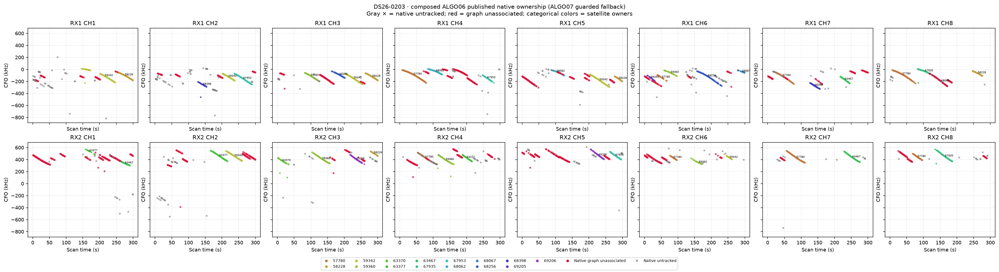
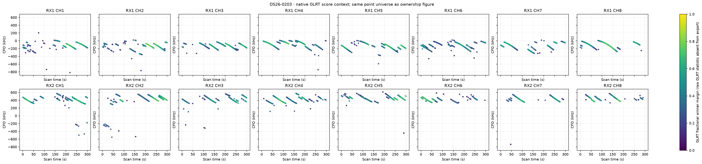
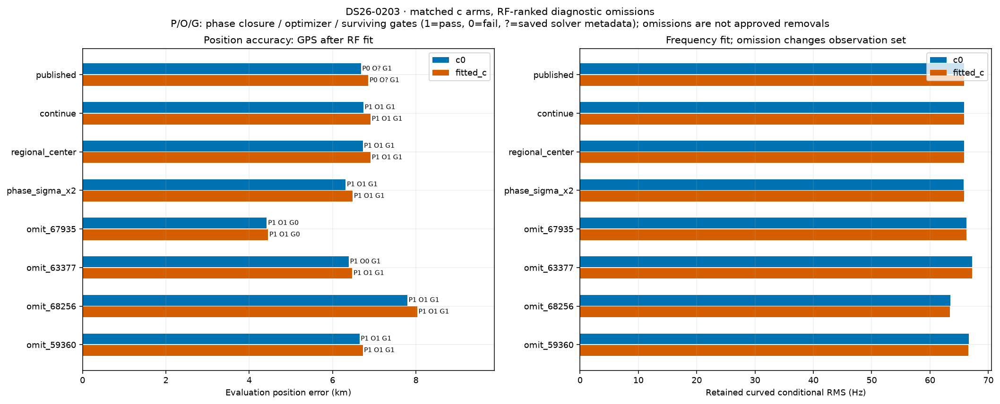
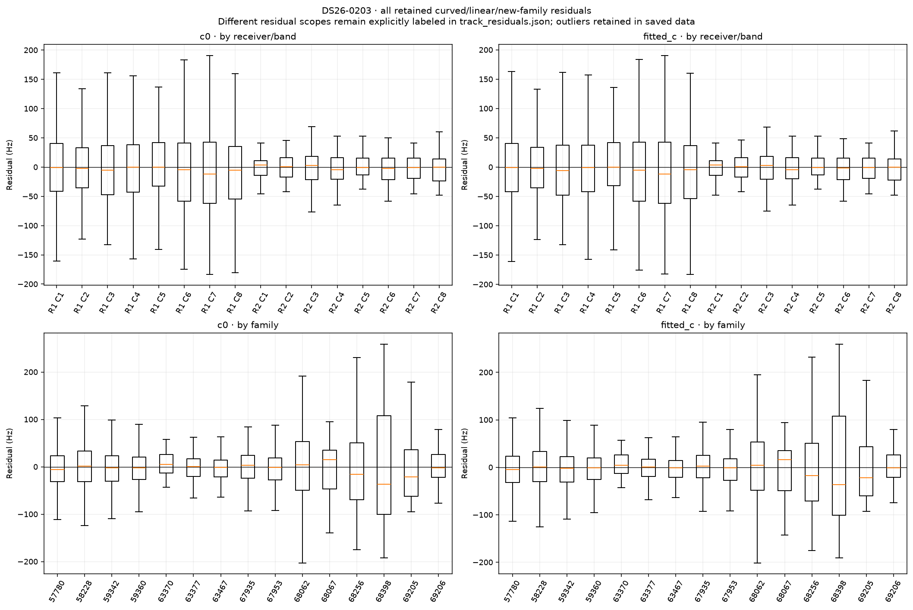
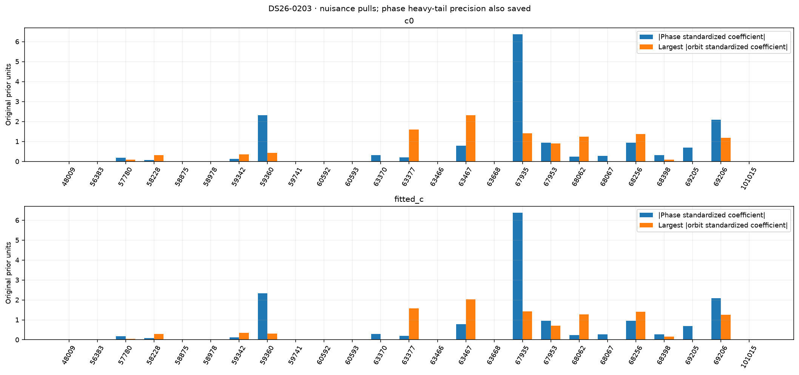
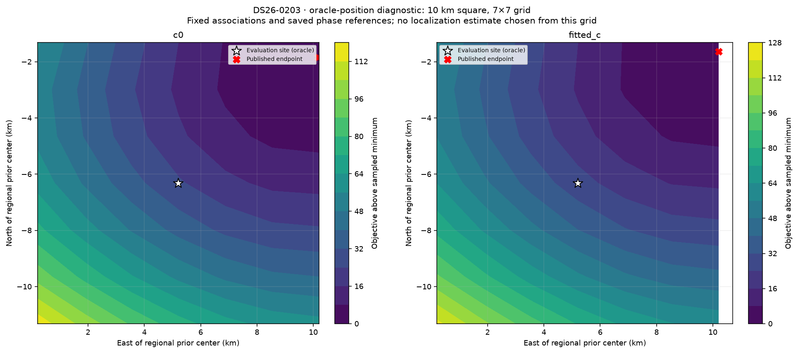

# DS26-0203: composed ALGO06 / ALGO07 fallback diagnostics

These are bounded offline RF diagnostics. Published satellite identities and ownership were not changed. Every family was audited; the four largest summed c-arm local RF omission sensitivities received full position/phase refits. Evaluation GPS was used only after fitting and to draw the explicitly labeled oracle loss grid. Family omission is a diagnostic control, not an approved removal.

| Arm | Published position error (m) | Curved residual RMS (Hz) | Native GLRT associated | Phase-reference movement (s) | Base/exact/mixture gates |
|---|---:|---:|---:|---:|---|
| c0 | 6681.4 | 65.81 | 2337/4171 (56.03%) | 0.02281 | True |
| fitted_c | 6858.0 | 65.83 | 2337/4171 (56.03%) | 0.01782 | True |

Matched tests use the same regional bounds, candidate identities, other priors and 15-round / 140 objective-evaluation-per-round budgets in both c arms. Each arm starts at its own saved endpoint; the regional-center test starts both at (0, 0). The phase-SD test doubles the shared prior multiplier. Omission objectives/RMS use reduced observations, so their raw likelihoods are not comparable evidence for deleting a family.

| Diagnostic (own published RF start unless center) | c0 error (m) | fitted-c error (m) | c0 / fitted-c RMS (Hz) | Phase closed | Optimizer success | All gates pass |
|---|---:|---:|---|---|---|---|
| continue | 6741.6 | 6910.9 | 65.81 / 65.83 | True / True | True / True | True / True |
| regional_center | 6724.3 | 6911.3 | 65.81 / 65.83 | True / True | True / True | True / True |
| phase_sigma_x2 | 6314.9 | 6483.8 | 65.80 / 65.82 | True / True | True / True | True / True |
| omit_67935 | 4421.7 | 4453.1 | 66.25 / 66.24 | True / True | True / True | False / False |
| omit_63377 | 6389.2 | 6472.1 | 67.19 / 67.21 | True / True | False / True | True / True |
| omit_68256 | 7796.1 | 8031.9 | 63.47 / 63.44 | True / True | True / True | True / True |
| omit_59360 | 6646.8 | 6724.4 | 66.62 / 66.61 | True / True | True / True | True / True |

Only the frozen fitted IDs enter each RMS/objective. The post-fit membership helper also screens graph extensions; those proposals are never adopted in these diagnostics or counted as published coverage. Delta references are the exact composed published incumbent, including accepted ALGO06 additions.

| Trial / arm | Fixed fitted native IDs | Intentional omitted family IDs | Proposed unrelated losses | Proposed additions | Proposed non-omitted reassignments |
|---|---:|---:|---:|---:|---:|
| continue / c0 | 2337 | 0 | 0 | 450 | 0 |
| continue / fitted_c | 2337 | 0 | 0 | 450 | 0 |
| regional_center / c0 | 2337 | 0 | 0 | 450 | 0 |
| regional_center / fitted_c | 2337 | 0 | 0 | 450 | 0 |
| phase_sigma_x2 / c0 | 2337 | 0 | 0 | 450 | 0 |
| phase_sigma_x2 / fitted_c | 2337 | 0 | 0 | 450 | 0 |
| omit_67935 / c0 | 2208 | 129 | 58 | 431 | 0 |
| omit_67935 / fitted_c | 2208 | 129 | 58 | 431 | 0 |
| omit_63377 / c0 | 2229 | 108 | 0 | 421 | 0 |
| omit_63377 / fitted_c | 2229 | 108 | 0 | 421 | 0 |
| omit_68256 / c0 | 2197 | 140 | 0 | 391 | 0 |
| omit_68256 / fitted_c | 2197 | 140 | 0 | 391 | 0 |
| omit_59360 / c0 | 2106 | 231 | 0 | 437 | 0 |
| omit_59360 / fitted_c | 2106 | 231 | 0 | 437 | 0 |

A separate paired control starts both arms at the same published fitted-c RF position and phase reference. Continuation is checked for all ten cases; only three predeclared headline omissions receive this extra start control. This is one shared RF start, not an independent random-start study.

| Shared-start diagnostic | c0 / fitted-c error (m) | c0 / fitted-c RMS (Hz) | Phase closed | Optimizer success | Surviving gates pass |
|---|---|---|---|---|---|
| matched_continue | 6724.2 / 6910.9 | 65.81 / 65.83 | True / True | True / True | True / True |

RF influence is local position sensitivity at the saved solution. It does not establish a wrong satellite identity. Full omission refits provide a nonlinear control; any apparent position gain with failed phase closure, optimizer or gates remains unqualified.

| Family | c0 local displacement (km) | fitted-c local displacement (km) | Native associated points (fitted-c) |
|---|---:|---:|---:|
| 67935 | 2.774 | 2.783 | 129 |
| 63377 | 1.512 | 1.509 | 108 |
| 68256 | 1.181 | 1.185 | 140 |
| 59360 | 0.762 | 0.433 | 231 |
| 57780 | 0.633 | 0.548 | 461 |
| 59342 | 0.286 | 0.492 | 383 |
| 68398 | 0.354 | 0.414 | 62 |
| 63467 | 0.323 | 0.295 | 142 |
| 69206 | 0.249 | 0.239 | 98 |
| 68062 | 0.217 | 0.187 | 122 |
| 68067 | 0.181 | 0.194 | 21 |
| 58228 | 0.161 | 0.193 | 227 |
| 63370 | 0.125 | 0.119 | 32 |
| 67953 | 0.106 | 0.079 | 161 |
| 69205 | 0.054 | 0.073 | 20 |

c0: the largest phase standardized coefficient is family 67935 (-6.371 in original prior units; adaptive precision 0.0962). The largest orbital coefficient magnitude is family 63467 (2.313). The highest-RMS retained track is SCAN-RX1-CH8-T003-RF12690312500.000000 (curved_conditional, 199.25 Hz, mean -9.12 Hz, slope 0.15 Hz/s). These fitted nuisance quantities are not independent orbit-error measurements.

fitted_c: the largest phase standardized coefficient is family 67935 (-6.386 in original prior units; adaptive precision 0.0957). The largest orbital coefficient magnitude is family 63467 (2.035). The highest-RMS retained track is SCAN-RX1-CH8-T003-RF12690312500.000000 (curved_conditional, 198.47 Hz, mean -4.85 Hz, slope 0.19 Hz/s). These fitted nuisance quantities are not independent orbit-error measurements.

Longest native graph unassociated source after splitting gaps >5 s: SCAN-RX2-CH1-T002-RF10940312500.000000, RX2 CH1, 71 unique points spanning 50.31 s. This duration rank is independent of fit-error ranking.

Receiver/band residual structure is tabulated numerically in summary.json and visualized below. Attribution to receiver calibration versus satellite orbit remains unresolved by these same-data diagnostics; independent family/receiver transfer and causal-versus-later TLE comparisons are required. Candidate search and identity conclusions are reported separately by the orbit investigation.

Exact per-gate dimensionless margins, exact-orbit linearization differences, native owner changes and mixture gate witnesses are saved in published_gates_*.json and each trial arm JSON. Track residual arrays and native observation IDs are saved in track_residuals.json. No identities, priors or model complexity were selected using the evaluation site.
