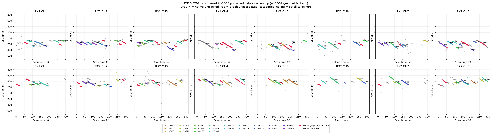
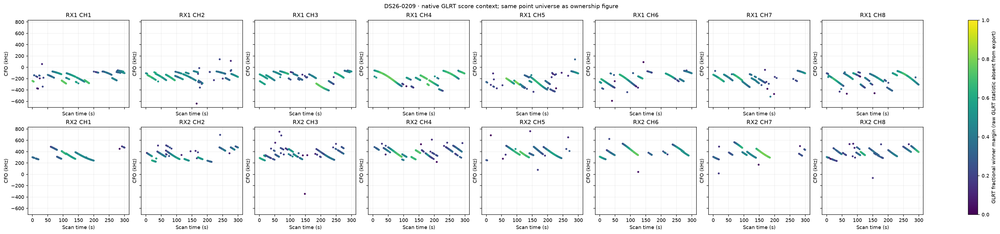
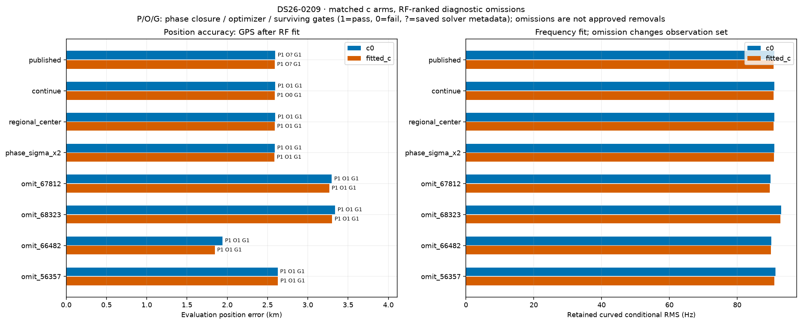
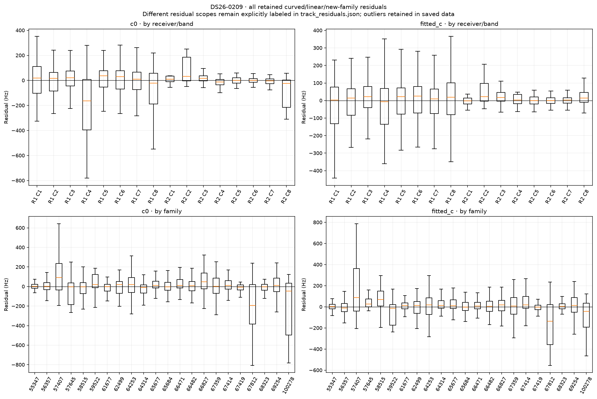
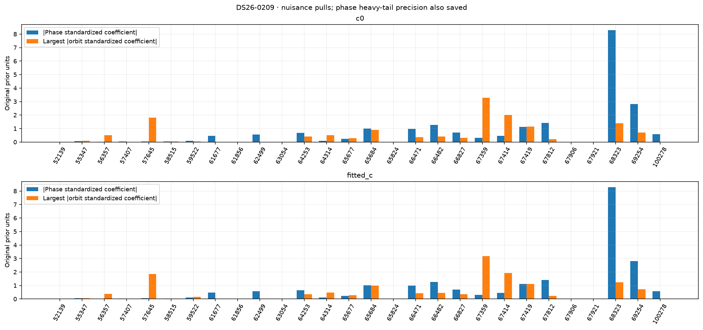
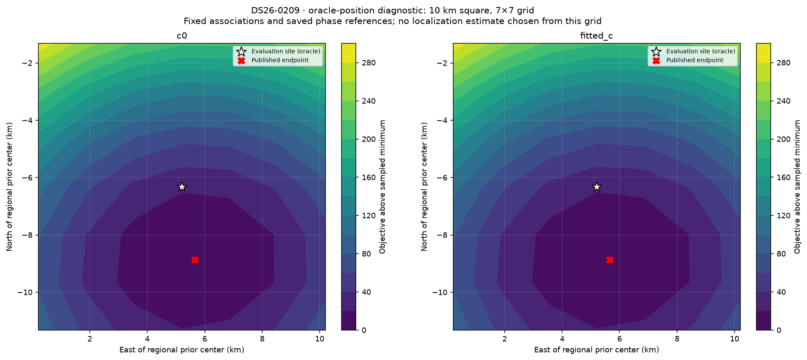

# DS26-0209: composed ALGO06 / ALGO07 fallback diagnostics

These are bounded offline RF diagnostics. Published satellite identities and ownership were not changed. Every family was audited; the four largest summed c-arm local RF omission sensitivities received full position/phase refits. Evaluation GPS was used only after fitting and to draw the explicitly labeled oracle loss grid. Family omission is a diagnostic control, not an approved removal.

| Arm | Published position error (m) | Curved residual RMS (Hz) | Native GLRT associated | Phase-reference movement (s) | Base/exact/mixture gates |
|---|---:|---:|---:|---:|---|
| c0 | 2596.8 | 90.93 | 3030/4385 (69.10%) | 0.00130 | True |
| fitted_c | 2589.1 | 90.75 | 3030/4385 (69.10%) | 0.00066 | True |

Matched tests use the same regional bounds, candidate identities, other priors and 15-round / 140 objective-evaluation-per-round budgets in both c arms. Each arm starts at its own saved endpoint; the regional-center test starts both at (0, 0). The phase-SD test doubles the shared prior multiplier. Omission objectives/RMS use reduced observations, so their raw likelihoods are not comparable evidence for deleting a family.

| Diagnostic (own published RF start unless center) | c0 error (m) | fitted-c error (m) | c0 / fitted-c RMS (Hz) | Phase closed | Optimizer success | All gates pass |
|---|---:|---:|---|---|---|---|
| continue | 2596.8 | 2589.1 | 90.93 / 90.75 | True / True | True / False | True / True |
| regional_center | 2596.8 | 2589.1 | 90.93 / 90.75 | True / True | True / True | True / True |
| phase_sigma_x2 | 2590.1 | 2585.0 | 90.96 / 90.78 | True / True | True / True | True / True |
| omit_67812 | 3298.0 | 3266.5 | 89.81 / 89.60 | True / True | True / True | True / True |
| omit_68323 | 3340.4 | 3302.9 | 92.93 / 92.73 | True / True | True / True | True / True |
| omit_66482 | 1942.2 | 1844.7 | 90.04 / 89.89 | True / True | True / True | True / True |
| omit_56357 | 2626.3 | 2629.7 | 91.27 / 90.99 | True / True | True / True | True / True |

Only the frozen fitted IDs enter each RMS/objective. The post-fit membership helper also screens graph extensions; those proposals are never adopted in these diagnostics or counted as published coverage. Delta references are the exact composed published incumbent, including accepted ALGO06 additions.

| Trial / arm | Fixed fitted native IDs | Intentional omitted family IDs | Proposed unrelated losses | Proposed additions | Proposed non-omitted reassignments |
|---|---:|---:|---:|---:|---:|
| continue / c0 | 3030 | 0 | 0 | 0 | 0 |
| continue / fitted_c | 3030 | 0 | 0 | 0 | 0 |
| regional_center / c0 | 3030 | 0 | 0 | 0 | 0 |
| regional_center / fitted_c | 3030 | 0 | 0 | 0 | 0 |
| phase_sigma_x2 / c0 | 3030 | 0 | 0 | 0 | 0 |
| phase_sigma_x2 / fitted_c | 3030 | 0 | 0 | 0 | 0 |
| omit_67812 / c0 | 2890 | 140 | 0 | 0 | 0 |
| omit_67812 / fitted_c | 2890 | 140 | 0 | 0 | 0 |
| omit_68323 / c0 | 2794 | 236 | 0 | 0 | 0 |
| omit_68323 / fitted_c | 2794 | 236 | 0 | 0 | 0 |
| omit_66482 / c0 | 2942 | 88 | 0 | 0 | 0 |
| omit_66482 / fitted_c | 2942 | 88 | 0 | 0 | 0 |
| omit_56357 / c0 | 2920 | 110 | 0 | 0 | 0 |
| omit_56357 / fitted_c | 2920 | 110 | 0 | 0 | 0 |

A separate paired control starts both arms at the same published fitted-c RF position and phase reference. Continuation is checked for all ten cases; only three predeclared headline omissions receive this extra start control. This is one shared RF start, not an independent random-start study.

| Shared-start diagnostic | c0 / fitted-c error (m) | c0 / fitted-c RMS (Hz) | Phase closed | Optimizer success | Surviving gates pass |
|---|---|---|---|---|---|
| matched_continue | 2597.1 / 2589.1 | 90.93 / 90.75 | True / True | True / False | True / True |

RF influence is local position sensitivity at the saved solution. It does not establish a wrong satellite identity. Full omission refits provide a nonlinear control; any apparent position gain with failed phase closure, optimizer or gates remains unqualified.

| Family | c0 local displacement (km) | fitted-c local displacement (km) | Native associated points (fitted-c) |
|---|---:|---:|---:|
| 67812 | 1.192 | 1.157 | 140 |
| 68323 | 0.638 | 0.684 | 236 |
| 66482 | 0.416 | 0.472 | 88 |
| 56357 | 0.410 | 0.369 | 110 |
| 67359 | 0.381 | 0.350 | 141 |
| 66471 | 0.308 | 0.269 | 215 |
| 69254 | 0.286 | 0.236 | 217 |
| 57407 | 0.228 | 0.262 | 50 |
| 57645 | 0.215 | 0.218 | 113 |
| 100278 | 0.204 | 0.220 | 44 |
| 64314 | 0.156 | 0.159 | 292 |
| 67414 | 0.142 | 0.144 | 99 |
| 65677 | 0.151 | 0.132 | 178 |
| 61677 | 0.130 | 0.110 | 30 |
| 65684 | 0.121 | 0.116 | 234 |
| 67419 | 0.137 | 0.084 | 133 |
| 59522 | 0.096 | 0.113 | 74 |
| 64253 | 0.101 | 0.070 | 82 |
| 55347 | 0.076 | 0.078 | 194 |
| 66827 | 0.048 | 0.061 | 178 |
| 62499 | 0.051 | 0.043 | 29 |
| 58515 | 0.048 | 0.028 | 153 |

c0: the largest phase standardized coefficient is family 68323 (-8.298 in original prior units; adaptive precision 0.0573). The largest orbital coefficient magnitude is family 67359 (3.287). The highest-RMS retained track is SCAN-RX1-CH8-T010-RF12459687500.000000 (linear_raw_prediction, 561.12 Hz, mean -552.96 Hz, slope 2.00 Hz/s). These fitted nuisance quantities are not independent orbit-error measurements.

fitted_c: the largest phase standardized coefficient is family 68323 (-8.300 in original prior units; adaptive precision 0.0572). The largest orbital coefficient magnitude is family 67359 (3.180). The highest-RMS retained track is SCAN-RX1-CH3-T008-RF11209687500.000000 (linear_raw_prediction, 506.60 Hz, mean 484.44 Hz, slope -13.22 Hz/s). These fitted nuisance quantities are not independent orbit-error measurements.

Longest native graph unassociated source after splitting gaps >5 s: SCAN-RX1-CH8-T001-RF12459687500.000000, RX1 CH8, 27 unique points spanning 34.73 s. This duration rank is independent of fit-error ranking.

Receiver/band residual structure is tabulated numerically in summary.json and visualized below. Attribution to receiver calibration versus satellite orbit remains unresolved by these same-data diagnostics; independent family/receiver transfer and causal-versus-later TLE comparisons are required. Candidate search and identity conclusions are reported separately by the orbit investigation.

Exact per-gate dimensionless margins, exact-orbit linearization differences, native owner changes and mixture gate witnesses are saved in published_gates_*.json and each trial arm JSON. Track residual arrays and native observation IDs are saved in track_residuals.json. No identities, priors or model complexity were selected using the evaluation site.
