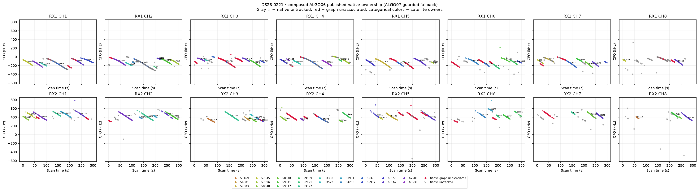
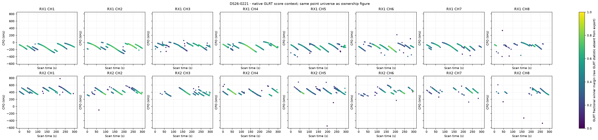
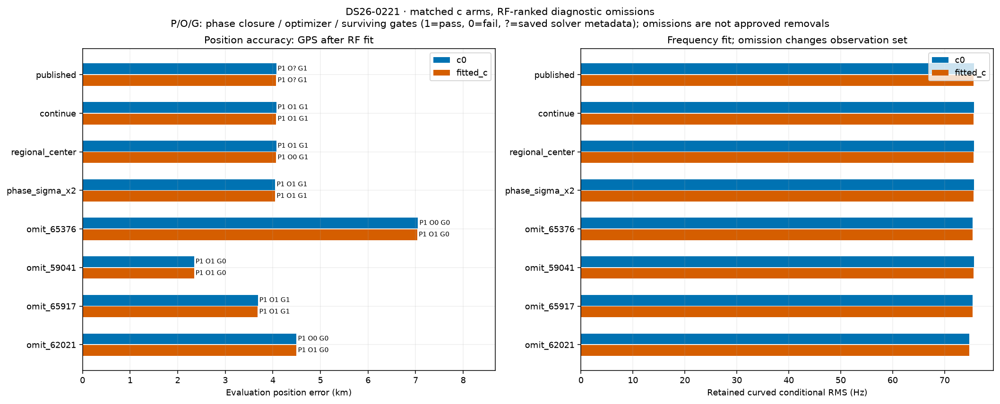
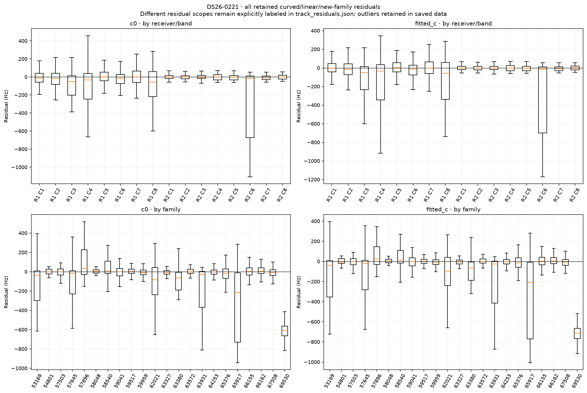
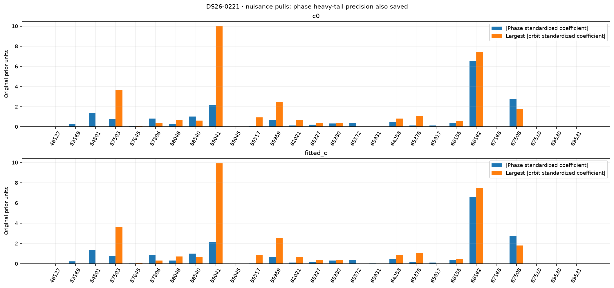
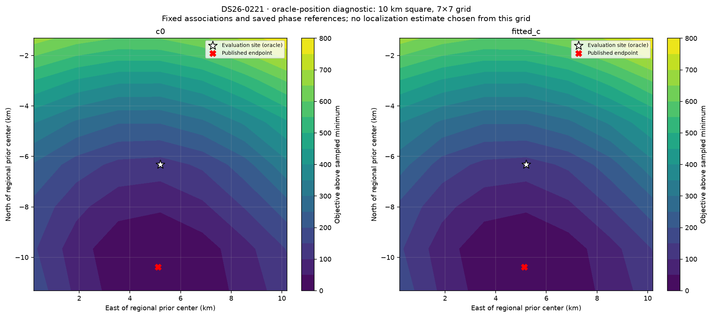

# DS26-0221: composed ALGO06 / ALGO07 fallback diagnostics

These are bounded offline RF diagnostics. Published satellite identities and ownership were not changed. Every family was audited; the four largest summed c-arm local RF omission sensitivities received full position/phase refits. Evaluation GPS was used only after fitting and to draw the explicitly labeled oracle loss grid. Family omission is a diagnostic control, not an approved removal.

| Arm | Published position error (m) | Curved residual RMS (Hz) | Native GLRT associated | Phase-reference movement (s) | Base/exact/mixture gates |
|---|---:|---:|---:|---:|---|
| c0 | 4070.9 | 75.64 | 3486/4795 (72.70%) | 0.00279 | True |
| fitted_c | 4070.2 | 75.61 | 3486/4795 (72.70%) | 0.00285 | True |

Matched tests use the same regional bounds, candidate identities, other priors and 15-round / 140 objective-evaluation-per-round budgets in both c arms. Each arm starts at its own saved endpoint; the regional-center test starts both at (0, 0). The phase-SD test doubles the shared prior multiplier. Omission objectives/RMS use reduced observations, so their raw likelihoods are not comparable evidence for deleting a family.

| Diagnostic (own published RF start unless center) | c0 error (m) | fitted-c error (m) | c0 / fitted-c RMS (Hz) | Phase closed | Optimizer success | All gates pass |
|---|---:|---:|---|---|---|---|
| continue | 4070.9 | 4070.2 | 75.64 / 75.61 | True / True | True / True | True / True |
| regional_center | 4070.8 | 4070.1 | 75.64 / 75.61 | True / True | True / False | True / True |
| phase_sigma_x2 | 4049.8 | 4049.1 | 75.64 / 75.62 | True / True | True / True | True / True |
| omit_65376 | 7049.3 | 7036.2 | 75.39 / 75.38 | True / True | False / True | False / False |
| omit_59041 | 2344.9 | 2344.1 | 75.62 / 75.59 | True / True | True / True | False / False |
| omit_65917 | 3685.6 | 3683.3 | 75.38 / 75.37 | True / True | True / True | True / True |
| omit_62021 | 4497.1 | 4497.7 | 74.77 / 74.74 | True / True | False / True | False / False |

Only the frozen fitted IDs enter each RMS/objective. The post-fit membership helper also screens graph extensions; those proposals are never adopted in these diagnostics or counted as published coverage. Delta references are the exact composed published incumbent, including accepted ALGO06 additions.

| Trial / arm | Fixed fitted native IDs | Intentional omitted family IDs | Proposed unrelated losses | Proposed additions | Proposed non-omitted reassignments |
|---|---:|---:|---:|---:|---:|
| continue / c0 | 3486 | 0 | 0 | 0 | 0 |
| continue / fitted_c | 3486 | 0 | 0 | 0 | 0 |
| regional_center / c0 | 3486 | 0 | 0 | 0 | 0 |
| regional_center / fitted_c | 3486 | 0 | 0 | 0 | 0 |
| phase_sigma_x2 / c0 | 3486 | 0 | 0 | 0 | 0 |
| phase_sigma_x2 / fitted_c | 3486 | 0 | 0 | 0 | 0 |
| omit_65376 / c0 | 3030 | 456 | 93 | 34 | 0 |
| omit_65376 / fitted_c | 3030 | 456 | 93 | 34 | 0 |
| omit_59041 / c0 | 3280 | 206 | 32 | 90 | 0 |
| omit_59041 / fitted_c | 3280 | 206 | 32 | 90 | 0 |
| omit_65917 / c0 | 3367 | 119 | 0 | 0 | 0 |
| omit_65917 / fitted_c | 3367 | 119 | 0 | 0 | 0 |
| omit_62021 / c0 | 3384 | 102 | 90 | 35 | 0 |
| omit_62021 / fitted_c | 3384 | 102 | 90 | 35 | 0 |

A separate paired control starts both arms at the same published fitted-c RF position and phase reference. Continuation is checked for all ten cases; only three predeclared headline omissions receive this extra start control. This is one shared RF start, not an independent random-start study.

| Shared-start diagnostic | c0 / fitted-c error (m) | c0 / fitted-c RMS (Hz) | Phase closed | Optimizer success | Surviving gates pass |
|---|---|---|---|---|---|
| matched_continue | 4070.2 / 4070.2 | 75.64 / 75.61 | True / True | False / True | True / True |

RF influence is local position sensitivity at the saved solution. It does not establish a wrong satellite identity. Full omission refits provide a nonlinear control; any apparent position gain with failed phase closure, optimizer or gates remains unqualified.

| Family | c0 local displacement (km) | fitted-c local displacement (km) | Native associated points (fitted-c) |
|---|---:|---:|---:|
| 65376 | 1.886 | 1.876 | 456 |
| 59041 | 1.324 | 1.318 | 206 |
| 65917 | 0.633 | 0.634 | 119 |
| 62021 | 0.601 | 0.603 | 102 |
| 59517 | 0.588 | 0.587 | 118 |
| 57503 | 0.408 | 0.410 | 186 |
| 63931 | 0.367 | 0.370 | 108 |
| 59959 | 0.264 | 0.262 | 108 |
| 69530 | 0.214 | 0.216 | 57 |
| 63380 | 0.203 | 0.205 | 124 |
| 58540 | 0.181 | 0.184 | 149 |
| 57896 | 0.164 | 0.173 | 140 |
| 63572 | 0.136 | 0.135 | 32 |
| 57645 | 0.132 | 0.138 | 158 |
| 66162 | 0.110 | 0.121 | 486 |
| 58048 | 0.073 | 0.076 | 55 |
| 67508 | 0.064 | 0.064 | 346 |
| 63327 | 0.038 | 0.037 | 217 |
| 53169 | 0.028 | 0.027 | 47 |
| 64253 | 0.025 | 0.026 | 130 |
| 66155 | 0.015 | 0.023 | 117 |
| 54801 | 0.017 | 0.016 | 25 |

c0: the largest phase standardized coefficient is family 66162 (-6.565 in original prior units; adaptive precision 0.0907). The largest orbital coefficient magnitude is family 59041 (9.976). The highest-RMS retained track is SCAN-RX2-CH4-T006-RF11459687500.000000 (linear_raw_prediction, 994.41 Hz, mean 994.08 Hz, slope 3.43 Hz/s). These fitted nuisance quantities are not independent orbit-error measurements.

fitted_c: the largest phase standardized coefficient is family 66162 (-6.564 in original prior units; adaptive precision 0.0907). The largest orbital coefficient magnitude is family 59041 (9.914). The highest-RMS retained track is SCAN-RX2-CH4-T006-RF11459687500.000000 (linear_raw_prediction, 901.83 Hz, mean 901.47 Hz, slope 3.32 Hz/s). These fitted nuisance quantities are not independent orbit-error measurements.

Longest native graph unassociated source after splitting gaps >5 s: SCAN-RX2-CH5-T003-RF11709687500.000000, RX2 CH5, 57 unique points spanning 44.30 s. This duration rank is independent of fit-error ranking.

Receiver/band residual structure is tabulated numerically in summary.json and visualized below. Attribution to receiver calibration versus satellite orbit remains unresolved by these same-data diagnostics; independent family/receiver transfer and causal-versus-later TLE comparisons are required. Candidate search and identity conclusions are reported separately by the orbit investigation.

Exact per-gate dimensionless margins, exact-orbit linearization differences, native owner changes and mixture gate witnesses are saved in published_gates_*.json and each trial arm JSON. Track residual arrays and native observation IDs are saved in track_residuals.json. No identities, priors or model complexity were selected using the evaluation site.
