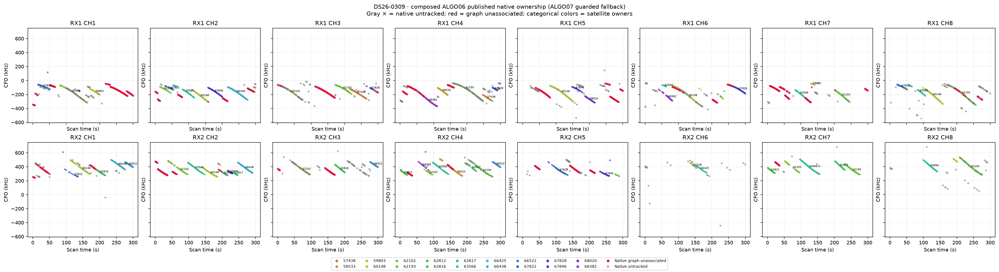
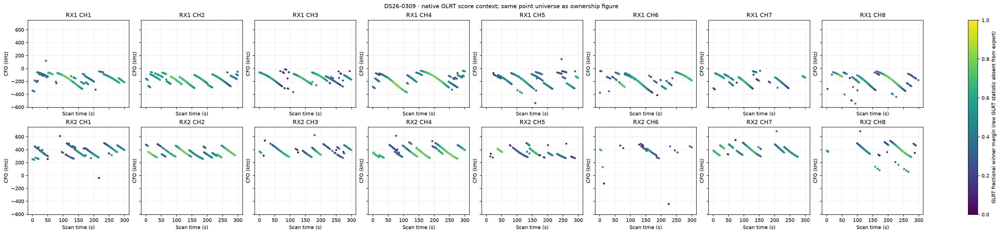
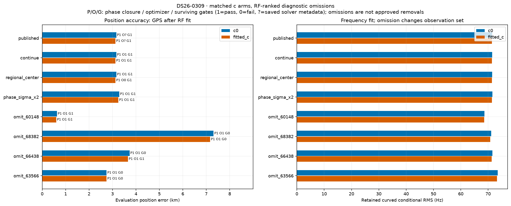
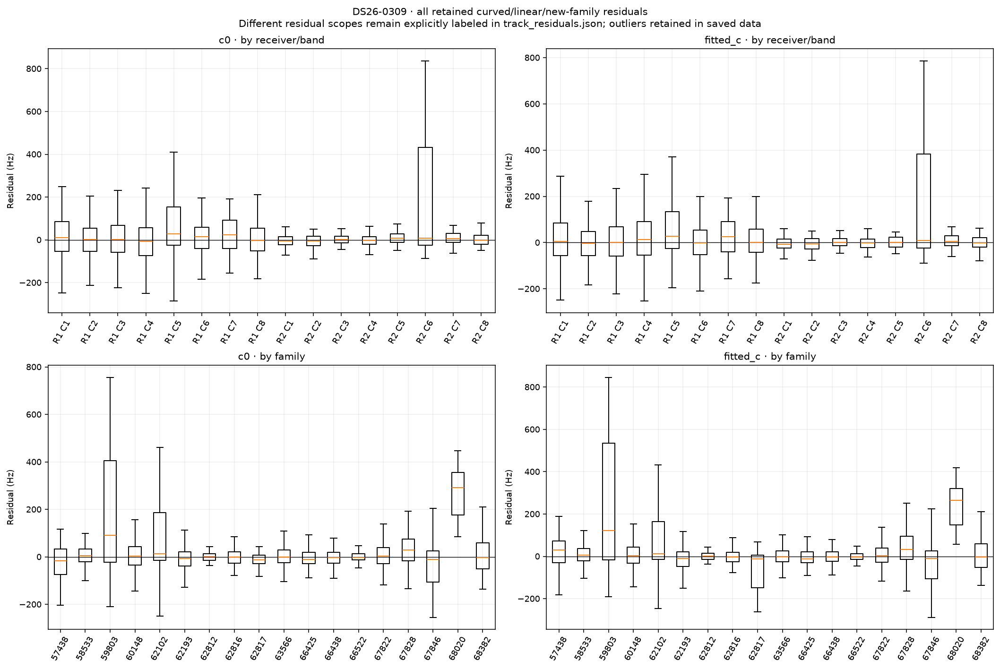
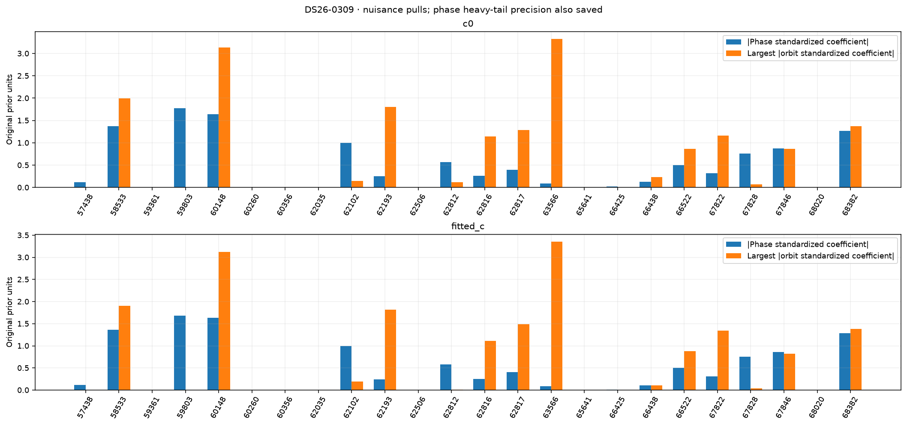
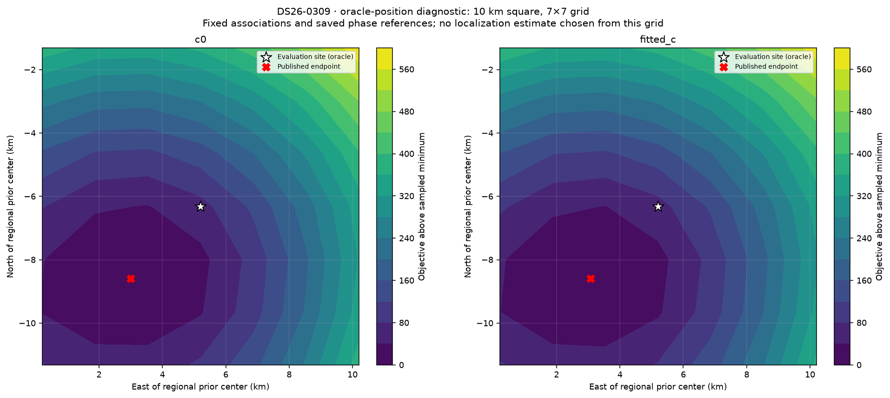

# DS26-0309: composed ALGO06 / ALGO07 fallback diagnostics

These are bounded offline RF diagnostics. Published satellite identities and ownership were not changed. Every family was audited; the four largest summed c-arm local RF omission sensitivities received full position/phase refits. Evaluation GPS was used only after fitting and to draw the explicitly labeled oracle loss grid. Family omission is a diagnostic control, not an approved removal.

| Arm | Published position error (m) | Curved residual RMS (Hz) | Native GLRT associated | Phase-reference movement (s) | Base/exact/mixture gates |
|---|---:|---:|---:|---:|---|
| c0 | 3162.1 | 71.52 | 3008/4789 (62.81%) | 0.00014 | True |
| fitted_c | 3126.8 | 71.36 | 3008/4789 (62.81%) | 0.00012 | True |

Matched tests use the same regional bounds, candidate identities, other priors and 15-round / 140 objective-evaluation-per-round budgets in both c arms. Each arm starts at its own saved endpoint; the regional-center test starts both at (0, 0). The phase-SD test doubles the shared prior multiplier. Omission objectives/RMS use reduced observations, so their raw likelihoods are not comparable evidence for deleting a family.

| Diagnostic (own published RF start unless center) | c0 error (m) | fitted-c error (m) | c0 / fitted-c RMS (Hz) | Phase closed | Optimizer success | All gates pass |
|---|---:|---:|---|---|---|---|
| continue | 3162.1 | 3126.8 | 71.52 / 71.36 | True / True | True / True | True / True |
| regional_center | 3162.9 | 3127.5 | 71.52 / 71.36 | True / True | True / False | True / True |
| phase_sigma_x2 | 3293.3 | 3252.5 | 71.58 / 71.40 | True / True | True / True | True / True |
| omit_60148 | 633.5 | 601.9 | 68.70 / 68.60 | True / True | True / True | True / True |
| omit_68382 | 7312.9 | 7167.4 | 71.14 / 70.75 | True / True | True / True | False / False |
| omit_66438 | 3729.7 | 3661.7 | 71.60 / 71.33 | True / True | True / True | False / True |
| omit_63566 | 2749.4 | 2748.5 | 73.49 / 73.27 | True / True | True / True | False / False |

Only the frozen fitted IDs enter each RMS/objective. The post-fit membership helper also screens graph extensions; those proposals are never adopted in these diagnostics or counted as published coverage. Delta references are the exact composed published incumbent, including accepted ALGO06 additions.

| Trial / arm | Fixed fitted native IDs | Intentional omitted family IDs | Proposed unrelated losses | Proposed additions | Proposed non-omitted reassignments |
|---|---:|---:|---:|---:|---:|
| continue / c0 | 3008 | 0 | 0 | 0 | 0 |
| continue / fitted_c | 3008 | 0 | 0 | 0 | 0 |
| regional_center / c0 | 3008 | 0 | 0 | 0 | 0 |
| regional_center / fitted_c | 3008 | 0 | 0 | 0 | 0 |
| phase_sigma_x2 / c0 | 3008 | 0 | 0 | 0 | 0 |
| phase_sigma_x2 / fitted_c | 3008 | 0 | 0 | 0 | 0 |
| omit_60148 / c0 | 2498 | 510 | 0 | 69 | 0 |
| omit_60148 / fitted_c | 2498 | 510 | 0 | 69 | 0 |
| omit_68382 / c0 | 2886 | 122 | 36 | 0 | 0 |
| omit_68382 / fitted_c | 2886 | 122 | 36 | 0 | 0 |
| omit_66438 / c0 | 2819 | 189 | 36 | 0 | 0 |
| omit_66438 / fitted_c | 2819 | 189 | 0 | 0 | 0 |
| omit_63566 / c0 | 2593 | 415 | 32 | 0 | 0 |
| omit_63566 / fitted_c | 2593 | 415 | 32 | 0 | 0 |

A separate paired control starts both arms at the same published fitted-c RF position and phase reference. Continuation is checked for all ten cases; only three predeclared headline omissions receive this extra start control. This is one shared RF start, not an independent random-start study.

| Shared-start diagnostic | c0 / fitted-c error (m) | c0 / fitted-c RMS (Hz) | Phase closed | Optimizer success | Surviving gates pass |
|---|---|---|---|---|---|
| matched_continue | 3162.5 / 3126.8 | 71.52 / 71.36 | True / True | True / True | True / True |
| matched_omit_60148 | 633.2 / 601.9 | 68.70 / 68.60 | True / True | True / True | True / True |

RF influence is local position sensitivity at the saved solution. It does not establish a wrong satellite identity. Full omission refits provide a nonlinear control; any apparent position gain with failed phase closure, optimizer or gates remains unqualified.

| Family | c0 local displacement (km) | fitted-c local displacement (km) | Native associated points (fitted-c) |
|---|---:|---:|---:|
| 60148 | 1.954 | 1.924 | 510 |
| 68382 | 1.408 | 1.366 | 122 |
| 66438 | 0.648 | 0.628 | 189 |
| 63566 | 0.408 | 0.375 | 415 |
| 62193 | 0.419 | 0.357 | 496 |
| 62102 | 0.361 | 0.346 | 244 |
| 67822 | 0.300 | 0.296 | 160 |
| 66522 | 0.231 | 0.240 | 100 |
| 68020 | 0.217 | 0.212 | 42 |
| 58533 | 0.140 | 0.176 | 87 |
| 62816 | 0.159 | 0.147 | 107 |
| 62817 | 0.133 | 0.153 | 84 |
| 66425 | 0.123 | 0.128 | 32 |
| 67846 | 0.121 | 0.120 | 134 |
| 67828 | 0.086 | 0.092 | 93 |
| 59803 | 0.074 | 0.076 | 62 |
| 57438 | 0.023 | 0.055 | 72 |
| 62812 | 0.033 | 0.044 | 59 |

c0: the largest phase standardized coefficient is family 59803 (-1.771 in original prior units; adaptive precision 0.964). The largest orbital coefficient magnitude is family 63566 (3.323). The highest-RMS retained track is SCAN-RX2-CH6-T001-RF11959687500.000000 (linear_raw_prediction, 759.79 Hz, mean 748.96 Hz, slope 9.87 Hz/s). These fitted nuisance quantities are not independent orbit-error measurements.

fitted_c: the largest phase standardized coefficient is family 59803 (-1.678 in original prior units; adaptive precision 1.04). The largest orbital coefficient magnitude is family 63566 (3.354). The highest-RMS retained track is SCAN-RX2-CH6-T001-RF11959687500.000000 (linear_raw_prediction, 710.71 Hz, mean 699.17 Hz, slope 9.78 Hz/s). These fitted nuisance quantities are not independent orbit-error measurements.

Longest native graph unassociated source after splitting gaps >5 s: SCAN-RX1-CH3-T000-RF11209687500.000000, RX1 CH3, 80 unique points spanning 58.52 s. This duration rank is independent of fit-error ranking.

Receiver/band residual structure is tabulated numerically in summary.json and visualized below. Attribution to receiver calibration versus satellite orbit remains unresolved by these same-data diagnostics; independent family/receiver transfer and causal-versus-later TLE comparisons are required. Candidate search and identity conclusions are reported separately by the orbit investigation.

Exact per-gate dimensionless margins, exact-orbit linearization differences, native owner changes and mixture gate witnesses are saved in published_gates_*.json and each trial arm JSON. Track residual arrays and native observation IDs are saved in track_residuals.json. No identities, priors or model complexity were selected using the evaluation site.
