# DS26-0014: orbit and curve diagnostic

The catalogue search compares the saved ALGO06 composition at its own inferred positions. Per-track nuisance fits are diagnostic lower bounds; a clean fit does not establish unique identity. No localization gain or production recovery is claimed.

| Target | Incumbent | Regime | L3 winner / runner-up | Margin | RMS Hz | Phase s | Rate Hz/s | Noise gate |
|---|---:|---|---|---:|---:|---:|---:|---|
| 0: SCAN-RX2-CH1-T000-RF10940312500.000000 | 64724 | causal | 64724 / 100477 | 24.55 | 53.2 | -0.9 | 0.57 | False |
| 0: SCAN-RX2-CH1-T000-RF10940312500.000000 | 64724 | later | 64724 / 100477 | 38.50 | 43.6 | -0.6 | 0.50 | False |
| 1: SCAN-RX1-CH3-T001-RF11440312500.000000 | 66964 | causal | 66964 / 68083 | 191.02 | 96.6 | -2.1 | 0.29 | True |
| 1: SCAN-RX1-CH3-T001-RF11440312500.000000 | 66964 | later | 66964 / 58055 | 229.57 | 94.6 | -0.6 | 0.07 | True |
| 2: SCAN-RX1-CH5-T003-RF11940312500.000000 | None | causal | 55405 / 59568 | 81.31 | 134.8 | -0.1 | 0.29 | False |
| 2: SCAN-RX1-CH5-T003-RF11940312500.000000 | None | later | 55405 / 59568 | 98.60 | 130.1 | -3.0 | 0.25 | False |

Target 0 full graph selects degree 4 under descriptive independent-noise BIC; RMS 89.0 Hz; endpoint leverage [0.4145536863038752, 0.30010845310421197]. Irregular correlation limits this complexity score. Piece fits and excluded original endpoints are retained in `targets.json`.
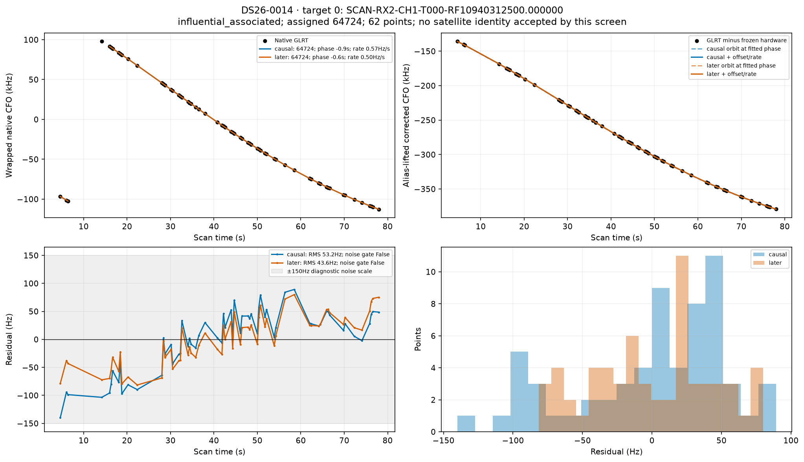
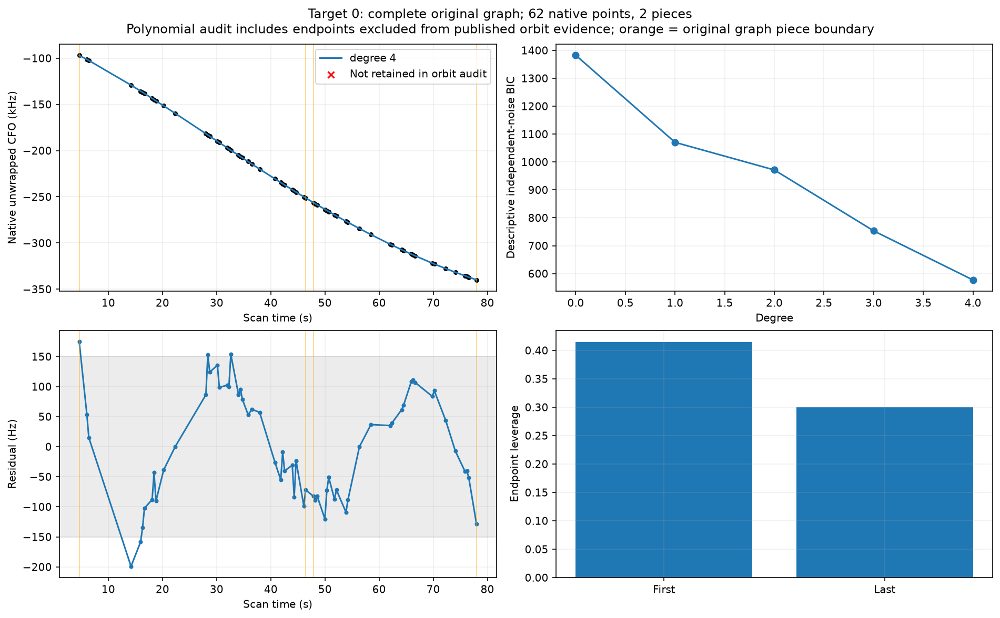
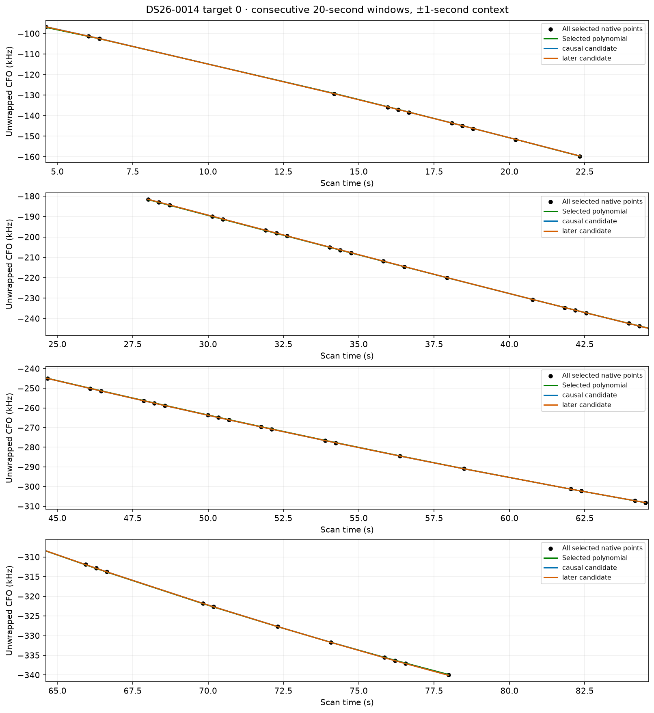
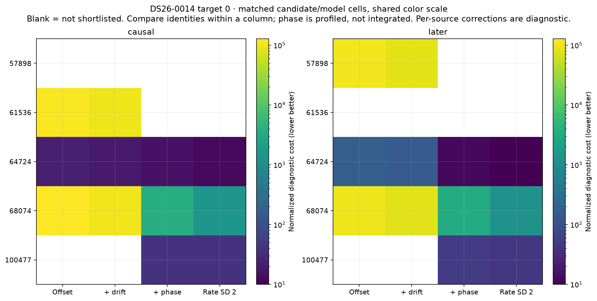

Target 1 full graph selects degree 4 under descriptive independent-noise BIC; RMS 93.6 Hz; endpoint leverage [0.6604295820120328, 0.2771562171792862]. Irregular correlation limits this complexity score. Piece fits and excluded original endpoints are retained in `targets.json`.
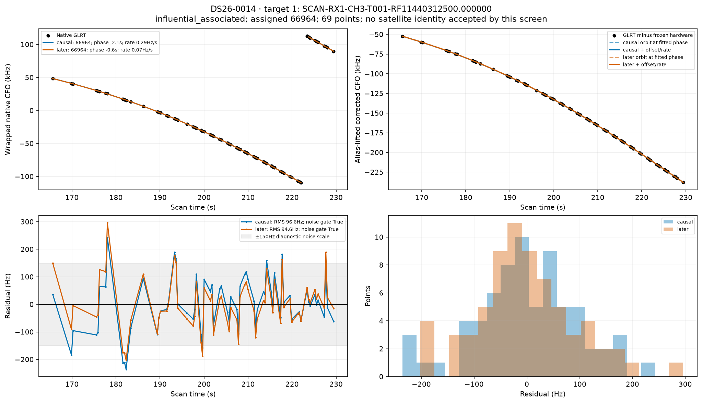
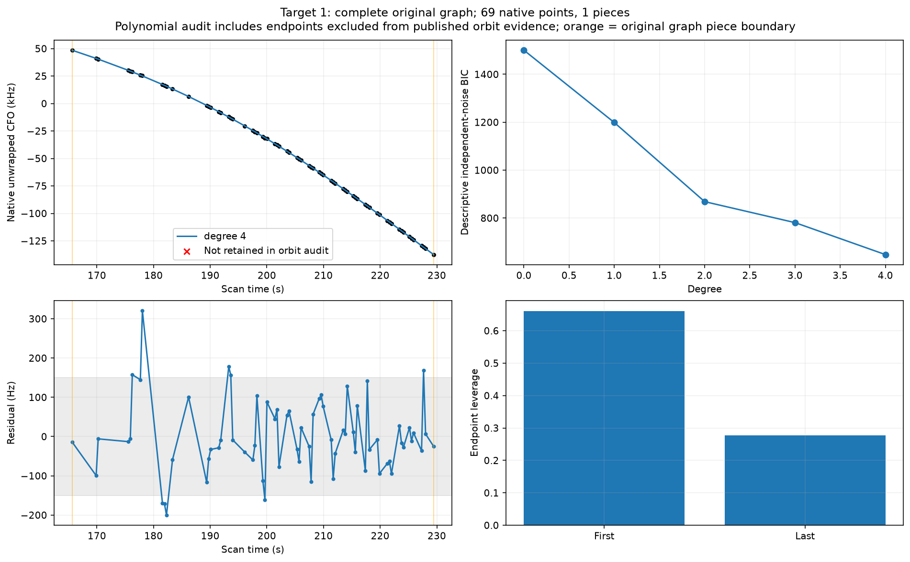
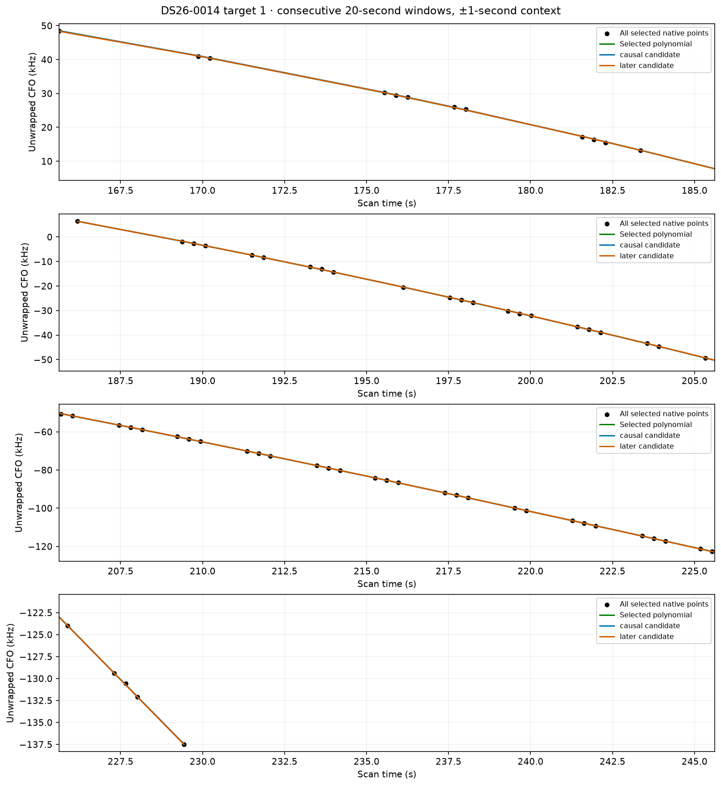
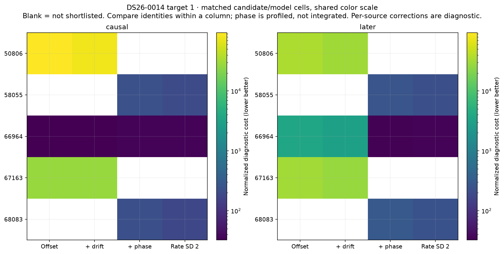

Target 2 full graph selects degree 3 under descriptive independent-noise BIC; RMS 112.0 Hz; endpoint leverage [0.2608117756400542, 0.31341068938837385]. Irregular correlation limits this complexity score. Piece fits and excluded original endpoints are retained in `targets.json`.
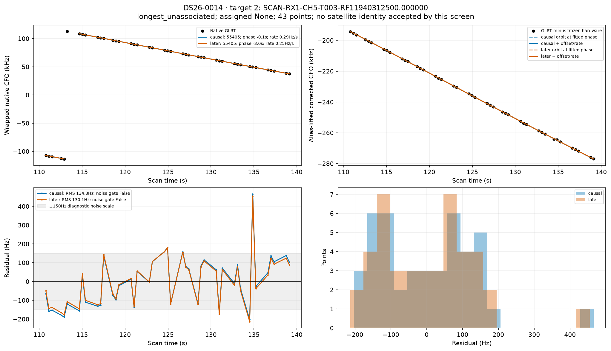
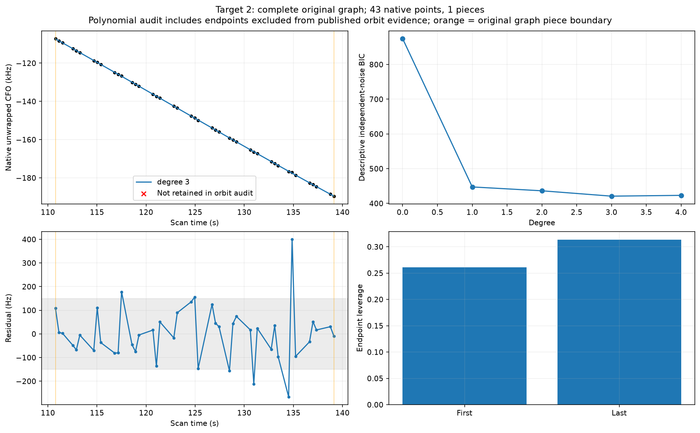
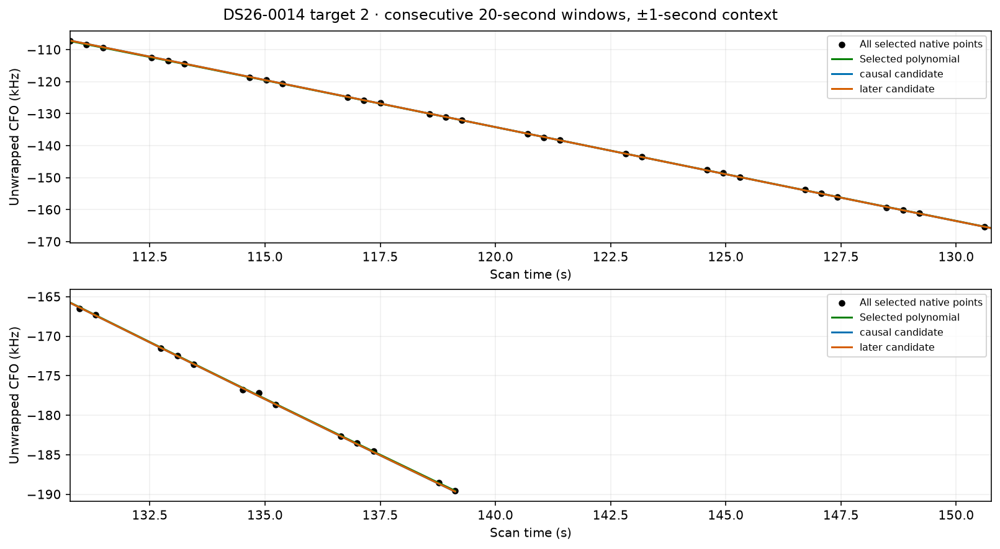
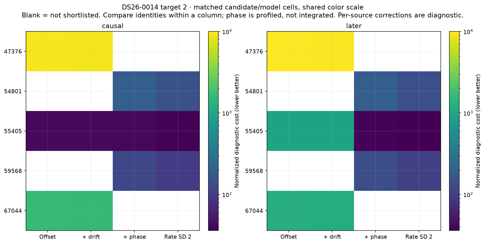

Whole-family consistency uses all published native owners of each influential family and matched shortlists. A shared phase/rate must explain every track. Constants remain per-track diagnostic terms; no independent receiver correction is inferred from them.

These restricted-model RMS values are not published baseline residuals. The restricted search uses SGP4 phase plus constant/rate in place of the production marginalized satellite/orbit nuisance block. It omits the posterior physical orbital-mode corrections and any satellite-clock/family corrections in that full block. Published full-model residuals and exact production gates are recorded separately in the sibling diagnostics report. A restricted-model failure therefore does not prove the published association is wrong.

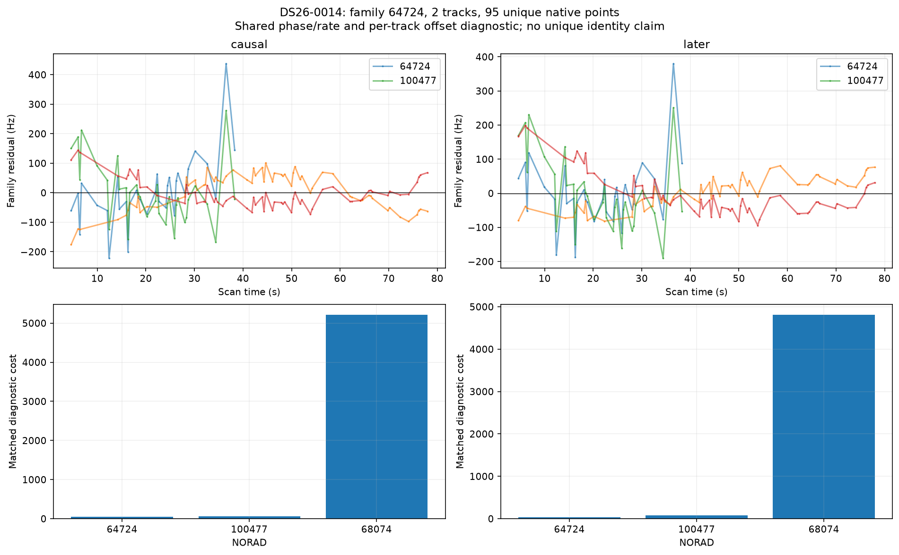
causal family 64724: best shortlist identity 64724, RMS 82.5 Hz, shared phase -0.8 s, rate -0.04 Hz/s, all-track noise pass False.
later family 64724: best shortlist identity 64724, RMS 67.4 Hz, shared phase -0.6 s, rate 0.49 Hz/s, all-track noise pass False.

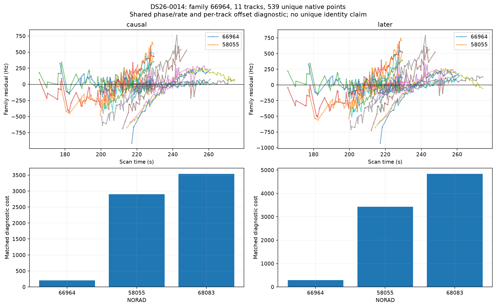
causal family 66964: best shortlist identity 66964, RMS 78.3 Hz, shared phase -2.2 s, rate -0.01 Hz/s, all-track noise pass False.
later family 66964: best shortlist identity 66964, RMS 92.3 Hz, shared phase -0.6 s, rate 2.05 Hz/s, all-track noise pass False.

Paired causal/later swaps appear in `frozen_tle_swap.json`: the frozen-corrections comparison isolates the changed elements; later-refitted values are separately labeled. Missing later exact fits are null. Exact production gates and localization ablations live in the sibling diagnostics report. These per-track RMS/noise screens are not a replacement for those gates.

Search: every propagation-valid member of causal ≤72h and first-post-epoch ≤48h catalogues receives a coarse scan. Matched c arms share top-three model nominees plus the incumbent and exact phase budget. L1/L2 freeze the saved phase; L3/L4 profile ±30s with a 5s prior. L2 rate prior SD is 0.5 Hz/s and L4 is 2 Hz/s. Detailed inventories and hash provenance are in `run_manifest.json`, `tle_inventory.csv`, and search coverage files.

Remaining ambiguity: independent whole-group prediction and regional position stability have not been executed for these single-track catalogue fits. Per-track slopes cannot distinguish receiver clock, calibration and orbit errors. Next bounded discriminator: compare the same candidate over independent receivers/families using a shared correction, then replay exact ownership gates.

Reproduce from the worktree with `PYTHONPATH=src:tools OPENBLAS_NUM_THREADS=1 OMP_NUM_THREADS=1 /srv/bulk/leo-dev/fast-algo02-production-v1/.venv/bin/python reports/2026_11_02_algo07_top10_outliers/orbits/investigate.py CASE`, then the same invocation of `finish.py CASE`. Archive creation requires the existing read-only archive permission. No RF collection was performed.

Mechanism assessment (restricted model):

Paired later-element check: 0/6 fitted-c rows improve under frozen causal phase, constant and rate. Refitted later-RMS improvements re-estimate those corrections and therefore do not isolate an orbit improvement. Frozen-swap and refitted values are separately listed in `paired_tle_summary.csv`.

Family 64724: incumbent identity stable in restricted family shortlist; geometry or richer nuisance calibration remains the leading unresolved alternative. Same diagnostic identity 64724: later refit restricted-family RMS 82.5→67.4 Hz; this refits nuisance and is not the frozen-swap test. Confidence: model-sensitive / ambiguous; no independent identity validation. Next: Use the rival and incumbent with matched production physical orbital modes and all family receivers, fit on frozen whole time groups, test held groups, then exact ownership/gate replay.

Family 66964: incumbent identity stable in restricted family shortlist; geometry or richer nuisance calibration remains the leading unresolved alternative. Same diagnostic identity 66964: later refit restricted-family RMS 78.3→92.3 Hz; this refits nuisance and is not the frozen-swap test. Confidence: model-sensitive / ambiguous; no independent identity validation. Next: Use the rival and incumbent with matched production physical orbital modes and all family receivers, fit on frozen whole time groups, test held groups, then exact ownership/gate replay.

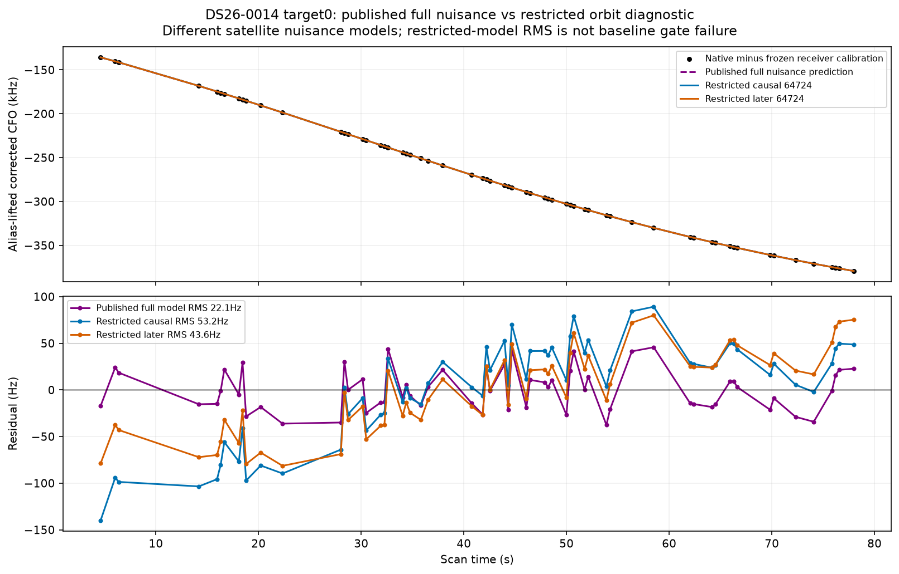

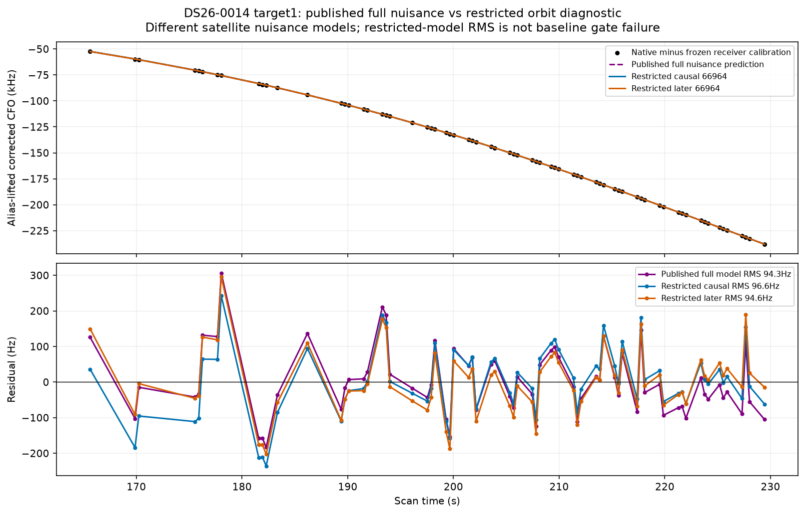

Saved ALGO07 conditional candidate-family guards:
Final selected replacement: None. Guard passage and final production acceptance are separate checks; no replacement is implied by a diagnostic orbit fit.
