# DS26-0070: orbit and curve diagnostic

The catalogue search compares the saved ALGO06 composition at its own inferred positions. Per-track nuisance fits are diagnostic lower bounds; a clean fit does not establish unique identity. No localization gain or production recovery is claimed.

| Target | Incumbent | Regime | L3 winner / runner-up | Margin | RMS Hz | Phase s | Rate Hz/s | Noise gate |
|---|---:|---|---|---:|---:|---:|---:|---|
| 0: SCAN-RX1-CH6-T000-RF12190312500.000000 | 62320 | causal | 67047 / 63571 | 106.84 | 163.3 | 25.2 | 0.39 | False |
| 0: SCAN-RX1-CH6-T000-RF12190312500.000000 | 62320 | later | 63571 / 62320 | 1247.66 | 213.3 | -1.0 | 1.00 | False |
| 1: SCAN-RX1-CH7-T001-RF12440312500.000000 | 63321 | causal | 63321 / 62422 | 699.25 | 120.2 | -5.3 | -0.05 | True |
| 1: SCAN-RX1-CH7-T001-RF12440312500.000000 | 63321 | later | 63321 / 62422 | 610.15 | 131.2 | -0.7 | -0.26 | True |
| 2: SCAN-RX1-CH6-T003-RF12190312500.000000 | None | causal | 58065 / 62317 | 8.77 | 123.9 | 0.2 | -0.20 | True |
| 2: SCAN-RX1-CH6-T003-RF12190312500.000000 | None | later | 58065 / 62317 | 17.10 | 122.7 | -0.3 | -0.16 | True |

Target 0 full graph selects degree 4 under descriptive independent-noise BIC; RMS 94.1 Hz; endpoint leverage [0.40201962874017516, 0.25860278607673703]. Irregular correlation limits this complexity score. Piece fits and excluded original endpoints are retained in `targets.json`.
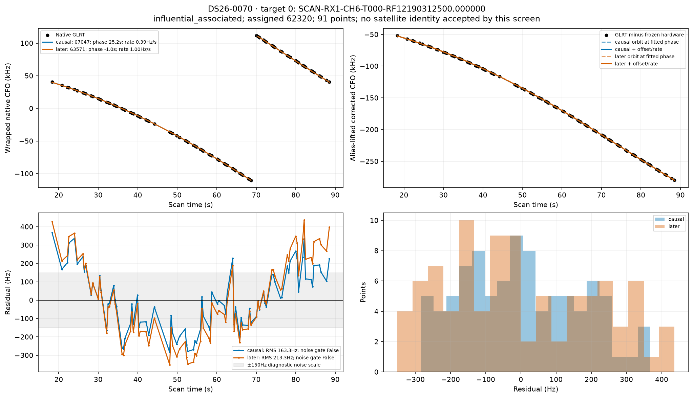
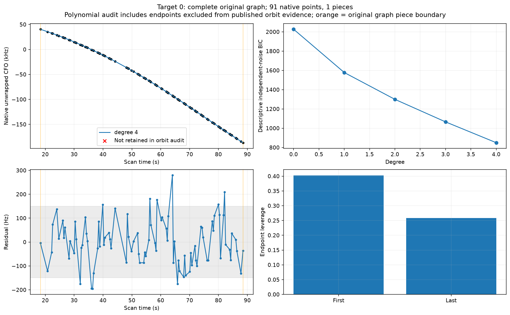
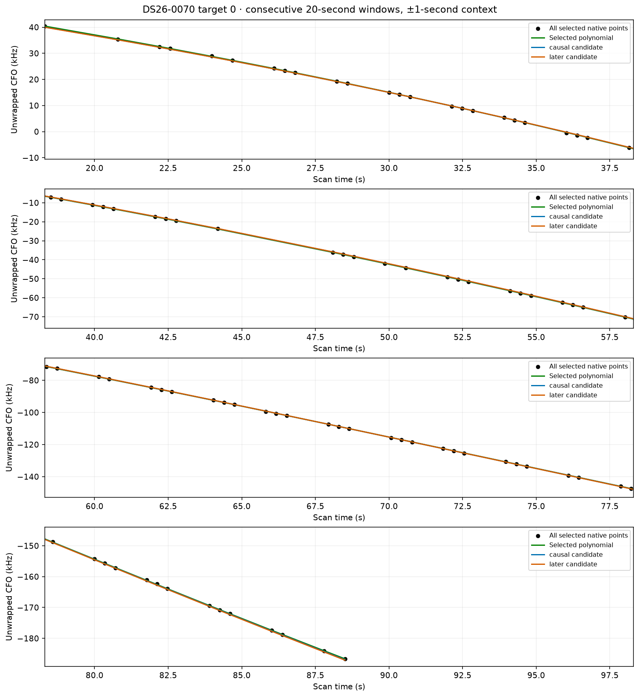
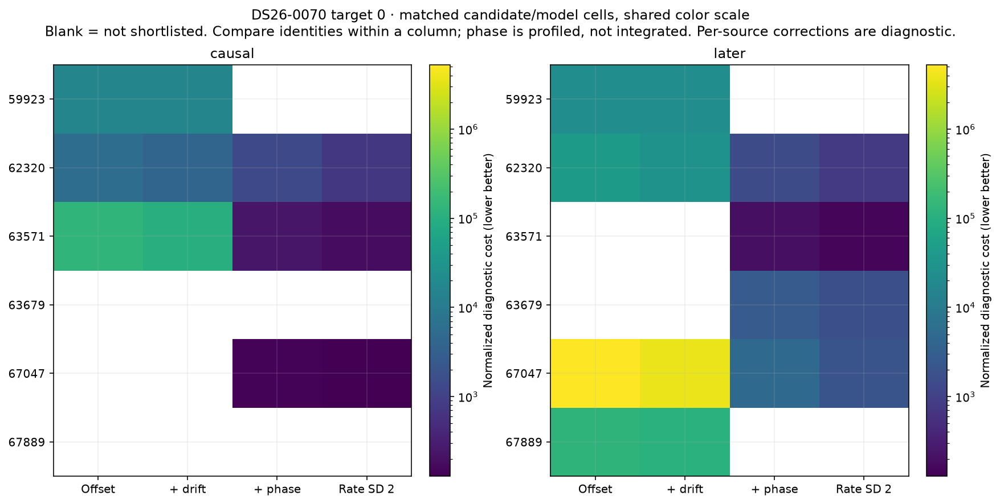

Target 1 full graph selects degree 4 under descriptive independent-noise BIC; RMS 50.9 Hz; endpoint leverage [0.5178124946855844, 0.46858469642556566]. Irregular correlation limits this complexity score. Piece fits and excluded original endpoints are retained in `targets.json`.
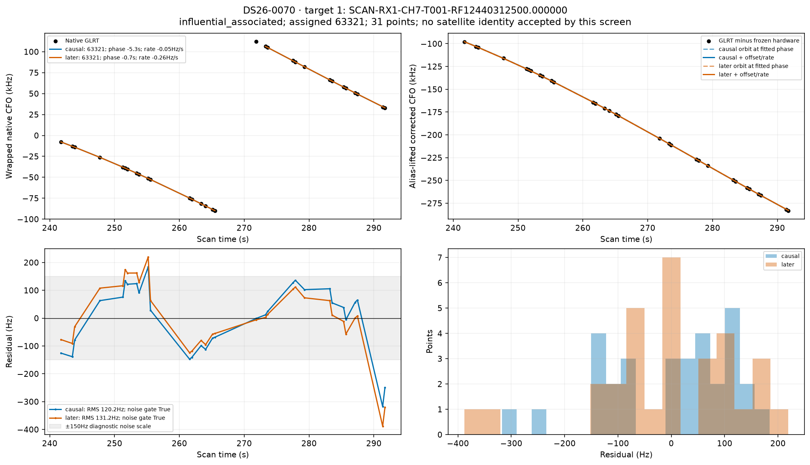
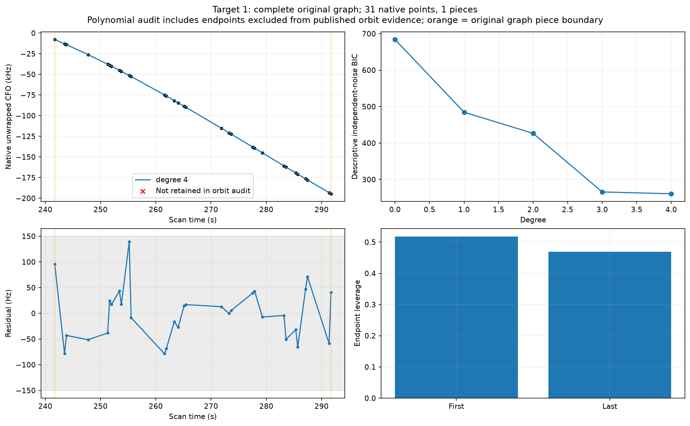
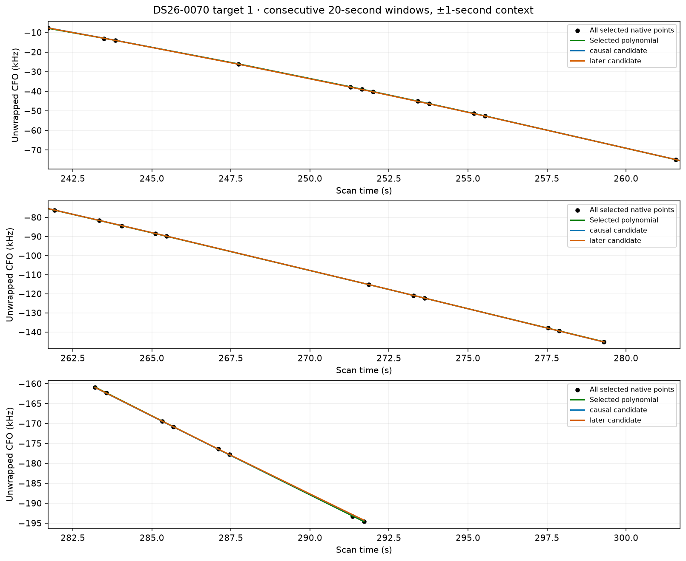
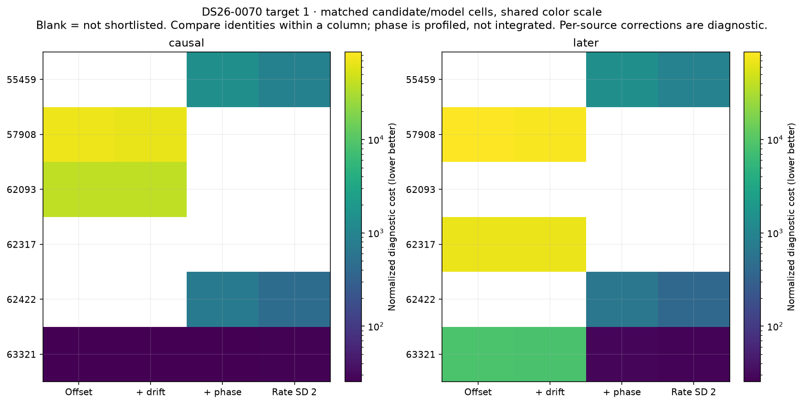

Target 2 full graph selects degree 4 under descriptive independent-noise BIC; RMS 99.8 Hz; endpoint leverage [0.27340931880639885, 0.27717446334443296]. Irregular correlation limits this complexity score. Piece fits and excluded original endpoints are retained in `targets.json`.
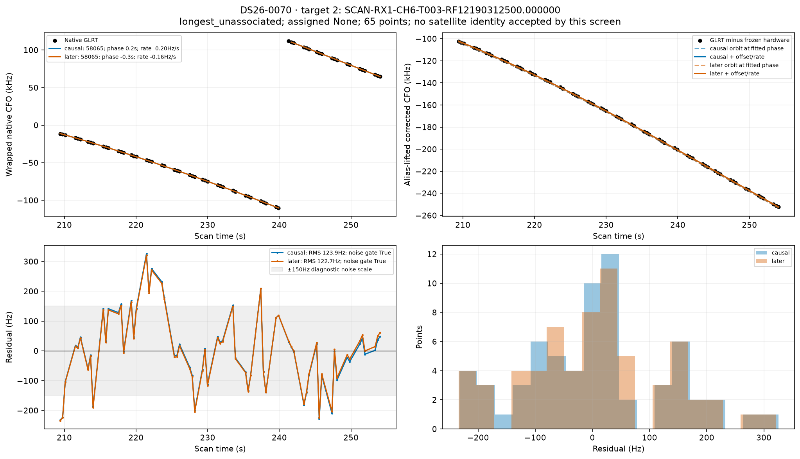
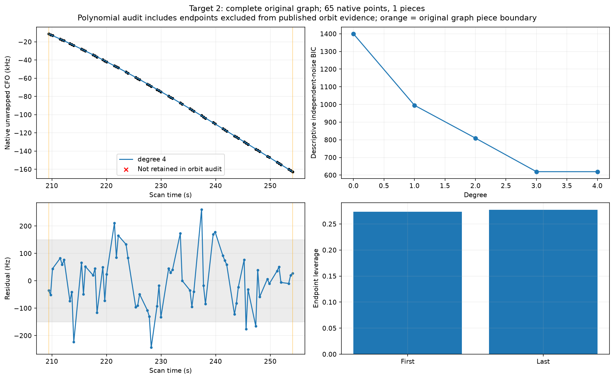
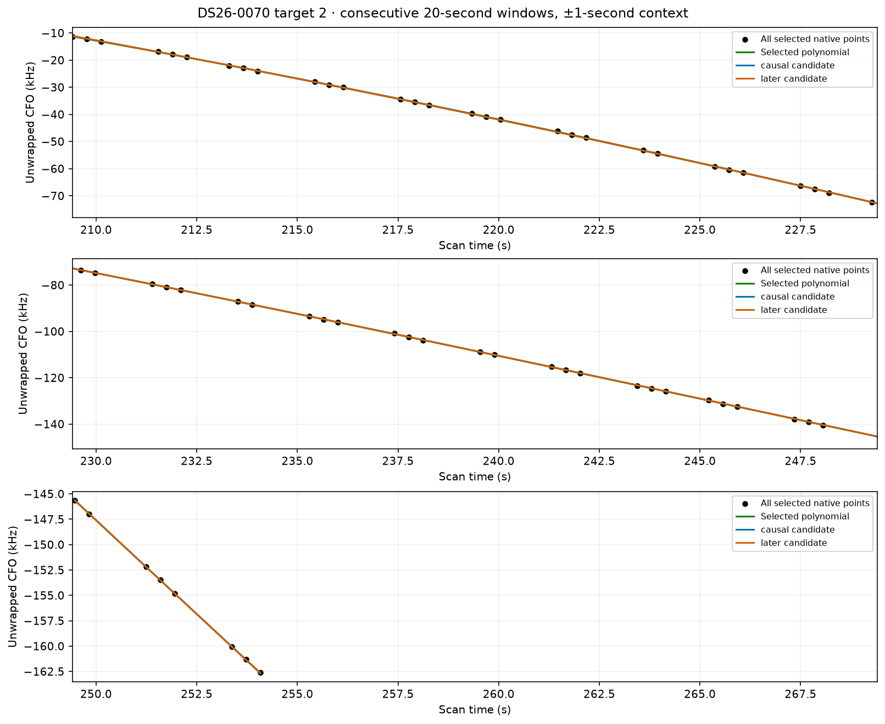
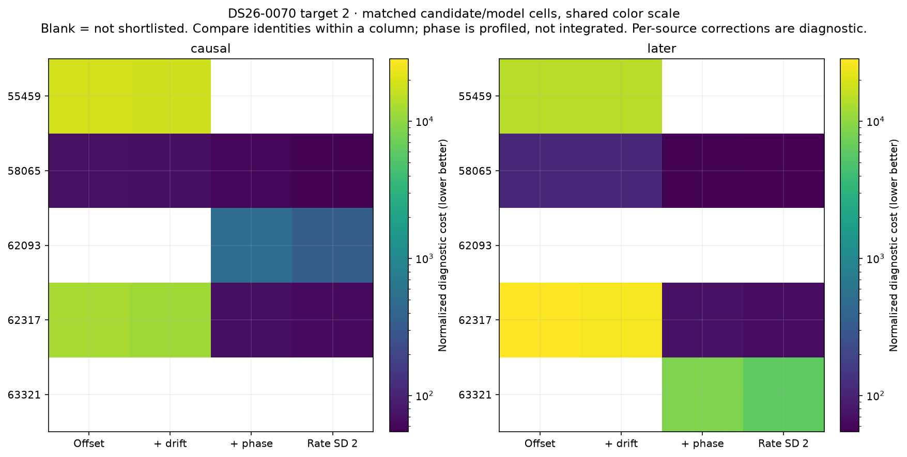

Whole-family consistency uses all published native owners of each influential family and matched shortlists. A shared phase/rate must explain every track. Constants remain per-track diagnostic terms; no independent receiver correction is inferred from them.

These restricted-model RMS values are not published baseline residuals. The restricted search uses SGP4 phase plus constant/rate in place of the production marginalized satellite/orbit nuisance block. It omits the posterior physical orbital-mode corrections and any satellite-clock/family corrections in that full block. Published full-model residuals and exact production gates are recorded separately in the sibling diagnostics report. A restricted-model failure therefore does not prove the published association is wrong.

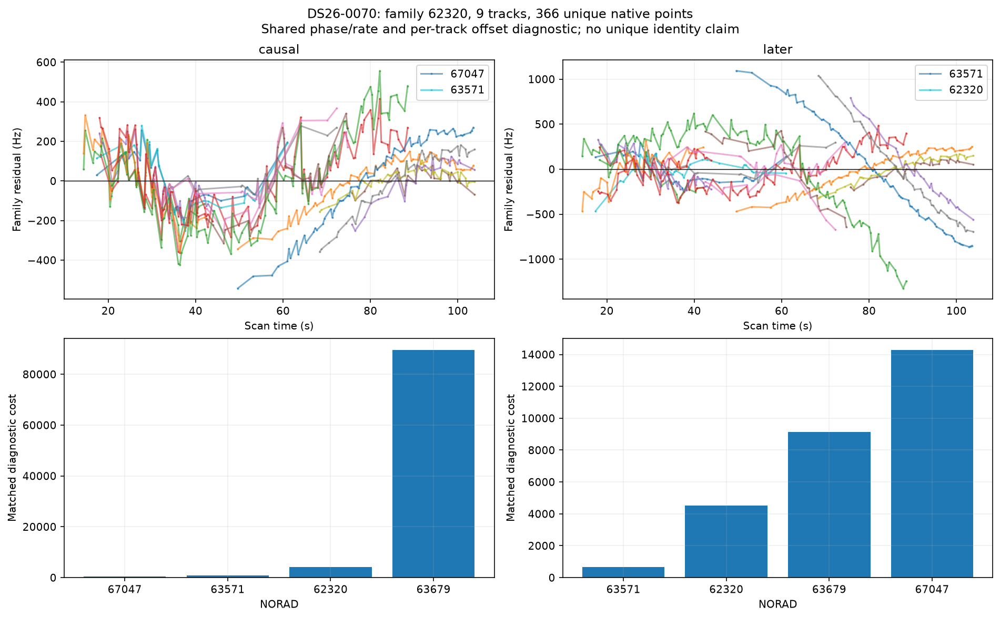
causal family 62320: best shortlist identity 67047, RMS 135.7 Hz, shared phase 25.4 s, rate 1.63 Hz/s, all-track noise pass False.
later family 62320: best shortlist identity 63571, RMS 180.2 Hz, shared phase -0.8 s, rate 3.59 Hz/s, all-track noise pass False.

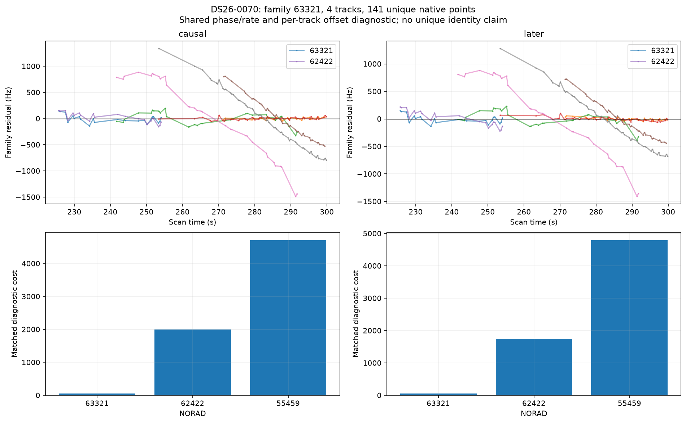
causal family 63321: best shortlist identity 63321, RMS 66.7 Hz, shared phase -5.4 s, rate -0.34 Hz/s, all-track noise pass True.
later family 63321: best shortlist identity 63321, RMS 74.5 Hz, shared phase -0.8 s, rate -0.69 Hz/s, all-track noise pass True.

Paired causal/later swaps appear in `frozen_tle_swap.json`: the frozen-corrections comparison isolates the changed elements; later-refitted values are separately labeled. Missing later exact fits are null. Exact production gates and localization ablations live in the sibling diagnostics report. These per-track RMS/noise screens are not a replacement for those gates.

Search: every propagation-valid member of causal ≤72h and first-post-epoch ≤48h catalogues receives a coarse scan. Matched c arms share top-three model nominees plus the incumbent and exact phase budget. L1/L2 freeze the saved phase; L3/L4 profile ±30s with a 5s prior. L2 rate prior SD is 0.5 Hz/s and L4 is 2 Hz/s. Detailed inventories and hash provenance are in `run_manifest.json`, `tle_inventory.csv`, and search coverage files.

Remaining ambiguity: independent whole-group prediction and regional position stability have not been executed for these single-track catalogue fits. Per-track slopes cannot distinguish receiver clock, calibration and orbit errors. Next bounded discriminator: compare the same candidate over independent receivers/families using a shared correction, then replay exact ownership gates.

Reproduce from the worktree with `PYTHONPATH=src:tools OPENBLAS_NUM_THREADS=1 OMP_NUM_THREADS=1 /srv/bulk/leo-dev/fast-algo02-production-v1/.venv/bin/python reports/2026_11_02_algo07_top10_outliers/orbits/investigate.py CASE`, then the same invocation of `finish.py CASE`. Archive creation requires the existing read-only archive permission. No RF collection was performed.

Mechanism assessment (restricted model):

Paired later-element check: 0/7 fitted-c rows improve under frozen causal phase, constant and rate. Refitted later-RMS improvements re-estimate those corrections and therefore do not isolate an orbit improvement. Frozen-swap and refitted values are separately listed in `paired_tle_summary.csv`.

Family 62320: family identity ranking changes with TLE bank; model/orbit sensitivity and association ambiguity remain entangled. Causal/later family winners differ; a smaller refitted RMS cannot be attributed solely to better elements. Confidence: model-sensitive / ambiguous; no independent identity validation. Next: Use the rival and incumbent with matched production physical orbital modes and all family receivers, fit on frozen whole time groups, test held groups, then exact ownership/gate replay.

Family 63321: incumbent identity stable in restricted family shortlist; geometry or richer nuisance calibration remains the leading unresolved alternative. Same diagnostic identity 63321: later refit restricted-family RMS 66.7→74.5 Hz; this refits nuisance and is not the frozen-swap test. Confidence: model-sensitive / ambiguous; no independent identity validation. Next: Use the rival and incumbent with matched production physical orbital modes and all family receivers, fit on frozen whole time groups, test held groups, then exact ownership/gate replay.

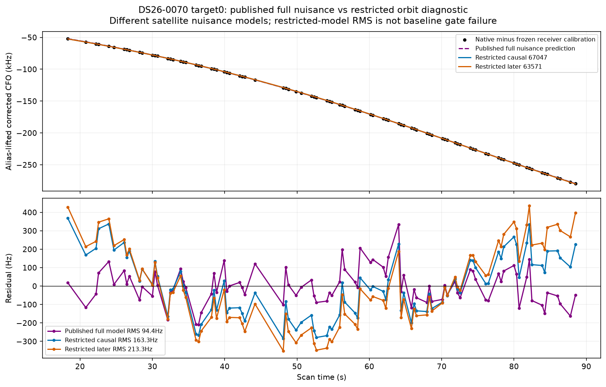

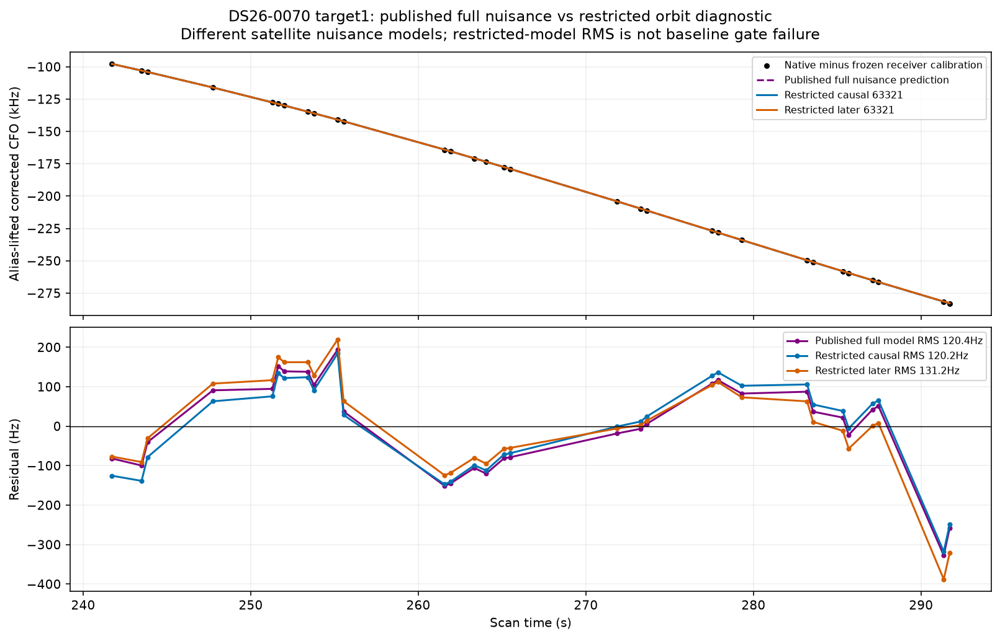

Saved ALGO07 conditional candidate-family guards:
62320_to_63571: rejected; minimum competitor margin -40.48743523506255; 10 unique folds. Scope: Conditional on supplied full-data finalist inventory, graph/alias choices, and cavity calibration; not independent discovery or an identity probability.
62320_to_67047: rejected; minimum competitor margin -65.88321413058748; 10 unique folds. Scope: Conditional on supplied full-data finalist inventory, graph/alias choices, and cavity calibration; not independent discovery or an identity probability.
Final selected replacement: None. Guard passage and final production acceptance are separate checks; no replacement is implied by a diagnostic orbit fit.
