# DS26-0100: orbit and curve diagnostic

The catalogue search compares the saved ALGO06 composition at its own inferred positions. Per-track nuisance fits are diagnostic lower bounds; a clean fit does not establish unique identity. No localization gain or production recovery is claimed.

| Target | Incumbent | Regime | L3 winner / runner-up | Margin | RMS Hz | Phase s | Rate Hz/s | Noise gate |
|---|---:|---|---|---:|---:|---:|---:|---|
| 0: SCAN-RX2-CH4-T002-RF11459687500.000000 | 59770 | causal | 63315 / 59315 | 56.96 | 65.6 | -14.5 | 0.49 | False |
| 0: SCAN-RX2-CH4-T002-RF11459687500.000000 | 59770 | later | 63315 / 59315 | 8.98 | 104.3 | -6.7 | -1.01 | False |
| 1: SCAN-RX2-CH1-T000-RF10709687500.000000 | 63931 | causal | 63931 / 57813 | 1393.21 | 68.8 | -0.7 | -0.32 | False |
| 1: SCAN-RX2-CH1-T000-RF10709687500.000000 | 63931 | later | 63931 / 56110 | 420.53 | 49.1 | 1.3 | -0.22 | False |
| 2: SCAN-RX1-CH4-T000-RF11459687500.000000 | None | causal | 66887 / 51968 | 45.42 | 84.3 | -0.7 | -0.13 | False |
| 2: SCAN-RX1-CH4-T000-RF11459687500.000000 | None | later | 66887 / 51968 | 33.46 | 77.8 | -0.2 | -0.21 | False |

Target 0 full graph selects degree 4 under descriptive independent-noise BIC; RMS 49.1 Hz; endpoint leverage [0.25862639524025693, 0.23355238457681066]. Irregular correlation limits this complexity score. Piece fits and excluded original endpoints are retained in `targets.json`.
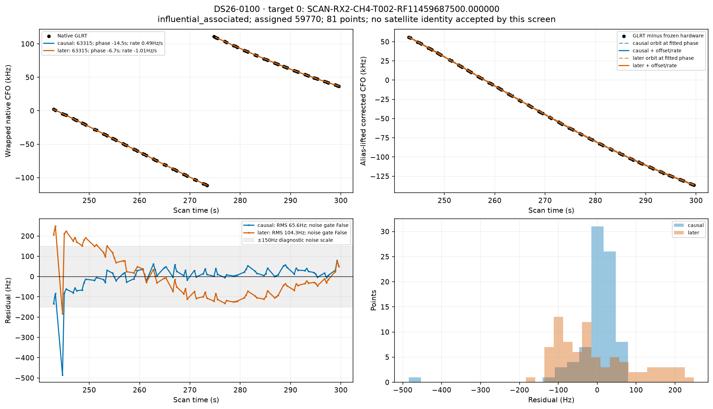
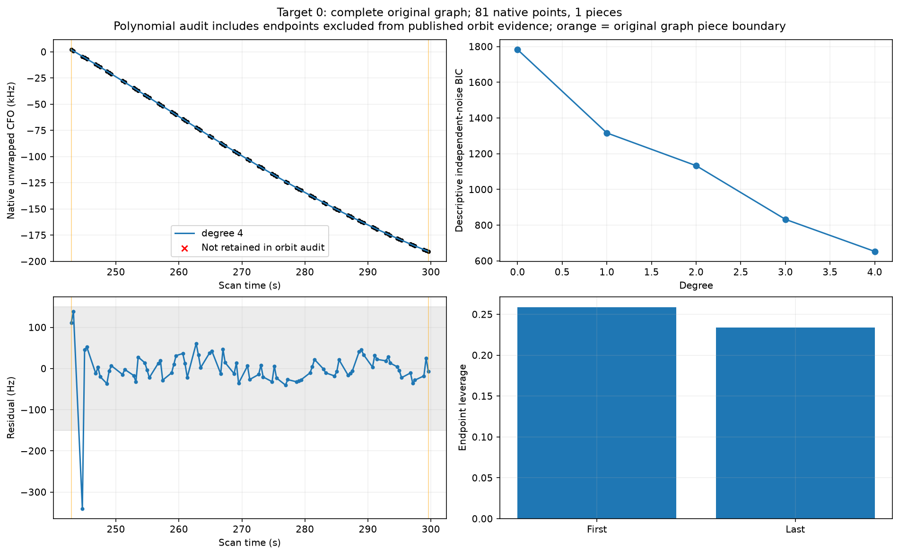
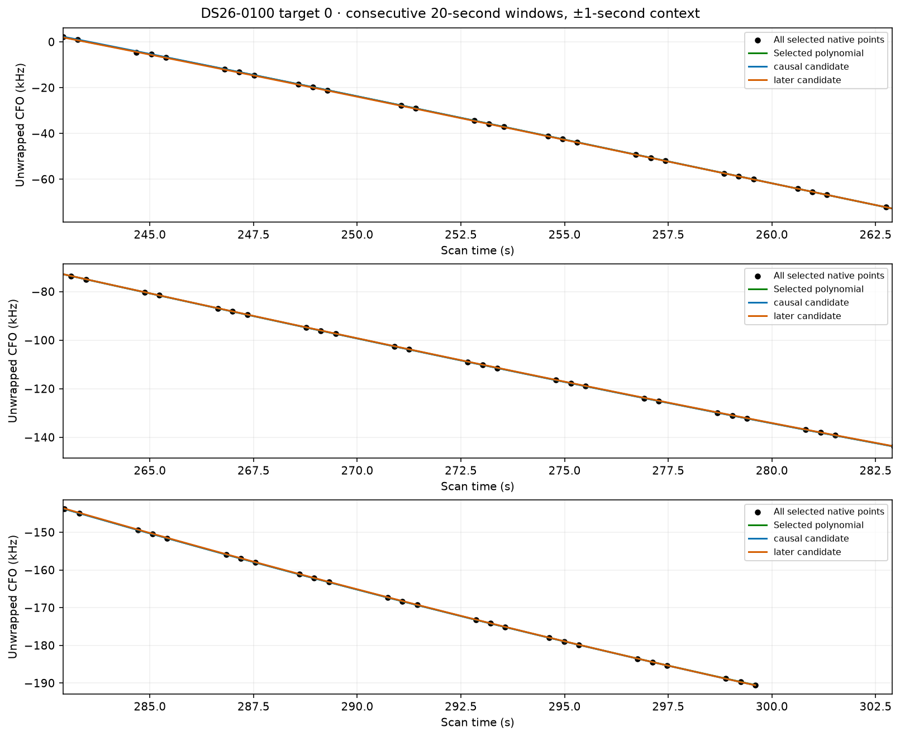
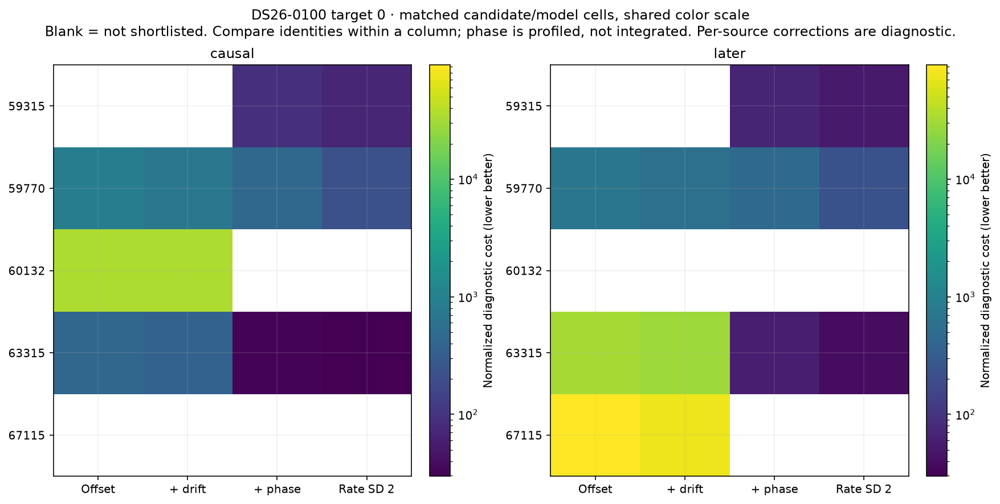

Target 1 full graph selects degree 4 under descriptive independent-noise BIC; RMS 18.3 Hz; endpoint leverage [0.6832447132263064, 0.3001067192830129]. Irregular correlation limits this complexity score. Piece fits and excluded original endpoints are retained in `targets.json`.
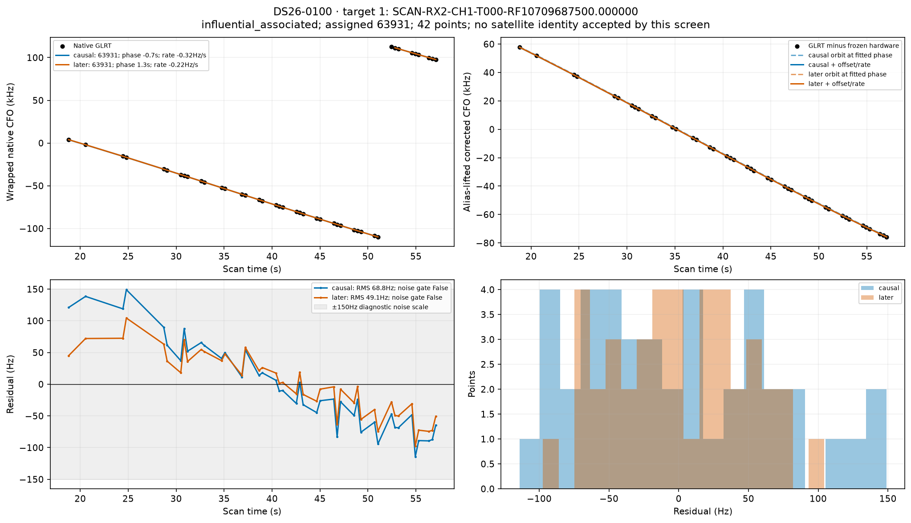
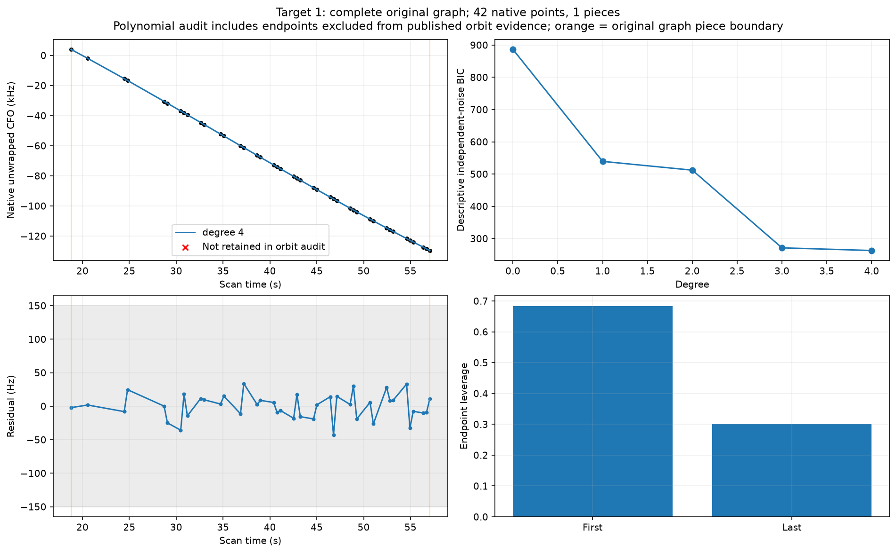
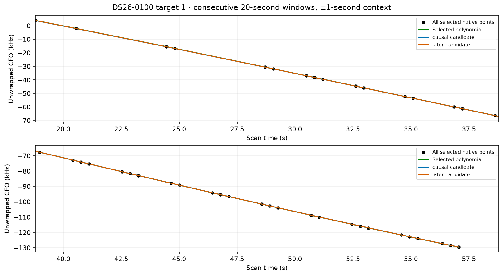
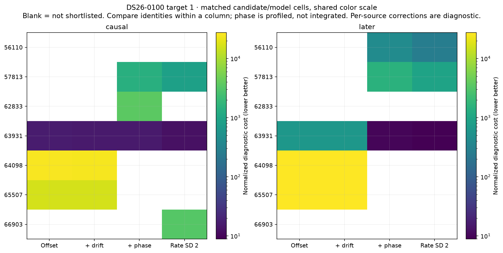

Target 2 full graph selects degree 4 under descriptive independent-noise BIC; RMS 74.4 Hz; endpoint leverage [0.26865873708867416, 0.34109972044199366]. Irregular correlation limits this complexity score. Piece fits and excluded original endpoints are retained in `targets.json`.
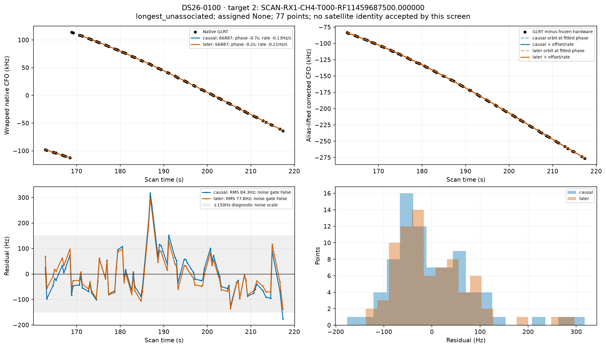
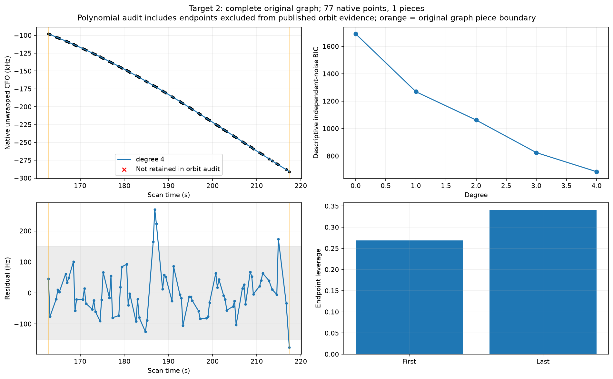
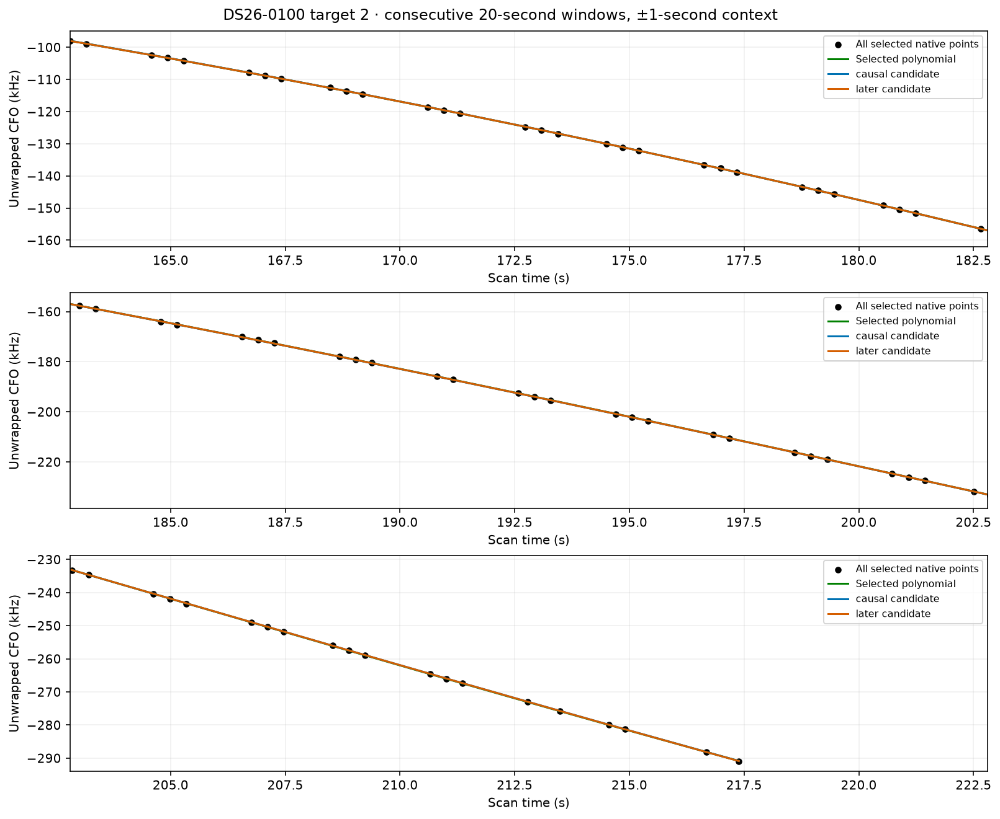
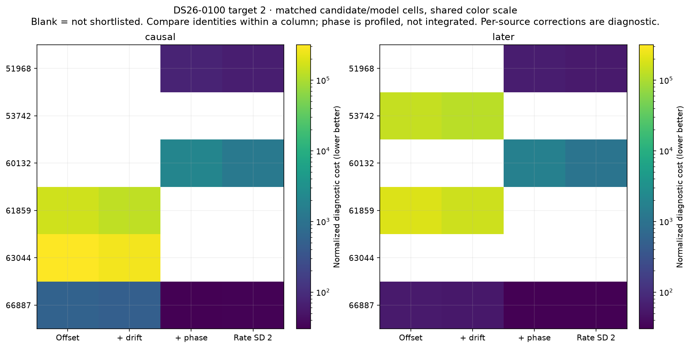

Whole-family consistency uses all published native owners of each influential family and matched shortlists. A shared phase/rate must explain every track. Constants remain per-track diagnostic terms; no independent receiver correction is inferred from them.

These restricted-model RMS values are not published baseline residuals. The restricted search uses SGP4 phase plus constant/rate in place of the production marginalized satellite/orbit nuisance block. It omits the posterior physical orbital-mode corrections and any satellite-clock/family corrections in that full block. Published full-model residuals and exact production gates are recorded separately in the sibling diagnostics report. A restricted-model failure therefore does not prove the published association is wrong.

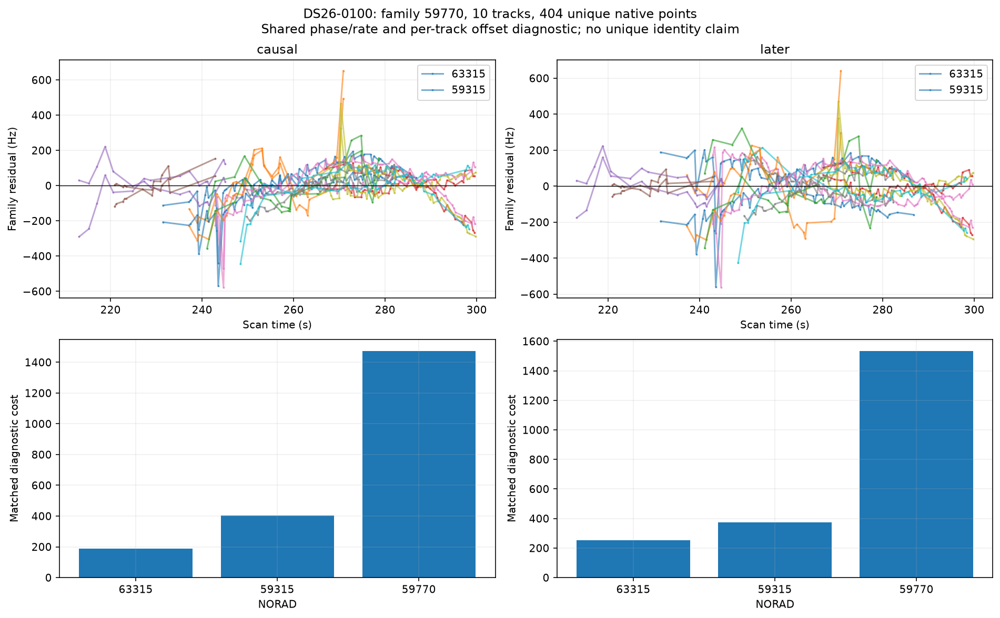
causal family 59770: best shortlist identity 63315, RMS 77.9 Hz, shared phase -14.6 s, rate 1.99 Hz/s, all-track noise pass False.
later family 59770: best shortlist identity 63315, RMS 95.6 Hz, shared phase -6.6 s, rate -2.95 Hz/s, all-track noise pass False.

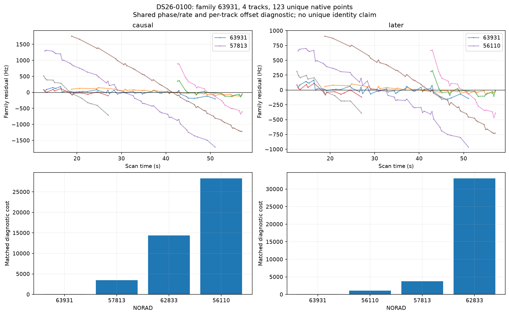
causal family 63931: best shortlist identity 63931, RMS 87.1 Hz, shared phase -0.6 s, rate -0.76 Hz/s, all-track noise pass False.
later family 63931: best shortlist identity 63931, RMS 71.6 Hz, shared phase 1.2 s, rate -0.13 Hz/s, all-track noise pass False.

Paired causal/later swaps appear in `frozen_tle_swap.json`: the frozen-corrections comparison isolates the changed elements; later-refitted values are separately labeled. Missing later exact fits are null. Exact production gates and localization ablations live in the sibling diagnostics report. These per-track RMS/noise screens are not a replacement for those gates.

Search: every propagation-valid member of causal ≤72h and first-post-epoch ≤48h catalogues receives a coarse scan. Matched c arms share top-three model nominees plus the incumbent and exact phase budget. L1/L2 freeze the saved phase; L3/L4 profile ±30s with a 5s prior. L2 rate prior SD is 0.5 Hz/s and L4 is 2 Hz/s. Detailed inventories and hash provenance are in `run_manifest.json`, `tle_inventory.csv`, and search coverage files.

Remaining ambiguity: independent whole-group prediction and regional position stability have not been executed for these single-track catalogue fits. Per-track slopes cannot distinguish receiver clock, calibration and orbit errors. Next bounded discriminator: compare the same candidate over independent receivers/families using a shared correction, then replay exact ownership gates.

Reproduce from the worktree with `PYTHONPATH=src:tools OPENBLAS_NUM_THREADS=1 OMP_NUM_THREADS=1 /srv/bulk/leo-dev/fast-algo02-production-v1/.venv/bin/python reports/2026_11_02_algo07_top10_outliers/orbits/investigate.py CASE`, then the same invocation of `finish.py CASE`. Archive creation requires the existing read-only archive permission. No RF collection was performed.

Mechanism assessment (restricted model):

Paired later-element check: 0/7 fitted-c rows improve under frozen causal phase, constant and rate. Refitted later-RMS improvements re-estimate those corrections and therefore do not isolate an orbit improvement. Frozen-swap and refitted values are separately listed in `paired_tle_summary.csv`.

Family 59770: same rival preferred by restricted whole-family model in both banks; association sensitivity is plausible, but omitted production orbital modes prevent a wrong-identity conclusion. Same diagnostic identity 63315: later refit restricted-family RMS 77.9→95.6 Hz; this refits nuisance and is not the frozen-swap test. Confidence: model-sensitive / ambiguous; no independent identity validation. Next: Use the rival and incumbent with matched production physical orbital modes and all family receivers, fit on frozen whole time groups, test held groups, then exact ownership/gate replay.

Family 63931: incumbent identity stable in restricted family shortlist; geometry or richer nuisance calibration remains the leading unresolved alternative. Same diagnostic identity 63931: later refit restricted-family RMS 87.1→71.6 Hz; this refits nuisance and is not the frozen-swap test. Confidence: model-sensitive / ambiguous; no independent identity validation. Next: Use the rival and incumbent with matched production physical orbital modes and all family receivers, fit on frozen whole time groups, test held groups, then exact ownership/gate replay.

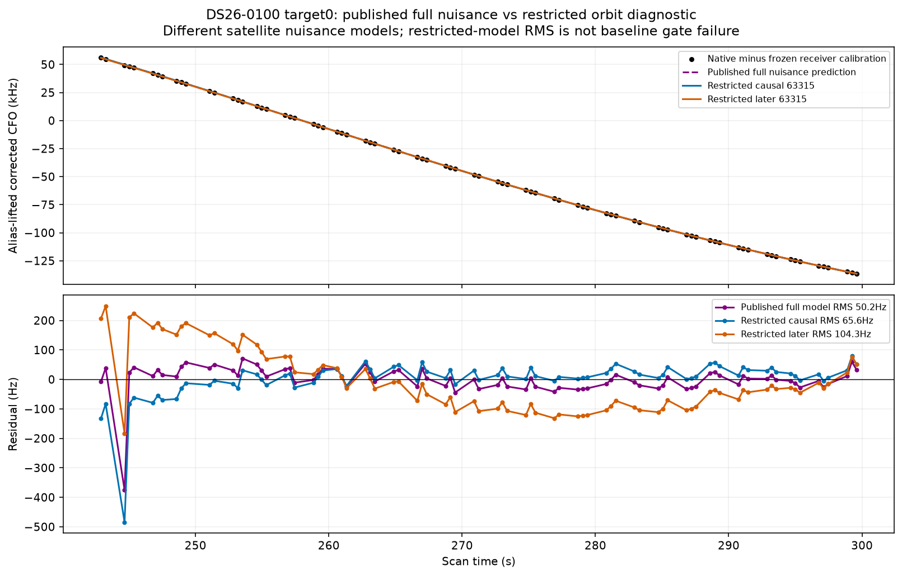

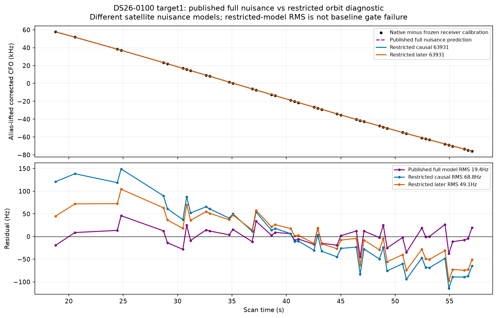

Saved ALGO07 conditional candidate-family guards:
59770_to_59315: rejected; minimum competitor margin -18.44572236529484; 10 unique folds. Scope: Conditional on supplied full-data finalist inventory, graph/alias choices, and cavity calibration; not independent discovery or an identity probability.
59770_to_63315: rejected; minimum competitor margin -142.92465662162851; 10 unique folds. Scope: Conditional on supplied full-data finalist inventory, graph/alias choices, and cavity calibration; not independent discovery or an identity probability.
Final selected replacement: None. Guard passage and final production acceptance are separate checks; no replacement is implied by a diagnostic orbit fit.
