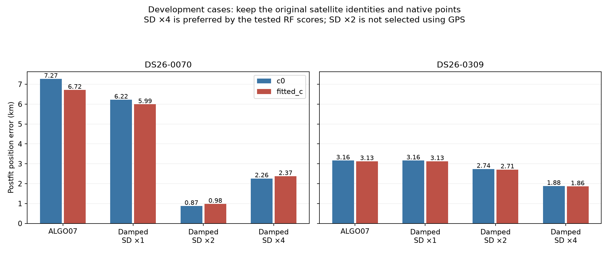
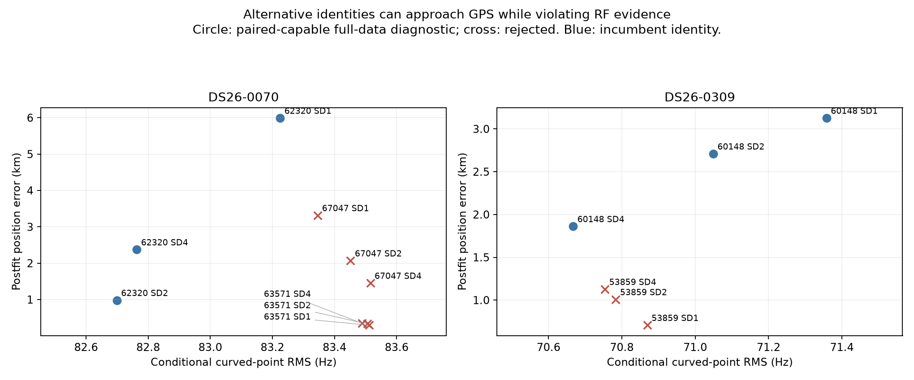
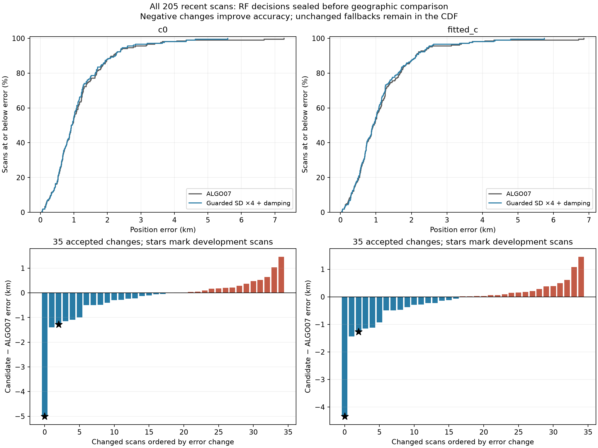
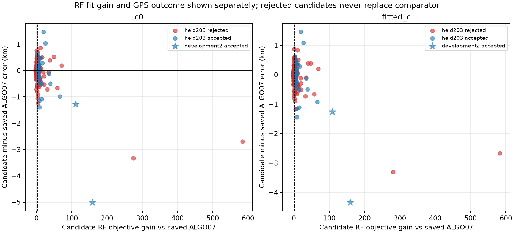

# Family reliability prototypes and the 205-scan stress test

This report implements the three proposed experiments after the [ten-outlier audit](../2026_11_02_algo07_top10_outliers/README.md): solver repair, family-level orbital uncertainty, and a combined bounded identity ensemble. ALGO07 remains the production control. No new RF collection, future-TLE inference, observation deletion, production change or deployment occurs.

**Recommendation: retain ALGO07 in production.** Damping plus broader shared orbital uncertainty substantially improves DS26-0070 and DS26-0309. However, a fixed RF-guarded SD ×4 policy gives only a 10 m mean improvement outside those two development scans, slightly worsens the 90th percentile, and accepts a 1.457 km regression. This experiment identifies useful mechanisms, but does not establish a reliable general replacement.

## What the two development scans establish

There are two separable problems. **0070 has a phase-reference convergence failure**, which damping repairs. It also has a larger localization/model discrepancy: convergence alone leaves approximately 6 km error. **0309 is already converged**, but increasing uncertainty in the existing physical orbital modes of its RF-selected family reduces its influence and improves position. This demonstrates model sensitivity; it does not uniquely identify TLE error as the physical cause.

The family is selected using the existing generic RF influence trigger, without a scan or NORAD lookup: 62320 for 0070 and 60148 for 0309. Three existing physical uncertainty directions are scaled by a frozen standard-deviation grid of 1, 2 or 4. Their coefficient priors, Gaussian normalization and log-volume penalty remain present. There are no new free per-track slopes or extra correction columns. Receiver/band calibration, phase priors, native observations and aliases stay fixed for the incumbent-identity comparisons.

| Method | 0070 c0 / fitted-c error, km | 0309 c0 / fitted-c error, km | Interpretation |
|---|---|---|---|
| Published ALGO07 | 7.269 / 6.716 | 3.162 / 3.127 | Exact replayed controls |
| A: half-damped phase updates | 6.223 / 5.991 | 3.162 / 3.127 | All four close phase and pass residual checks; convergence alone is insufficient |
| A+B: orbital SD ×2 | 0.875 / 0.982 | 2.740 / 2.709 | Full-data checks pass; not chosen because its GPS error looks attractive |
| A+B: orbital SD ×4 | 2.261 / 2.374 | 1.881 / 1.861 | Full-data checks pass; preferred by the tested RF scores, subject to predictive limitations below |

Both calibration arms start at the same published fitted-c position and phase reference for each hypothesis. The regional box remains 25×25 km around the operational regional center, not the evaluation site. Position error is computed only after RF fitting. All original associated native points remain represented: 2,023 in 0070 and 3,008 in 0309, including the latter's 349 ancillary predictive observations. Association coverage stays **47.07% / 62.81%**; proposed incidental extensions are neither fitted nor adopted.

See [paired numerical results](development_results.csv), [solver experiment](solver/README.md), and [family covariance experiment](family/README.md). The undamped family-only experiment is retained separately: every 0070 SD setting fails phase closure despite passing its residual checks. Its endpoints must not be mixed with the closed combined results.

## A: what the solver repair actually changes

The phase parameters are absolute phases, not increments with a reset prior. Updating the phase reference changes the nonlinear approximation and the physical-mode design. Consequently, successive reference surfaces are not one invariant exact likelihood. Half damping stabilizes the same fixed-point equations; this prototype does not claim to implement an exact joint nonlinear optimizer.

On 0070, half damping closes the two arms in four/three rounds, versus nonclosure after fifteen legacy rounds. Exact-versus-linearized orbital prediction disagreement also shrinks substantially. On 0309, position barely changes; damping is not a universal speed optimization. The optional quarter-damping variant was preregistered but never triggered because all half-damped full-data fits closed.

## B: uncertainty must be shared, penalized and tested predictively

Increasing a family orbital standard deviation by four multiplies its covariance contribution by sixteen. This makes that family's shape less rigid as a positional constraint, while still retaining its points. The normalized marginal objective penalizes uncertainty volume; it is not an unpenalized residual reduction or arbitrary per-point downweighting. Dense-Gaussian tests and actual-model feature audits verify the normalization and unchanged unrelated columns.

On 0070, SD ×2 gives a better GPS position than SD ×4, while RF objectives favor SD ×4. We preserve that disagreement. Choosing ×2 for this scan using GPS would be a location-specific repair, not a reusable inference rule.

## C: identity uncertainty did not authorize a satellite swap

The combined experiment retains the original identity and the whole-family alternatives from the earlier complete causal RF search. These are 62320/63571/67047 for 0070 and 60148/53859 for 0309. Shared causal-history completion is matched across candidate contexts. Later TLEs are not used. Each identity receives the same three SD settings, damping schedule and paired-arm budgets; the original full-data nomination remains a development-selection limitation.

All alternative identities fail the full-data physical/ownership checks. For example, 0070→63571 reaches approximately **0.296 km**, but fails residual gates and loses 47 proposed incumbent owners; 0309→53859 reaches **0.707 km**, but severely fails residual gates. These results remain rejected regardless of geographic proximity.

Only the original identities qualify at all three SD settings. The diagnostic generalized-ELBO ensemble therefore concentrates on the SD ×4 incumbent models. Its weights are **not calibrated satellite-identity probabilities**, and its tiny between-model dispersion excludes within-model and unmodeled uncertainty. It supplies no justification for a narrow position confidence interval. No-match behavior is explicit: if no paired hypothesis qualifies, the ensemble returns unresolved rather than manufacturing an endpoint.

The raw combined runner omitted phase-boundary eligibility from its provisional summary. [Final qualification](qualify_combined.py) explicitly enforces the preregistered boundary-mass requirement without refitting or using GPS; zero endpoints are reclassified. The [independent review](solver/REVIEW.md) and separate full-native-union audits verify all 30 endpoints, including ancillary observations, matched history, objective replay and unrelated ownership preservation.

## Predictive checks and their limits

The predictive experiment withholds synchronized 5-second groups across receivers/channels, with adjacent 5-second guards. Three fixed folds are used in both c arms. Training masks enter the actual position, hardware, phase and orbital fits. Held points do not refit their corrections. Predictive scores integrate coefficient covariance and a local Gaussian position approximation; exact joint-Gaussian and dense normalization tests verify that position and nuisance uncertainty are not double counted.

This is nevertheless a **conditional development test**. Full-data nomination, aliases and empirical preprocessing remain inherited. Ancillary linear/new-family objectives are excluded from this base-family test to avoid held-point leakage. Existing Gamma noise uncertainty is approximated, and the folds are not new scans or sites.

SD ×4 improves the aggregate scores of other satellite families as well as the suspect family. However, the original eight-round test has nonclosed folds. A separately frozen fifteen-round replication closes the expanded models on 0070 but exposes boundary solutions. Its untruncated local position Gaussian puts roughly **9–50% of probability outside the declared box** for the SD ×4 folds. Algebraic normalization alone therefore does not make those scores valid bounded-position validation.

See the [initial predictive report](predictive/report.md), [extended-budget audit](predictive/extended/report.md), and [bounded predictive correction](predictive/bounded/report.md). The final experiment evaluates the exact box-mass correction within the local Gaussian model at all 48 existing endpoints without optimization or held-point fitting. It leaves every aggregate rank unchanged: SD ×4 remains first, SD ×2 second for both scans, both c arms, and all/target/other-family subsets. Deterministic quadrature agrees with the independent Gaussian CDF check to 4.5×10⁻¹⁶. The correction fixes bounded-model normalization; it does not validate the local Gaussian approximation, remove optimizer failures or turn reused development folds into independent validation.

## Full-cohort stress test

The population experiment freezes one conservative research rule before examining aggregate candidate GPS outcomes: after an ALGO07 fallback, select the first RF-triggered family, test SD ×4 plus half damping, and retain it only when both c arms pass numerical/physical/ownership checks and improve normalized RF objectives over the matched SD ×1 control and the saved incumbent by more than `2 log(3)`. Previously accepted ALGO07 identity repairs are preserved exactly. Failed or unfinished experiments retain explicit exact fallbacks.

All **205 available scans now have sealed, independently checked decisions**. There are 168 completed paired candidate fits and 81 completed paired matched controls; RF short circuits avoid unnecessary controls. The final decisions are 35 accepted changes, 133 guard rejections, 20 scans without an RF trigger, three exactly preserved existing ALGO07 repairs, two unsupported physical-mode contexts, two inherited baseline evidence-contract mismatches, and ten timeout fallbacks. No unattempted queue placeholders or active numerical workers remain. A complete decision ledger is not 205 completed model fits. The source cohorts contain another 24 members without comparable saved results, excluded from the metric denominator and explicitly retained in the inventory.

| Evaluation subset / arm | Scans | Mean error, km, ALGO07 → candidate | Median, km | 90th percentile, km | Improved / worse / unchanged |
|---|---:|---:|---:|---:|---:|
| All / c=0 | 205 | 1.169 → 1.128 | 0.926 → 0.926 | 2.152 → 2.217 | 18 / 17 / 170 |
| All / fitted-c | 205 | 1.155 → 1.118 | 0.923 → 0.918 | 2.122 → 2.134 | 17 / 18 / 170 |
| Exclude development / c=0 | 203 | 1.129 → 1.119 | 0.923 → 0.923 | 2.085 → 2.170 | 16 / 17 / 170 |
| Exclude development / fitted-c | 203 | 1.118 → 1.108 | 0.918 → 0.909 | 2.109 → 2.120 | 15 / 18 / 170 |

The fitted-c maximum decreases from 6.858 to 5.742 km, but this does not imply uniformly better tails: p90 worsens and some individual scans regress substantially. The 203-scan subset was held out of this two-scan uncertainty experiment, not the historical development of the underlying association pipeline. These are same-site retrospective stress results, not new-location validation. All association counts remain unchanged.

| Cohort | Available scans | Accepted changes | Fitted-c mean error, km, ALGO07 → candidate | Fitted-c median, km |
|---|---:|---:|---:|---:|
| DS24 fast | 25 | 6 | 1.175 → 1.169 | 1.017 → 1.017 |
| DS26 fast | 148 | 24 | 1.223 → 1.162 | 0.977 → 0.962 |
| DS27 fast | 13 | 2 | 0.619 → 0.609 | 0.641 → 0.637 |
| DS28 fast | 14 | 1 | 0.803 → 0.829 | 0.726 → 0.726 |
| Five fresh-validation recordings | 5 | 2 | 1.424 → 1.691 | 1.258 → 1.162 |

The association problem is not solved by simply trusting normalized RF improvement. FRSH-0004 passes the frozen rule with a 19.14 objective improvement while its error worsens **2.272 → 3.728 km**; DS26-0044 improves that objective by 27.11 while worsening **3.715 → 4.799 km**. Conversely, DS26-0040 improves **1.816 → 0.381 km** with a smaller 8.16 objective gain. Raising a score threshold after seeing these GPS outcomes would be another development adjustment, not validation. No such threshold change is applied.

The [complete population report](population/README.md), [statistics](population/cohort_statistics.csv), [per-scan outcomes](population/positions.csv), and [final case ledger](population/case_ledger.csv) include both calibration arms, all fallbacks, and the amended acceptance rules. The final independent review verifies every current worker/input/protocol binding and all accepted native-set, owner, and control-convergence checks. DS26-0104 and DS26-0179 have 23 and 31 published-owner IDs, respectively, absent from their inherited fitted likelihoods; neither is silently repaired or admitted to a candidate comparison.

The bounded resume coordinator initially retried several already exhausted attempts after a manager restart. File locks prevented simultaneous duplicate fitting, but did not prevent these redundant serial retries. Those retries were stopped and the sealed second-attempt timeout outcomes restored. The execution ledger retains the incident; it supplies no extra fitting budget or favorable replacement endpoint to the final comparison.

## What to carry forward

The current approach can fail in two distinct ways: its phase-reference iterations can fail to close, and its shared family model can impose too much or incorrectly shaped confidence on position. Residual gates alone do not identify either a stable fixed point or a trustworthy position. The experiment supports investigating family-correlated model discrepancy, but does not prove the source is TLE error rather than other shared modeling error. It also provides no evidence that the two target identities should be replaced.

The next bounded experiment should compare successful and harmful uncertainty changes with the **same held-group procedure**, starting with 0070/0309 and the counterexamples FRSH-0004/DS26-0044. Measure whether corrections learned from one time/receiver group predict another, and whether other satellite families independently support the positional movement. Rebuild empirical precision estimates inside each training split; retain grouped noise and bounded-position uncertainty, and reject inconclusive predictive comparisons. Fit a shared, regularized family uncertainty model only if this diagnostic distinguishes transferable discrepancy from lost useful information. Do not substitute a threshold chosen from these GPS outcomes.

Separately, test a phase-closure fallback against ALGO07 without changing orbital uncertainty, and investigate a joint nonlinear phase-position formulation if approximation error remains material. This separates numerical reliability from the broader question of weighting satellite evidence. The standalone solver repair has only two-scan evidence here; the population experiment tested the combined guarded policy. Neither branch yet warrants ALGO08 or a deployment change.

## Reproduction and provenance

The frozen numerical base is ALGO07 at repository `d8d7033f9f654279463fa054cd2020be0bfd273e`. Report-local prototypes use the existing numerical Python environment, read-only saved corpus and causal archive exports. `solver/protocol.json`, `family/protocol.json`, `combined_protocol.json` and predictive/population protocols retain sources, hashes, observations, candidate choices, bounds and budgets. Controls use c=0 and fitted-c with matched evidence and settings.

Scientific manifests distinguish fixed likelihood observations from unadopted membership proposals, conditional base-only prediction from full objectives, exact model checks from optimizer status, and RF scores from geographic error. The user-confirmed site is an evaluation reference, never a prior or candidate-selection rule. See the population audit for the removal of an initial pre-fit GPS consistency assertion and for protocol-bound replay of completed decisions.

Thirty prototype/audit tests passed in the final parent verification run; [test receipt](verification_tests.txt). [Publication manifest](publication_manifest.json) binds the report, source, tables, figures and audit evidence. Dense excluded research artifacts remain identified by hashes in the section manifests. Production and golden fixtures are unchanged.
