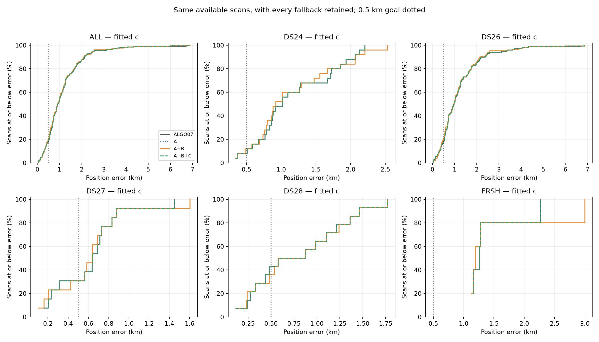
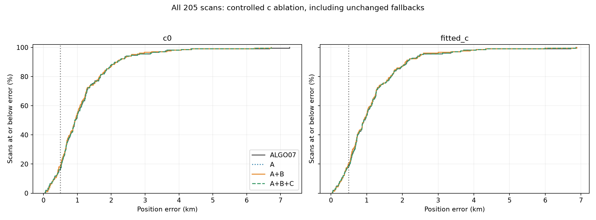
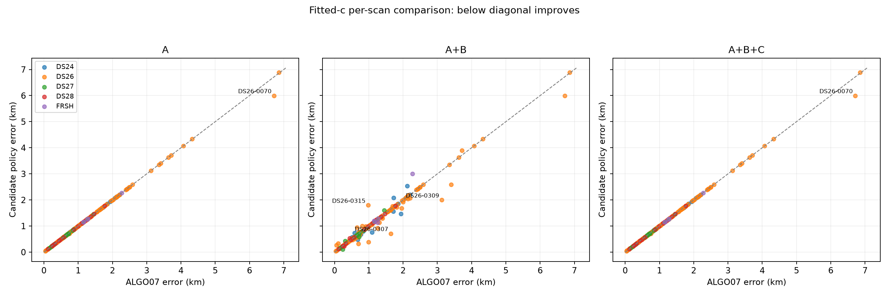
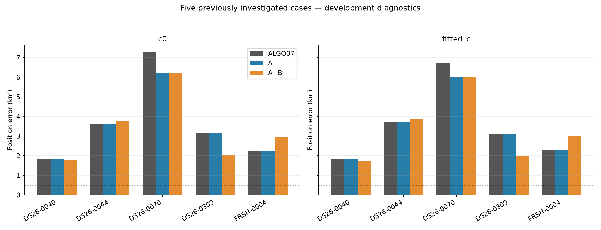
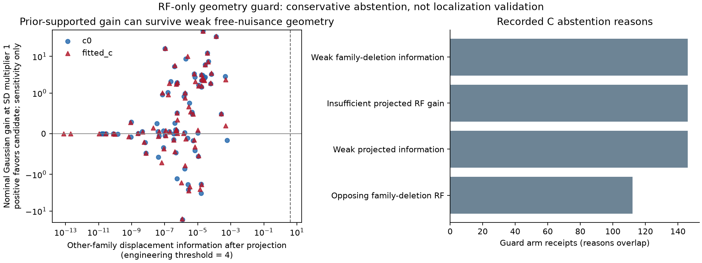

# Generalized solver, causal orbit uncertainty and support-guard prototypes

**The new causal covariance helps several difficult scans, but is not reliable enough to promote.** Across 205 available fast recordings, fitted-c mean error changes from **1.155 km with ALGO07 to 1.152 km with numerical repair and 1.138 km with repair plus causal covariance**. Median error stays approximately 0.923 km. The covariance policy improves 27 scans by more than 50 m and worsens 16; its largest regression is 820 m. The strict other-satellite guard rejects every covariance correction and therefore reproduces the numerical-repair policy.

ALGO07 remains the production default. No production source, satellite identity, graph join, point ownership or association count was changed. Three SOL xhigh workers implemented the numerical evaluation, orbital-history model and independent support/audit work. Decisions were sealed and independently verified before geographic evaluation.

## What was tested

| Policy | Change | Fallback |
| --- | --- | --- |
| ALGO07 | Exact saved comparator | — |
| A | Half-damped phase refresh and central-gradient solver rescue, with explicit stationarity checks | Saved ALGO07 |
| A+B | A's solver plus a directional covariance for one generically nominated satellite, derived only from causal TLE history | Selected A |
| A+B+C | Same B endpoint, accepted only if other satellites support its displacement after jointly removing all nuisance directions | Selected A |

B retains the existing three physical orbital modes, zero prior mean and normalized Gaussian nuisance model. The full inference still uses the inherited variational approximation at each phase reference. B does not pick a covariance because that covariance lowers the current scan's RF score. C adds no fit: it evaluates the B displacement with the nominated satellite excluded and recalibrates nuisance terms in each other-family deletion diagnostic. Full equations, thresholds, budgets and limitations are in [METHODS.md](METHODS.md).

These are **local model refinements of saved ALGO07 outputs**, within the existing 25 × 25 km regional box. They are not new catalogue searches, raw-IQ pipeline reruns or cold-start convergence tests. Both c arms use matched observations, starts, candidate identities, priors except the declared intervention, and search budgets.

## Position performance

The table reports fitted-c **mean position error in km**, retaining every unchanged fallback. C has zero acceptances, so A+B+C equals A exactly.

| Cohort | Available / source | ALGO07 | A: numerical repair | A+B: causal covariance | A+B+C |
| --- | ---: | ---: | ---: | ---: | ---: |
| DS24 fast | 25 / 34 | 1.175 | 1.175 | 1.164 | 1.175 |
| DS26 fast | 148 / 159 | 1.223 | 1.219 | 1.196 | 1.219 |
| DS27 fast | 13 / 15 | 0.619 | 0.619 | 0.620 | 0.619 |
| DS28 fast | 14 / 16 | 0.803 | 0.803 | 0.808 | 0.803 |
| Five recent controls | 5 / 5 | 1.424 | 1.424 | 1.555 | 1.424 |
| **All available** | **205 / 229** | **1.155** | **1.152** | **1.138** | **1.152** |

The 24 unavailable source members lack comparable saved inputs/outcomes and are not counted as successful evaluations. DS25's adaptive recordings are excluded, and its DS24 fast comparison subset is not counted again. DS23 is outside this recent-cohort experiment. The recent controls have already appeared in earlier development; they are not a new independent validation set.

| Arm | Policy | Mean km | Median km | p90 km | p95 km | Below 500 m | Improve / regress >50 m |
| --- | --- | ---: | ---: | ---: | ---: | ---: | ---: |
| c=0 | ALGO07 | 1.169 | 0.926 | 2.152 | 2.742 | 35/205 | — |
| c=0 | A | 1.164 | 0.926 | 2.152 | 2.742 | 35/205 | 1 / 0 |
| c=0 | A+B | 1.152 | 0.940 | 2.154 | 2.603 | 39/205 | 27 / 17 |
| fitted c | ALGO07 | 1.155 | 0.923 | 2.122 | 2.497 | 38/205 | — |
| fitted c | A | 1.152 | 0.923 | 2.122 | 2.497 | 38/205 | 1 / 0 |
| fitted c | A+B | 1.138 | 0.923 | 2.086 | 2.525 | 41/205 | 27 / 16 |

The fitted-c covariance policy's mean gain is **17.6 m** against ALGO07, including **14.1 m** beyond A. Its p90 improves by 35.7 m, but p95 worsens by 27.5 m. The 500 m success fraction changes from 18.5% to 20.0%, far from broadly achieving the goal. The c=0 comparison has a worse median and slightly worse p90. This is a tradeoff, not an across-the-board improvement.

Excluding the five previously investigated challenge cases still gives a modest mean improvement, 1.096 → 1.083 km, while median error worsens 0.912 → 0.913 km. That exclusion is a sensitivity analysis, not independent validation. DS26 supplies 148 of 205 scans, so its gains dominate the pooled mean.

[Full tables](RESULTS.md) · [Exact cohort statistics](cohort_statistics.csv) · [Incremental comparisons](incremental_comparisons.csv) · [Every scan/arm/policy](position_results.csv)

## What happened to the difficult scans

Fitted-c error, km:

| Scan | ALGO07 | A | A+B | Interpretation |
| --- | ---: | ---: | ---: | --- |
| DS26-0070 | 6.716 | 5.996 | 5.996 | Numerical repair helps 719 m; insufficient separated causal history prevents a supported covariance change. |
| DS26-0309 | 3.127 | 3.127 | 1.997 | Causal covariance helps 1.130 km; numerical repair alone barely moves the estimate. |
| DS26-0040 | 1.816 | 1.816 | 1.721 | Smaller benefit than the earlier fixed-SD4 diagnostic. |
| DS26-0044 | 3.715 | 3.715 | 3.900 | History-based covariance still moves this scan in the wrong direction. |
| FRSH-0004 | 2.272 | 2.271 | 3.003 | A 731 m regression remains despite choosing covariance without scan residuals. |
| DS26-0307 | 1.640 | approximately unchanged | 0.712 | Large useful correction outside the five-case challenge panel. |
| DS26-0315 | 0.976 | approximately unchanged | 1.796 | Largest new regression: 820 m. |

The numerical repair's aggregate accuracy gain comes almost entirely from DS26-0070. Its 65 accepted pairs should not be interpreted as 65 materially improved positions. The largest fitted-c regression under A is 27 m, but that observed result does not establish safety on future scans.

The earlier uniform-SD4 policy is a different intervention: it reported 1.118 km pooled fitted-c mean but substantially harmed FRSH-0004. B here uses different direction-dependent covariances, stricter numerical qualification and explicit history fallbacks. Its 1.138 km mean does not improve that earlier development mean; its justification is a more independent construction of uncertainty, which still needs calibration.

## What the support guard teaches us

All **73 accepted B pairs** reached both C arms; **none passed**. This is not a time-limit artifact. The median proposed displacement is approximately 120 m, but the median fraction of displacement information surviving unrestricted nuisance projection is only about **5.4 × 10⁻⁹**. Median projected information is approximately 1.2 × 10⁻⁶ against the frozen threshold of 4.

In 42 pairs, the separate Gaussian sensitivity favors the candidate in both arms at all three tested prior widths, while the free-nuisance projection rejects it. This shows how strongly the proposed movement depends on physical regularization. Projecting out every nuisance direction removes nearly all useful position separation in this diagnostic. It does not prove the associations are wrong, or that RF cannot localize the receiver. C is too conservative to distinguish beneficial from harmful covariance corrections here.

[Guard specification](identifiability/DESIGN.md) · [All guard diagnostics](identifiability/guard_arm_diagnostics.csv)

## Why causal history alone is not enough

The history audit finds a positive age/disagreement relationship within 86/96 original target contexts, but older histories do not explain covariance capping across satellites. The current proxy mixes forecasts of different ages, correlated catalog revisions and possible mean biases. It is not calibrated uncertainty in the current nominal TLE. All 77 runtime-ready covariances passed the independent provenance and construction audit; accurate implementation does not make the proxy physically calibrated.

The unchanged graph contributes 642,355 associated points in each arm under every policy. There is no GLRT-coverage gain. Saved-baseline RMS was not preserved for this experiment. On the 22 accepted-B cases with a comparable selected-A RMS, B changes curved-point RMS by only −0.078 Hz at c=0 and −0.080 Hz with fitted c. This limited frequency-fit comparison is separate from the position metrics and excludes conditional/mixture residuals.

[History diagnostic and figures](covariance/diagnostics/README.md) · [Covariance model](covariance/README.md)

## Recommendation

Keep ALGO07 in production. Retain A as an experimental comparator and useful convergence diagnostic; it addresses a real numerical failure but does not explain most of the cohort's position error. Do not promote the current B/C combination on a 17.6 m mean gain with 16 material regressions.

The next bounded prototype should estimate **age-matched causal orbital uncertainty**, with one globally chosen shrinkage strength toward the incumbent covariance. Keep zero mean and the same physical modes. Separate persistent signed catalog bias from variance before allowing a mean correction. Calibrate against disjoint historical update groups using only material available before each evaluation cutoff, then test a frozen rule on untouched recordings. Catalog revisions remain proxies rather than orbit truth.

Replace unrestricted nuisance removal with a diagnostic that reports how conclusions change over a predeclared, independently calibrated range of physical priors. It should abstain when the evidence cannot distinguish positions; lowering C's threshold after seeing these geographic outcomes would not establish a generalizable selector. See the [next experiment design](covariance/diagnostics/NEXT_DESIGN.md).

## Execution, reproducibility and limits

The original eight-worker wave ran 1,200.71 s. Before any candidate geography was opened, a prospective completion protocol authorized only never-started cases; its sixteen-worker wave completed in 667.05 s. There was no third wave and no retry of any actual attempt. All 205 available cases reached a worker or an explicit preserved decision.

- 164 workflows completed; 28 hit preparation limits: seven baseline numerical probes and 21 generic family rankings.
- Eight original-wave attempts stopped at the global deadline, retaining completed stages; two retained accepted A repairs.
- Three earlier ALGO07 identity repairs were preserved exactly; two known native-owner/likelihood mismatches remained explicit fallbacks.
- There are 334 completed raw arm receipts, 304 qualified, plus seven cell caps. One completed receipt was not installed into a final stage before the global interruption; four additional checkpoint-only cells make 345 an observed attempted-arm lower bound.
- A accepts 65 pairs; B accepts 73; C accepts zero. B's selected outputs include 43 additional A fallbacks, giving 116 selected case replacements rather than 116 accepted B corrections.

These limits describe the tested budgeted policy, not exhaustive completion of every possible model on every scan. Wall-time caps depend on host load; this is not an embedded-runtime benchmark. Completed-worker elapsed time totals 17,231 s, excluding interrupted worker time. [Full execution accounting](evaluation/EXECUTION.md).

The independent audit checks all 205 authoritative rows, paired decisions, causal byte/epoch/availability provenance, ownership, numerical gates, immutable sources, and no-retry eligibility. Eight saved endpoints across three deterministic scans reproduce objectives exactly; real-data target-CFO perturbation and independent least-squares projection checks also pass. **60 component/report tests pass.** [Independent review](review/FINAL_REVIEW.md).

The exact RF ledgers and partial-attempt evidence are published in the [compressed receipt archive](evaluation_receipts.tar.gz), with an [external hash manifest](evaluation_receipts.manifest.json) and [restore instructions](ARCHIVE.md). Source protocols, scripts, tables and figures are published directly. The [evaluation binding](position_evaluation_binding.json) records the completed RF result and audit hashes used before reading geographic labels.

All geography is the user-confirmed evaluation site, used only after inference. This is same-site retrospective development evidence; it does not establish generalization to a new location or to a moving receiver. No new RF collection, deployment or ALGO version promotion was performed.
