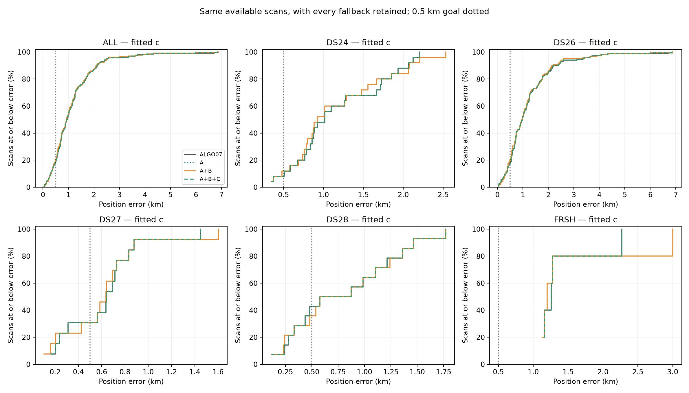
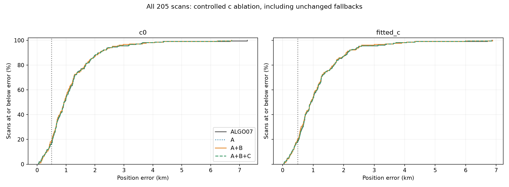
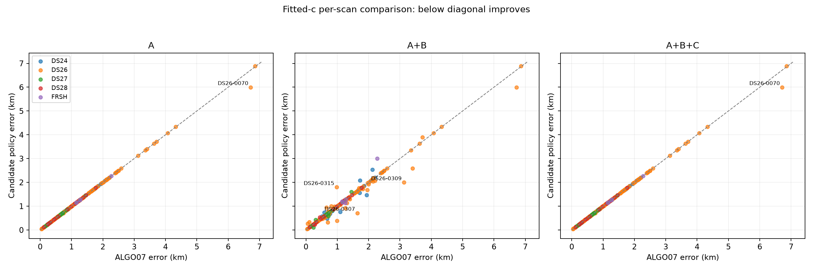
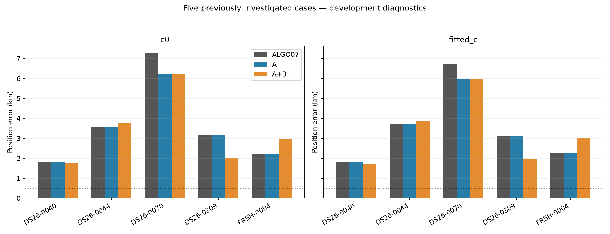

# Position outcomes after sealed RF decisions

All results are same-site retrospective development evidence. Every unchanged fallback remains in the denominator.
A is the numerical repair; A+B adds the causal-history covariance; A+B+C gates that same endpoint with other-family support.

| Cohort | n | Arm | Policy | Mean km | Median km | p90 km | Below 500 m | Improve / regress >50 m |
| --- | ---: | --- | --- | ---: | ---: | ---: | ---: | ---: |
| ALL | 205 | c0 | ALGO07 | 1.169 | 0.926 | 2.152 | 17.1% | 0 / 0 |
| ALL | 205 | c0 | A | 1.164 | 0.926 | 2.152 | 17.1% | 1 / 0 |
| ALL | 205 | c0 | A+B | 1.152 | 0.940 | 2.154 | 19.0% | 27 / 17 |
| ALL | 205 | c0 | A+B+C | 1.164 | 0.926 | 2.152 | 17.1% | 1 / 0 |
| ALL | 205 | fitted_c | ALGO07 | 1.155 | 0.923 | 2.122 | 18.5% | 0 / 0 |
| ALL | 205 | fitted_c | A | 1.152 | 0.923 | 2.122 | 18.5% | 1 / 0 |
| ALL | 205 | fitted_c | A+B | 1.138 | 0.923 | 2.086 | 20.0% | 27 / 16 |
| ALL | 205 | fitted_c | A+B+C | 1.152 | 0.923 | 2.122 | 18.5% | 1 / 0 |
| DS24 | 25 | c0 | ALGO07 | 1.162 | 1.024 | 2.000 | 8.0% | 0 / 0 |
| DS24 | 25 | c0 | A | 1.162 | 1.024 | 2.000 | 8.0% | 0 / 0 |
| DS24 | 25 | c0 | A+B | 1.159 | 0.966 | 2.082 | 8.0% | 4 / 5 |
| DS24 | 25 | c0 | A+B+C | 1.162 | 1.024 | 2.000 | 8.0% | 0 / 0 |
| DS24 | 25 | fitted_c | ALGO07 | 1.175 | 1.017 | 2.013 | 8.0% | 0 / 0 |
| DS24 | 25 | fitted_c | A | 1.175 | 1.017 | 2.013 | 8.0% | 0 / 0 |
| DS24 | 25 | fitted_c | A+B | 1.165 | 0.923 | 2.072 | 12.0% | 5 / 4 |
| DS24 | 25 | fitted_c | A+B+C | 1.175 | 1.017 | 2.013 | 8.0% | 0 / 0 |
| DS26 | 148 | c0 | ALGO07 | 1.242 | 0.991 | 2.396 | 16.2% | 0 / 0 |
| DS26 | 148 | c0 | A | 1.235 | 0.991 | 2.396 | 16.2% | 1 / 0 |
| DS26 | 148 | c0 | A+B | 1.213 | 0.963 | 2.279 | 18.9% | 19 / 8 |
| DS26 | 148 | c0 | A+B+C | 1.235 | 0.991 | 2.396 | 16.2% | 1 / 0 |
| DS26 | 148 | fitted_c | ALGO07 | 1.223 | 0.977 | 2.260 | 17.6% | 0 / 0 |
| DS26 | 148 | fitted_c | A | 1.219 | 0.977 | 2.260 | 17.6% | 1 / 0 |
| DS26 | 148 | fitted_c | A+B | 1.196 | 0.967 | 2.149 | 19.6% | 19 / 8 |
| DS26 | 148 | fitted_c | A+B+C | 1.219 | 0.977 | 2.260 | 17.6% | 1 / 0 |
| DS27 | 13 | c0 | ALGO07 | 0.638 | 0.643 | 0.921 | 30.8% | 0 / 0 |
| DS27 | 13 | c0 | A | 0.638 | 0.643 | 0.921 | 30.8% | 0 / 0 |
| DS27 | 13 | c0 | A+B | 0.639 | 0.596 | 0.921 | 30.8% | 2 / 2 |
| DS27 | 13 | c0 | A+B+C | 0.638 | 0.643 | 0.921 | 30.8% | 0 / 0 |
| DS27 | 13 | fitted_c | ALGO07 | 0.619 | 0.641 | 0.869 | 30.8% | 0 / 0 |
| DS27 | 13 | fitted_c | A | 0.619 | 0.641 | 0.869 | 30.8% | 0 / 0 |
| DS27 | 13 | fitted_c | A+B | 0.620 | 0.637 | 0.869 | 30.8% | 2 / 2 |
| DS27 | 13 | fitted_c | A+B+C | 0.619 | 0.641 | 0.869 | 30.8% | 0 / 0 |
| DS28 | 14 | c0 | ALGO07 | 0.812 | 0.729 | 1.447 | 35.7% | 0 / 0 |
| DS28 | 14 | c0 | A | 0.812 | 0.729 | 1.447 | 35.7% | 0 / 0 |
| DS28 | 14 | c0 | A+B | 0.817 | 0.754 | 1.448 | 35.7% | 1 / 1 |
| DS28 | 14 | c0 | A+B+C | 0.812 | 0.729 | 1.447 | 35.7% | 0 / 0 |
| DS28 | 14 | fitted_c | ALGO07 | 0.803 | 0.726 | 1.434 | 42.9% | 0 / 0 |
| DS28 | 14 | fitted_c | A | 0.803 | 0.726 | 1.434 | 42.9% | 0 / 0 |
| DS28 | 14 | fitted_c | A+B | 0.809 | 0.726 | 1.434 | 35.7% | 0 / 1 |
| DS28 | 14 | fitted_c | A+B+C | 0.803 | 0.726 | 1.434 | 42.9% | 0 / 0 |
| FRSH | 5 | c0 | ALGO07 | 1.438 | 1.284 | 1.901 | 0.0% | 0 / 0 |
| FRSH | 5 | c0 | A | 1.438 | 1.283 | 1.902 | 0.0% | 0 / 0 |
| FRSH | 5 | c0 | A+B | 1.569 | 1.274 | 2.297 | 0.0% | 1 / 1 |
| FRSH | 5 | c0 | A+B+C | 1.438 | 1.283 | 1.902 | 0.0% | 0 / 0 |
| FRSH | 5 | fitted_c | ALGO07 | 1.424 | 1.258 | 1.875 | 0.0% | 0 / 0 |
| FRSH | 5 | fitted_c | A | 1.424 | 1.258 | 1.875 | 0.0% | 0 / 0 |
| FRSH | 5 | fitted_c | A+B | 1.555 | 1.198 | 2.313 | 0.0% | 1 / 1 |
| FRSH | 5 | fitted_c | A+B+C | 1.424 | 1.258 | 1.875 | 0.0% | 0 / 0 |
| EXCLUDE_FIVE_CHALLENGE | 200 | c0 | ALGO07 | 1.108 | 0.919 | 2.018 | 17.5% | 0 / 0 |
| EXCLUDE_FIVE_CHALLENGE | 200 | c0 | A | 1.108 | 0.919 | 2.018 | 17.5% | 0 / 0 |
| EXCLUDE_FIVE_CHALLENGE | 200 | c0 | A+B | 1.097 | 0.921 | 2.097 | 19.5% | 24 / 15 |
| EXCLUDE_FIVE_CHALLENGE | 200 | c0 | A+B+C | 1.108 | 0.919 | 2.018 | 17.5% | 0 / 0 |
| EXCLUDE_FIVE_CHALLENGE | 200 | fitted_c | ALGO07 | 1.096 | 0.911 | 2.068 | 19.0% | 0 / 0 |
| EXCLUDE_FIVE_CHALLENGE | 200 | fitted_c | A | 1.096 | 0.911 | 2.068 | 19.0% | 0 / 0 |
| EXCLUDE_FIVE_CHALLENGE | 200 | fitted_c | A+B | 1.083 | 0.913 | 2.066 | 20.5% | 24 / 14 |
| EXCLUDE_FIVE_CHALLENGE | 200 | fitted_c | A+B+C | 1.096 | 0.911 | 2.068 | 19.0% | 0 / 0 |

[Exact statistics](cohort_statistics.csv) · [Incremental policy comparisons](incremental_comparisons.csv) · [All scan/arm/policy rows](position_results.csv) · [Evaluation binding](position_evaluation_binding.json)

These are conditional graph/model refinements of saved ALGO07 outputs, not raw-IQ pipeline reruns or new-site validation. Association counts are unchanged.
