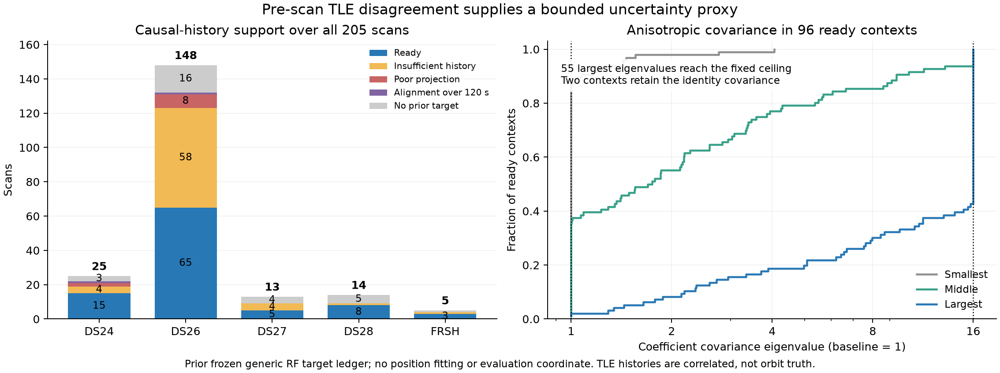

# B: causal-history anisotropic uncertainty prototype

The prototype estimates the **shape of a conservative uncertainty adjustment from pre-scan TLE history**, without fitting scan RF residuals or reading an evaluation coordinate. It retains the same three physical orbital modes and the same zero-mean Gaussian coefficient prior. This is a bounded engineering model for correlated TLE disagreement, not a calibrated orbit-error covariance.

The frozen implementation is `causal_covariance.py`, SHA256 `04c63abf99a198bb0cd5352db7f96334800f1baf3e6524287f8a5bf4fa43ef32`. Its interface is `candidate_context(d, z, metadata) -> (context, receipt)`. The evaluator supplies the first family nominated by the existing generic RF influence trigger. Missing, invalid or unsupported evidence returns the exact same input context with an explicit fallback receipt. The population evaluator retains the matched A result in that event.

## Availability is established from archive collection receipts

All **205** native inference roots contain `causal_phase_history/SCAN.json`. Across those per-scan files, all 1,801,457 historical records satisfy the scan's epoch and collection cutoff, and their `(collection timestamp, snapshot hash)` pairs occur in the corresponding source ledger. This is a count of overlapping archived records, not independent evidence. Each raw file binds its native `nominal_elements.json` by SHA256.

Both element epoch and archive availability must precede the scan-start cutoff. The implementation also checks parsed satellite number, parsed TLE epoch, history origin/cutoff equality, nominal-file binding and nominal snapshot provenance. Epoch alone never qualifies a record.

The exporter deduplicates identical snapshot bytes by their earliest collection. A nominal receipt can cite a later repeated collection of those same bytes. Consequently, nominal availability is verified using a matching snapshot hash with an archived collection no later than the nominal receipt, which itself must be pre-cutoff. Both timestamps are recorded. Repeated collections do not count as new orbit information.

## Frozen construction

Only the nominated family is eligible for adjustment, and only if it already has the engine's supported three-mode model. The physical directions are the existing midpoint-aligned mean-motion, inclination and RAAN perturbations. Their baseline scales already depend on previous-versus-current causal TLE disagreement; this experiment does not treat that baseline and the larger history bank as independent measurements.

1. Select older elements with both epoch and collection in the 72 hours before the cutoff. Deduplicate equal epochs, retain the earliest available receipt, and greedily thin newest-to-oldest to at least six hours between retained epochs. Require at least three retained epochs spanning at least 12 hours. These thresholds reduce repeated-update influence; they do not establish statistical independence.
2. Use the minimum, midpoint and maximum timestamp of **all native observations** as the common propagation epochs. Only timestamps are read for this step. The observation file hash and actual epochs are recorded.
3. Propagate the nominal and each retained historical element to those same epochs. Align historical orbital phase using only orbital position and velocity. The Earth-rotation transport for both position and velocity matches the existing `phase_shifted_states` convention. Alignment must converge in at most eight Newton steps with an absolute final step below `1e-7` seconds and an absolute phase below 120 seconds. Failure is an explicit fallback.
4. Combine position in km with velocity multiplied by the orbital timescale `radius / inertial speed`, in seconds. Remove the residual orbital-phase tangent from both the discrepancy and the existing mode design. Least squares then projects the phase-aligned state discrepancy into the **same three baseline coefficient directions**. Record singular values, coefficients, alignment convergence and residual state energy.
5. Form the uncentered second moment `S = mean(a a^T)`, preserving a zero prior mean. Replace the baseline coefficient covariance by `C_raw = 0.5 I + 0.5 S`, then clip its eigenvalues to `[1, 16]`. The 50% shrinkage is a fixed conservative choice for short, correlated, reused histories. The lower bound retains the existing uncertainty floor; the upper bound retains the previous experiment's SD ×4 ceiling. Neither choice was selected using GPS. No sample-size-derived posterior precision is claimed.
6. If less than half the historical state-discrepancy energy is represented after phase removal, retain the original context. Unrepresented state variance is reported, never converted to extra modes or independent RF slopes.

This is expansion-only relative to the incumbent covariance. It cannot learn that a family deserves more confidence than the baseline, cannot identify orbital error as the cause of an RF mismatch, and cannot represent arbitrary eccentricity changes or maneuvers. Strong historical disagreement often reaches the fixed ceiling: 55 of the 96 ready contexts have an eigenvalue capped at 16. The largest uncapped eigenvalue is 635.36. The cap limits an uncertain proxy; it is not evidence that the bounded covariance is correct.

## Orbit-only inventory before location fitting

The inventory uses the prior experiment's frozen generic RF target ledger. The population harness reruns the actual nomination and model-support checks. A prior case with no recorded target can include an existing preserved repair or an earlier unavailable context; the 29 rows below are not all newly verified no-trigger cases.

| Cohort | Available | Ready | Insufficient history | Poor three-mode projection | Alignment over 120 s | No prior target |
|---|---:|---:|---:|---:|---:|---:|
| DS24 fast | 25 | 15 | 4 | 2 | 1 | 3 |
| DS26 fast | 148 | 65 | 58 | 8 | 1 | 16 |
| DS27 fast | 13 | 5 | 4 | 0 | 0 | 4 |
| DS28 fast | 14 | 8 | 1 | 0 | 0 | 5 |
| FRSH control | 5 | 3 | 1 | 0 | 0 | 1 |
| **Total** | **205** | **96** | **68** | **10** | **2** | **29** |

Among ready contexts, 46 retain three historical epochs, 30 retain four, 13 retain five and seven retain six. The median represented state energy is 87.87%, with a range of 54.96–98.94%. This adequacy measure is orbital-state projection, not predictive RF performance or localization accuracy.



Examples illustrate the policy without using geographic outcomes:

| Scan | History decision | Coefficient-covariance eigenvalues |
|---|---|---|
| DS26-0070 | Fallback: only two separated pre-nominal epochs | Original covariance |
| DS26-0309 | Ready; 94.99% represented energy | 1.000, 3.074, 16.000 |
| DS26-0044 | Ready; 55.46% represented energy | 1.000, 1.002, 1.440 |
| FRSH-0004 | Ready; 98.23% represented energy | 1.000, 5.365, 16.000 |

DS24-0013 and DS26-0221 exceed the alignment bound and fall back. DS26-0173 and DS28-0012 produce the identity covariance after clipping; they remain explicit ready no-ops. No scan-specific identity or threshold is added.

## Normalization and invariants

For `C = L L^T`, the wrapper replaces only the target family's three physical columns `U` by `U L`. The coefficients remain standard Gaussian and the original marginal solver retains its determinant/volume penalty. No additional `log det(C)` term is added because integrating the transformed unit-normal coefficients already represents `U C U^T` exactly.

Ten component tests pass, including dense normalized-Gaussian equivalence, covariance positive definiteness and bounds, invariance to duplicated history records, byte identity/epoch and archive-availability guards, snapshot deduplication, mode-transform orientation, exact unrelated mode preservation and exact fallback identity. A direct numerical comparison verifies the phase-position and phase-velocity transport convention.

The actual DS26-0309 model audit checks both c arms without fitting a position. Only columns 57–59 of the 179-column c=0 model and columns 58–60 of the 180-column fitted-c model change. Every unrelated feature has maximum absolute difference exactly zero; observations, masks, aliases, hardware, smooth receiver terms, constants, phase scales and phase references are identical. See `context_audit-DS26-0309.json`.

## Interpretation and reproduction

The input-bank construction is causal relative to recorded archive availability, and the adjustment is RF/GPS-free conditional on the generic RF nomination and existing baseline mode scales. TLE updates are temporally correlated catalog estimates, not truth. The historical second moment, projection fraction and eigenvalue cap do not establish that a location will improve. The main report's matched A/B, c=0/fitted-c population comparison supplies that separate measurement; these orbit-only inventory results must not be described as localization gains.

From the worktree root, with BLAS threads set to one:

```text
PYTHONPATH=src:tools:reports/2026_11_02_generalized_corrections/covariance /srv/bulk/leo-dev/fast-algo02-production-v1/.venv/bin/python -m pytest -q reports/2026_11_02_generalized_corrections/covariance/test_causal_covariance.py
PYTHONPATH=src:tools /srv/bulk/leo-dev/fast-algo02-production-v1/.venv/bin/python reports/2026_11_02_generalized_corrections/covariance/inventory.py --derive
PYTHONPATH=src:tools /srv/bulk/leo-dev/fast-algo02-production-v1/.venv/bin/python reports/2026_11_02_generalized_corrections/covariance/audit_context.py --case DS26-0309
```

`availability_inventory.json` retains all historical provenance checks. `derived_inventory.json` retains every per-scan target, history hash, archive time, selected element hash, projection and covariance. No network archive download, new RF collection, QNAP write, production change or golden-fixture change is required.
