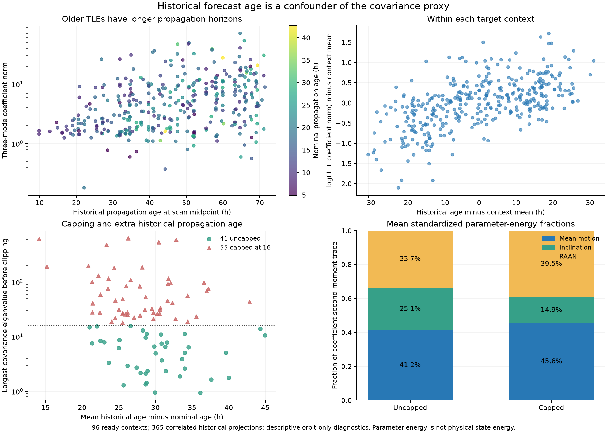
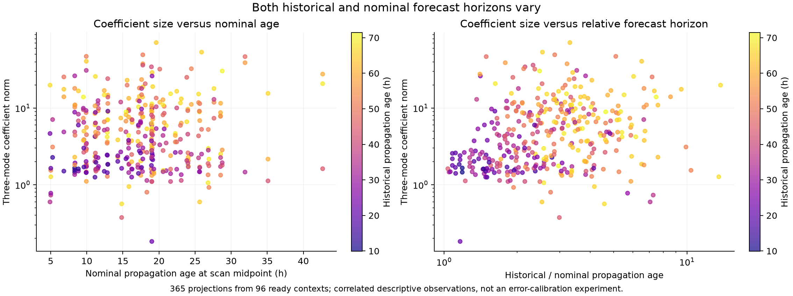

# Forecast-age diagnostic of the frozen uncertainty proxy

**Older historical elements usually produce larger disagreements within the same target context. Across satellites, the 55 covariance caps are not explained by longer historical propagation horizons.** These are two different comparisons and should remain separate when interpreting B's population results.

The analysis reads only the saved `derived_inventory.json` and writes new diagnostic artifacts. Its source SHA256 is `4b6149fd41175959e40719441b45d767553dc1e6362f68e3b93911d34233ad2d`. The frozen B module remains unchanged at SHA256 `04c63abf99a198bb0cd5352db7f96334800f1baf3e6524287f8a5bf4fa43ef32`. No RF residuals, positions, evaluation coordinates, alternate covariance or new model-selection rule are used.

The denominator is the **96 ready contexts in the prior frozen generic RF target inventory**, comprising 365 selected historical TLE projections and 95 distinct satellites. NORAD 56304 appears in two contexts; every other satellite appears once. This remains a metadata diagnostic of the original target ledger, not the runtime population decision ledger.

## Within a fixed target context

Historical propagation age is the interval from the element epoch to the common scan midpoint. Nominal age uses the nominal element epoch at that same midpoint. Every historical element is older than its nominal comparator. Their disagreement therefore compares forecasts of unequal duration; it is not a calibrated estimate of the current nominal orbit's error.

The coefficient norm is the Euclidean norm in the existing three standardized physical-mode coordinates after orbital-phase removal. It depends on the incumbent mode scales as well as physical orbit disagreement.

- Historical age and coefficient norm have positive Spearman correlation in **86 of 96** contexts. The median within-context correlation is **0.50**, with an interquartile range of **0.486–0.90**. Each context contains only three to six correlated historical versions, so these are short descriptive rankings.
- Centering age and `log(1 + coefficient norm)` within each context gives a pooled correlation of **0.569** when each context has equal total weight. This removes differences in context means from that descriptive comparison; it is not an error-growth model or causal estimate.
- The oldest retained element has the largest coefficient energy in **47 of 96** contexts. Its median contribution is **36.3%** of the second-moment trace and **39.9%** of energy along the largest second-moment eigenvector.
- Weighting historical age by that principal-direction energy places the effective age a median **7.91 hours** beyond the unweighted mean historical age. The interquartile range is **2.26–12.76 hours**. Some contexts instead give greater weight to younger historical versions.

The pooled correlation over all 365 historical projections is **0.388** for age versus coefficient norm and **0.278** for historical/nominal age ratio versus coefficient norm. These pooled numbers mix the within-context age effect with differences between satellites and their incumbent scales.

## Between contexts and satellites

| Descriptive quantity | 55 capped contexts | 41 uncapped contexts |
|---|---:|---:|
| Median nominal propagation age | 18.96 h | 16.28 h |
| Median mean historical propagation age | 47.34 h | 48.21 h |
| Median additional historical age beyond nominal | 27.10 h | 29.82 h |
| Median oldest-element principal-energy contribution | 40.97% | 39.80% |

The capped group does not have a longer median historical horizon or additional horizon. Across 95 satellite means, Spearman correlation between mean historical age and coefficient RMS is **−0.116**; nominal age versus coefficient RMS is **0.125**, and additional historical age versus coefficient RMS is **−0.276**. Across the 96 individual contexts the corresponding values are **−0.112**, **0.119** and **−0.258**.

These results do not establish that age is irrelevant. They show that the observed cap count cannot be attributed simply to longer historical forecasts across this inventory. Satellite dynamics, nominal and historical element differences, state-projection geometry and the existing mode scales also differ. There are too few repeated satellite contexts to separate those effects with an independent within-satellite cross-scan comparison. No regression, p-value, threshold search or alternative B variant is introduced.

## Directional parameter-energy profiles

The table averages each context's fraction of the coefficient second-moment trace, giving contexts equal weight.

| Existing physical direction | Capped contexts | Uncapped contexts |
|---|---:|---:|
| Midpoint-aligned mean motion | 45.63% | 41.20% |
| Inclination | 14.88% | 25.09% |
| RAAN | 39.49% | 33.71% |

These are energies in **standardized parameter coordinates**, not fractions of physical position/velocity error. The three physical directions are not orthogonal; cross terms contribute to state-space energy. The profile describes the frozen proxy without identifying the physical cause of an RF discrepancy.





## Consequence for interpreting generalization

The frozen B covariance summarizes a spread of longer historical forecasts against a shorter nominal forecast. Within-context age dependence is visible, and the spread often reaches the fixed ceiling. It must remain a conservative disagreement proxy with explicit fallbacks, rather than being described as a learned calibrated covariance of current orbit error. A geographic improvement or regression in the matched population experiment is a separate observation; this diagnostic neither chooses an endpoint nor changes that experiment.

`history_age_summary.json` retains all numerical summaries. The projection, context and satellite-mean CSVs preserve the rows and grouping. The script asserts the counts, positive age ordering, unit energy fractions and unchanged input digest. Both scientific figures are available as PNG and PDF.

Reproduction from the worktree root:

```text
OPENBLAS_NUM_THREADS=1 OMP_NUM_THREADS=1 PYTHONPATH=src:tools /srv/bulk/leo-dev/fast-algo02-production-v1/.venv/bin/python reports/2026_11_02_generalized_corrections/covariance/diagnostics/analyze_forecast_age.py
```
