# Can held-out RF evidence select a reliable orbital-uncertainty correction?

The bounded follow-up to the [family-reliability experiment](../2026_11_02_family_reliability/README.md) is complete. **Held-out time prediction does not reliably distinguish useful from harmful position changes on this challenge panel.** All five cases remain inconclusive under the frozen rule requiring consistent time and receiver transfer. ALGO07 remains the production policy; this report establishes no new localization gain or algorithm promotion.

There is a promising lead in DS26-0309: all three time partitions and one numerically qualified receiver transfer favor the wider orbital uncertainty. Its reverse transfer fails the optimizer-success check. More broadly, receiver-transfer evidence is unavailable under our declared support requirements for four of the five targets. These are limitations of the available evidence and test, not proof that their associations are wrong.

## What was compared

The two models retain each scan's previously nominated satellite identity, causal TLE, graph fragments, native observation eligibility and alias integers. SD1 uses the existing orbital prior. SD4 multiplies the standard deviations of the nominated family's **three existing physical orbital modes** by four, multiplying their covariance contribution by sixteen. Both retain the normalized Gaussian prior penalty and use half-damped phase-reference updates. Neither adds free per-track slopes or new satellites.

The five cases were deliberately selected from previously observed helpful and harmful position changes. They are an **explanatory development panel**, not an independent validation cohort. Family nomination came from the previous generic RF influence procedure; the reusable model has no scan/NORAD lookup for selecting a correction.

| Case | Fixed target family | Prior full-data ALGO07 → SD4, c=0 (km) | Prior full-data ALGO07 → SD4, fitted c (km) | New qualified paired partitions / 5 | New strict decision |
| --- | ---: | ---: | ---: | ---: | --- |
| DS26-0070 | 62320 | 7.269 → 2.261 | 6.716 → 2.374 | 0 | Inconclusive |
| DS26-0309 | 60148 | 3.162 → 1.881 | 3.127 → 1.861 | 4 | Inconclusive |
| DS26-0040 | 54851 | 1.845 → 0.449 | 1.816 → 0.381 | 3 | Inconclusive |
| DS26-0044 | 61846 | 3.594 → 4.626 | 3.715 → 4.799 | 1 | Inconclusive |
| FRSH-0004 | 59704 | 2.237 → 3.701 | 2.272 → 3.728 | 3 | Inconclusive |

The position columns are **previously published full-data outcomes**, included only after the new RF decisions were sealed. They are not errors from the new training splits. The new experiment changes preprocessing and starts to prevent held-data leakage, so its SD1 control is not a replay of deployed ALGO07. A retrospective selector that abstains on all five would preserve all five previous ALGO07 outputs: it would avoid the two candidate regressions while also losing the three candidate gains. That is not a demonstrated improvement in discrimination. [Exact table and binding](retrospective.csv), [binding receipt](retrospective_binding.json).

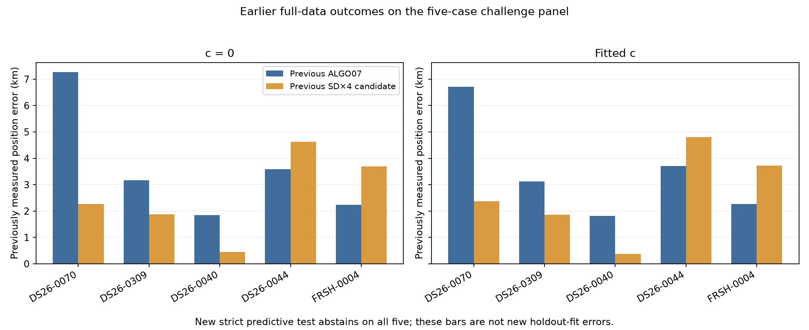

Associated-point counts in those earlier comparisons were unchanged: 2,023 / 3,008 / 2,805 / 2,803 / 3,084 respectively. This experiment tests the reliability of existing evidence; it does not recover new GLRT points or raise association coverage.

## How the held tests work

Each case has three seeded random **whole 5-second time-group partitions**. All receivers and channels in a selected time group are held together. Approximately 20% of available groups are held; adjacent 5-second groups are excluded from training as guards. These are randomized groups, not a chronological train/test cut or independent random individual points. The three partitions overlap and must not be treated as independent trials.

Two further partitions hold the nominated satellite's entire evidence on RX1 or RX2. The same satellite on the opposite receiver trains the family correction; other satellites on the held receiver train that receiver's calibration. Holding a whole receiver without such calibration would mostly test an unconstrained hardware prior.

| Case | Receiver-transfer support under frozen requirements | Target points held in time folds 0 / 1 / 2 |
| --- | --- | ---: |
| DS26-0070 | Both directions lack sufficient other-family, same-band calibration | 64 / 108 / 42 |
| DS26-0309 | Both directions supported; 366 / 124 target points held and 59.8 s target overlap | 124 / 67 / 140 |
| DS26-0040 | Target observed only on RX1 | 36 / 59 / 44 |
| DS26-0044 | Both directions lack sufficient other-family, same-band calibration | 47 / 61 / 38 |
| FRSH-0004 | Target observed only on RX2 | 9 / 4 / 15 |

Transfer requires at least 20 target observations on each receiver, at least 10 seconds of target time overlap, and at least two other calibration families in every held target band. Each calibration family must provide at least 10 training points spanning 10 seconds within the held target time range. Failing these conservative minima does not establish physical impossibility. [Exact partitions and support inventories](predictive/plan.json).

Every fit starts at the operational regional center, **37.906, −122.545**, inside the same 25 × 25 km box, with zero phase reference. It does not start at a full-data fitted position or the evaluation site. Existing causal phase priors remain present. Both `c=0` and fitted-c use identical observations, model candidates, priors other than the intended c ablation, and budgets.

Full-data empirical noise estimates and likelihood powers are replaced: the engineering base scale is 150 Hz with unit likelihood powers, and Gamma precision is learned from training points only. Wholly unseen fragments use their declared prior. All ancillary/conditional entries are excluded from both training and scoring in this base-graph diagnostic. Graph construction, identity nomination, alias selection and original eligibility remain inherited from the full data; consequently this is **conditional prediction on a selected graph**, not blind end-to-end cross-validation. [Preprocessing specification](preprocessing/README.md), [frozen protocol](protocol.json).

## Scores, gates and execution

The score is a normalized approximate held-data log density, including shared nuisance covariance, local position covariance and the bounded regional-box mass correction. A positive gain means SD4 has a lower negative twice-log predictive density. Residual quadratic and log-volume terms are retained separately. All-point, target-family and other-family marginal scores are shown separately; their gains do not add because the predictions share covariance.

Noise is moment-matched using the training posterior's `150² E[1/tau]`, rather than substituting `150² / E[tau]`. The exact Gamma mixture is not integrated. Position uncertainty is a local Gaussian approximation, checked against four training-objective evaluations at its ±1-standard-deviation axes. The expected negative twice-objective increase is one; each probe must fall within 0.5–1.5 and remain inside the regional box. This checks local consistency, not global uniqueness or calibrated coverage.

Qualification also requires optimizer success, raw phase gap ≤0.01 s, inner precision change ≤1e-5, positive unfloored position curvature, an interior endpoint, finite scores, quadrature relative error ≤1e-6, matched native IDs and the training horizon gate. All gates and the decision rule were frozen before fitting. The strict decision requires all five partitions to qualify, a consistent score preference in both c arms, and no deterioration in other-family prediction in the time partitions beyond numerical tolerance. Failed or unsupported comparisons cannot vote.

The run produced **100 terminal receipts: 68 completed fits and 32 unsupported-transfer entries**, with no numerical exceptions or timeout fallbacks. It used four BLAS-one workers, 10.8 seconds of preload and 140.2 seconds of fitting. The frozen ceilings were 120 seconds per fit and 600 seconds for the fit stage; no retry or budget expansion occurred. All workers joined. [Execution receipt](predictive/execution_summary.json), [all cell summaries](predictive/cell_summary.csv), [sealed decisions](decisions.json).

## What each case teaches us

Blue/positive values below favor SD4 in conditional RF prediction. Crosses identify failed paired numerical checks; gray cells lack transfer support. The magnitudes are unnormalized gains on different held sets and are not comparable evidence thresholds across scans or fold sizes.

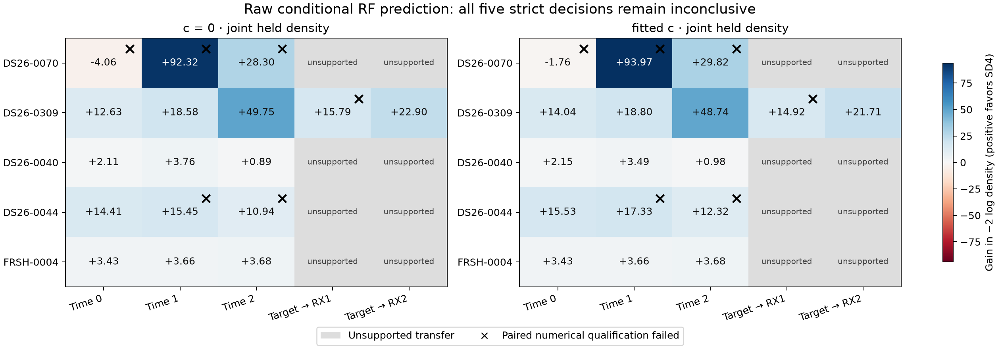

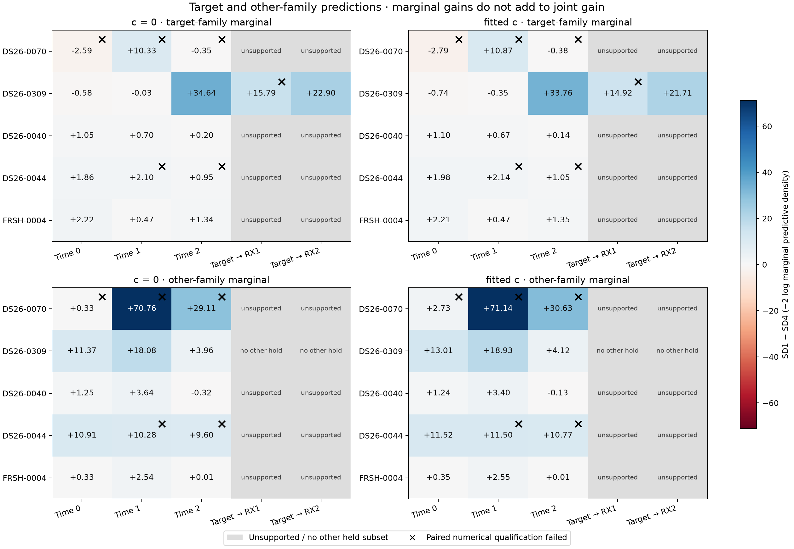

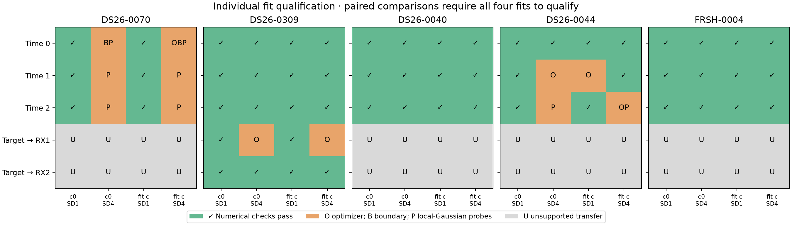

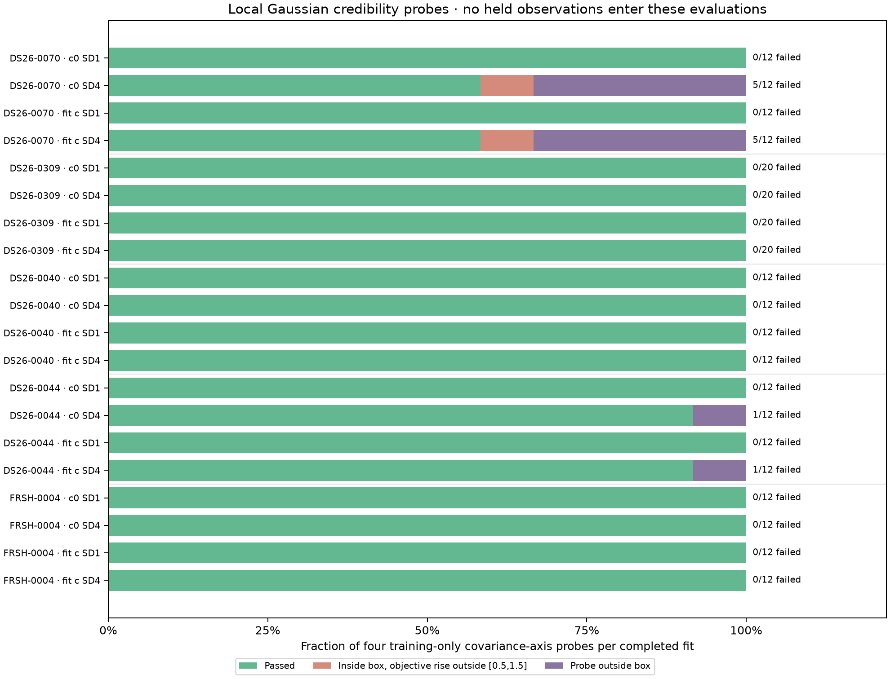

[Compact scores, support and probe tables](presentation/FINDINGS.md) preserve both c arms and every unqualified result.

**DS26-0070 — the local uncertainty approximation is unstable.** All six SD1 time fits qualify, but all six SD4 time fits fail the local-Gaussian probes. Two also hit the regional boundary and one reports optimizer failure. Raw predictive gains change sign across time splits. Its previously favorable full-data position change cannot be validated by these local predictive scores. This strengthens the case for inspecting the nonlinear position/phase surface rather than interpreting one Hessian as reliable uncertainty.

**DS26-0309 — strongest positive transfer evidence, still incomplete.** Fitted-c joint predictive gains across the three time folds are +14.04, +18.80 and +48.74. Transfer to RX2 qualifies and gains +21.71. Transfer to RX1 has a raw +14.92 gain, but both SD4 c arms fail optimizer success and cannot count. Both finish with L-BFGS-B `ABNORMAL` termination, despite closing their phase gaps to 0.0080 / 0.0081 s and passing the local-Gaussian probes. This is an optimization limitation, not a failed measured prediction; the saved receipt does not establish the underlying cause of the termination. The target-only fold-0 score actually worsens slightly while the joint and other-family scores improve: total improvement must not be described as every satellite getting a better fit.

**DS26-0040 — a useful earlier correction lacks reciprocal observation support.** All time fits qualify and joint scores favor SD4, but its target is only observed on RX1. Other-family prediction also worsens slightly in time fold 2 (−0.325 c0 / −0.127 fitted-c), beyond the declared numerical tolerance. Joint preference alone would conceal this tradeoff. Its earlier sub-kilometer outcome does not justify relaxing the gate after observing GPS.

**DS26-0044 — raw prediction gains do not eliminate a known position regression.** Fitted-c joint gains are +15.53, +17.33 and +12.32, but only the first paired time partition qualifies. Other partitions have optimizer/probe failures; independent receiver calibration is insufficient. The earlier full-data error increased by 1.084 km. The current test remains inconclusive, rather than identifying a uniquely bad association.

**FRSH-0004 — the clearest counterexample to time prediction as a position selector.** All twelve time fits qualify. All three joint gains favor SD4 (+3.426, +3.663, +3.679 fitted-c), and all other-family gains are positive too. Yet this correction previously increased full-data position error by 1.457 km. Only 9, 4 and 15 target held points contribute in those time partitions, and the target is observed only on RX2. Repeated predictions within the same selected geometry can agree while leaving a position/model ambiguity unresolved. This is evidence against using time-score preference alone as a general promotion rule; it is not a proof that satellite 59704 is wrongly identified.

## Native GLRT, orbit and residual views

These figures reconstruct **saved endpoints without refitting**. The first time fold and fitted-c arm were chosen for visualization before outcomes; both receiver directions are also shown for DS26-0309. They show only held target-family points. Columns show native graph CFO branch, alias-lifted orbital/full predictions, and residuals. Dotted orbital curves include trained phase/physical corrections; full predictions also include receiver, smooth and fragment contributions. Lines stop at fragment boundaries or gaps longer than five seconds. Shading is a local model standard deviation, not a calibrated confidence interval. Endpoint qualification is labeled and is distinct from the all-partition decision.

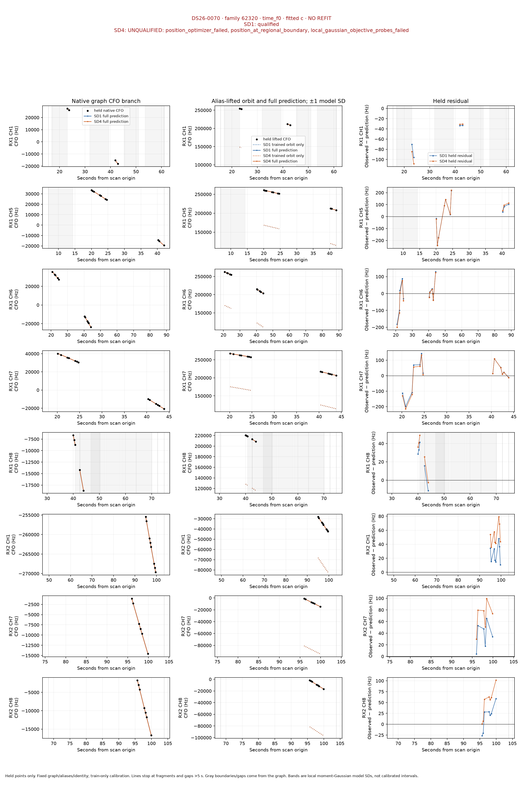

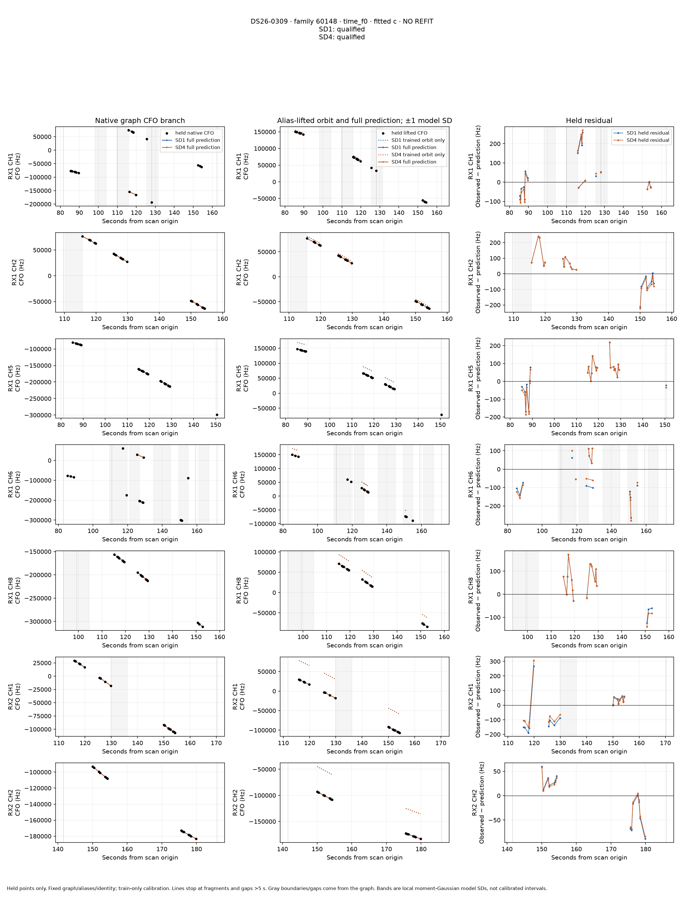

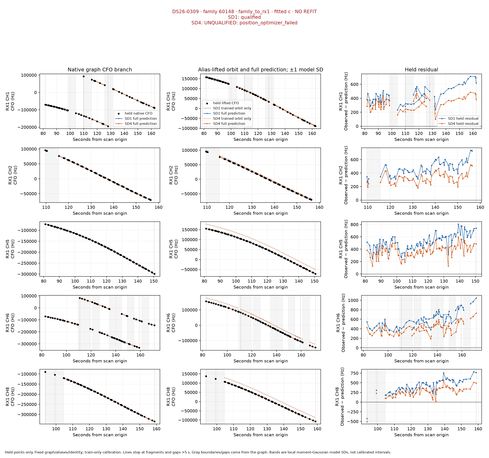

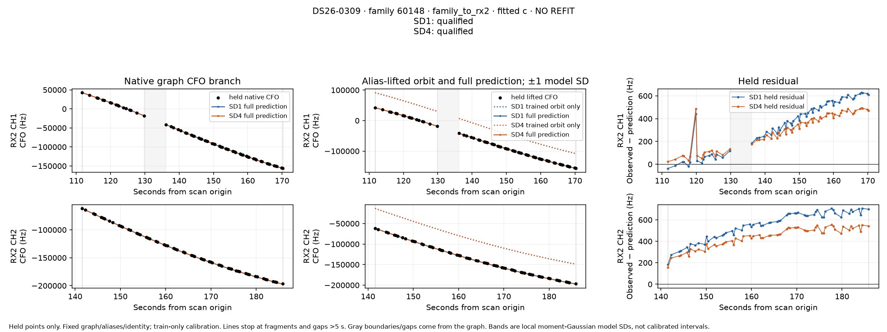

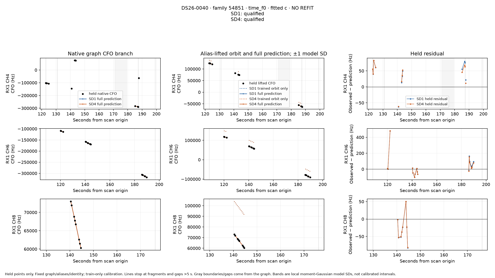

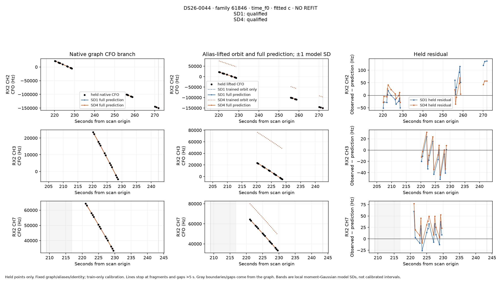

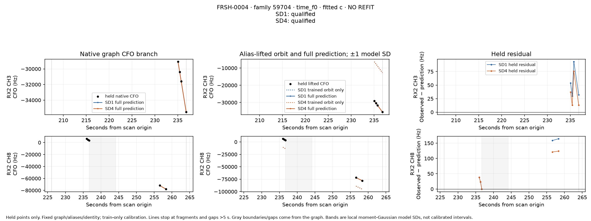

Fourteen endpoint exports preserve native IDs and full shared covariance factors. Training objectives and reconstructed held predictive densities agree exactly with the sealed fit receipts. The export used no held-data calibration or optimizer and completed in 10 seconds. [Native artifact guide](native/README.md), [export manifest](native/manifest.json).

## Recommendation and next bounded experiments

Keep ALGO07 as the deployed policy. This experiment does not supply a safe replacement selector, and strict abstention on every example is not a useful recovery policy by itself. The earlier broad SD4 experiment had only a 10 m mean gain outside its two original development scans and worsened the full-cohort p90; that evidence still governs promotion.

1. **Resolve DS26-0309's reverse-transfer numerical failure under a newly frozen matched budget.** Keep this run intact. Inspect the saved optimizer termination and gradient, then compare one targeted solver correction in both c arms and SD settings. Qualifying the reverse transfer would complete the RF evidence for this case, not prove broad localization gains.
2. **For 0070, measure the nonlinear position/phase ambiguity directly.** Use a bounded regional objective/profile evaluation with training-only nuisance fitting, and compare its mass/curvature to the failed local Gaussian. A different optimizer flag alone cannot repair a covariance approximation that fails its own probes.
3. **For single-receiver targets, test uncertainty identifiability before widening priors.** FRSH-0004 and 0040 show why shared-frequency prediction can favor the same intervention with opposite position outcomes. Examine family/receiver/position sensitivity directions and genuinely distinct satellite or time geometry already present in the scan. If the available data cannot separate those directions, report the ambiguity and preserve the incumbent rather than force a correction.

Raw held residuals remain correlated in several panels. That merits posterior-predictive calibration and inspection of whitened/grouped residuals, but raw correlation alone is not proof of unmodeled noise: the prediction already includes shared nuisance covariance. A future correlated-discrepancy model should demonstrate calibration and independent transfer before its lower frequency residual is credited as better localization. No evidence here identifies sample rate or receiver pointing as the cause of these failures.

## Audit and reconstruction

The independent audit perturbed held CFOs by approximately 100 kHz in 28 real model/arm/partition contexts. All training objectives, coefficient and latent means, Gamma precisions, prior precisions, features and convergence values changed by exactly zero; training-CFO positive controls did change the objective. All 68 saved endpoint objectives, phase gaps, Gamma moments, Hessians, probes and bounded predictive scores independently replayed exactly. All 100 receipts and five RF decisions match their bindings. [Independent review](review/REVIEW.md), [audit receipt](review/final_audit.json), [decision binding](review/decision_binding.json).

Protocol SHA256: `72be3047c7ca499931efbd6b680b71210444f9d66710a5725e25e28e131b01ff`.
Results SHA256: `3f27532ffabfff56aa690e2754855d280f1cca031fe072be2436483e23a2e8a8`.
RF decision SHA256: `bc9c1cd301a396c2876721271937cfef30a78dfb99d7d11dd69d7ba080fc222d`.

The report-local `freeze.py`, `preprocessing/adapter.py`, `predictive/engine.py`, `predictive/runner.py`, `decision.py` and their tests record the implementation. The runner supports preparation and execution against the frozen plan; numerical inputs remain referenced by path and content hash. `seal_decisions.py` refuses to overwrite an existing decision seal. `retrospective.py` reads the previously published position CSV only after checking that seal. The separate native exporter and presentation scripts cannot alter the scientific fit receipts. This reconstruction requires the repository's numerical environment and referenced local corpus; the publication does not copy RF recordings or private storage into Git.

All **22 report-owned tests pass**. The publication manifest records the exact report sources, receipts, figures and compact native arrays; generated caches and execution logs are excluded.
