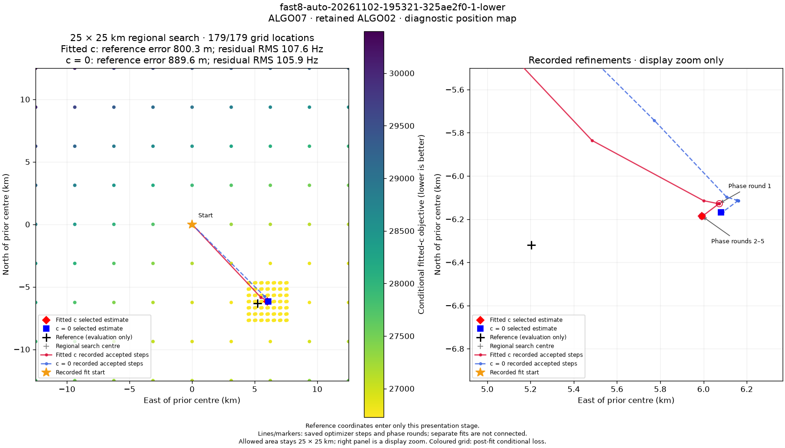

# ALGO07 position PNG with recorded optimizer paths

The standard position PNG now shows the saved path used to reach the published estimate. The left panel retains the full 25 × 25 km regional box and conditional-loss grid. The right panel magnifies the recorded refinements; it does not depict a smaller allowed search area.

For `fast8-auto-20261102-195321-325ae2f0-1-lower`, ALGO07 retained ALGO02. The fitted-c path starts at the regional centre, **37.906, −122.545**. Its first accepted move is to **(+5.484, −5.836) km**, relative to that centre. Phase round 1 ends at **(+6.072, −6.128) km**, round 2 at **(+5.993, −6.186) km**, and later rounds make negligible corrections. Both calibration arms have five saved phase rounds.

Red solid lines show recorded fitted-c steps; blue dashed lines show c=0 steps. The orange star marks a recorded fit start. The red diamond and blue square mark the published estimates. A black cross marks evaluation GPS, when a reference has been attached after inference. Coloured grid points are the previously published conditional loss samples, not optimizer iterates. The GPS error remains **800.3 m** for fitted c and **889.6 m** for c=0.

Only recorded history is displayed. Separate accepted fits and phase-round histories remain separate segments, without invented connecting steps. If only phase-round endpoints were saved, they are shown as endpoints. If a compact accepted result has no intermediate history, the zoom explicitly states that history was not saved. Rejected family-removal diagnostic positions are not joined to the published path.

The independent presentation revision is `optimizer-path-v6`. The verified [path JSON](position-path.json) binds the selected-model history to the scientific terminal, input, both ownership maps and the position PNG. The API serves it at `/api/v2/fast-scans/{run_id}/standard-analysis/position-path.json`. Existing grid data is reused for a presentation upgrade; no optimizer, satellite search, phase refresh or new RF scoring is run. The scientific result and seven other PNGs remain unchanged, and previous digest-qualified URLs continue to resolve.

Validation passed **40 component tests**. A read-only compatibility audit extracted histories from all **67** completed ALGO07 status records available at that check, with no extraction failures. Forty-one selected compact results lacked intermediate history; the renderer labels this honestly rather than fabricating a path. This compatibility check does not requalify their scientific fits. The deployment verification separately checks the validated scientific terminal for the example scan.

Production presentation code is deployed from commit `c40617908edda22084a3f7fba6d4d57db3a3b79a`. The [HTTP check](http-check.json) verified all eight current PNGs, image links across three prior revisions, the unchanged scientific result and grid scores, both recorded starts and both five-round histories. The [browser check](browser-check.json) decoded the two-panel 1680 × 960 position PNG, showed the unchanged evaluation errors and reported no page exceptions or HTTP failures. Scientific workers were left running unchanged.
