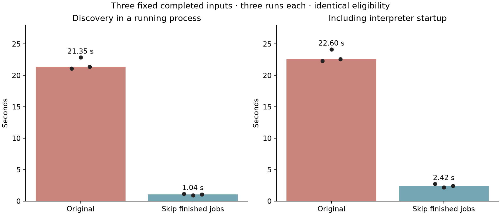

# ALGO07 runtime iteration 001: skip finished jobs before validation

Matched discovery time falls from **21.35 s to 1.04 s**, a **20.45×** reduction,
for three fixed already-finished source jobs. Including interpreter startup,
median wall time falls from **22.60 s to 2.42 s**, or **9.33×**. This is a
discovery improvement, **not** the tenfold end-to-end ALGO07 target.

## Change

ALGO04–07 watchers previously asked their upstream component to validate and
reconstruct every completed input, then checked whether their own corresponding
job was already finished. Nested terminal validation repeatedly decoded the
same ALGO02–06 evidence. The initial three-input profile reached 96 ALGO02
terminal-validation calls without finding any job needing processing.

The public upstream enumeration port now accepts an optional status-selection
predicate. After checking source status identity and completion cutoff, it can
skip an input whose downstream job is already finished. Watchers request this
selection explicitly. The predicate uses exactly the previous eligibility rule:
missing and running jobs remain eligible; completed, failed and unavailable
attempts remain finished. Status is read each time, so retries are not hidden by
a permanent cache.

Every included input still receives the original full validation. Terminal
reads and exports are unchanged. No scientific module, catalogue policy,
observation owner, solver setting, prior, gate, or public persisted schema was
changed. This deliberately avoids caching a supposedly valid terminal without
checking it when a consumer actually needs it.

## Matched benchmark

| Metric, median of three runs | Original | Pending selection | Speedup |
|---|---:|---:|---:|
| Discovery time | 21.347 s | 1.044 s | 20.45× |
| Whole worker process | 22.604 s | 2.422 s | 9.33× |
| User + system CPU | 22.523 s | 2.340 s | 9.62× |

The same three source-job IDs are explicitly selected through the public port in
all six trials. Run ordering alternates; both versions use Python 3.12, one BLAS
thread, nice level 10, and the same completion cutoff. Every run produces the
same empty eligible-job set and verifies the complete frozen reference afterward.
The original path reconstructs three finished inputs; the candidate correctly
avoids reconstructing them. [Raw rows and medians](matched-summary.json) retain
the selected IDs and per-trial measurements. The host also runs production
workloads, so these are small repeated measurements, not an isolated throughput
capacity study.

The earlier unrestricted candidate sample enumerated metadata across the current
upstream inventory. It is retained for diagnosis but is not used for the matched
speedup table.

## Correctness and accuracy evidence

- Storage tests compare original and optimized eligibility across all four
  recovery stages and all five relevant states. Needed corrupt inputs still
  fail validation; a finished job switched back to running becomes eligible.
- The existing lifecycle, export, contract-binding and watcher tests pass.
- [Saved-policy replay](policy-parity.json) exactly matches all **175 cases /
  350 calibration arms**, including selected identities, final coordinates,
  frequency objectives, counts and rejection reviews. The three accepted
  repairs remain DS26-0034, DS26-0066 and DS26-0251.
- All **707 frozen reference files** remain unchanged. The reference preserves
  the 15 unavailable upstream recordings in its accounting.

The policy replay uses saved numerical fits; it is **not a new numerical
inference run over DS26/27/28**. This iteration changes scheduling/discovery
only. Future numerical optimizations must additionally rerun the fixed scientific
benchmark and compare full native owner maps, endpoints, objectives and gates.

## Deployment design

The optional watcher `--worker-root` argument keeps each numerical worker on
its existing qualified release. It selects both that release's script and its
`PYTHONPATH`; otherwise a watcher overlay could accidentally redirect scientific
imports. Default launch behavior remains compatible with the existing CLI.

Rollout updates only idle analysis watchers, preserving active numerical jobs,
capture services, and their cadence. The frozen numerical releases and persisted
result namespaces are retained. Live rollout/CPU receipts will be recorded here
after activation. The old service configuration remains the rollback target.

## Next measurement

Measure idle CPU and queue discovery latency after rollout, then profile the
expensive two-family phase integration within numerical optimization. The
remaining overall speedup must be demonstrated from recorded data to published
position, separately from discovery, queueing and acquisition duration.
