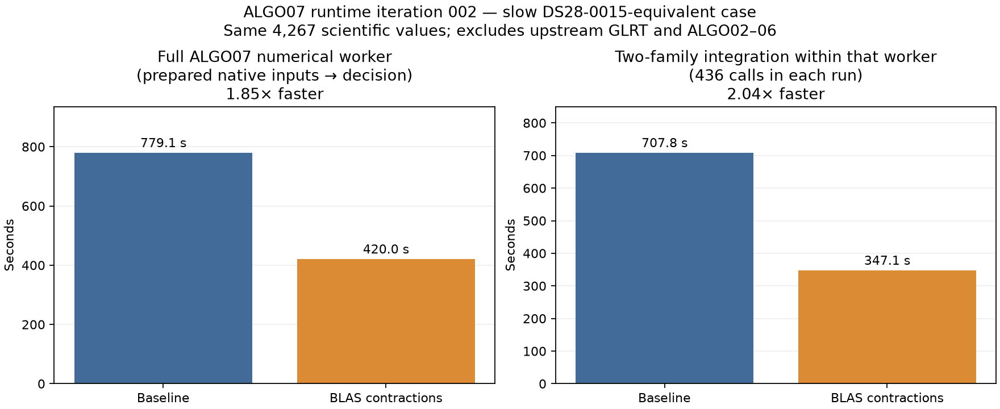
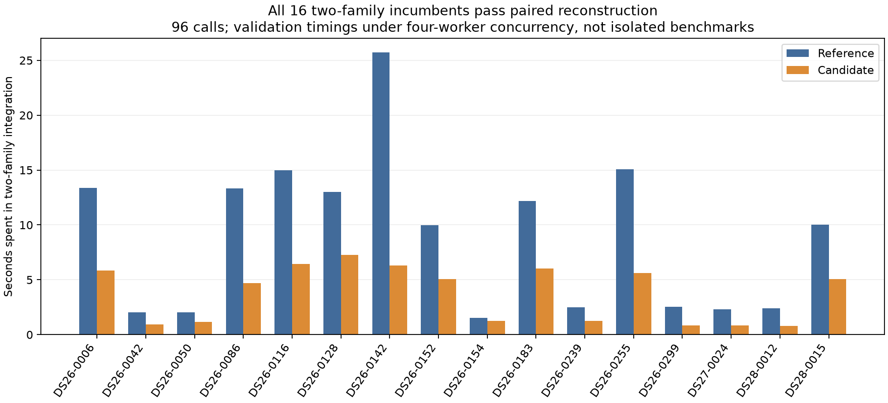

# ALGO07 runtime iteration 002: BLAS phase-pair contractions

A matched numerical replay of the slow additive scan falls from **779.06 to
420.00 seconds (1.85× faster)**. All **4,267 scientific values** across the eight
intermediate/result files match exactly, including RF family ranking, nominated
families, cavity optimizer histories, gate outcomes, and both final calibration
arms. Output directory paths and runtime measurements are excluded from that
comparison. This is an ALGO07 worker improvement, not a tenfold improvement from
IQ to position.

## What changed

Three `numpy.einsum` calls in `two_family_phase_evidence` now use `optimize=True`.
This permits NumPy's BLAS contraction path for cross-family orbit-mode products
and the two cross-family right-hand-side terms. Every phase pair, observation,
covariance, prior, visibility mask, chunk budget, and downstream solver/gate is
retained. The change does not factor the families into independent likelihoods.

The slow case contains two predictive families with 35 and 29 observations and
1,201 phases each: **1,442,401 phase pairs per likelihood evaluation**. The
original reconstruction profile attributed 9.80 of 12.62 seconds to six calls
to this routine. Its direct tensor contractions were a measured hotspot.

## Matched complete ALGO07 worker replay

| Measurement | Reference | Candidate | Ratio |
|---|---:|---:|---:|
| Process wall time, including imports | 779.063 s | 420.000 s | 1.855× |
| User + system CPU | 778.261 s | 419.794 s | 1.854× |
| Numerical orchestration | 771.669 s | 411.279 s | 1.876× |
| Two-family routine total | 707.847 s | 347.094 s | 2.039× |
| Two-family calls | 436 | 436 | identical |
| Investigated RF families | 59079, 67430 | 59079, 67430 | identical |
| Published outcome | exact ALGO06 fallback | exact ALGO06 fallback | identical |

The source is public completed job `1afa181f335df49bfa8906f9096f7b67`, with the
same 1,776 owned observations in both arms. It is the production counterpart
of the two-family DS28-0015 evidence. The saved production worker previously
took 753.13 seconds; the **matched 779.06-second replay**, not that historical
timing, is the comparison denominator.

Both replays used the same private relocated input snapshot, Python 3.12 and
locked installed NumPy/SciPy environment, one BLAS thread, nice level 10, and
cProfile instrumentation. They overlapped on separate CPU cores while production
continued. This is one matched full-worker pair, not a distribution of full
pipeline runtimes. The snapshot binds 2,833 input/reference files. Native input
and terminal checks use the public evidence port; neither trial writes into the
production namespace or reads QNAP.

[Full intermediate parity](full-replay-parity.json) finds **zero differing
floats**, not merely an unchanged fallback endpoint. All 2,833 frozen files remain
unchanged. Both guarded read audits pass with no denied paths. The initial
baseline receipt collector accidentally included the concurrently finishing
candidate's receipt; the corrected collector selects the recorded process tree.
The original failure receipt and [corrected audit](replay-baseline/audit-corrected/read-audit.json)
are both retained. No numerical inference was rerun or altered to repair that
bookkeeping error.

## DS26/27/28 numerical coverage

Of the 175 available paired reference cases, **16 use the two-family routine**:
13 DS26, one DS27 and two DS28. The others have fewer than two predictive
families in their reconstructed ALGO06 incumbent. The replacement operation does
not add a new predictive family.

All 16 were reconstructed independently with reference and candidate code,
including both calibration arms, in isolated exported research contexts. All
**96 captured calls** received byte-equivalent tensor values and passed the
predeclared comparison tolerances. Scores and MAP phase indices were exactly
equal. Maximum phase-marginal difference was **2.5535e−15**; maximum orbital
MAP coefficient difference was **7.0777e−16**. Each reconstruction also checks
saved RF objectives and native ownership against the original incumbent.

[Population results](population-reconstruction.json) preserve every case's
counts, timings, and differences. These are **new numerical incumbent
reconstructions**, not full reassociation/refit runs on all 16 scans. Their
timings were collected with four concurrent workers and reference-before-candidate
ordering; use them for validation and hotspot diagnosis, not a controlled
population speedup claim. DS26-0154's total reconstruction was slower despite
faster kernel time, illustrating why a component gain is not sufficient evidence
of end-to-end throughput.

The complete saved guarded-policy audit also replays all **175 cases / 350 c
arms** against the 707-file reference. That audit reuses saved numerical fits;
it is not another 175-scan inference campaign. The three accepted repairs and
all unavailable-case accounting remain unchanged.

## Reproducibility and rejected direction

- [Predeclared protocol](protocol.json) records tolerances before candidate
  measurement. Neither kernel nor full-worker comparisons required a relaxation.
- `tools/profile_algo07_numerics.py` snapshots through the public replay port,
  freezes inputs, launches guarded bounded runs, and captures real likelihood
  tensors. `tools/profile_algo07_research_snapshot.py` separately isolates
  historical research exports and follows verified receipt hash dependencies;
  it explicitly prohibits treating them as public production terminals.
- `tools/compare_algo07_runtime_replays.py` checks intermediate screens and
  optimizer records, so identical final fallback coordinates cannot conceal
  changed decisions. Component tests exercise that failure mode.
- All 16 targeted tests for the numerical kernel, profiler, snapshot adapters,
  and intermediate-result comparator pass.
- Input inventories and source receipts are published here; bulk native arrays
  remain in the immutable local benchmark snapshots. The public source and
  recorded hashes make missing or changed inputs detectable.
- A separate one-factorization Cholesky/triangular-solve prototype was **slower**
  than the existing NumPy solve plus determinant and is not adopted. The
  [five alternating comparisons](factorization-probe.json) preserve this result.
- Initial research snapshot attempts rejected missing historical receipt
  dependencies. The exporter now follows explicit digest edges and rejects
  changed bytes; it does not ignore missing proofs.

## Deployment and remaining target

The qualified numerical runtime is now live for ALGO07. The new composition is
`145ec0f3356b3f68619409f1ac12f382e9d7a7bf`, installed under
`/opt/leo-fast-graph-runtime-numerics/145ec0f3356b3f68619409f1ac12f382e9d7a7bf`.
It binds 2,160 files, retains the original release/manifests, and reuses the exact
tested Python/dependency installation. The service pins composition manifest
`bdd440ff16fe07f6d575cd1ec4d55c0ceb537df99bc9f040942d234a00d74c44`.
The [staging receipt](runtime-stage.json) and
[runtime composition design](../../docs/operations/algo07-runtime-release.md)
describe the explicit kernel and verification-entry-point differences.

An [installed production-entry-point canary](installed-canary.json), run as
the service account into a separate research output, completed in 490.27 seconds
including public export/preparation, with no failure and a verified read audit.
It reproduced the original incumbent and exact fallback position. Against the
qualified candidate replay, all 4,261 scientific leaves matched exactly; six
private path/hash provenance fields differed. Those hashes bind the actual local
exports, and their native observations, tracks and causal catalogue are identical.
Both the [raw comparison](installed-canary-parity.json) and
[provenance reconciliation](installed-canary-provenance.json) are retained.
This installed canary's timing has a different scope from the 420-second prepared
replay and is not used as a matched speedup measurement.

The watcher had no numerical child before activation. It was restarted at
**16:23 UTC on November 3**, with iteration 001's discovery adapter retained
and the new qualified worker root selected. The service is active; no running
numerical job was interrupted. [Activation receipt](runtime-activation.json).
The other numerical stages remain on their original releases. Eleven tests
cover the runtime verifier/stager and original production-worker behavior, in
addition to the 16 numerical/profiling tests above.

Rollback removes only `95-runtime-numerics.conf` from the ALGO07 systemd drop-ins,
reloads systemd, and restarts the watcher when no numerical child is active.
Iteration 001's `90-runtime-discovery.conf` then selects the prior worker root
without the new manifest environment pin. No scientific outputs are deleted.

The remaining work is to profile and reduce the remaining cost. Even after the
contraction improvement, the phase-pair
routine accounts for 84% of this worker's numerical orchestration. Upstream
GLRT and ALGO02–06 must also be measured and improved before claiming the user's
**10× overall** target.
