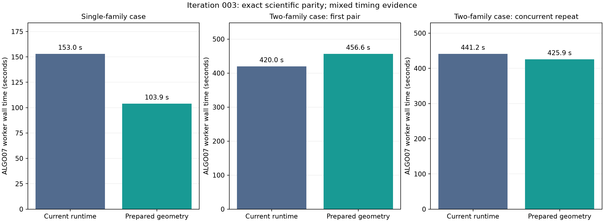

# ALGO07 runtime iteration 003: prepare fixed phase geometry once

The fixed-grid geometry optimization preserves every compared scientific value.
The single-family full-worker replay improves from **153.03 to 103.94 seconds**
(**1.47×**). The initial two-family comparison is slower, **420.00 to 456.62
seconds**, despite less interpolation work. The concurrent repeat improves from
**441.24 to 425.94 seconds (1.036×)**, with exactly equal scientific values and
almost identical time in the unchanged likelihood kernel. Every trial is
retained. This change is published as a measured candidate and **has not been
deployed**. Production continues to use the qualified iteration 002 composition.

The [comparison receipt](comparison.json) contains every pair, wall time, CPU
time, peak resident memory, kernel calls and exact-parity count. These are
prepared ALGO07 worker runs, not the entire GLRT-to-position pipeline.

## Mechanism and invariants

A `NewFamily` instance holds a fixed satellite orbit bank, orbital-mode bank,
observation times and phase quadrature grid. Interpolating and rotating those
states does not depend on the trial receiver position. Previously the code
repeated those operations for every position, and interpolated the nominal
states separately for CFO and orbital modes.

`PreparedPhaseGeometry` computes these states once, stores read-only arrays, and
repeats the existing position-dependent range-rate and orbital-mode projection
at each trial position. The arithmetic and reduction order of those projections
remain unchanged. Both single-family and joint-family predictions use this
object. It is local to a fixed family instance; no global cache is introduced.
History completion or a different quadrature grid constructs a new family.
Continuous phase refinement still uses the original dynamic interpolation.

The candidate retains every observation, causal TLE, orbital mode, nuisance
prior, phase grid, starting point, solver budget, acceptance gate and both
calibration arms. It neither changes the search nor learns from evaluation GPS.
The [predeclared protocol](protocol.json) requires **exact** scientific parity,
which is stricter than the shared comparator's default floating tolerances.

## Complete numerical replays

| Case and comparison | Baseline wall | Candidate wall | Scientific values |
|---|---:|---:|---:|
| Single-family public job `6940d22f1c98042bb2ac2de3c5665aed` | 153.032 s | 103.945 s | 4,185 exact |
| Two-family public job `1afa181f335df49bfa8906f9096f7b67` | 420.000 s | 456.621 s | 4,267 exact |
| Same two-family job, concurrent repeat | 441.242 s | 425.944 s | 4,267 exact |

The comparison includes eight intermediate/result JSON files per replay:
candidate screens, numerical objectives, optimizer histories, gates, ownership,
selected identities and both endpoints. All compared floating values match
exactly. Unchanged fallback coordinates alone would not pass this check.
Only execution times, output-root paths and the resulting protocol digest are
excluded. Both first replays preserve all frozen input files and pass their
process-tree read audits with no denied paths.

The single-family snapshot binds 1,716 files. Its orchestration falls from
144.95 to 97.40 seconds. Repeated `paired_phase_states` work falls from 32.64 to
2.24 seconds of profiler self time. It makes no two-family likelihood calls,
so iteration 002's contraction optimization did not address its main cost.

The two-family snapshot binds 2,833 files. It still performs exactly 436
two-family likelihood calls. That unchanged kernel consumed **347.09 seconds**
in the earlier baseline and **393.97 seconds** in the first geometry trial.
This variation exceeds the observed whole-worker regression. The profile is
consistent with changing host contention, but it does not by itself prove the
cause. The additional simultaneous baseline/candidate replay uses a separate
clean checkout of commit `1a8daab23` for the baseline, avoiding a kernel-only
reference switch that would leave the candidate geometry in place.

In that repeat, kernel time is **367.46 versus 367.51 seconds**, while total
orchestration improves from **433.06 to 417.35 seconds**. That comparison
supports the expected reduction outside the unchanged kernel. It establishes a
modest gain for this case, rather than the 1.47× seen in the single-family case.
The repeat also passes exact intermediate parity, frozen-input verification and
both guarded read audits. No earlier failed or slower trial is discarded.

All runs use the same installed Python/NumPy/SciPy, one BLAS thread, nice level
10 and cProfile. Production continues on the same 24-thread host. No production
job is interrupted or output replaced. Small differences under this shared load
should not be interpreted as population throughput improvements.

The prepared states retain additional memory. First-pair peak resident memory
changes from about **1,880 to 1,922 MiB** in the single-family case and **1,477
to 1,533 MiB** in the two-family case. These measured peaks include all worker
allocations; they are not a direct accounting of cache bytes. Raw KiB values
and repeated-pair measurements remain in the timing receipts.

## Broader scientific checks

The [population reconstruction](population-parity.json) covers all 16 frozen
DS26/27/28 cases with two predictive families, both c=0 and fitted-c. All **96
captured kernel calls** have exactly equal input tensors and output values
against iteration 002. Reconstruction objectives and native ownership match.
The captures and their digests are retained in the isolated benchmark folders;
this report publishes their receipts, summaries and digests. These checks are
incumbent reconstructions, **not complete reassociation on all 16 scans**.

The [saved-policy replay](policy-parity.json) passes **175 cases / 350 arms**
and verifies all 707 reference files. The same three guarded replacements are
selected. This separate policy audit reuses saved numerical fits; it must not
be reported as 175 fresh numerical runs.

All **27 component tests** pass, including projection at different sites and
altitudes, immutable input snapshots, changed-grid behavior, rejected
extrapolation, existing orbital-mode checks, dense predictive-likelihood oracles
and the joint-family kernel. Ruff and `git diff --check` pass. Golden fixtures
are unchanged.

## Separate factorization probe and next work

A diagnostic C implementation combines Cholesky factorization, solve and log
determinant for one captured batch of 27 × 1,201 six-dimensional systems. Seven
alternating comparisons show a roughly **2.46×** substep speedup. It differs from
NumPy by up to 3.84e−13 in coefficients and 3.00e−11 in quadratic values.
[Raw probe](compiled-factor-probe.json).

This compiled probe is **not adopted**, not called by the candidate, and has not
passed complete-worker validation. It adds no production compiler dependency.
The code and measurement are preserved to avoid losing an exploratory result
or confusing it with the exact geometry optimization.

The next measured opportunity is duplicate curved-calibration evaluation:
the single-family profile has 924 hierarchical-bound calls for roughly 464
predictive evaluations. Predictive attachment currently mutates the returned
dictionary, so naive caching would risk double-counting objectives. Any reuse
must preserve copy semantics and pass the same complete scientific comparisons.
Upstream GLRT and ALGO02–06 remain outside these worker speedups. The overall
**10× runtime goal remains open**.

## Publication and production boundary

[Implementation hashes](implementation.json), raw cProfile files, launch
receipts, frozen input manifests and reproduction scripts accompany this report.
Bulk radio arrays remain in the bound local snapshots. Publishing the source
does not alter immutable installed releases or their manifests. Any deployment
of this candidate requires a new explicit qualified runtime composition and an
installed-entry-point canary; the iteration 002 runtime remains the live one.
