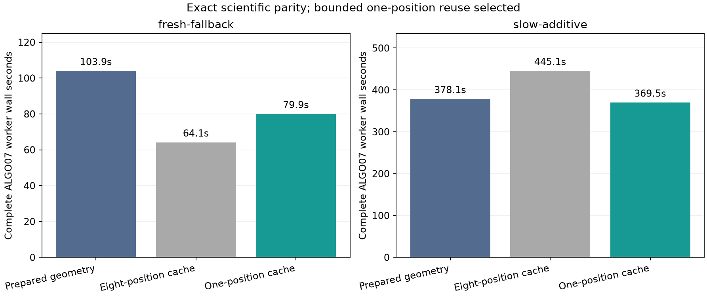
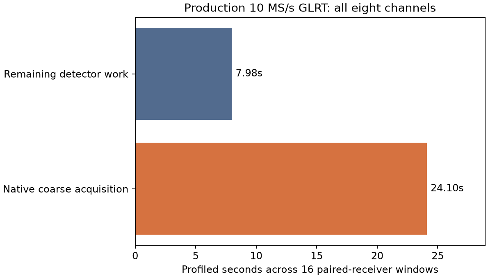

# ALGO07 runtime iteration 004: reuse curved calibration

The new one-position cache reduces the single-family prepared ALGO07 worker
from **103.94 to 79.95 seconds**, with **4,185 scientific values exactly equal**.
Curved-calibration evaluations fall from **924 to 464**. The cache retains only
the most recent position and returns an independent copy to each consumer.
The same observed points, causal catalogue, priors, solver budgets, identities,
gates, optimizer histories and both c arms are preserved.

All measurements and parity receipts are in [full-replays.json](full-replays.json).
These are prepared ALGO07 workers. They exclude upstream GLRT and ALGO02–06,
so they do not establish the **10× overall** target.

## Why the duplicated work existed

The outer position objective asks for curved calibration plus the incumbent's
predictive score. The satellite-family likelihood then asks for the same curved
calibration at the same position to condition receiver uncertainty. The previous
outer cache did not cache this shared inner calculation.

Predictive attachment mutates its result dictionary by adding objectives,
normalization terms and residuals. Reusing that dictionary directly would add
predictive evidence multiple times or leak changed coefficients into another
consumer. The new `copying_position_cache` stores a private result and returns a
deep copy on every request, preserving alias relationships within each copy.
The key includes the exact coordinate bytes, shape and dtype; it does not round
positions. It is scoped to one fixed problem. Different masks, priors, phase
references or models construct another problem, as the existing builders do.

Both ordinary predictive-linear attachment and event-aware attachment use the
cache. Conditional satellite refresh continues to consume independent curved
results. Exceptions are not cached. No persistent cache or global model state
is introduced.

## Cache size and timing variability

| Single-family trial | Wall time | Peak RSS | Curved fits |
|---|---:|---:|---:|
| Prepared geometry, no inner cache | 103.945 s | 1,968,524 KiB | 924 |
| Eight-position prototype | 64.052 s | 2,429,576 KiB | 460 |
| Selected one-position cache | 79.948 s | 1,937,040 KiB | 464 |

The eight-position cache retained substantially more memory. The one-position
variant recovers almost all calculation reuse and brings measured peak memory
below the prior baseline. The timing difference between those two trials is
larger than four extra curved evaluations can explain; runs share the live
host, so cache size alone is not assigned that entire difference.

In the first two-family comparison, the one-position candidate took **468.22
seconds**, versus an earlier **425.94 seconds**. Its curved-bound calls fell
**861 → 438**, while time in the unchanged phase-pair kernel rose **367.51 →
414.33 seconds**. This prompted the [recorded repeat plan](repeat-plan.json),
not a relaxed numerical gate. All initial timings are preserved, including the
slower trial and the eight-position prototype.

The repeat uses a clean checkout of baseline commit `85d933aad` and an
overlapping candidate run. An extra fresh-case repeat was launched accidentally
before the intended slow candidate; it was allowed to finish and is retained.
The starts were therefore staggered, and that extra run overlapped the early
part of the pair. [Execution note](repeat-execution-note.json). Production
continued throughout; the comparison is not a dedicated-host throughput test.

The overlapping two-family repeat improves **378.10 → 369.46 seconds**
(**1.023×**). Its unchanged phase-pair kernel takes **328.89 versus 329.46
seconds**, while curved-bound time falls **11.02 → 5.62 seconds**. All **4,267
scientific leaves** match exactly, both read audits pass, and all 2,833 frozen
files remain unchanged. The extra single-family repeat takes **66.63 seconds**,
retains 464 curved evaluations, peaks at 1,936,696 KiB, and also passes exact
4,185-value parity. This supports the one-position memory choice; it does not
turn the separate shared-host trials into a population speedup distribution.

## Scientific checks and qualification

The [predeclared protocol](protocol.json) requires exact intermediate numerical
values, not just unchanged fallback coordinates. Complete replay comparisons
include candidate screens, cavity optimizer histories, gates, owners, selected
identities and both endpoints. Only timings, output-root paths and the resulting
protocol digest are excluded. Every replay must also pass frozen-input and
process-tree read-audit checks.

All **16 DS26/27/28 paired incumbent reconstructions** pass, with exact equality
of all **96 captured input tensors and kernel outputs**. Their associated counts
and saved objectives match. [Population evidence](population-parity.json).
These are new reconstructions, not full reassociation of every scan.

The separate [175-case / 350-arm saved-policy audit](policy-parity.json) also
passes, verifies all 707 frozen reference files and retains the same three
guarded replacements. It reuses saved fits and is not a 175-scan numerical rerun.

All **31 targeted tests** pass. They cover independent nested output copies,
exact coordinate keys, bounded eviction, exception handling, model separation,
ordinary and event-aware predictive attachment without double counting, the
existing predictive and phase-pair numerical oracles, native fixture selection,
and release verification. Qualified-source changes or non-exact replay evidence
are rejected by the runtime stager. Golden fixtures remain unchanged.

## Upstream GLRT profile

The installed native fast worker processes **10 MS/s** recordings. The older
fast-scan adapter in this checkout does not describe that production path.
The new `tools/profile_algo07_glrt.py` explicitly selects the installed worker,
exports verified paired-receiver windows through its public source ports, and
freezes the exported IQ plus installed Python/native-library bytes.

The first fixture contains **16 windows, two randomly selected within each
channel**, seed `20261103`, from lower-band recording
`fast8-auto-20261103-152850-3c3fb941-1-lower`. It freezes 370 files. Selection
keeps both receivers together, uses only already-processed windows, and does not
use position error. The reader is exhausted so complete compressed-chunk
validation still runs. Bulk IQ arrays stay in the isolated local snapshot.

Detector execution took **32.076 seconds**; native coarse acquisition accounted
for **24.096 seconds (75.1%)**. Whole-process time including imports and profiling
was **34.231 seconds**. Every published fractional candidate field matched
exactly for all sampled windows. [Result](native-glrt/baseline/result.json),
[profile](native-glrt/baseline/profile.pstats), [frozen inventory](native-glrt/frozen.json).
This is a bounded hotspot measurement, not a full-scan GLRT run or a localization
accuracy comparison.

The repository already contains a 12-lane register-accumulation/CFO-tiling
implementation absent from this installed native worker. Its next evaluation
must preserve production's peak-retention implementation, all scientific CFO
rows and candidates, and compare against the frozen native outputs. The older
installed and current repository modules differ in more than this kernel, so
copying the whole acquisition module would mix unrelated changes.

## Production composition

The `prepared-calibration` qualification in `tools/stage_algo07_runtime.py`
binds the eight explicit geometry/cache files to
[implementation hashes](implementation.json), checks their original installed
hashes, and requires the complete replay, population and policy evidence.
It also retains the already-qualified iteration 002 contraction kernel and the
original worker/contract. It never overwrites the old release or manifests.

Staging and service activation are separate. The installed entry point must
pass a private canary before the watcher can use the new composition, and the
watcher must have no active numerical child before restart. Activation evidence,
when completed, is recorded separately; the existence of this report alone is
not a deployment receipt.
