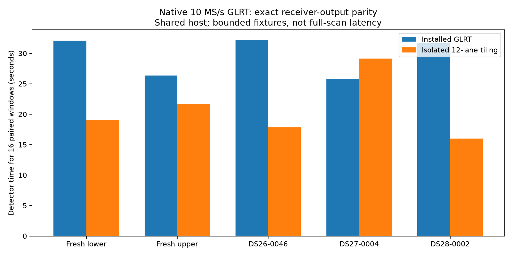
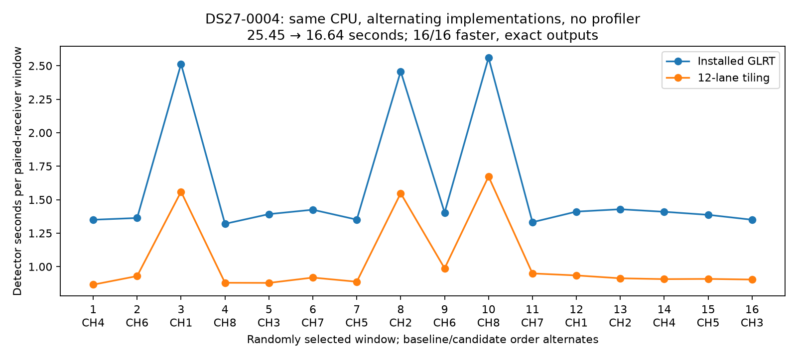

# ALGO07 runtime iteration 005: native GLRT CFO tiling prototype

An isolated 12-lane CFO-tiling prototype preserves **all 160 receiver outputs
exactly across 80 paired windows** from five 10 MS/s recordings. The controlled
DS27 repeat reduces detector time **25.45 → 16.64 seconds (1.53×)**, with every
sampled window faster. This is a promising GLRT component optimization; it is
**not deployed**, and it does not establish the tenfold whole-pipeline target.

## Why this change

The preceding iteration measured native coarse acquisition at 75.1% of detector
time. Production's 21-frequency search uses a general native kernel. The
repository already contains a specialized 12-lane AVX2/FMA implementation which
retains accumulators in registers. The prototype partitions the same scientific
frequency grid into 12-lane execution tiles, pads the final tile with discarded
duplicates, and returns every original scientific row in order.

The installed worker differs from current repository code elsewhere, including
peak retention. The [builder](build_prototype.py) copies that installed worker
to an isolated research directory, replaces only the native-grid Python
function, compiles the two existing C sources with the installed Python/NumPy,
and verifies that exactly four files differ: the wrapper, C kernel, included
kernel template and compiled extension. Production's heap peak selection,
refinement, thresholds, searched frequencies and receiver processing are
preserved. [Complete build inventory](prototype-build.json).

The native kernel's established synthetic-grid oracle permits `1e-12` floating
differences because explicit FMA can round differently from the generic loop.
It also checks winning epochs. For real-window qualification here, the stronger
gate is **exact equality of every receiver output**, including candidates that
do not become published GLRT points. No candidate tolerance was relaxed.

## Bounded fixtures and results

Each fixture contains two randomly selected whole paired-receiver windows per
channel, covering all eight channels. Seed `20261103` is recorded. The first
two recordings are fresh lower/upper examples. One scan from each frozen cohort
was then sampled from available 10 MS/s tracking evidence, using no position
error or signal-score selection. Cohort eligibility is 157 DS26, 14 DS27 and 15
DS28 scans; unavailable tracking evidence remains excluded explicitly.
[Cohort selection](cohort-selection.json), [replay driver](run_cohort_windows.py).

Snapshots use the installed public source reader, exhaust it to complete chunk
verification, freeze the IQ and implementation bytes, and compare to published
candidate evidence. Baseline and candidate additionally match each other in
the full receiver output. IQ stays in isolated local storage; metadata, hashes,
outputs and profiles are published here. All frozen inputs and original/candidate
source bytes pass verification. [Collected results](results.json).

| Fixture, 16 paired windows | Installed detector | Tiled detector | Ratio |
|---|---:|---:|---:|
| Fresh lower | 32.076 s | 19.093 s | 1.680× |
| Fresh upper | 26.374 s | 21.679 s | 1.217× |
| DS26-0046 | 32.241 s | 17.856 s | 1.806× |
| DS27-0004, initial trial | 25.855 s | 29.162 s | **0.887×** |
| DS28-0002 | 31.683 s | 15.978 s | 1.983× |

These are serial fixture trials on a shared production host. Timing uses the
detector interval, excluding imports and fixture loading; profiler overhead is
included in this table. Process time, peak memory and host load are retained in
each trial's timing/launch receipt. The ratios are not a full-scan throughput
distribution and should not be multiplied by ALGO07 worker speedups.

## Investigating the slower DS27 trial

DS27's initial candidate run is retained above. Its unchanged sinc and
conditioned-frame routines were also slower. That suggested a host timing
effect but did not prove one. A separate fresh-lower repeat yielded
**27.309 → 17.994 seconds (1.518×)** with exact outputs.

For DS27, [a controlled repeat](paired_windows.py) keeps independent installed
and candidate processes alive, pins both to CPU 0, alternates which implementation
runs first for each saved window, and excludes import/IQ-load time. It does not
run the two implementations concurrently and does not use cProfile. Production
continues on the host. This reduces **25.454 → 16.643 seconds (1.529×)**; all 16
windows are faster and full outputs remain exactly equal.
[Per-window measurements](DS27-alternating.json).

This supports a computational benefit on the same data. It does not retroactively
invalidate the slower observation or establish dedicated-host performance.

## Regression checks and deployment boundary

All **31 targeted tests** pass, including native tiled/unpartitioned grids across
1.25, 2.5, 5 and 10 MS/s, acquisition behavior, and preservation of unrelated
peak-selection code during the build. [Test output](tests.txt).

The **175-case / 350-arm saved-policy audit** also passes and verifies all 707
frozen scientific-reference files, retaining the same guarded replacements.
[Policy audit](policy-parity.json). This is saved-policy replay; it is not fresh
GLRT or position inference across those 175 scans. Position errors and c=0 versus
fitted-c objectives have therefore not been recomputed for this GLRT prototype.

Production GLRT remains unchanged. Deployment still needs a complete-scan
candidate-inventory comparison through localization and a qualified immutable
native-worker package. The sampled outputs cannot prove every untested window
has identical gate behavior. No new RF collection was performed.

## Next measured opportunities

1. Complete a bounded full-scan GLRT comparison and downstream replay, retaining
   both c arms, owners, satellite identities, objectives and gate decisions.
2. Profile the earlier recovery stages. Installed ALGO03 still uses the original
   phase-pair kernel with SHA-256
   `dbf7f397753cf91f764c75630e208bb2162a5ce9e2c69305537ce8ba53385065`,
   byte-identical to ALGO07's former kernel. Iteration 002's contraction change
   is therefore a concrete candidate for that stage, subject to separate complete
   ALGO03 replay qualification. It has not been applied there yet.
3. Measure the full recorded-IQ-to-position chain after qualified changes.
   Acquisition time and queue delay must remain separate from active computation.

The production change completed during this turn is the separately qualified
[prepared-calibration ALGO07 runtime](../2026_11_03_algo07_runtime_iteration004/README.md),
not this GLRT prototype.
