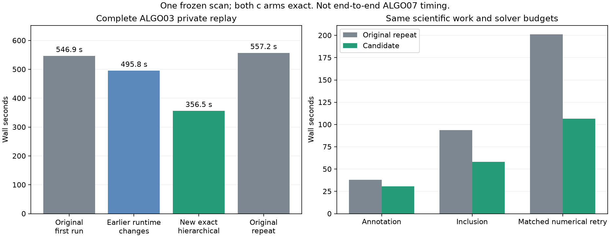

# Runtime iteration 007: remove discarded solves and prepare matrix indexing

The new private ALGO03 recovery replay completed in **356.49 seconds**, with
**117 scientific JSON files and 2,714,225 values exactly matching** the original
runtime. Both c=0 and fitted-c, satellite identities, native owners, objectives,
optimizer histories and intermediate nominations are preserved. This is one
complete recovery-stage replay, not the end-to-end ALGO07 pipeline.

The repeated original runtime took **557.20 seconds**, versus **356.49 seconds**
for the candidate: **1.56× faster, 36.0% less elapsed time**. The original first
run took 546.88 seconds and the earlier prepared/cache composition took 495.77
seconds. All four timings are retained. The first original and earlier candidate
runs overlapped the native full-scan replay; neither the new candidate nor the
original repeat overlapped that replay. Production remained active throughout.

| Run | Wall time | User + system CPU | Peak child RSS |
| --- | ---: | ---: | ---: |
| Original, first | 546.88 s | 545.57 s | 1,857,752 KiB |
| Earlier prepared/cache composition | 495.77 s | 486.53 s | 2,013,456 KiB |
| New exact hierarchical candidate | 356.49 s | 355.07 s | 2,007,164 KiB |
| Original, repeat after candidate | 557.20 s | 554.83 s | 1,858,052 KiB |

## Measured bottleneck and changes

Nonblocking sampling of the earlier annotation worker found most time in
training fits and their hierarchical posterior calculations. Reusing training
fits across targets is not generally valid: random partitions depend on the
target's timestamps. That shortcut was not implemented.

Two exact changes address measured repeated work:

1. `JointMarginal.calculate(..., geometry_only=True)` builds the same geometry
   and performs the original input validation without computing a Gaussian
   posterior that the hierarchical caller immediately replaces. The ordinary
   Gaussian calculation remains the default. No prior or observation changes.
2. `hierarchical_bound` prepares block index arrays and the identity matrix once
   per likelihood evaluation. It computes the determinant only for the final
   posterior, where it is used. Matrix arithmetic, iteration limits, convergence
   threshold and final determinant arithmetic remain unchanged.

The changes are composed on top of the previously qualified contraction,
prepared-geometry and one-position cache implementations. The three new files
are explicitly identified as experimental in the private runtime manifest.
Neither this ALGO03 composition nor the triangular experiment is deployed.

## Numerical checks

The exact comparator verifies all bound runtime files and result source hashes,
requires both calibration arms and complete process read receipts, and checks
all scientific JSON files. It ignores timing/process accounting and normalizes
private output paths. It does not ignore frequency scores or endpoint changes.
The original and candidate runtime inventories contain 2,046 and 2,050 files.

Eight captured real likelihood calls, each with 2,757 observations and 189 or
190 nuisance coordinates, also match exactly. Five alternating-order repeats
give summed median times **0.18195 → 0.16574 seconds** for the matrix-setup change
alone. The captured arrays, implementation hashes and timings are published in
this report for reproducibility; they contain no raw IQ.

The frozen saved-policy audit passes all **175 cases / 350 arms**, retains the
same three guarded replacements and verifies all 707 frozen reference files.
This audit reuses saved fits; it is not a fresh 175-scan numerical rerun.

All **16 DS26/DS27/DS28 paired incumbent reconstructions** also pass, with exact
equality of **96 captured likelihood input tensors and kernel results**. This
is fresh reconstruction under the changed code, not a full reassociation and
position optimization for all 16 scans. See
[population parity](receipts/population-parity.json).

A complete prepared ALGO07 single-family replay also passes: **4,185 exact
scientific values across eight files**, zero differing floats, a complete read
audit and all 1,716 frozen inputs unchanged. It took 69.57 seconds while some
population reconstructions overlapped it. The prior one-position-cache trials
took 79.95 and 66.63 seconds, so this does **not** establish a further speedup of
that final stage. See [parity](receipts/algo07-fresh-parity.json) and
[timing](receipts/algo07-fresh-timing.json). The slower two-family full replay is
the next outstanding check.

Component-owned CLI, provenance, Gaussian geometry, posterior and reconstruction
tests pass: **28 tests**. Ruff and whitespace checks pass. Input validation is
explicitly tested even when the discarded Gaussian posterior is skipped.

## Alternative tested but not included

Replacing general linear solves with triangular solves took **0.20941 → 0.13908
seconds** on the same eight calls in a separate alternating-order run. It did
not meet the predeclared exact-equality requirement. The largest conditional
frequency residual difference was 3.38e-8 Hz; objective difference was 2.55e-11.
Those differences are small, but that experiment has not passed full optimizer
and association checks and is kept separate from the selected exact candidate.

## Profiling and reproduction

The `algo07_profile sample` CLI now attaches a bounded nonblocking sampler to one
live private research child. It records process identity, raw stacks, parse
errors and a sampler log without injecting Python into the worker. A 20-second
sample of this candidate's inclusion fit collected 1,975 valid stacks; py-spy
reported 24 read errors and no corrupted stack rows. Both this candidate and the
earlier prepared-runtime trial had a 20-second sampling interval. The original
baseline runs did not. These are shared-host measurements, not a dedicated-host
throughput study.

The new comparator, likelihood capture/replay tool and population reconstruction
runner are described in the updated profiling skill and benchmark protocol.
The report's `collect_results.py` collects every timed trial, including the
original-runtime repeat, and renders the figure without selecting the fastest
trial. Raw full worker outputs remain in the private benchmark directory.

## Remaining qualification and overall goal

The **10× overall target is not established**. GLRT, ALGO02, ALGO03–07 and
publication must be measured together on matched inputs; component speedups
cannot be multiplied. This iteration adds stage-level evidence and exact
optimizations. Broader full-worker validation and an immutable production
composition remain necessary before deploying these new changes.
