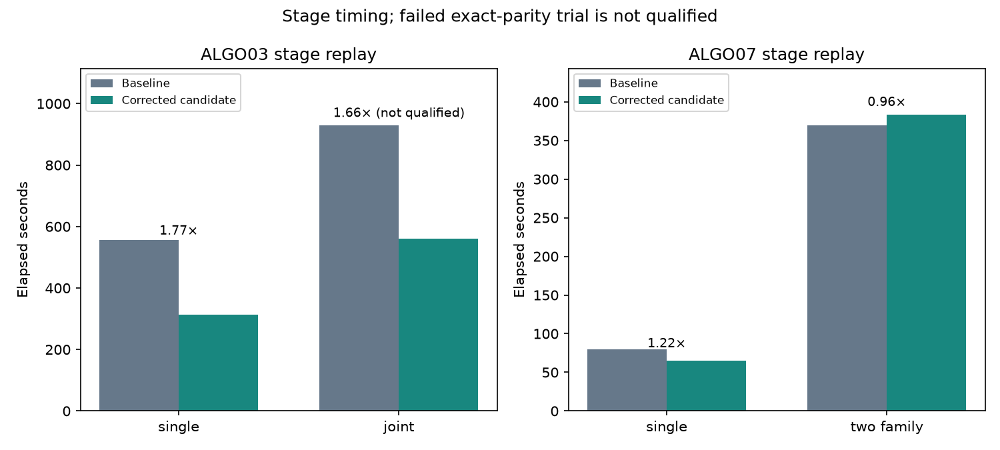

# Runtime iteration 008: cache correction and an exact-parity blocker

This iteration corrects a stale geometry cache uncovered by a new, independent
joint-family recovery replay. It extends the exact hierarchical optimization
from [iteration 007](../2026_11_03_algo07_runtime_iteration007/README.md).
The corrected composition is **not deployment-qualified**: a new joint-family
case exposes tiny diagnostic differences from the previously optimized tensor
contractions. The tenfold whole-pipeline target remains unachieved.

The [measurement table](measurements.json) separates ALGO03 recovery from the
final ALGO07 worker. The original ALGO03 implementation is the recovery baseline;
the already optimized iteration004 implementation is the final-worker baseline.
These speedups have different denominators and must not be multiplied together.

| Stage and case | Baseline | Candidate | Ratio | Exact scientific comparison |
|---|---:|---:|---:|---|
| ALGO03 single family | 557.20 s | 313.98 s | 1.77× | Pass: 2,714,225 values |
| ALGO03 joint families | 928.94 s | 559.90 s | 1.66× | **Fail: 12 tiny diagnostic differences** |
| Final ALGO07 single family | 79.95 s | 65.31 s | 1.22× | Pass: 4,185 values |
| Final ALGO07 two families | 369.46 s | 383.18 s | 0.96× | Pass: 4,267 values |

The last case provides no additional final-worker speedup. The unqualified joint
timing must not be presented as a production-ready performance gain.

## What failed and why

`NewFamily.geometry` originally prepared interpolated orbit states once per
family. That assumption was incomplete: `audit_two_predictive_families.at_phases`
shallow-copies an evaluated family, replaces its banks and phase grid, and then
evaluates one endpoint. The copy inherited prepared states for the entire
integration grid. In the real replay, 481 phases × 27 observations produced
12,987 cached frequency values where 27 were required.

The first candidate's joint c0 audit raised a broadcast error. Its 385.90-second
completion was therefore **not a valid speedup**. The failed audit, traceback and
timing are retained under [receipts](receipts/rejected-cache-audit.json). The
original baseline completed that audit successfully and took 928.94 seconds for
the complete recovery.

The corrected cache binds the exact time, label and phase grids and the orbit
buffer identities. It retains references to prevent identity reuse. Copied or
edited grids and replaced orbit arrays trigger reconstruction; moving the
receiver with unchanged inputs still reuses interpolation. Orbit buffers remain
fixed inputs: changed histories replace arrays, rather than editing them in
place. No priors, candidate sets, gates, quadrature or optimizer budgets change.

The direct reproduction returns 12 rows instead of 4 with the old implementation
and exactly 4 with the correction. Regression tests exercise the actual audit
copy function, same-shape grid edits, bank replacement, reuse across positions,
and exact agreement with uncached frequency, elevation and orbit-mode calculations.

## Why the corrected runtime is still unqualified

All final positions, association choices, gates and objective values in the joint
replay match. Twelve stored comparisons differ in phase-probability tails or
orbital posterior coefficients; some are repeated summaries of the same values.
The largest absolute difference is 6.94 × 10⁻¹⁸. This is not evidence of a
localization regression, but it violates the predeclared zero-tolerance gate.

An identical-input diagnostic ran the original and optimized contraction kernels
on ten actual joint likelihood inputs. Three calls reproduce the probe's exact
differences: one probability-tail difference of 1.26 × 10⁻¹⁶⁸ and two posterior
coefficient differences of 6.94 × 10⁻¹⁸ and 2.17 × 10⁻¹⁹. This isolates the
contraction-order optimization, rather than the corrected geometry cache.
[Kernel comparison](receipts/identical-input-kernel-comparison.json) and the
[first differing input tensors](receipts/first-kernel-difference.npz) are retained.

The original comparison additionally reported 44 duplicated remaining-time
differences. Both runs had the same 1,200-second overall budget; faster execution
left more time available for later stages. The revised comparator records these
separately only when both stages completed normally before either deadline.
It still rejects the 12 numerical differences. Runtime-source receipts, including
relative source paths used by joint retries, are verified against each explicitly
pinned runtime manifest. Changed or unbound source receipts remain errors.

The next isolated composition retains the original contraction implementation
and keeps the geometry and hierarchical-solve improvements. Full single- and
joint-family replays were launched into new `original-contractions` directories;
their results are not claimed here. The numerical tolerance is unchanged.

## Scientific checks

The two ALGO03 cases cover single-family and joint-family recovery, including
both c=0 and fitted-c, intermediate nominations and memberships, endpoint audits,
retry stages and optimizer histories. Comparisons require exact values and
matching scientific file inventories. Runtime accounting and relocated paths are
handled separately; source hashes and process read ancestry are independently
validated. Pinned original and candidate runtime manifests bind implementation
bytes. The joint case was chosen by completed recovery type and target count,
without selecting on position error.

Two additional full ALGO07 final-worker replays cover single- and two-family
cases. The 16-case DS26/27/28 reconstruction benchmark compares 96 likelihood
calls and their input tensors exactly. The 175-case, 350-arm saved-policy audit
preserves identities, decisions and endpoints. These last two checks are **not**
175 fresh end-to-end position fits. All replay input inventories remain unchanged.

[Qualification](qualification.json), [cache source binding](cache-fix.json),
[regression checks](regression.json) and the receipts provide the detailed scope.
No change in position accuracy is inferred from a faster or lower likelihood
score; the scientific values themselves must agree.

## Timing limits and next deployment step

Runs use the original locked Python dependencies, one BLAS thread, nice level 10,
and the existing bounded worker budgets on a shared production host. Launch
receipts retain host load and commands. Candidate runs overlap independent
replays; neither these corrected runs nor the joint baseline were externally
sampled. These are stage measurements, not an isolated-host throughput study.
Differences from earlier candidate timings should not be attributed entirely to
the cache fix.

The faulty ALGO03 composition was a private research prototype. Production ALGO03
remained on the original implementation throughout these tests. The final ALGO07
worker also uses the shared geometry code, so its complete replays are included;
its normal family reconstruction creates new families rather than using the
joint endpoint audit's shallow-copy operation.

The staging tool preserves the prior qualification's exact source bytes, applies
the separately qualified cache correction, and requires successful single/joint
replays tied to the corrected runtime manifest. This report's qualification has
`passed: false`, so staging must reject it. No service was changed. An exact-parity
resolution, installed canary and controlled activation remain required before deployment.
Native GLRT and the upstream graph-localization stages remain separate targets
for progress toward the tenfold whole-pipeline objective.

To regenerate this report's receipts and figure after the named comparisons
have completed, run `collect_results.py` with the analysis Python environment.
The collector refuses incomplete trials and records scientific failures without
qualifying them.
