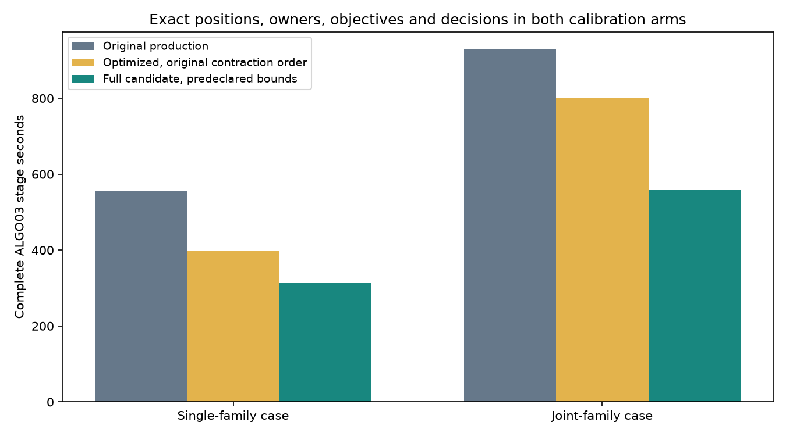

# Runtime iteration 009: ALGO03 qualification under the original numerical contract

The corrected, optimized ALGO03 recovery takes **314 versus 557 seconds** in the
single-family case and **560 versus 929 seconds** in the joint-family case.
Both calibration arms preserve positions, observation owners, associations,
objectives, gates and optimizer histories exactly. Twelve serialized posterior
diagnostic values differ by at most **6.94 × 10⁻¹⁸**, within the bounds registered
before the original contraction optimization. These are stage gains of **1.77×**
and **1.66×**; the tenfold whole-pipeline target remains open.

## Correcting the qualification interpretation

[Iteration 008](../2026_11_03_algo07_runtime_iteration008/README.md) correctly
retains a failed bit-for-bit comparison. Its conclusion that the tiny differences
blocked qualification was stricter than the original scientific protocol.
Reviewing the actual [predeclared iteration002 protocol](receipts/predeclared-kernel-protocol.json)
showed that floating-point differences from BLAS contractions were already
explicitly permitted. The original 16-case qualification also reported nonzero
posterior differences; it did not claim every diagnostic was bit-identical.

This report does not replace or loosen that protocol. The additional assessment
accepts only the two diagnostic fields that differ: phase marginals, with the
original absolute limit 10⁻⁸, and orbital MAP coefficients, with limit 10⁻⁶.
It requires all other scientific fields to match exactly, including objectives
and positions, which is stricter than the original protocol for those fields.
The largest observed orbital difference is over eleven orders of magnitude below
its bound. The strict failure is retained beside the contract assessment.

The assessor verifies the original protocol's SHA-256, accepts no nonfinite
values or unrelated differences, and records every tolerated value. The staging
tool reconstructs the assessment from the committed strict receipt and pinned
protocol rather than trusting a `passed` flag. Modified source hashes, unmatched
runtime manifests, missing calibration arms and incomplete replays remain errors.

## Independent checks and the original-order alternative

The geometry-cache correction and hierarchical optimizations were also replayed
with the original contraction code. Both original-order full-recovery comparisons
must be exact before this report's collector creates a qualification receipt.
Their timings are shown separately in [measurements](measurements.json); the
faster, previously qualified contraction implementation is the proposed release.

For all 16 DS26/27/28 numerical reconstruction cases, the original-order trial
matches the original-kernel reference exactly, including 96 calls and their
input tensors. The first comparison mistakenly used the optimized-kernel
reference and therefore rediscovered the already documented floating-point
differences. [That comparison](receipts/cross-kernel-strict-comparison.json) is
preserved; [the corrected reference comparison](receipts/original-order-population-parity.json)
reuses the same completed trials, without rerunning or modifying their results.

The proposed optimized composition also passes the previous iteration's exact
16-case comparison against the optimized reference, the 175-case/350-arm saved
policy audit, and both complete final ALGO07 worker replays. These are distinct
validation scopes, not 175 fresh end-to-end position fits. All frozen inputs and
guarded process read audits remain valid. No GPS, TLE, candidate, prior, phase
grid or optimizer-budget changes are introduced.

Both original-order trials and the faster trials ran on the shared production
host with one BLAS thread and the existing bounded budgets. They are not an
isolated-host timing distribution. The final two-family ALGO07 worker showed no
additional speed gain in iteration008; this deployment targets upstream ALGO03
recovery rather than claiming another improvement to that final stage.

## Release scope

Sixteen focused assessor, release-verifier, prototype, comparator and population
tests pass. Ruff and whitespace checks pass for this iteration. These checks
supplement the earlier 29 cache/regression tests and the numerical replays above.

The composed runtime keeps the installed ALGO03 scientific manifest and locked
Python dependencies. Explicit numerical overrides are bound to the tested
candidate manifest. The corrected geometry cache is separately bound to its old
and new source hashes. The production entry point verifies the full composition
before and after the guarded worker. The failed iteration008 qualification
remains unchanged.

An installed production-entry-point canary and idle-watcher activation are the
remaining deployment steps at initial publication. No running numerical job may
be interrupted. Deployment receipts will be added after those steps complete.
The final ALGO07 worker and native GLRT services are not changed by this release.

Regenerate the collected receipts and figure with `collect_results.py` after all
named comparisons exist. A missing or failing required result prevents a
qualification file from being emitted.
