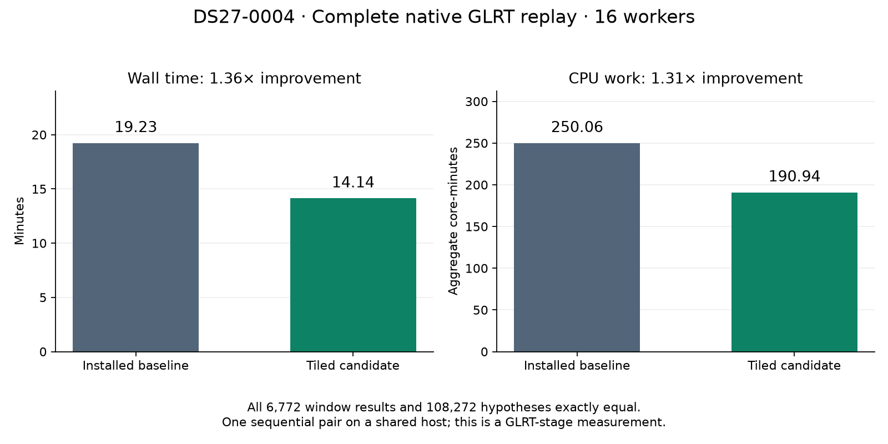

# Full-scan native GLRT qualification: 1.36× faster with exact hypotheses

The matched full-scan native replay improves **1,154.046 → 848.122 seconds
(1.36×)** with all **6,772 windows, 13,534 receiver results and 108,272 hypotheses
exactly equal**. Aggregate CPU work decreases **23.64%**. The downstream
localization replay is running; the tiled GLRT candidate has **not been deployed**.
This is a native-stage speedup, not a measured end-to-end ALGO07 speedup.
The tenfold ALGO07 objective remains open.

The prior native experiments showed a promising detector improvement, but the
first completed candidate trial used eight workers.
Current production uses sixteen GLRT workers. This comparison ran the
original and tiled implementations sequentially, each with sixteen workers and
an 1,800-second bound, over the same frozen DS27-0004 recording. The original
runtime frozen for this experiment is byte-identical to the current production
native worker. Production continues running, so host contention remains a
measurement limitation; CPU time and launch load are retained separately.

| Complete DS27-0004 native replay | Installed baseline | Tiled candidate | Improvement |
| --- | ---: | ---: | ---: |
| Wall seconds | 1,154.046 | 848.122 | 1.36× |
| Aggregate subprocess CPU seconds | 15,003.471 | 11,456.147 | 1.31× |
| Peak child RSS, KiB | 289,328 | 289,036 | Comparable |

[Matched full-output comparison](receipts/full-native-matched-parity.json),
[candidate timing](receipts/candidate16-timing.json),
[candidate range results](receipts/candidate16-result.json),
[candidate launch](receipts/candidate16-launch.json),
[figure source](render_runtime.py).

## Stronger scientific comparison

`tools/compare_full_glrt_replays.py` compares the complete native result for every
window. This includes scores, every receiver hypothesis, fractional refinement,
gate decisions, acquisition metadata and invalid-window reasons. It checks the
frozen input/runtime files, launch identity, successful termination, segment
coverage and ordered visit inventories before comparing. Missing or duplicate
windows fail validation. Nonfinite numeric leaves fail equality. Timing ratios
are withheld if workers, interpreter, host, thread settings, profiling or replay
script differ. No tolerance is introduced.

The checker compared the original sixteen-worker baseline with the previous
eight-worker candidate over their complete inventories:

| Evidence | Count |
| --- | ---: |
| Native windows | 6,772 |
| Processed windows | 6,767 |
| Receiver results | 13,534 |
| All receiver hypotheses, including unpublished candidates | 108,272 |

There are **zero differences**, including unpublished hypotheses, gate fields,
scores and invalid windows. All **708 frozen runtime/input files** verified.
[Complete native parity receipt](receipts/full-native-exact-parity.json).
The eight-worker candidate's 1,436.036-second wall time must not be compared
directly with the sixteen-worker baseline to claim a kernel speedup; the checker
explicitly records `matched_timing_configuration: false` and no speed ratio.

The baseline processed all 6,767 valid windows and five invalid windows. Detector
CPU time was 14,954.348 seconds; total subprocess CPU time was 15,003.471 seconds.
[Baseline timing](receipts/baseline16-timing.json),
[range results](receipts/baseline16-result.json),
[launch configuration](receipts/baseline16-launch.json).

Eleven component tests pass, including changed unpublished hypotheses, invalid
window reasons, missing windows, duplicate ranges, timeout, extra unfrozen code,
nonfinite values and mismatched worker counts. Ruff passes for the new tool and
its tests. The profiling skill and benchmark protocol now describe this check
and the production-matched concurrency.

## Downstream reference

The public ALGO02 analysis export port supplied the completed analysis for this
same native recording. Its 23 analysis files plus descriptor are now frozen in
the private benchmark directory. This preserves both calibration arms, the
original causal preparation and the terminal reference without rebuilding a
catalogue from today's archive.

The historical terminal records preparation at 30.978 seconds, ALGO02 fitting at
209.875 seconds and family comparison at 53.871 seconds. These are historical
stage timings, not a new matched run. Exporting the analysis does not rerun
localization. Its stored results must remain reference evidence, never feed
the optimizer as answers.

The new `tools/profile_algo02_prepared.py` adapter now isolates **17 prepared
input files** from this export and freezes them with the installed ALGO02
runtime: **1,793 bound files** in total. The installed numerical runtime is
`1b63f5908785fc940446086aa4ef5de1a1539003`, identified from the live ALGO02 watcher.
The adapter preserves production's discovery subprocess, initial/ALGO02 fits in
one parent, and subsequent family comparison. It records per-stage timing,
optional cProfile output, and complete read ancestry under a 1,200-second total
bound. It does not rerun graph construction or ALGO03–07.

Three additional tests verify exclusion of archived fitted answers, rejection of
changed prepared inputs, and accounting for every stage and child in the read
audit. All **14 combined tool tests** passed at that checkpoint. Snapshot creation
has completed; the prepared numerical replay started after both native timing
trials finished, avoiding another numerical research workload during timing.

The downstream adapter now also has an exact `compare` subcommand. It covers
all six regenerated scientific JSON files, including discovery alternatives,
optimizer histories, satellites, native ownership, gates, objectives and both
position estimates. It verifies read ancestry and unchanged inputs, and rejects
extra output files. Only five top-level timing fields, checked hash links to
independently compared results, and validated local discovery paths are
normalized. Tests explicitly reject changed owners, satellites, gates, position,
a 1e-10 objective change, forged result hashes and unexpected output files.
The combined suite now has **22 passing tests**, with Ruff passing.

## Package preparation

`tools/stage_native_glrt_runtime.py` now defines the native deployment package.
It requires committed complete matched GLRT parity/timing, downstream exact
both-arm parity, the five-fixture qualification and the 175-case saved-policy
audit. It verifies the original and candidate file inventories against the
already published prototype-build receipt, then copies the exact tested binary
and sources. Only the four qualified numerical files differ from the installed
native implementation; unrelated peak-retention and orchestration code remain
the installed versions. There is no deployment-time rebuild.

Thirteen staging tests pass, rejecting incomplete or mismatched trials, a slower
candidate, scientific differences, changed runtime bytes and incomplete package
markers. The stager makes no service change. No native package has been staged
or activated yet; downstream evidence remains pending.

The native watcher owns a global lock but does not use ALGO03's per-job ownership
files. Child-PID absence alone therefore cannot authorize a restart: a worker
thread may be preparing input or publishing results. A native handoff must
establish idle processing threads as well as no active child before activation.

A separate [lifecycle experiment](verify_native_drain.py) exercised the actual
installed watcher with two simulated jobs and subprocesses, no radio access and
no production signal. Sending SIGINT only to that test watcher's main process
preserved both active work and a job waiting on the GLRT lock. Both children
finished successfully before the watcher exited with SIGINT. This confirms the
existing thread-pool context drains work during Python exception unwinding.
[Test receipt](receipts/native-drain-test.json). An operational handoff must wait
for the old process to exit and explicitly start the service if needed: SIGINT
can be considered a clean exit by systemd's `Restart=on-failure` policy.

The live native watcher's source root is `17bf8ccfa3dd495f040fcb05fbcffcb1e11c42e3`;
systemd's newer configured root is `c54fd39e22d4e3b7e68490b603e6e3ab23ce8c79`.
All 356 native files are byte-identical between them. The watcher module itself
also matches this checkout exactly, SHA-256
`c3b73217c4ae2460cfee0e999785e9ac665932cfe17e1a0cf2091709c1500651`.

## Remaining qualification

1. Complete the running downstream localization checks
   with both c=0 and fitted-c, matching observations, causal inputs and budgets.
2. Stage a qualified immutable package and verify an installed canary.
3. Hand off the production watcher without interrupting its numerical work.
4. Measure the full recording-to-ALGO07 chain; keep component improvements
   separate from the tenfold overall runtime target.
