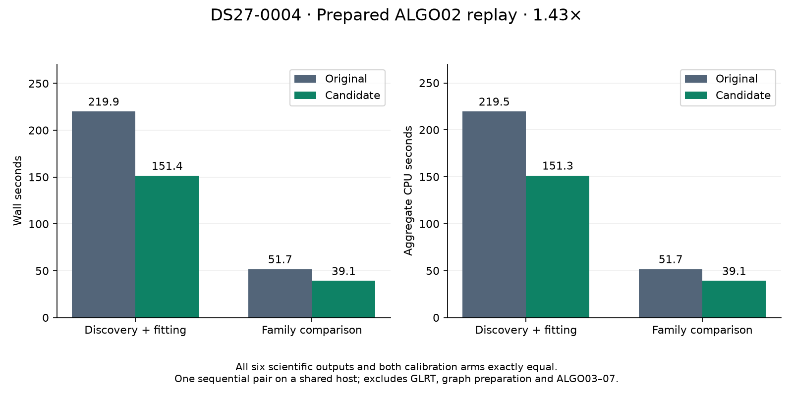

# Exact hierarchical calculations in the earlier ALGO02 stage

The isolated ALGO02 candidate reduces unprofiled prepared-stage time from
**271.637 to 190.556 seconds (1.43×)** and reproduces **all six scientific JSON outputs
exactly**, including discovery alternatives, native point ownership, satellite
assignments, gates, objectives, optimizer histories and both calibration arms.
Aggregate CPU work decreases **29.78%**. The qualified runtime was deployed to
the standard ALGO02 worker at **20:41:01 UTC on November 3**, after an exact
installed canary and an idle handoff.

| Unprofiled stage | Installed baseline seconds | Candidate seconds |
| --- | ---: | ---: |
| Discovery + initial/ALGO02 fitting | 219.944 | 151.437 |
| Family comparison | 51.693 | 39.119 |
| Sum of stage wall times | **271.637** | **190.556** |
| Aggregate subprocess CPU seconds | 271.173 | 190.420 |

[Paired exact comparison and timing](receipts/unprofiled-pair.json),
[baseline execution](receipts/baseline-unprofiled-execution.json),
[candidate execution](receipts/candidate-unprofiled-execution.json),
[reproducible figure source](render_runtime.py).

These are sequential trials on the same shared 24-CPU host, using the same
installed Python, BLAS/OMP thread limits of one, 1,200-second execution bound,
causal evidence and solver budgets. Neither timing trial uses cProfile or an
external sampler. Total adapter times including manifest checks are 271.942 and
190.862 seconds; the table sums the two subprocess stages. This is one timing
pair, not a confidence interval or a whole-pipeline measurement. Launch loads
and stage CPU times remain in the receipts.

## Why this change

The preceding full-native qualification exported DS27-0004's public ALGO02
reference and profiled fresh discovery, fitting and family comparison. The
profile exposed millions of repeated matrix-index constructions and Gaussian
calculations whose posterior was subsequently replaced by the hierarchical
model. Iteration007 already qualified exact improvements to these operations
for ALGO03. This experiment applies those numerical changes to the installed
ALGO02 version without changing its older scientific API.
[Prototype file hashes and build receipt](receipts/prototype-build.json).

`tools/build_algo02_runtime_prototype.py` verifies the installed release manifest
and all 1,774 files, then changes only:

1. `dsx01_hierarchical_bound.py`: reuse index arrays and the identity matrix;
   avoid a determinant that iterative callers discard. Final arithmetic remains
   unchanged.
2. `dsx01_joint_marginal.py`: expose the already qualified geometry-only mode,
   preserving input validation and the default complete calculation.
3. `probe_ds23_history_calibrated_phase.py`: use that mode before calculating
   the hierarchical posterior. Preserve the installed ALGO02 signature and
   behavior; do not import newer ALGO03 support policies.

The prototype has its own manifest and private directory. The deployed package
preserves the interpreter and all unrelated runtime files from
`1b63f5908785fc940446086aa4ef5de1a1539003`.

## Scientific checks and scope

The replay uses the same 17 frozen prepared input files: graph observations,
noise and causal orbital evidence. Previous fit results are excluded from the
inference workspace. Both c=0 and fitted-c run with unchanged observations,
candidates, priors, phase grids, numerical budgets and acceptance gates.
Evaluation GPS is not an inference input.

Each trial binds 1,793 files and accounts for both parent processes and the
discovery child through three read receipts. The comparison checks every
scientific output against the historical public reference and the new baseline.
Only recorded top-level timing, independently verified hash links and validated
local discovery paths are normalized. Scientific tolerance is zero.

| Arm | Latitude, both reference and candidate | Longitude, both reference and candidate |
| --- | ---: | ---: |
| c=0 | 37.85036003824613 | -122.4777589714538 |
| fitted-c | 37.85036983800171 | -122.47774826569346 |

The saved-policy benchmark also passes all 175 cases / 350 arms, with all 707
frozen files intact. [Saved-policy receipt](receipts/saved-policy-parity.json).
This is a replay of saved policy decisions, **not** fresh
numerical inference on all 175 recordings. The fresh numerical evidence here
is DS27-0004's prepared ALGO02 stage. It excludes graph construction, native
GLRT and ALGO03–07; it does not prove a tenfold end-to-end improvement.

## Diagnostic profiles

| Parent profile | Original | Candidate |
| --- | ---: | ---: |
| Discovery supervisor + initial/ALGO02 wall seconds | 281.928 | 208.513 |
| Family comparison wall seconds | 88.045 | 70.791 |
| Initial/ALGO02 `np.ix_` calls | 3,141,270 | 128,466 |
| Family `np.ix_` calls | 1,070,528 | 50,896 |
| Initial/ALGO02 discarded Gaussian calls, including remaining callers | 1,396 | 720 |

These diagnostic times are **not the deployment speed estimate**. Unchanged
orbit interpolation became substantially faster too, and system CPU time fell.
The host continued serving production work, including the newly deployed native
worker. Profiling overhead also changes when Python call counts shrink. We
therefore require a separate sequential unprofiled pair.

The parent profile includes time waiting for discovery but does not profile its
child. A separate 20-second nonblocking sample of that child returned 1,990 valid
samples, zero corrupt rows and nine sampler read errors. Of valid samples,
91.41% included `hierarchical_bound` and 36.83% included a dense solve. These are
overlapping stack proportions during one interval, not whole-run percentages.
The profiled candidate was externally sampled; unprofiled timing trials are not.
[Profiled scientific comparison](receipts/profiled-pair.json),
[sampling receipt](receipts/discovery-sampling.json),
[retained stacks](receipts/discovery-stacks.folded),
[sampler errors](receipts/discovery-sampler.log).

## Validation and next gate

Twenty-five targeted tests pass, including scientific comparison failures,
changed manifests, input validation, both older-helper adaptation and rejection
of mismatched timing configurations. Ruff passes. Existing exact likelihood
qualification for the two shared numerical modules is retained in iteration007.

The sequential unprofiled pair, immutable installed package, exact installed
canary and idle production handoff are complete. The original runtime remains
available. This is a runtime composition of the existing scientific ALGO02
stage in the standard ALGO07 chain, not a new association algorithm.
The tenfold overall runtime goal remains open.

## Immutable package and handoff preparation

`tools/stage_algo02_runtime.py` requires the committed unprofiled exact comparison,
both reference audits, candidate manifest identity and saved-policy audit. It
verifies the installed baseline and tested prototype, copies all 1,774 runtime
files, and permits only the three qualified numerical differences. It adds
qualification receipts, the verifier and release provenance, without changing
the service or rebuilding numerical code. A pinned pre-start verification will
check the package before production starts.

`tools/activate_algo02_runtime.py` requires a fresh exact replay from that installed
package. It checks all watcher-thread children and open per-job owner locks,
then repeats the check with every watcher thread stopped. The installed ALGO02
application owns its job lock before input validation and until terminal/status
publication; a job in preparation or publication therefore blocks activation.
Only an idle watcher can be terminated and replaced. The configured interpreter,
1,200-second budget and other service resource settings remain unchanged.

The source qualification now explicitly binds each trial's runtime manifest:
[package qualification](receipts/package-source-qualification.json). Thirty-five
targeted tests pass, covering qualification and canary identity failures, frozen
input/output comparison, configuration preservation and the reused per-job
ownership check at the preparation checkpoint. The subsequent activation checks
bring this to **37 passing targeted tests**; they additionally reject a busy
watcher before any signal and ensure the runtime override sorts after the
existing `release.conf`. Ruff passes.

## Installed canary and production activation

The installed package is
`/opt/leo-fast-graph-runtime-algo02/38b8fc5634b59b6df0bb72720ceb20eb22cbab08`,
with **1,780 files** and manifest pin
`d2691fbc69b5cf8ae470e37755775dcc17c5a127cbc7427adae95ca20b7a96f5`.
[Stage receipt](receipts/algo02-runtime-stage.json).

A new prepared replay from that installed directory took **224.223 seconds**,
including manifest checks. All six scientific outputs and both arms match the
public reference exactly, with 1,799 frozen files and all three process read
receipts verified. This additional canary timing is not another matched speed
trial; it also illustrates shared-host variability.
[Installed comparison](receipts/installed-canary-parity.json),
[installed execution](receipts/installed-canary-execution.json).

The old watcher had no numerical children or per-job owners both before and
after every watcher thread was stopped for the final idle check. No active job
was terminated. Systemd's pre-start check verified all 1,780 files. The new
watcher, PID 3183532, is active/running with zero automatic restarts and uses
the pinned package through its working directory and Python path.
[Activation receipt](receipts/algo02-runtime-activation.json),
[live verification](receipts/algo02-runtime-live.json),
[previous service configuration](receipts/algo02-service-before.txt).

The handoff tool checks the effective working directory after `daemon-reload`
before terminating the idle old watcher, guarding against a later drop-in that
would otherwise shadow the new configuration. It verifies the replacement's
live environment after startup. Full recording-to-published-ALGO07 timing and
the tenfold objective remain outstanding.
