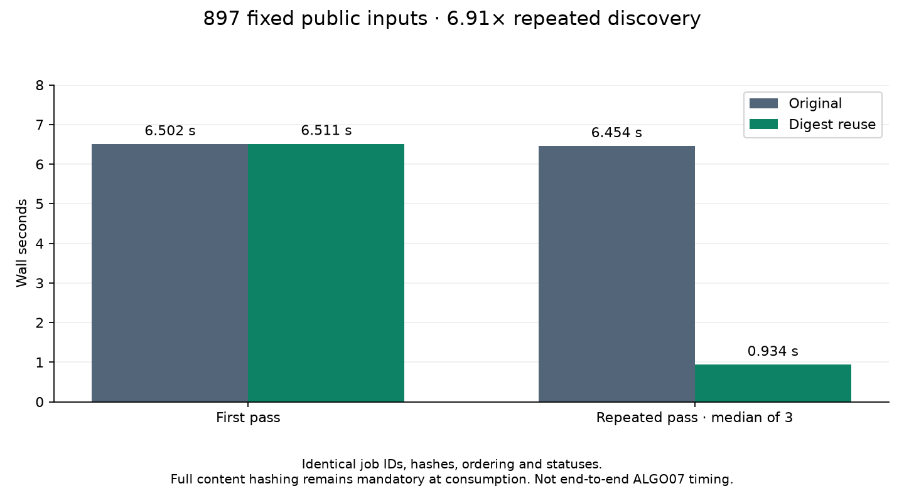

# ALGO02 discovery digest reuse: 6.9× faster repeated inventory scans

Repeated discovery over **all 897 exported tracking inputs** falls from a median
**6.454 to 0.934 seconds (6.91×)**. Every job identity, input hash, ordering and
status matches the original implementation. This is a watcher/discovery
optimization, not a numerical or end-to-end ALGO07 speedup. It was deployed on
November 3 at 21:02 UTC after the installed full-inventory comparison passed.

| Full fixed inventory | Original | Candidate |
| --- | ---: | ---: |
| First pass, seconds | 6.502 | 6.511 |
| Median repeated pass, seconds | 6.454 | 0.934 |
| Input bytes read for hashes on each repeated pass | 15,390,864,341 | 0 |
| Input digests recomputed on each repeated pass | 897 | 0 |

The warm repeated comparison alternates execution order across three pairs in
one process, without profiling. The same installed interpreter and read-only
public input port are used. Both versions still enumerate the fixed input paths
and read current job statuses; directory enumeration is outside this fixed-path
timing. The first pass retains all original hashing. All 897 file hashes are
checked before and after measurement. The run has a 120-second bound. This
measures normal filesystem metadata behavior on this local host, not hostile
filesystem tampering or network-filesystem consistency.

[Full measurements](receipts/full-inventory.json),
[frozen public inventory](receipts/fixture.json),
[earlier 32-input sample](receipts/sample32.json).
The full inventory includes 878 complete, 12 failed and seven unavailable jobs;
none is silently removed from the comparison.

## Change and correctness

`FastGraphPositionStore.inputs()` now uses a bounded in-memory digest cache for
discovery. Entries include device, inode, size, nanosecond modification time and
nanosecond change time. A cache miss hashes the file and compares metadata again
before caching it. Concurrent changes fail discovery and can be retried by the
watcher. The cache retains at most 4,096 entries and stores only identities and
digests, not parsed observations or inference results.

**`verify_input()` still computes a new full content hash.** Terminal validation
and publication retain their original validation. Job statuses are not cached;
a completed job changed to running is still observed immediately. Cache eviction
changes only performance, not job identity. No persisted schema, scientific
module, candidate set, prior, phase grid, solver budget or acceptance gate changes.

The benchmark applies only the cache edits to the older installed storage module,
preserving its other methods and API. The exact tested module is retained as
[candidate source](receipts/candidate_store.py). Its hash is recorded with the
original module, current implementation and installed runtime hashes in the
measurement receipt. The new CLI is `tools/profile_algo02_discovery_cache.py`:
`--snapshot --limit 0` freezes the public inventory, then `--fixture PATH
--repeats 3` compares cold and repeated passes against that fixed inventory.

Thirty-one targeted storage, application and benchmark tests pass. They cover:

- Stable reuse and a fresh full hash at consumption.
- Atomic replacement with the same size and restored modification time.
- In-place changes with restored modification time, using change time to detect them.
- Rejection at consumption even when discovery metadata is deliberately made stale.
- Changes during hashing, deleted inputs, changing job statuses and bounded eviction.
- Preservation of installed status and validation methods by the prototype adapter.

Ruff passes. The saved ALGO07 policy audit still matches all **175 cases / 350
arms**, with all 707 frozen files intact. [Policy audit](receipts/saved-policy.json).
This saved-policy check is not fresh localization on all those recordings; this
iteration does not change numerical inference.

## Installed qualification and deployment

Packaging tools now support `stage-discovery`, which preserves the installed
numerical modules and pins the tested storage module and full-inventory evidence.
The profiler accepts `--candidate-runtime` and `--candidate-pin` to qualify the
installed package. Activation checks that canary against the package manifest
and preserves the previous service override during an idle handoff. Forty-one
targeted packaging, activation, profiling and cache tests pass, as does Ruff.
The installed comparison repeats all 897 cases exactly. Median repeated discovery
is **6.205 → 0.898 seconds (6.91×)**; cold discovery is 6.226 versus 6.339 seconds.
Both cold passes hash all 15.39 GB, while warm candidate passes reuse all 897
digests. This is a separate measurement from the prototype table above.
[Installed comparison](receipts/installed-discovery.json).

The 1,784-file immutable package is
`/opt/leo-fast-graph-runtime-algo02/f7897f7c9f33cef7d8b46b70a41078091d0f217a`,
with manifest SHA-256
`2d0683d54286bb11900142858e058626b1c11f8411cac3a659b3d42deb177e86`.
It preserves the previously deployed numerical modules, interpreter and
1,200-second budget. The guarded handoff checked all threads, children and
per-job ownership before and while stopped; no job was active. The previous
override is retained for rollback. New PID 3193854 was verified active/running
with the pinned package and zero automatic restarts.
[Stage](receipts/installed-stage.json), [handoff](receipts/activation.json),
[live verification](receipts/live.json).

The numerical ALGO02 improvement from iteration011 remains deployed. The tenfold overall
recording-to-published-ALGO07 target remains open; the next large numerical
opportunity is still native GLRT correlation and duplicated recovery-stage work.
