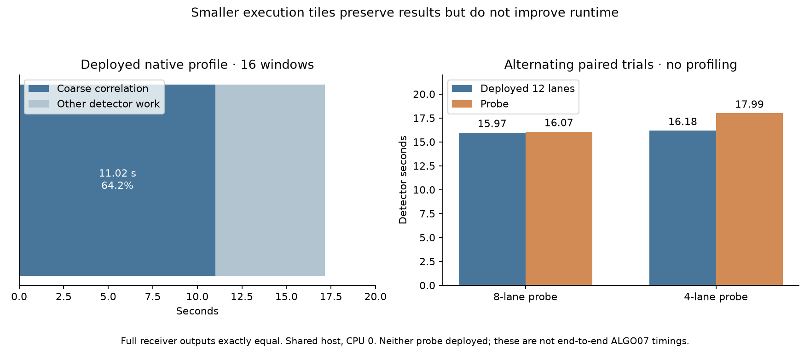

# Native GLRT execution-tile audit: retain 12 lanes

Neither smaller execution tile improves the deployed native detector. The 8-lane
probe is effectively tied but slightly slower; 4 lanes cost 11.2% more wall time.
Both preserve every receiver output exactly across the same 16 paired windows.
**Neither probe is deployed.** The qualified 12-lane native runtime remains in
production, alongside the separately deployed discovery optimization from
[iteration012](../2026_11_03_algo07_runtime_iteration012/README.md).

| Alternating paired comparison | Deployed 12 lanes | Probe | Baseline / probe |
| --- | ---: | ---: | ---: |
| 8 lanes | 15.969 s | 16.066 s | 0.994× |
| 4 lanes | 16.179 s | 17.991 s | 0.899× |

## Measured bottleneck

A fresh profile of the **deployed** tiled GLRT kernel on frozen DS27-0004 windows
takes 17.172 seconds inside the detector. Coarse correlation accounts for 11.023
seconds, **64.2%**. The run has 70 native grid calls, reflecting two execution
tiles per 21-frequency scientific search. The separate whole command takes
18.884 seconds, including imports and profiling overhead. These are small-window
profiles, not full-scan timing or downstream localization measurements.

[Profile summary](receipts/profile-summary.json),
[top functions](receipts/profile.txt), [execution timing](receipts/profile-timing.json),
[complete profiled receiver outputs](receipts/profile-result.json).
All published candidate fields match the frozen reference.

## Experiment and safeguards

`tools/build_native_tile_probe.py` copies the verified installed package into a
new private research directory. It changes the register kernel, native dispatch,
Python execution tiling and compiled extension only. Other files are byte-identical.
The compiler flags remain `-O3 -fno-math-errno`, without fast-math. Retained lanes
perform the same multiply, fused multiply/add and accumulation in the same sample
order. All 21 scientific CFO rows remain in their original order. Padding lanes
are discarded; peak selection, refinement, thresholds and search budgets do not
change. These research packages cannot satisfy the production package verifier.

The fixture is the earlier seed-20261103 selection: two whole paired-receiver
windows per channel, 16 windows total, chosen independently of localization error.
The installed native Python launches separate persistent baseline/candidate
processes, both pinned to CPU 0. The existing
`reports/2026_11_03_algo07_runtime_iteration005/paired_windows.py` driver alternates
which implementation runs first for each window, without concurrent evaluation.
Imports and IQ loading are outside the per-window timers. Production continues
on the shared host. The two probe comparisons have their own baseline measurement;
do not compare their absolute timings as if host conditions were identical.

All full receiver outputs, including unpublished candidates, match exactly in
each comparison. Both comparisons verify all 370 fixture/runtime files before
and after, plus every installed and candidate package member. Each command is
bounded to 180 seconds. Raw IQ remains outside Git.

- [8-lane timings and equality](receipts/tile8-paired.json),
  [verification](receipts/tile8-verification.json), [build](receipts/tile8-build.json).
- [4-lane timings and equality](receipts/tile4-paired.json),
  [verification](receipts/tile4-verification.json), [build](receipts/tile4-build.json).

Three builder tests check preservation of unrelated native/Python code, retained
arithmetic, and rejection of unknown layouts. Ruff passes. The saved ALGO07
policy audit passes all **175 cases / 350 calibration arms**, with all 707 frozen
files intact and the same three accepted repairs.
[Audit](receipts/policy.json). This is saved-policy verification, not fresh
localization of every scan. The rejected probes do not change production inference.

## Decision and next direction

The evidence does not support further tuning of CFO tile width alone. Even
eliminating the entire coarse-correlation cost would yield at most about 2.8×
detector speedup on this profiled fixture, before accounting for downstream
position work. That arithmetic ceiling is not a measured speedup.

The next experiments should reduce repeated computation: reuse exact fractional
interpolation weights where the same fractional offsets recur, and investigate
whether correlation work can be shared across neighboring epochs without changing
accumulation order or candidate decisions. The profile records 2,429 fractional
interpolation calls with 4,858 sinc calls; interpolation consumes 1.696 seconds
inclusively. This is a measured secondary hotspot, not a qualified optimization.
Earlier GEMM and FFT probes were slower and should not be repeated unchanged.

The tenfold recorded-data-to-published-ALGO07 goal remains unachieved. Neither
these trials nor the discovery improvement establishes an end-to-end ratio.
