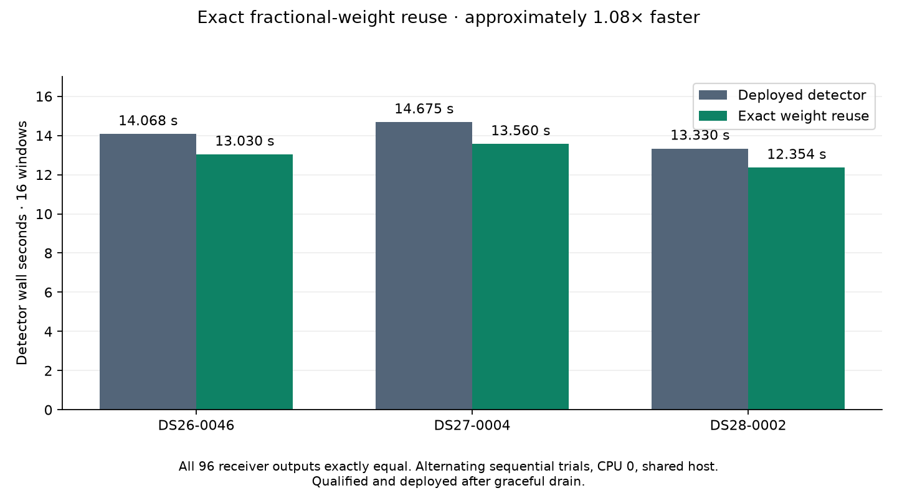

# Exact fractional-weight reuse: consistent 1.08× detector improvement

Reusing a single interpolation-weight row for positions with the same **exact**
fractional offset reduces native detector time in all three sampled cohorts.
Every full receiver output remains exactly equal across **48 paired windows / 96
receiver results**. Complete-recording and downstream qualification now pass
exactly. The installed canary also passes. **Production activation completed on
November 3 at 21:45:04 UTC**, after the old watcher finished its graceful drain.
The replacement process and all 372 package files verify. The tenfold end-to-end
objective remains open.

| Frozen fixture, 16 paired windows each | Deployed native detector | Weight reuse | Ratio |
| --- | ---: | ---: | ---: |
| DS26-0046 | 14.068 s | 13.030 s | 1.080× |
| DS27-0004 | 14.675 s | 13.560 s | 1.082× |
| DS28-0002 | 13.330 s | 12.354 s | 1.079× |

These are alternating sequential per-window trials with separate persistent
processes pinned to CPU 0, without cProfile. Imports and IQ loading are excluded.
Production continued on the shared host. The fixture selection is unchanged:
seed 20261103, two whole paired-receiver windows per channel in each previously
selected cohort scan. These are development fixtures, not independent validation,
full-cohort localization runs or end-to-end ALGO07 timing.

[Summary](receipts/summary.json), [DS26](receipts/glrt-native-DS26-0046.json),
[DS27](receipts/glrt-native-DS27-0004.json), [DS28](receipts/glrt-native-DS28-0002.json).

## Why this change

The preceding deployed-native profile measured 2,429 fractional interpolation
calls and 4,858 sinc calls, with 1.696 seconds inside interpolation out of 17.172
detector seconds. `fractional_take` previously computed two sinc functions for
every tap of every position, even when all positions shared identical weights.

After unchanged input/support checks, the candidate checks whether at least 32
positions have identical floating-point fractional parts. If so, it forms the
first weight row using the original position-minus-index subtraction, normalizes
it once, and broadcasts it. Each position retains its original IQ indexes,
multiplication and reduction order. No fractional values are rounded or binned.
Varying offsets retain the original per-position computation. Integer positions
retain their exact direct-index path. There is no persisted or cross-call cache.

Supported interpolation indexes are nonnegative integers within the source array.
Subtracting the floor to obtain a fractional part is exact in this range; equal
fractional parts therefore yield the same tap distances. At floating-point
boundaries, offsets that cease to compare equal use the original calculation.
The tests exercise those boundaries rather than assuming a requested decimal
offset remains identical after adding it to every integer position.

## Isolation and correctness

[The builder](build_probe.py) verifies the deployed 362-file package against its
manifest pin, then copies it to a new private research directory. Exactly one
module changes: `src/leo/analysis/starlink/fast_scan_fractional.py`. The baseline
module is pinned by hash; all other top-level definitions in that module are
checked unchanged. No compiled kernel, search grid, prior, candidate count,
acceptance gate, solver budget or production service changes.
[Build receipt](receipts/build.json).

[The driver](run_probe.py) verifies the candidate, baseline and frozen fixture
before and after each comparison. It invokes the existing alternating-window
driver with a 180-second process-group deadline per fixture. Every receiver
result, including unpublished candidates, is compared exactly. Failure or timeout
does not become a successful timing result. The three verification receipts retain
commands, interpreter, source hashes and the complete fixture-check result:
[DS26](receipts/glrt-native-DS26-0046-verification.json),
[DS27](receipts/glrt-native-DS27-0004-verification.json),
[DS28](receipts/glrt-native-DS28-0002-verification.json).

Forty component tests pass, including 23 new interpolation tests and the existing
conditioned-score batch equivalence tests. The new tests cover common offsets,
different half widths, floating-point boundaries, arbitrary offsets and shapes,
scalar/empty/integer inputs, and unsupported positions. They also confirm that a
common-offset batch computes just one 16-tap weight row. Ruff passes.

The frozen **175-case / 350-arm saved-policy audit** passes, with all 707 files
unchanged and the same three accepted repairs. [Audit](receipts/policy.json).
This is saved-policy verification, not a fresh c=0/fitted-c localization replay;
no new position-error or frequency-objective improvement is claimed.

## Complete-recording and downstream qualification

The candidate replayed all **6,772 windows** of DS27-0004 with sixteen workers
and an 1,800-second bound through the public recording ports. Its complete input
document is exactly equal to the earlier full-recording reference. The new frozen
inventory separately binds the candidate and deployed runtime bytes.
[Launch](receipts/full-launch.json).

`compare_full_glrt_replays.py --baseline-snapshot` now supports comparison to an
earlier complete trial without rerunning unchanged baseline computation. It
independently verifies both frozen inventories and requires exact equality of
their full input documents. It still checks every window, invalid-window reason,
receiver, hypothesis, source binding and output inventory. **This mode withholds
timing ratios**; the new alternating comparisons above provide performance
evidence. Twelve checker tests pass, including changed inputs, corrupt original
files, unpublished hypotheses, missing windows and mismatched worker settings.

Private replay directory:
`/srv/bulk/leo/research/algo07-runtime-20261103/full-glrt-fractional-DS27-0004/candidate16`.
The terminal comparison matches every window, **13,534 receiver results and
108,272 hypotheses exactly**, including invalid windows and unpublished
candidates. Both 708-file inventories verify. The replay took 669.503 seconds
on the shared host. Its reused baseline is parity evidence, so the checker
withholds a full-scan speed ratio. [Full comparison](receipts/full-parity.json),
[execution](receipts/full-timing.json), [range inventory](receipts/full-result.json).

A fresh prepared downstream replay using the deployed ALGO02 runtime matches all
six scientific files exactly: both calibration-arm endpoints, satellite identities,
point ownership, objectives, gates and optimizer histories. All 1,803 bound files
and three read receipts verify. Its observations and causal catalogue are the
same public export previously bound to this native recording. It ran concurrently
with the native replay at nice level 10; its 380.869 seconds are not a controlled
performance comparison. This replay does not reconstruct graph tracklets or rerun
ALGO03–07. [Downstream parity](receipts/downstream-parity.json).

| Arm | Reference and fresh latitude | Reference and fresh longitude |
| --- | ---: | ---: |
| c=0 | 37.85036003824613 | -122.4777589714538 |
| fitted-c | 37.85036983800171 | -122.47774826569346 |

The packaging tool now supports `stage-fractional`: complete native parity,
three faster paired cohort trials, exact downstream both-arm results and the
frozen policy audit are required. It pins the committed module, preserves all
other native source bytes, and retains the preceding runtime for rollback.
Thirty-five packaging, activation and comparator tests pass. Activation replaces
the previous runtime pre-start pin while preserving unrelated checks, and waits
for the replacement process to expose its post-exec environment. Installed
canary verification also passed, as described below.

## Installed canary and completed guarded handoff

The 372-file qualified package is
`/opt/leo-native-glrt-runtime/64c6b8469e79c03216c1ff94647b12778ff58ea3`,
with manifest SHA-256
`3cf714999b83a0179a819b5f52d75a2f13041b5db7cfa1e9ef17e7997186e7dc`.
The installed 16-window canary matches all 32 complete receiver outputs exactly.
Both the package and frozen fixture verify. Its 16.357-second whole-command time
includes startup and is not a matched performance comparison.
[Package](receipts/installed-stage.json), [canary](receipts/installed-canary.json),
[execution](receipts/installed-timing.json).

Creating the handoff receipt directory briefly waited in the bulk filesystem's
`xfs_buf_lock`; no service signal had been sent at that point. The same request
subsequently resumed and verified the stopped main thread at the tested sleep
point before requesting a main-process-only SIGINT drain. The previous override
was saved; active native children were not signalled. Watcher PID 3169996
finished its thread pool and exited before the replacement was started.
[Drain request](receipts/drain-request.json),
[observation](receipts/draining-observation.json).

The existing request's `finish` operation started replacement PID 3210832 at
21:45:04 UTC. The live receipt verifies the pinned 372-file package, the process's
new runtime `PYTHONPATH`, active/running service state, zero restarts, the pinned
pre-start check and the preserved sixteen-worker configuration. Production
resource limits and all capture settings remain unchanged. The previous runtime
remains available for rollback. [Activation](receipts/activation.json),
[live verification](receipts/live.json).
