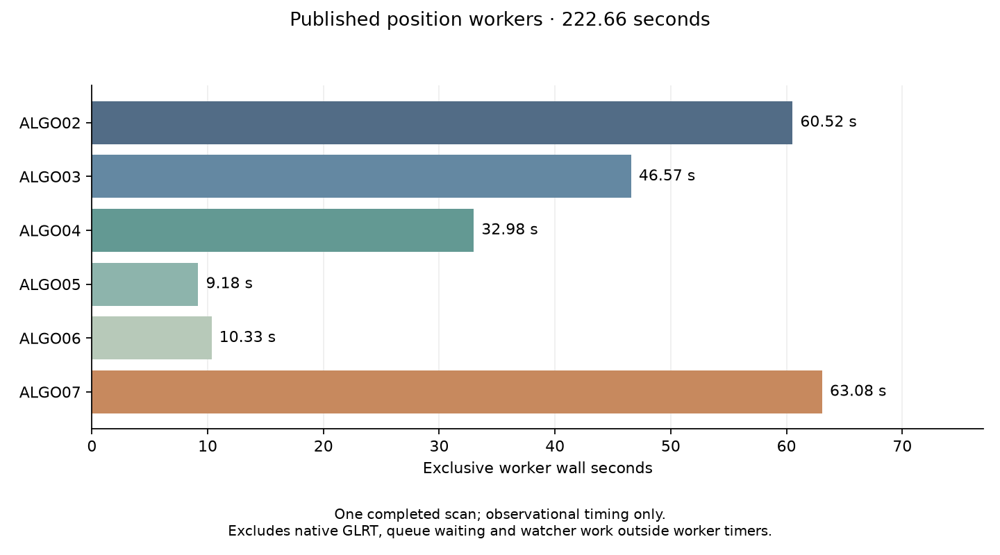

# Position-chain attribution without double counting

The newest inspected completed scan records **222.662 seconds** across ALGO02–07
position workers. The final ALGO07 recovery worker accounts for 63.075 seconds,
followed by ALGO02 at 60.520 and ALGO03 at 46.571 seconds. This is an observational
timing breakdown, **not** a new speedup, a full pipeline replay or an accuracy
comparison.

The new command is:

```bash
python -m leo.cli.algo07_profile chain --bulk-root /srv/bulk/leo \
  --job efd5e89fd04366ce81d56f8b3c7f1a0d \
  --output /srv/bulk/leo/research/runtime/position-chain.json
```

It reads through the public storage ports and validates the full terminal before
summarizing it. It does not construct another component's storage paths or read
private models. It checks the native recording/session identity, then verifies
every cumulative timing relationship. Only the exclusive stage durations are
summed. The compact output omits the nested scientific results.



| Worker | Recorded wall seconds | Decision |
| --- | ---: | --- |
| ALGO02 | 60.520 | Baseline position |
| ALGO03 | 46.571 | Single-family recovery |
| ALGO04 | 32.982 | Additive recovery |
| ALGO05 | 9.182 | Retain ALGO04 incumbent |
| ALGO06 | 10.332 | Retain ALGO05 incumbent |
| ALGO07 | 63.075 | Retain ALGO06 incumbent |
| **Sum** | **222.662** | |

The recording is `fast8-auto-20261103-205640-ab5c41df-1-upper`, with 6,770 native
windows. The terminal digest and observation timestamp are retained in
[the timing receipt](receipts/position-chain.json). Reading and validating that
terminal took 5.439 seconds in this invocation; that read is diagnostic overhead,
not part of the recorded 222.662-second worker sum.

ALGO02's 60.520 seconds include preparation (19.768), initial fitting (30.495),
family comparison (10.095), and a small orchestration remainder. Adding these
substeps to the ALGO02 parent would double-count them. Likewise, every later
`total_seconds` field includes its entire incumbent chain. Adding those cumulative
fields would substantially exaggerate processing time.

## What this does and does not establish

The native report currently has no processing-duration field. The CLI therefore
returns **`end_to_end_seconds: null`**. Native GLRT, acquisition, queue waiting and
watcher operations outside the worker timers remain outside this summary. The
durations also reflect the runtime composition and host contention at execution
time; they do not compare two releases on matched inputs.

This scan's final recovery worker consumed meaningful time while retaining its
incumbent. That is not evidence the computation was unnecessary: screening and
rejection are part of ALGO07. A runtime optimization must preserve those decisions
and their scientific evidence, rather than skipping them because a previous run
did not accept a replacement. Native coarse correlation remains a separately
measured major hotspot in the frozen detector fixtures.

The next large improvement must reduce repeated computation in those measured
hotspots. A reliable tenfold claim additionally requires complete recorded-data
to published-position replay, including graph preparation and the interfaces
between stages. Summing isolated component speedup factors cannot establish it.

Fourteen CLI tests pass. They check exclusive versus cumulative accounting,
incomplete or contradictory chains, invalid durations, public-port usage, and
cross-recording identity mismatch, alongside the existing frozen-profile tests.
Ruff passes. This read-only diagnostic changes no inference or production results;
the frozen scientific benchmark and the ongoing guarded native handoff are
unchanged. The tenfold goal remains open.
