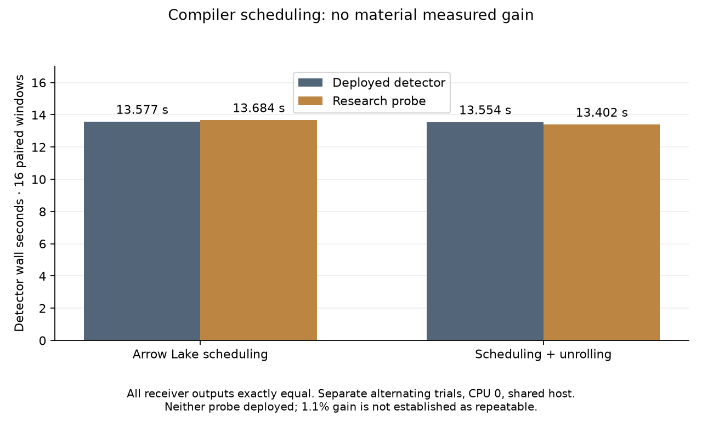

# Native scheduling audit: no useful gain

Changing the native coarse kernel's compiler scheduling does not produce a
material detector improvement on this host. Arrow Lake scheduling alone is
0.8% slower; combining it with loop unrolling is 1.1% faster in one paired trial.
That small difference does not establish a repeatable gain. **Neither probe is
deployed.** The qualified fractional-weight reuse from
[iteration014](../2026_11_03_algo07_runtime_iteration014/README.md) is now live,
with its completed graceful-drain and package-verification receipts published.

| Variant | Deployed detector | Candidate | Baseline / candidate |
| --- | ---: | ---: | ---: |
| Arrow Lake scheduling | 13.577 s | 13.684 s | 0.992× |
| Arrow Lake scheduling + loop unrolling | 13.554 s | 13.402 s | 1.011× |

Each row is a separate alternating sequential comparison across the same sixteen
frozen DS27-0004 windows. Both variants match all 32 complete receiver outputs,
including unpublished candidates, exactly. Imports and IQ loading are excluded;
both persistent processes run on CPU 0, without cProfile. Production continues
on the shared host. Absolute times across rows are not a matched comparison.
These measurements do not establish whole-scan or end-to-end speedups.

## Why test this

The deployed-native profile attributes 64.2% of detector time to coarse
correlation. Inspection found that its AVX2/FMA functions request Haswell
instruction scheduling while this machine is an Intel Core Ultra 9 285K
(Arrow Lake). The hot twelve-lane correlation loop already retains its six
accumulators in registers without stack spills. This suggested a bounded test
of scheduling rather than another smaller-tile experiment.

`tools/build_native_schedule_probe.py` verifies the installed 372-file package,
copies it into a new private research directory, changes only the two target
attributes from `tune=haswell` to `tune=arrowlake`, and rebuilds the same extension.
The second probe also uses `-funroll-loops`. Both retain `-O3 -fno-math-errno`,
AVX2/FMA and FP64 arithmetic; neither enables fast-math. All other sources,
Python code, templates, native kernels and configuration remain byte-identical.
The source formulas, scientific search grid, ordering, priors, solver budgets
and acceptance gates are unchanged.

The compiled register-kernel function contains 661 disassembly lines in the
baseline, 662 with scheduling alone and 1,345 with unrolling. The extension grows
from 42,752 to 55,040 bytes with unrolling. These are descriptive code-size
observations, not performance predictions. Full output comparison remains
necessary even when the source arithmetic is unchanged.

## Evidence and limits

The existing paired-window driver was reused with an explicit schedule-probe
receipt. Each comparison has a 180-second process-group deadline. It verifies
every installed/candidate package member and all 370 fixture/reference files
before and after execution, pins driver and builder hashes, and compares every
receiver field exactly. No timeout or failure was counted as successful timing.
Four scheduling-builder tests and three existing tile-builder tests pass; Ruff
passes. The tests reject unexpected source layouts and verify that only target
scheduling changes in the handwritten native source.

- Scheduling: [build](receipts/schedule-build.json),
  [paired timing](receipts/schedule-paired.json),
  [verification](receipts/schedule-verification.json).
- Scheduling and unrolling: [build](receipts/unroll-build.json),
  [paired timing](receipts/unroll-paired.json),
  [verification](receipts/unroll-verification.json).
- [Frozen policy audit](receipts/policy.json): all 175 cases / 350 calibration
  arms pass, all 707 reference files remain unchanged, and the same three repairs
  are selected. This is a saved-policy audit, not fresh full-cohort inference.

Because neither probe merits promotion, we did not spend a complete native or
downstream localization replay on them. Exact agreement on these sixteen windows
does not qualify either probe for deployment or establish population accuracy.

## Decision and next investigation

Retain the deployed kernel. The tile-width audit and this scheduling audit do not
support more tuning of these parameters as a route to tenfold improvement.

The next substantive experiment should measure whether a cheaper full-grid
screen can identify a small set for exact FP64 rescoring. Such a screen is only
acceptable if conservative error bounds prove that no omitted epoch/CFO can
change local-peak selection, suppression, ties or the retained candidates, and
uncertain cases fall back to the original full calculation. Simply using FP32
scores or checking that a few winners agree would not meet the accuracy
requirement. No such screening implementation is enabled by this iteration.

The tenfold recorded-data-to-published-position target remains unachieved.
Native, position-worker and end-to-end measurements remain separate; the
[exclusive chain CLI](../2026_11_03_algo07_runtime_iteration015/README.md) makes
the missing native duration explicit rather than adding nested timing totals.
