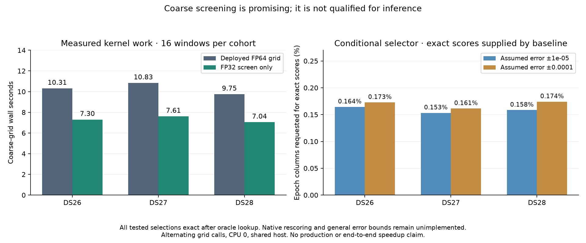

# Coarse screening: promising cost, not yet qualified for inference

A research-only FP32 coarse screen takes **1.38–1.42× less grid time** than the
deployed FP64 calculation on sixteen frozen windows from each of DS26, DS27 and
DS28. An interval-based selector then requests exact scores for **0.15–0.17% of
epoch columns** and recovers the exact retained peaks on these fixtures.
This is a feasibility result. **Nothing from this experiment is deployed.**
Native sparse rescoring and conservative runtime error bounds are still needed;
the tenfold end-to-end target remains open.

| Frozen fixture | Grid calls | Deployed FP64 grid | Approximate screen | Grid ratio |
| --- | ---: | ---: | ---: | ---: |
| DS26-0046 | 34 | 10.311 s | 7.300 s | 1.412× |
| DS27-0004 | 35 | 10.833 s | 7.607 s | 1.424× |
| DS28-0002 | 33 | 9.747 s | 7.041 s | 1.384× |

These are **grid timings**, not complete detector or position timings. Both grid
implementations execute sequentially in one process pinned to CPU 0; their order
alternates per call. Production continues on the shared host, without cProfile.
The selector's cost is measured separately. The driver always returns the
original exact grid to acquisition and refinement, so the diagnostic screen
cannot alter the actual detector result.

## What changed in the prototype

The previous profile placed 64.2% of detector time in coarse correlation. Smaller
CFO tiles and compiler scheduling did not produce useful gains. This experiment
instead tests cheaper arithmetic as a possible **screen before exact scoring**.

`tools/build_native_screen_probe.py` copies and verifies the deployed 372-file
native package. Its private AVX2/FMA register kernel handles 24 FP32 lanes,
covering the 21 scientific CFO rows in one call with three discarded execution
lanes. The baseline processes those same scientific rows in twelve-lane FP64
tiles. Reference rotation is computed in FP64 before conversion; correlation
uses FP32; energy denominators, magnitudes, accumulation across symbols/frames
and normalization remain FP64. The combined change tests arithmetic width and
execution shape, not precision in isolation. No grid point, frame or symbol is
removed. Compiler flags remain `-O3 -fno-math-errno`, without fast-math.

Only the native source, its included grid body and the rebuilt extension differ
from the installed package. All other files are identical. The build receipt
explicitly marks the package unsafe for inference and records that error bounds
and exact rescoring are unimplemented. [Build receipt](receipts/build.json).

Across the 102 grid calls, the greatest observed absolute score difference is
**7.09×10⁻⁹**. Row maxima and the actual acquisition configuration's retained
epoch/CFO coordinates agree in every call. **These observations do not prove
future scores are bounded or permit directly substituting the approximate grid.**
Every selected score and its refinement neighbors still need exact evaluation.

## Interval selection mechanics

`tools/interval_coarse_selection.py` accepts a score array, supplied error
intervals and a callback that evaluates requested epoch columns exactly for all
frequencies. Its guarantee is conditional on those intervals actually covering
the exact scores; it does not derive or certify a kernel error bound.

1. Form outward-rounded lower/upper score intervals. A point is a possible
   local maximum if its upper bound can reach both neighbors' lower bounds.
2. Request exact scores at the approximate retained peaks and their neighboring
   epochs. Use exact local maxima only when both neighbors are known.
3. Apply the original ordering and epoch/CFO suppression rules to those verified
   peaks. Let the last retained exact score be the current threshold.
4. Request every still-uncertain possible maximum whose upper bound reaches that
   threshold, together with its neighbors. Include equal-score candidates so
   ties cannot be silently discarded. Repeat, because new peaks can change
   suppression and lower the threshold.
5. Stop only when every omitted point either cannot be a local maximum or has
   an upper score below the retained threshold. If too few peaks are verified,
   or a requested exact score violates its interval, evaluate the complete grid.

At termination, all omitted local maxima sort strictly below the retained
threshold. Therefore they cannot change the first K candidates under the same
greedy suppression. Merely finding K plausible peaks is insufficient: the
closure check is what protects against an unseen stronger peak or suppression
cascade. A false interval at an unrequested point cannot be discovered by this
selector; a conservative kernel error model is mandatory before deployment.

## Measured selection work

The following **assumed** absolute error envelopes are diagnostic scenarios,
not production tolerances or proved numerical bounds. Each envelope is checked
against the complete baseline grid for these experiments only. The exact-score
callback reads the already-computed baseline array; it does not perform native
sparse correlation. The reported selector time includes this cheap array lookup.

| Fixture | Exact columns at ±10⁻⁵ | Exact columns at ±10⁻⁴ | All epoch columns | Selector seconds, ±10⁻⁵ / ±10⁻⁴ |
| --- | ---: | ---: | ---: | ---: |
| DS26-0046 | 745 (0.164%) | 783 (0.173%) | 453,322 | 0.474 / 0.407 |
| DS27-0004 | 715 (0.153%) | 753 (0.161%) | 466,655 | 0.489 / 0.428 |
| DS28-0002 | 697 (0.158%) | 766 (0.174%) | 439,989 | 0.379 / 0.393 |

All 204 scenario/call combinations reproduce the baseline's retained tuples,
including exact score values. None requires a complete-grid fallback. Each
requested column contains every scientific CFO row, and neighboring columns
needed for peak refinement are included. The percentages are not percentages of
GLRT points associated or discarded. Larger-envelope timings sometimes being
lower reflect measurement variation; these are not monotonic timing claims.

The screen plus selector leaves a measurable budget for sparse exact evaluation
on these fixtures, but it would be premature to claim that budget as a realized
detector speedup. Native validation, bounds, memory allocation and exact scoring
can consume it. Initial screening-only experiments were also promising, but the
tables use the final hash-bound driver and selector version consistently across
all three cohorts.

## Reproduction and validation

`tools/probe_native_screen.py --candidate PRIVATE_PROBE --fixture FROZEN_FIXTURE
--output NEW_PRIVATE_JSON --selection` runs the diagnostic. Each launch was
wrapped in `timeout --signal=TERM --kill-after=5s 180s`. The source runtime and
candidate inventory are verified before and after, as are all 370 frozen
fixture/reference files. Receipts bind the compiler, builder, driver, selector,
interpreter, NumPy, host, CPU affinity, thread settings and complete call results:
[DS26](receipts/DS26.json), [DS27](receipts/DS27.json), [DS28](receipts/DS28.json).
The exact baseline detector path matches every frozen published candidate.
This is **not** a candidate full-detector parity replay.

Sixteen component tests pass and Ruff passes. They cover isolated source changes,
scientific-row preservation through execution padding, randomized interval
selection against the original selection rules, equal scores, plateaus, edges,
circular suppression, sparse requests, invalid bounds and complete fallback on
an observed bound violation. The tests corrected a single-epoch zero-score edge
case so it follows the original peak rules. Unit tests support the selector
implementation; they are not a proof that FP32 scores meet a particular bound.

The frozen [175-case / 350-arm policy audit](receipts/policy.json) passes with
all 707 files unchanged and the same three accepted repairs. It remains a
saved-policy audit, not fresh localization of the entire cohort. No position
improvement or change in calibration-arm behavior is claimed.

## Next implementation and promotion gates

Implement native evaluation of requested epoch columns with exactly the deployed
FP64 arithmetic, accumulation order and energy denominators. First compare every
requested value bit-for-bit to full-grid values; measure its real cost rather
than estimating it from the requested fraction.

Then derive conservative per-grid error intervals from actual input/reference
magnitudes and floating-point operations. Cover conversion, products, sequential
sums, magnitudes, division and normalization, with explicit handling or full
fallback for overflow, underflow, nonfinite values and unsupported geometry.
An observed error maximum must not become the runtime bound. Preserve the
original complete FP64 path as the fallback.

Finally, connect screening, interval closure and exact rescoring in an isolated
detector and run matched cohort windows, complete-recording parity, both-arm
downstream parity and fresh runtime comparisons before any production decision.
Production currently retains the exact interpolation optimization qualified in
[iteration014](../2026_11_03_algo07_runtime_iteration014/README.md).
