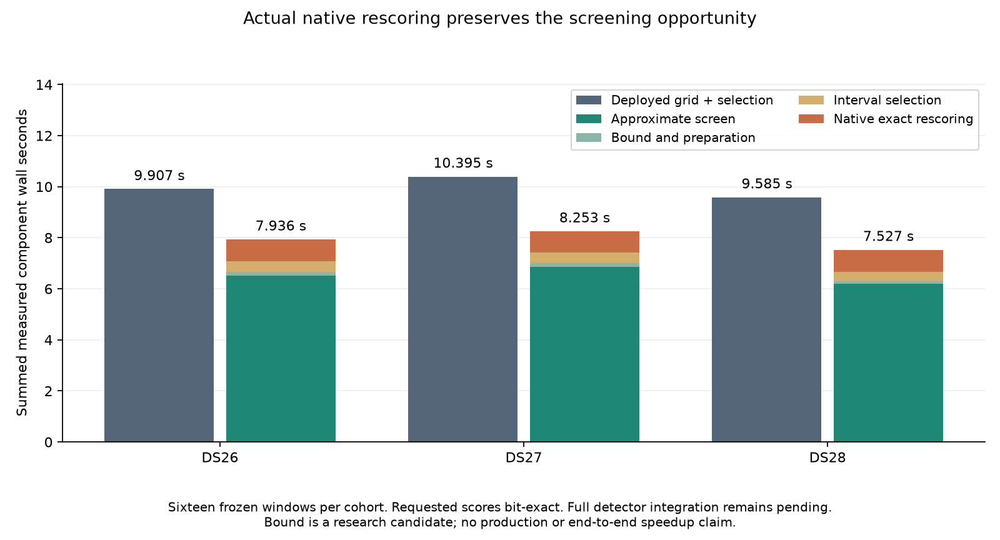

# Actual sparse native rescoring retains a 1.25–1.27× coarse-search opportunity

The screening experiment now evaluates requested scores through the **deployed
FP64 native kernel**, rather than reading them from a precomputed reference.
Including input-derived candidate bounds, setup, interval selection and actual
rescoring, the measured component totals are **1.25–1.27× faster** than the
deployed full-grid-plus-selection totals on the three frozen cohort fixtures.
All **51,114 requested scores are bit-exact**, and every retained peak matches.

**This remains research-only.** The actual detector still receives baseline
scores in this diagnostic. Full detector integration, qualification of all
fallback paths, complete-recording and downstream both-arm parity remain
outstanding. These are not deployed detector or end-to-end speedups; the tenfold
overall objective remains open.

| Fixture, 16 windows each | Full FP64 grid + selection | Screen + bound + selection + native rescoring | Component ratio | Native rescoring alone |
| --- | ---: | ---: | ---: | ---: |
| DS26-0046 | 9.907 s | 7.936 s | 1.248× | 0.847 s |
| DS27-0004 | 10.395 s | 8.253 s | 1.260× | 0.825 s |
| DS28-0002 | 9.585 s | 7.527 s | 1.273× | 0.854 s |

The grid calls alternate baseline/screen ordering on CPU 0, without cProfile,
while production continues on the shared host. Bound calculation and selection
follow those paired grid calls. Candidate totals sum those measured component
costs; they are not independent whole-worker trials. Reference comparisons are
timed separately and excluded. IQ loading, imports and provenance checks are
outside these component totals. [Summary](receipts/summary.json).

## Exact scoring without a new arithmetic kernel

`tools/native_exact_columns.py` preserves the original samples, reference,
energy-prefix array, CFO tiling and native extension. For requested epoch `e`,
it shifts every frame offset by `e` and calls the original kernel for one epoch.
That reproduces the same sample positions and the same symbol/frame accumulation
order as column `e` of the full grid. Unsupported tail positions receive exactly
the original support treatment. The final scientific CFO rows retain their
original execution tiles, including the special eleven-row padding behavior.

Requests exceeding 128 columns use the original complete grid and select the
requested columns afterward. This execution-cost threshold does not remove any
scientific point. Smaller requests preserve their order, and invalid or
out-of-range indexes are rejected.

This lean implementation repeats native validation, sample-amplitude scanning
and template preparation for each requested epoch. Its cost is now measured,
not inferred from the small fraction requested. A future batched sparse entry
point could remove that repeated work, but it must first demonstrate the same
bitwise results and full fallback behavior.

| Fixture | Requested columns / all columns | Requested scalar scores | Native calls | Dense fallbacks |
| --- | ---: | ---: | ---: | ---: |
| DS26-0046 | 818 / 453,322 | 17,178 | 1,636 | 0 |
| DS27-0004 | 791 / 466,655 | 16,611 | 1,582 | 0 |
| DS28-0002 | 825 / 439,989 | 17,325 | 1,650 | 0 |

Each requested column covers every scientific frequency, including the neighbors
needed for refinement. Every returned FP64 value is compared through its uint64
bit representation, not an approximate tolerance. These counts are correlation
grid columns, not GLRT association percentages.

## The first bound failed the runtime test

The first input-derived bound combined maximum sample/reference components with
the weakest positive denominator across the entire input. It covered the tested
score errors but was too loose: bounds of about 0.0044–0.0053 required hundreds
of exact columns and triggered complete-grid evaluation. On the initial two
DS27 windows the combined cost was **1.945 s versus 1.104 s baseline**, or 0.567×.
We rejected that formulation for performance; we did not replace it with an
empirical tolerance.

The [rejected receipt](receipts/global-bound-rejected.json) is bound to the
implementation at commit `59c5ac275`. Its source hashes were verified against
that commit before publication. The final fixture tables above use one consistent
version of the tighter energy-based bound.

## Input-derived energy bound

`tools/native_screen_bounds.py` uses a conservative Cauchy–Schwarz bound on the
complex correlation products, rather than combining unrelated global maxima.
It does not read observed FP32 errors, reference winners, position labels or
satellite identities.

For maximum tap count `n`, define `u32 = 2^-24` and
`gamma = (4n + 16) u32 / (1 - (4n + 16) u32)`. This exceeds the rounding-path
length through input/reference conversion, products, FMA and sequential
correlation accumulation. The four-product L1 sum is bounded using the sample
and rotated-reference norms. A factor sixteen allows reference rotation, FP64
norm estimation and rounding margins.

Sliding received energy needs care because subtracting two long prefixes can
amplify rounding error. The prototype bounds that error from both endpoint
prefix magnitudes using `gamma64 = (N + 4) u64 / (1 - (N + 4) u64)`, with a
fourfold allowance for power formation, summation and subtraction. It computes
the greatest resulting true-energy/computed-energy ratio over positive sliding
denominators. The leading normalized score-error term is therefore
`16 gamma sqrt(max_energy_ratio)`.

The candidate bound also includes an absolute FP32 underflow allowance, including
flush-to-zero, divided by a conservative lower normalization, plus an FP64
rounding allowance. The admitted amplitude range prevents FP32 overflow.
The implementation requires complex128 input, nearest rounding, bounded input
size/tap/support counts, finite frequencies and amplitudes, and nondegenerate
normalization. Unsupported cases return an explicit ineligible result; an
integrated detector must route them to complete FP64 evaluation. The current
diagnostic rejects an ineligible case rather than pretending it has a valid
screening result.

For these recorded grids, the resulting bound is about **1.8311×10⁻⁴**, while
the greatest observed error is 7.09×10⁻⁹. The large margin is a consequence of the
conservative operation/norm bound; the observed error was not used to select
the bound. Every complete grid is checked against it in the diagnostic.
This model is still marked **not production-qualified**. The formula and its
exceptional cases require review and integrated qualification before deployment;
passing finite fixtures is not a universal numerical proof.

## Evidence and validation

- [DS26](receipts/DS26.json), [DS27](receipts/DS27.json),
  [DS28](receipts/DS28.json): all 102 grid calls, native rescoring costs, bound
  inputs, exact retained peaks, implementation hashes and fixture checks.
- [Synthetic stress check](receipts/synthetic.json): 75 combinations of noise,
  alternating signals and prefix-cancellation patterns, with independent sample
  and reference scales from `2^-100` through `2^36`. All candidate bounds cover
  the observed complete-grid error, and all 6,300 requested native values are
  bit-exact, including initial, interior and final epoch positions.
- Thirty-one component tests pass; Ruff passes. Tests cover tiling, shifted-frame
  geometry, dense fallback, invalid indexes, dtype/range eligibility, randomized
  interval selection, ties/suppression and energy-prefix cancellation against an
  extended-precision reference. Hardware requirements are explicit in the native
  diagnostic: it fails if the deployed AVX2/FMA extension is unavailable.
- The [frozen policy audit](receipts/policy.json) passes all 175 cases / 350 arms,
  with all 707 files unchanged and the same three accepted repairs. This is a
  saved-policy audit, not fresh full-cohort localization.

The package and all 370 fixture/reference files are checked before and after
each recorded-input trial. Source hashes bind the driver, selector, exact oracle
and bound implementation. Each trial uses a 180-second external timeout; the
synthetic stress check uses 120 seconds. No new RF data is collected, production
results are not written, and the live native service remains on the qualified
exact runtime from [iteration014](../2026_11_03_algo07_runtime_iteration014/README.md).

## Next gate

Integrate screening, the interval selector and actual exact rescoring into an
isolated detector, restoring every retained score and refinement neighbor and
providing a complete FP64 fallback for every unsupported or uncertain case.
Then compare all receiver outputs, including unpublished hypotheses, under
matched standalone execution. Complete-recording parity and fresh downstream
c=0/fitted-c parity are required before considering production activation.
