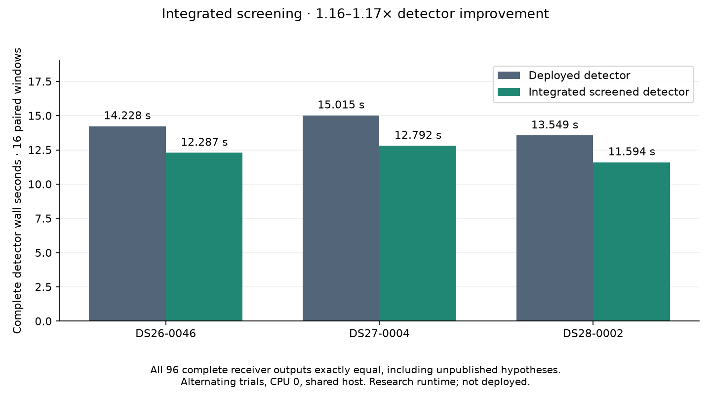

# Integrated screened detector: research checkpoint

The isolated detector now uses the FP32 coarse screen to nominate candidates,
then restores selected scores and refinement neighbors through the original
FP64 native kernel. Unlike iteration 018, candidate inference actually consumes
the screened result. This prototype is **not enabled in production**.

| Fixture (16 windows each) | Deployed detector | Screened detector | Speed ratio |
| --- | ---: | ---: | ---: |
| DS26-0046 | 14.228 s | 12.287 s | 1.158× |
| DS27-0004 | 15.015 s | 12.792 s | 1.174× |
| DS28-0002 | 13.549 s | 11.594 s | 1.169× |

All 96 complete receiver outputs across these 48 windows match exactly,
including unpublished hypotheses. All 102 acquisition calls used screening;
none required a full-grid or dense-oracle fallback. Trials alternated order on
CPU 0 on a shared production host. Timings exclude IQ loading, imports and
provenance verification. These are detector timings, not end-to-end pipeline
speedups. The 10× overall runtime objective remains unmet.

## Implementation and fallback behavior

`tools/build_screened_detector_runtime.py` composes an isolated research runtime
from the verified deployed native package and a separate FP32 extension. Only
the acquisition coarse-search/selection block is replaced; the original FP64
extension and subsequent refinement remain intact. The builder verifies that
the three component helpers match their tested research counterparts exactly.
Analysis code does not import the tools directory.

The input-derived error bound and interval selector from iteration 018 decide
which epochs need exact evaluation. No precomputed reference grid, reference
winner, satellite identity or evaluation position enters candidate inference.
Unsupported inputs/backends, missing screen extensions, invalid screen arrays,
broad bounds and detected interval failures use the original complete FP64
search. Requests for many exact columns also use the complete original grid.
General full-grid APIs retain their original semantics.

The numerical stress check passed all 77 cases: 66 screened and 11 complete
fallbacks. Selected tuples, refinement neighbors and refined epochs matched
exactly. The focused component/tool suite passed **44 tests**, and Ruff passed
all changed Python files. Finite fixture agreement is not a universal proof
of the proposed numerical bound.

## Completed evidence and pending qualification

- [Paired fixture summary](receipts/summary.json), with individual trial and
  before/after inventory receipts in this directory.
- [Isolated build inventory](receipts/build.json): 380 files, eight additions
  and one modified original member.
- [Numerical stress receipt](receipts/synthetic.json).
- [Saved-policy audit](receipts/policy.json): 175 cases / 350 calibration arms
  and 707 frozen files unchanged. This is a saved-policy audit, not fresh
  end-to-end inference.
- [Full-recording launch](receipts/full-launch.json): DS27-0004, 16 workers,
  bounded to 1,800 seconds. Final all-hypothesis parity is pending at this
  checkpoint.
- [Prepared downstream launch](receipts/downstream-launch.json): fresh ALGO02
  and family fitting, both c=0 and fitted-c, bounded to 1,200 seconds. Final
  scientific-file parity is pending at this checkpoint. This replay reuses
  prepared graph evidence; it does not rebuild graph tracks or run ALGO03–07.

The two larger replays were still running when this checkpoint was prepared.
Their concurrent execution is suitable for parity checks, not a matched timing
comparison. Their results must be recorded separately before making stronger
qualification claims. Bound review, full parity, packaging and installed canary
checks remain prerequisites for any production activation. Existing production
workers were left undisturbed.
