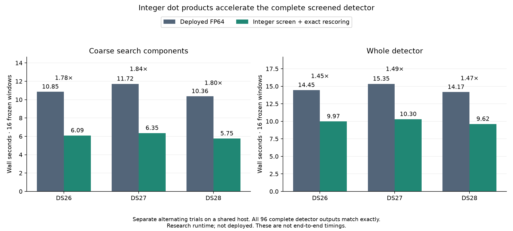

# Integer dot products: 1.45–1.49× faster complete detector on three fixtures

An isolated integer-screened detector reproduces **all 96 complete receiver
outputs exactly**, including unpublished hypotheses, across 48 frozen DS26,
DS27 and DS28 windows. Complete detector time improves **1.45–1.49×** against
the currently deployed FP64 detector. This is a stronger measured candidate than
iteration 019's FP32 screen, which improved complete detector time 1.16–1.17×.
These are separate paired experiments, not a direct timing comparison between
the two research candidates.

**Research only: not deployed.** The full-recording replay has now passed exact
comparison of all 108,272 hypotheses. The 10× recorded-data-to-position objective
remains unmet.

| Fixture, 16 windows | Deployed detector | Integer-screened detector | Ratio | Coarse-search component ratio |
| --- | ---: | ---: | ---: | ---: |
| DS26-0046 | 14.447 s | 9.975 s | 1.448× | 1.784× |
| DS27-0004 | 15.348 s | 10.299 s | 1.490× | 1.844× |
| DS28-0002 | 14.170 s | 9.617 s | 1.474× | 1.802× |

The component experiment includes screening, bound calculation, setup, interval
selection and actual FP64 native rescoring. The complete-detector experiment
uses separate persistent baseline/candidate processes and alternates window
order on CPU 0. IQ loading, imports and inventory verification are excluded from
those detector timings. Production continued on the shared host. Neither table
is an end-to-end position benchmark. [Timing summary](receipts/timing-summary.json).

## Why integer arithmetic helps

The recorded IQ in these fixtures has exact signed-integer real and imaginary
components. The current FP32 screen still executes complex products and sums
for every frequency, sample and epoch. The host supports AVX-VNNI signed
16-bit dot products, which combine two integer products and their accumulation
in one instruction. The prototype packs each IQ pair and quantizes the rotated
reference into signed 16-bit real/imaginary pairs. Six vector accumulators
compute real and imaginary correlations for 24 execution lanes, preserving all
21 scientific frequencies. Padding affects execution only.

Only the approximate proposal screen uses this arithmetic. The same interval
selector requests exact scores from the original deployed FP64 kernel, restores
all selected peaks and refinement neighbors, and leaves the original fine
refinement and output construction intact. Satellite candidates, priors,
observations, solver budgets and acceptance gates are unchanged.

## Quantization and overflow controls

For maximum tap count `n` and maximum absolute integer IQ component `X`, use
`Q = min(32767, floor((2^31-1)/(2 n X))) - 1`. The extra one-count margin prevents
an int32 accumulation from reaching its limit. If `R` is the maximum reference
component across the selected symbols, quantization scale is `Q/(2R)`. The
factor two covers real/imaginary rotation. IQ must be finite, exactly integral
and within ±32767; unsupported values use complete FP64 inference.

Each rotated-reference component has quantization error at most roughly
`0.5/scale`. Cauchy–Schwarz bounds its effect on normalized correlation by the
reference-error norm divided by reference norm. The implementation allows twice
that rounding term, uses the prior sliding-energy cancellation allowance and
adds FP64 arithmetic margin. The result is input-derived; it does not use
observed score errors or reference winners. Scores still accumulate and
normalize in FP64 after the integer correlation is rescaled.

The admitted domain also retains the previous geometry, finite-value,
rounding-mode, normalization and operation-count checks. Hardware without the
required integer instructions, unknown screen kinds, ineligible inputs,
excessively broad bounds, invalid score arrays and detected interval violations
use the original complete grid. A detected violation cannot detect errors at
unrequested points, so qualification of the bound itself remains necessary.
The bound remains marked **not production-qualified**; finite tests are evidence,
not a universal proof.

## Accuracy checks

| Fixture | Exact columns / all columns | Bit-exact rescored scalar values | Complete/dense fallbacks |
| --- | ---: | ---: | ---: |
| DS26 | 942 / 453,322 | 19,782 | 0 / 0 |
| DS27 | 847 / 466,655 | 17,787 | 0 / 0 |
| DS28 | 888 / 439,989 | 18,648 | 0 / 0 |

The approximate screen changes one frequency row's maximum in DS26. It does
not change the retained candidate set there, and the interval selector plus
exact rescoring reproduces every exact retained tuple in all three fixtures.
This is why approximate winners alone are not an acceptable inference result.
The greatest observed score difference is 6.275×10⁻⁶, below the computed bounds
of approximately 1.84×10⁻⁴ to 4.98×10⁻⁴. The observed difference was not used to
choose the bounds. [DS26](receipts/DS26.json), [DS27](receipts/DS27.json),
[DS28](receipts/DS28.json).

- [Native stress check](receipts/grid-stress.json): 80 cases covering four IQ
  amplitudes up to 32767, five reference scales, noise, alternating values,
  constant values and zero tails. Bounds cover the observed errors; exact
  selection and sparse native values match.
- [Integrated stress check](receipts/detector-stress.json): 117 exact cases,
  45 screened and 72 complete fallbacks, including fractional/extreme IQ and
  degenerate inputs. Selected scores, refinement neighbors and refined epochs
  match; fallback grids match in full.
- [Paired whole-detector trials](receipts/paired-summary.json): every complete
  receiver output matches. Individual trials and source/fixture verification
  receipts accompany the summary.
- [Saved ALGO07 policy audit](receipts/policy.json): all 175 cases / 350 arms
  match, with 707 frozen files unchanged. This is not fresh position inference.
- **55 focused tests pass**, including component fallback behavior and
  quantization bounds, native transformation checks, interval selection and
  exact rescoring. Ruff passes the changed implementation and tests.

The native builder preserves the deployed FP64 extension separately and records
the compiler, inputs and binary inventory. The detector builder checks the
component integer-bound function against the tested research function's AST,
binds it to the native transform's hash and installs no tools imports in analysis
code. [Native build](receipts/native-build.json),
[detector build](receipts/detector-build.json).

## Remaining qualification and next measured direction

A 16-worker DS27-0004 full replay completed within its 1,800-second bound.
[Exact comparison](receipts/full-parity.json) covers all 6,772 windows, 13,534
receiver results and 108,272 hypotheses, with both inventories verified and no
differences. Its [635.962-second elapsed time](receipts/full-timing.json) was
measured under concurrent shared-host work; the reused saved baseline establishes
parity only, not a new full-scan timing ratio.
Fresh prepared downstream parity from iteration 019 remains separate evidence;
it must not be described as graph construction from this candidate's outputs.
Production packaging, installed-canary checks and guarded activation have not
been performed for either screen candidate.

The fresh [complete-detector profile](receipts/profile-summary.json) completes
all 16 windows with unchanged published evidence and all 377 frozen files
verified. It ran concurrently with the full replay and production, so its times
are hotspot attribution only, not comparable with the paired table above.

| Profiled operation | Calls | Self time |
| --- | ---: | ---: |
| Integer-screen native grid | 35 | 11.685 s |
| Original native FP64 sparse rescoring | 1,694 | 3.245 s |
| Conditioned frame scores | 280 | 2.146 s |
| Conditioned fractional GLRT scores | 70 | 1.318 s |
| FFT implementation | 1,510 | 1.208 s |

The next concrete opportunity is **batching the requested exact columns**:
65 selector requests cause 1,694 native calls because the current exact oracle
calls the unchanged kernel separately for every column and CFO tile. That
repeats sample validation and reference preparation. A native sparse-column
entry point could reuse this work, but must retain each column's original FP64
operation order, tail support and normalization, and prove bitwise parity with
the complete grid. This is a measured direction, not an implemented gain.
Integer correlation remains the largest single cost; batching rescoring alone
cannot achieve the overall 10× target. Component speedups cannot be multiplied
into a claimed overall gain.
