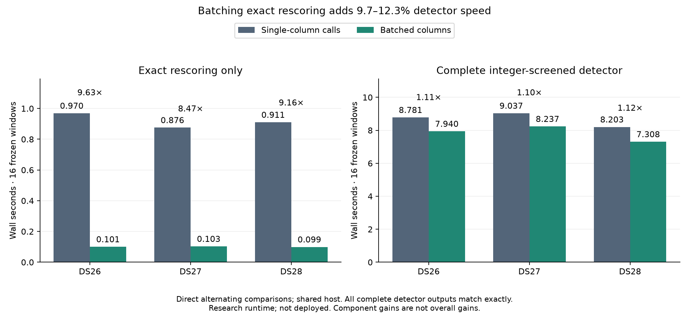

# Batched exact rescoring adds 9.7–12.3% complete-detector speed

Batching requested FP64 columns improves complete detector speed by
**1.097–1.123× against the unbatched integer-screened detector**, with every
complete receiver output unchanged in the three frozen fixtures. This isolates
the additional benefit of batching; it does not multiply separately measured
component ratios. The batched detector is **1.50–1.67× faster than deployed FP64**
in separate paired trials on the same fixtures.

**Research only: not deployed.** A bounded full-recording replay of the batched
candidate is running. The unbatched integer candidate already passed all
108,272 full-recording hypotheses in iteration 020. The 10× overall goal is
still unmet.

| Fixture, 16 windows | Unbatched integer detector | Batched integer detector | Direct ratio |
| --- | ---: | ---: | ---: |
| DS26-0046 | 8.781 s | 7.940 s | 1.106× |
| DS27-0004 | 9.037 s | 8.237 s | 1.097× |
| DS28-0002 | 8.203 s | 7.308 s | 1.123× |

The direct comparison alternates baseline/candidate order in persistent
processes on CPU 0. Both isolated variants share the same verified deployed
baseline, scientific settings and frozen input windows. All 96 receiver outputs,
including unpublished hypotheses, are exactly equal. Source and fixture
inventories are checked before and after each trial.
[Direct timing summary](receipts/incremental/summary.json).

| Fixture | Deployed FP64 detector | Batched integer detector | Ratio |
| --- | ---: | ---: | ---: |
| DS26-0046 | 17.004 s | 11.318 s | 1.502× |
| DS27-0004 | 15.151 s | 9.483 s | 1.598× |
| DS28-0002 | 12.633 s | 7.567 s | 1.670× |

These separate paired trials also reproduce all complete outputs exactly.
The changing shared-host load explains why their absolute times differ from
the direct incremental comparison; cross-table subtraction is not a controlled
measurement. Both exclude IQ loading, imports and inventory verification.
Neither is an end-to-end localization benchmark.
[Deployed comparison](receipts/deployed/summary.json).

## Measured bottleneck and change

Iteration 020's profile found 1,694 native FP64 calls for only 65 selector
requests. Each requested epoch was evaluated separately, repeating sample
validation, amplitude scanning, reference rotation and allocation. The new
optional `folded_anchor_score_columns` entry point accepts an intp vector of
epochs, prepares each CFO tile once and computes all requested columns.

The change preserves the original FP64 correlation and accumulation loops.
Only the mapping from output-column index to source epoch changes. Each column
still accumulates symbols and frames in the original order, retains the original
energy-prefix coordinates, and skips exactly the unsupported tail frames.
Out-of-order and duplicate requests retain their order. Negative, out-of-grid,
empty, non-intp and multidimensional vectors are rejected at the native boundary;
the Python adapter handles empty valid requests without entering native code.

The original exact extension remains untouched and is still used for complete
fallbacks. A separate sparse extension is optional; missing or incompatible
hardware retains the prior per-column oracle. The existing 128-column dense
fallback threshold is unchanged. Scientific CFO tiling, including padding for
the eleven-frequency case, is preserved.

## Direct native-rescoring comparison

The diagnostic calls both original and batched oracles on each identical column
request, alternates their order, and compares both with the complete original
FP64 grid through uint64 bit patterns. The old-control time and validation time
are excluded from candidate selector timing.

| Fixture | Separate-column native calls | Batched native calls | Old rescoring | Batched rescoring | Component ratio |
| --- | ---: | ---: | ---: | ---: | ---: |
| DS26 | 1,884 | 124 | 0.970 s | 0.101 s | 9.632× |
| DS27 | 1,694 | 130 | 0.876 s | 0.103 s | 8.474× |
| DS28 | 1,776 | 126 | 0.911 s | 0.099 s | 9.162× |

All **56,217 rescored values match bit-for-bit**. The integer screen, its
input-derived bound, interval selector, exact selected tuples and refinement
neighbors are unchanged. No dense or complete fallback was needed in the
recorded fixture diagnostics. [DS26](receipts/DS26-0046.json),
[DS27](receipts/DS27-0004.json), [DS28](receipts/DS28-0002.json).

## Validation and provenance

- [Native sparse stress check](receipts/sparse-stress.json): 54 cases and
  59,670 bit-exact values across six CFO counts, three amplitude/reference
  scale pairs, noise, constant input and zero tails. It covers full epoch
  vectors plus out-of-order duplicates and rejects five invalid native inputs.
- [Integrated stress check](receipts/detector-stress.json): 117 exact cases,
  45 screened and 72 complete fallbacks. Refined epochs and every selected
  neighbor match; fallback grids match completely.
- **66 component/tool tests pass**, including original frame-coordinate
  handling, CFO tiling, invalid inputs, integer bounds and fallback behavior.
  Ruff passes changed implementation, tests and the comparison driver.
- [Saved ALGO07 policy audit](receipts/policy.json): 175 cases / 350 calibration
  arms unchanged, with 707 frozen files verified. This is not fresh inference.
- [Sparse native inventory](receipts/sparse-build.json) and
  [composed detector inventory](receipts/detector-build.json) bind the original
  native baseline and the added extension. Original deployed full-grid code is
  not replaced. The [builder bytes used](receipts/detector_builder_used.py) are
  preserved because a later line-wrap-only edit changed the builder hash; the
  tested private runtime was left immutable.

The batched full DS27-0004 replay uses 16 workers and a 1,800-second bound. Its
final all-hypothesis comparison is pending at this checkpoint. A fresh prepared
ALGO02/family replay of both calibration arms is also running with a 1,200-second
bound, using the unchanged frozen public evidence export. It reuses prepared
graph evidence; it does not reconstruct graph tracks from the candidate output.
The concurrent runs provide parity evidence, not a matched timing comparison.
The unchanged
integer screen still requires completion of its numerical-bound qualification
and production packaging/canary gates. The next useful profile should identify
what dominates after batching; a fast rescoring component alone cannot deliver
the 10× recorded-data-to-position objective.
