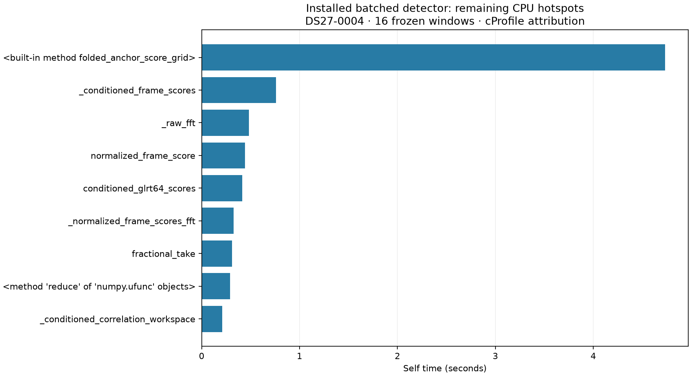

# Integer-screen installed qualification and remaining runtime costs

The integer-screened, batched-exact detector has passed full native parity,
prepared downstream parity and an installed 16-window canary. Its immutable
package is staged and a guarded production handoff has been requested. At this
checkpoint the old watcher is still draining active numerical jobs: **activation
is pending**, and no end-to-end speedup is claimed.

The [numerical review](NUMERICAL_DOMAIN.md) describes the admitted arithmetic
domain and selection guarantees. The [recorded challenge](receipts/domain-review.json)
covers 135 cases, 1,000,001 exact prefix values and six unsupported-input
rejections. Its largest observed error is 0.4999999998 of the calculated bound.

`tools/stage_screened_native_runtime.py` requires committed full native parity,
downstream parity, paired detector measurements, frozen policy evidence and
native/domain receipts before staging. It defaults to a dry run and does not
modify services. The completed staging and installed-runtime qualification are
recorded below, separately from the pending service activation.

Validation: Ruff passed for the two new tools and staging tests; the existing and
new native staging test suites passed all 30 tests. The completed full native
and prepared downstream comparisons, together with the controlled detector
benchmarks, are documented in
[iteration 021](../2026_11_03_algo07_runtime_iteration021/README.md).

## Installed qualification

The [staging receipt](receipts/installed-stage.json) binds release
`a1b999aad5bdc924fd90d35e055878bc23bd4c06` and its 402-file inventory to the
committed qualification evidence. Its manifest SHA-256 is
`e05bfc29c8987c83623ac8f310a68b45a27de355ae1020ece7de066f5eb728d2`.
The original FP64 native extension is unchanged. Unsupported screen inputs or
hardware retain the original complete-grid fallback.

The [installed canary](receipts/installed-canary.json) compares complete receiver
outputs against the original frozen baseline, including unpublished hypotheses:
16 windows, 32 receivers, zero differences. Its expanded frozen inventory covers
the installed package, inputs and reference result. The canary alone is not a
full localization replay; the separate downstream qualification covers prepared
ALGO02/family fitting in both calibration arms.

The [drain request](receipts/drain-request.json) records a verified watcher sleep
point and a main-process-only SIGINT. The watcher finishes its thread pool;
active numerical children are not killed. The old override and runtime remain
available. A requested drain must not be described as completed deployment.

## Profile after batching

The new installed-runtime profile executes all 16 frozen DS27-0004 windows and
verifies all 421 frozen files afterward. These self times attribute one profiled
run; they are not paired before/after timing measurements.

| Operation | Calls | Self time |
| --- | ---: | ---: |
| Integer coarse screening | 35 | 4.735 s |
| Conditioned frame scoring | 280 | 0.759 s |
| FFT kernel | 1,510 | 0.482 s |
| Normalized frame scoring | 840 | 0.444 s |
| Conditioned GLRT-64 batch | 70 | 0.414 s |
| Exact sparse column batches | 130 | 0.123 s |

Total profiled time is 11.234 seconds. Screening accounts for about 42.1%; exact
sparse rescoring accounts for about 1.1%. This identifies coarse screening as the
next optimization target, rather than further work on the now-small rescoring
cost. The profile also exposes refinement and FFT work that remains after any
screen improvement. [Profile summary](receipts/profile-summary.json),
[execution receipt](receipts/profile-timing.json), [launch](receipts/profile-launch.json).

The next bounded experiment should preserve the integer screen's scores while
reducing repeated reference loads or changing its SIMD scheduling, and compare
against this installed package. Earlier generic FFT/GEMM coarse-correlation
experiments were slower; they should not be repeated without a specific new
reason. Any new approximation requires its own bound and fallback review.

The 10× recorded-data-to-published-position objective remains unmet. The
1.50–1.67× controlled detector speedups in iteration 021 exclude IQ loading,
graph construction, recovery workers and publication; component ratios cannot
be multiplied into an overall claim.
