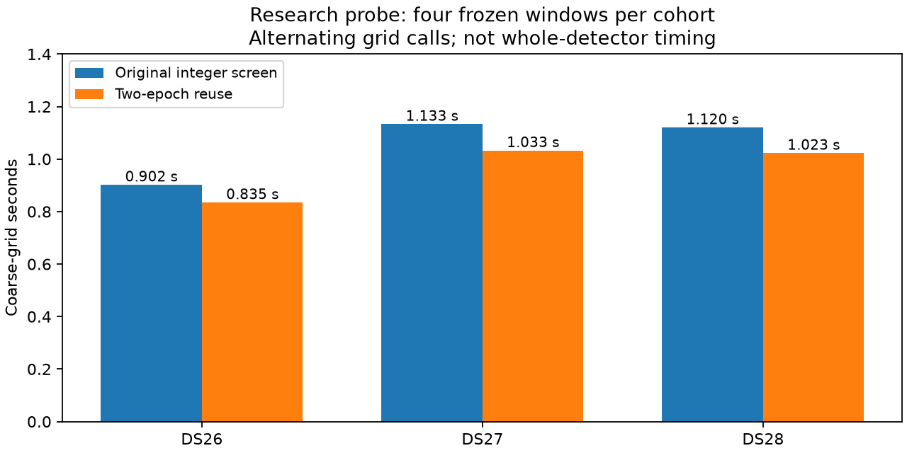

# Two-epoch reference reuse: bounded scheduling probe

The post-deployment profile in iteration 022 identified integer coarse screening
as the largest remaining detector cost. A new research probe computes two
adjacent epochs together, loading each quantized reference vector once for both.
The first bounded measurements improve coarse-kernel speed by **1.081–1.097×**.
This is a modest component gain; no whole-detector gain or production promotion
is established.

| Fixture | Windows | Grid calls | Original kernel | Paired epochs | Ratio |
| --- | ---: | ---: | ---: | ---: | ---: |
| DS26-0046 | 4 | 8 | 0.902 s | 0.835 s | 1.081× |
| DS27-0004 | 4 | 9 | 1.133 s | 1.033 s | 1.097× |
| DS28-0002 | 4 | 9 | 1.120 s | 1.023 s | 1.095× |

All **7,279,818 screening values match bit-for-bit**, and all 24 complete receiver
outputs match their existing baseline. The diagnostic alternates original and
candidate grid-call order in the same process. The exact original FP64 rescoring
and refinement paths remain unchanged. Timings exclude grid comparison and the
rest of the detector; this is not a paired whole-detector benchmark. The host
is shared, each cohort uses only four frozen windows, and no repeated timing
confidence interval is claimed.

## Change and validation

`tools/probe_integer_epoch_pair.py` builds a private extension from the pinned
integer-screen source and records the compiler command and changed inventory.
Only the grid include and compiled extension differ. Each epoch retains its
integer accumulation order, scale, FP64 normalization and support order. An odd
tail reuses the last valid sample for the unused lane and never accumulates that
lane. Original non-register paths are preserved. Three transformation tests
check the scalar path, unchanged normalization and tail guards; the recorded
native probe supplies actual execution evidence.

The build is research-only and separate from the deployed iteration 022 package.
Before any adoption it needs wider native boundary/tail testing, full fixture
coverage and a direct whole-detector comparison. Given the coarse kernel's
42.1% share in one profile, a 1.09× kernel improvement would suggest only about
3.6% detector improvement if every other cost stayed fixed. That is an Amdahl
estimate, not a measurement. Larger opportunities remain necessary for the 10×
end-to-end target.

[Build receipt](receipts/build.json), [DS26](receipts/DS26.json),
[DS27](receipts/DS27.json), [DS28](receipts/DS28.json).
