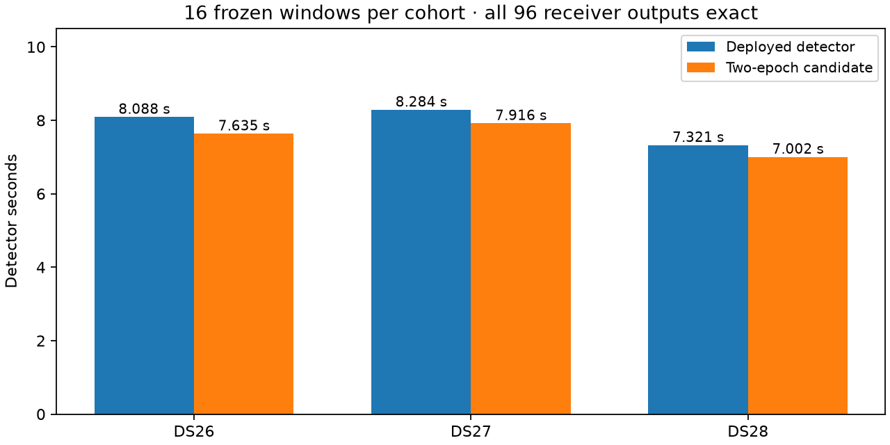

# Two-epoch reuse: complete-detector validation

The scheduling prototype from iteration 023 improves the complete detector by
**1.046–1.059×** against the currently deployed integer-screened, batched-exact
runtime. All 96 complete receiver outputs match exactly across 48 frozen
windows. This candidate remains research-only; a bounded full-recording parity
replay is running at publication.

| Fixture | Deployed detector | Two-epoch detector | Ratio |
| --- | ---: | ---: | ---: |
| DS26-0046 | 8.088 s | 7.635 s | 1.059× |
| DS27-0004 | 8.284 s | 7.916 s | 1.046× |
| DS28-0002 | 7.321 s | 7.002 s | 1.046× |

Each row covers 16 frozen paired-receiver windows. Independent persistent
processes alternate baseline/candidate order on CPU 0, with imports and IQ
loading excluded from the detector timer. Every receiver field, including
unpublished hypotheses, is compared. This is an incremental direct comparison
with the deployed package; it does not multiply prior component ratios. The
shared host and single traversal limit timing certainty.

## Numerical and composition checks

The new `evaluate_integer_epoch_pair.py` tool verifies that the prototype derives
from the exact deployed screen. It copies the deployed package and replaces only
the screen's grid include and compiled extension. The original exact FP64 kernel,
integer bounds, selection, sparse rescoring and downstream code are unchanged.
The tool rejects unrelated changes and verifies frozen files before and after
each paired trial. Three composition tests pass.

`check_integer_epoch_pair.py` executes both actual native kernels over **360
cases / 152,280 bit-exact values**: tap counts 1, 2, 44 and 4,096; epoch counts
1, 2, 3, 64 and 65; IQ maxima 127 and 32,767; noise, constant and zero-tail inputs;
and 1, 21 or 25 frequencies. The geometry includes partial final-frame support
and odd final epochs. This checks the paired loop without changing its inherited
arithmetic-domain requirements. Native execution explicitly requires AVX-VNNI;
unsupported hardware is an error in this diagnostic, not a silent skip.

The [frozen policy audit](receipts/policy.json) passes 175 cases / 350 arms and
verifies all 707 reference files. It is saved-policy replay, not fresh inference.
The new tools, tests and render scripts pass Ruff.

## Full-recording check and limits

The DS27-0004 native replay uses the full public recording inventory, 16 workers
and an 1,800-second bound. It must complete and pass the strict all-hypothesis
comparison before any promotion. Its [launch receipt](receipts/full-launch.json)
is recorded; no full-recording success is claimed yet. Existing exact downstream
qualification covers the unchanged downstream implementation and is not being
relabeled as a new run of this prototype.

This modest detector gain does not establish a 10× recorded-data-to-position
speedup. Larger gains must also address other detector work and numerical
localization; iteration 025 investigates a separate likelihood opportunity.

[Composition](receipts/detector-build.json), [native boundaries](receipts/native-boundaries.json),
[DS26](receipts/DS26.json), [DS27](receipts/DS27.json), [DS28](receipts/DS28.json).
