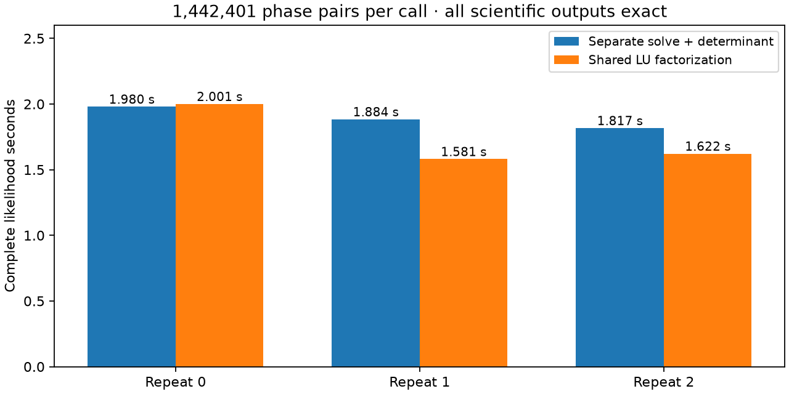

# Reuse one LU factorization for phase-pair solve and determinant

A research wrapper reuses the LU factorization already produced by LAPACK
`DGESV` to compute the log determinant. On one captured slow-case likelihood,
the median complete phase-integration time improves **1.884 → 1.622 seconds
(1.162×)** over three alternating comparisons. All returned scientific values
match exactly. This is not yet a complete ALGO07 worker result or a deployed
change.

| Comparison | Existing NumPy | Shared LU | Ratio |
| --- | ---: | ---: | ---: |
| First captured batch, median of seven | 0.01072 s | 0.00845 s | 1.268× |
| Full likelihood, repeat 0 | 1.98000 s | 2.00055 s | 0.990× |
| Full likelihood, repeat 1 | 1.88420 s | 1.58085 s | 1.192× |
| Full likelihood, repeat 2 | 1.81671 s | 1.62210 s | 1.120× |

The first full-likelihood pair is slightly slower. All trials are retained; the
median is a descriptive result on a shared host, not a confidence interval.
The independent initial batch-only probe is also preserved. The full native
GLRT qualification run overlapped this experiment, so absolute times are not
comparable with earlier reports.

## Why this differs from the earlier Cholesky probe

The phase likelihood currently calls `numpy.linalg.solve` and `slogdet` on the
same six-dimensional matrix for every phase pair. NumPy's determinant routine
uses LU and sums the logs of its diagonal, accounting for pivot signs; see the
[NumPy implementation](https://github.com/numpy/numpy/blob/main/numpy/linalg/umath_linalg.cpp).
The new C wrapper calls the **same installed ILP64 OpenBLAS `DGESV` routine**
used for solving, then consumes its retained LU factors. It preserves the
column-major matrix copy and sequential scalar log summation. No Cholesky
substitution, reduced phase grid, changed prior or approximate factorization is
introduced. The installed library, C source, compiled binary, captured input
and numerical kernel are hash-bound in the receipt.
The [installed-identity check](receipts/installed-identity.json) confirms that
the tested kernel and OpenBLAS binary match the deployed ALGO07 numerical
package and its interpreter environment byte-for-byte. This check does not
replace a complete-worker replay.

The earlier iteration 003 Cholesky prototype was faster in one substep but
changed coefficients and quadratic values. This LU experiment instead matches
the solve coefficients, determinant signs and log determinants **bit-for-bit**
on a real batch of 27 × 1,201 systems, plus 186 random nonsymmetric matrices
across dimensions 1, 2, 3, 6, 12 and 32. A singular batch is rejected.

The full likelihood covers **1,442,401 phase pairs per call**; all three candidate
calls consume 4,327,203 systems. The objective, phase marginals, MAP indices,
orbital coefficients, visibility mass and metadata match the original outputs.
This is one captured position, not a position optimizer or new association run.

## Research boundary and next qualification

`probe_shared_lu.py` uses a temporary process-local interception to test the
complete existing likelihood. The determinant is reused only for the identical
matrix object just solved, and NumPy is restored afterward. This interception
must not become the production integration. A candidate numerical backend
needs a narrow explicit solve-plus-determinant interface, supported-ABI checks,
fallback behavior and complete-worker validation in both calibration arms.

The current prototype is deliberately pinned to the installed NumPy/OpenBLAS
library. It does not qualify other BLAS providers, integer ABIs or platforms.
Its bounded experiment used no production outputs or service changes. Ruff
passes the probe. The [shared end-of-iteration audit](../2026_11_03_algo07_runtime_iteration024/receipts/policy.json)
passes all 175 saved-policy cases / 350 arms; this is not fresh inference with
the LU prototype.

[Full phase receipt](receipts/full-phase-probe.json),
[earlier batch-only receipt](receipts/initial-matrix-probe.json).
The 10× end-to-end goal remains unmet.
