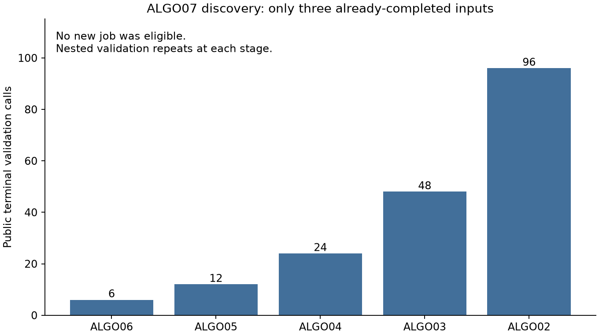

# ALGO07 runtime: frozen reference and first profile

The first measured opportunity is recovery-job discovery: the ALGO07 watcher
revalidates completed upstream chains before checking whether it already
processed those jobs. Three already-completed inputs required **96 ALGO02
terminal validations**. None needed a new numerical run.

This report establishes the benchmark and profiling tools before optimization.
No inference rule, numerical implementation, production service, or accuracy
reference changed. **No speedup is claimed yet.** The target remains tenfold
overall active-processing improvement with preserved scientific behavior.

## Frozen evidence

The [frozen manifest](frozen.json) binds 707 files totaling 1,953,061,206 bytes:
existing causal input manifests/catalogues, ALGO06 endpoints, numerical receipts,
predictive guard evidence, and the guarded-policy population audit. Every
provided historical source hash matched during freezing.

| Dataset | Fast recordings | Available paired reference outcomes | Unavailable upstream |
|---|---:|---:|---:|
| DS26 | 159 | 148 | 11 |
| DS27 | 15 | 13 | 2 |
| DS28 revision 2 | 16 | 14 | 2 |
| Total | 190 | 175 | 15 |

Both c=0 and fitted-c are retained. This is a freeze of existing development
evidence, **not a fresh numerical rerun or an independent validation cohort**.
It does not claim to copy all transitive raw-IQ data. Numerical replay requires
a verified private export and an end-to-end comparison of owners, identities,
endpoints, objectives, gates, convergence, and fallback reasons.

The benchmark protocol is [documented here](../../docs/operations/algo07-runtime-benchmark.md).
The repository skill is [profile-algo07](../../.agents/skills/profile-algo07/SKILL.md).

## First baseline measurement

The sample uses the public ALGO07 discovery port, with the production activation
cutoff and a limit of three inputs. It reads production evidence without starting
jobs or changing results. It profiles the current repository adapter using the
existing Python 3.12 numerical environment; it does not attach to or modify the
running service.

| Measurement | Profile enabled | Profile disabled |
|---|---:|---:|
| Worker process wall time | 20.858 s | 22.084 s |
| Discovery inside worker | 18.223 s | 20.958 s |
| Child user + system CPU | 20.481 s | 22.067 s |
| Inputs inspected | 3 | 3 |
| Jobs eligible for processing | 0 | 0 |

The two executions return the same discovered-job hash
`15f5e5f6ac5a390bb4f47a9b982c86e6a17c7bbf0ac6f23b274c7cb4f6938566`.
All 707 frozen files and the reference manifest passed verification after each.
Hash preservation checks reference integrity; it is not itself a numerical
accuracy comparison. The profiler records that distinction explicitly.

These are single measurements on a shared 24-thread production host, not a
statistical runtime comparison. The uninstrumented run was slower despite
having no profiler, illustrating why small differences need repeated matched
measurements. Launch receipts record load and thread settings. Hash verification
time is outside the reported worker interval.

The profiled sample makes 6 ALGO06, 12 ALGO05, 24 ALGO04, 48 ALGO03, and
96 ALGO02 terminal-validation calls. JSON decoding accounts for about 12.48 s
of the profile. Cumulative timings overlap and must not be summed. The raw
[profile](discovery-baseline/profile.pstats), [profiled timing](discovery-baseline/timing.json),
and [uninstrumented timing](discovery-uninstrumented/timing.json) are retained.

## Next experiment and acceptance

Test filtering already-finished downstream jobs before expensive upstream
validation. Preserve full validation for newly consumed inputs, terminal reads,
and exports. Preserve retry behavior for missing/running jobs, and verify that
changed/corrupt evidence is still rejected when consumed. Public persisted
contracts and all numerical modules remain unchanged.

Compare candidate eligibility with the original discovery logic on a frozen
inventory, then run storage/application tests and the accuracy reference checks.
This could sharply reduce idle CPU and scheduling delay. It cannot by itself
establish a tenfold reduction in numerical processing time. The separately
identified two-family phase-integration hotspot remains a later measurement.

Six profiling/discovery tests passed. Ruff checks and skill validation passed.
The CLI refuses to overwrite a frozen manifest, checks supplied source hashes,
detects changed evidence, records incomplete timeouts, and rejects QNAP output
destinations. The CLI's cProfile output covers the named process; child-worker
stacks require separate instrumentation.
