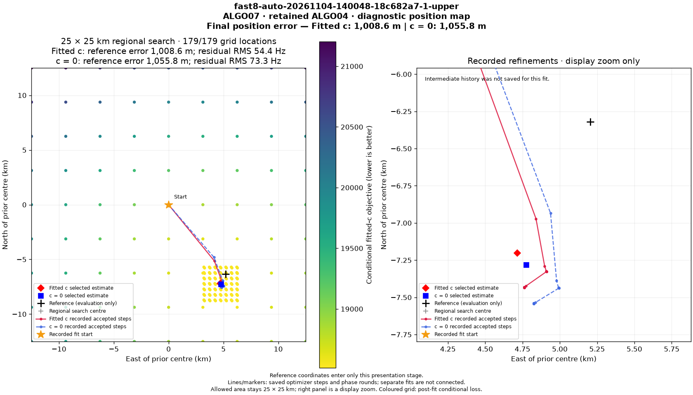
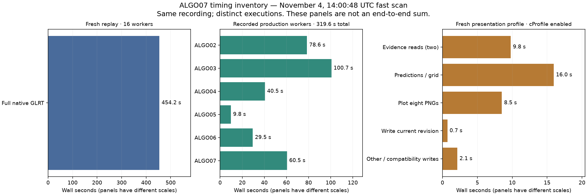
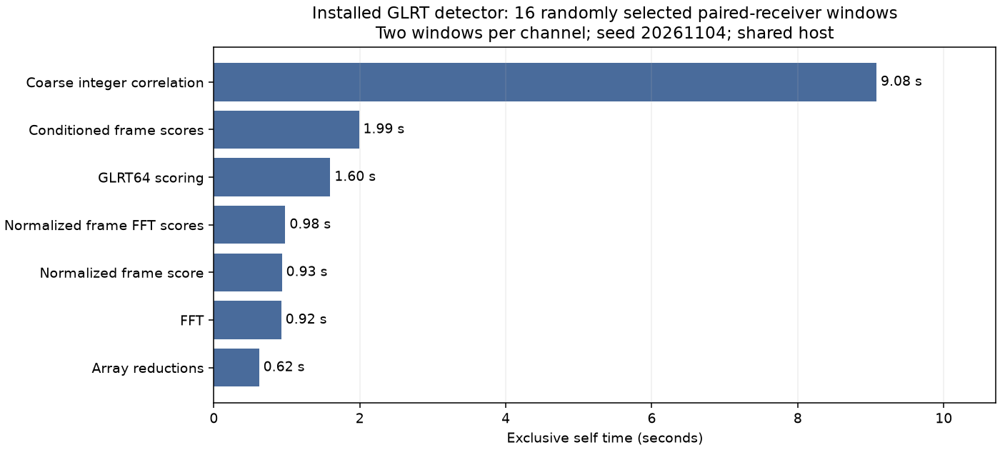

# ALGO07 pipeline costs and explicit final position error

The standard figure now prominently displays **1,008.6 m fitted-c error** and
**1,055.8 m c=0 error** for `fast8-auto-20261104-140048-18c682a7-1-upper`.
The revised renderer and API are deployed. The same confirmed site will be used
for new figures until the user changes it. Published scientific endpoints,
owners and the terminal digest are unchanged.

The missing error was a presentation wiring issue: fresh figures called
`render(packet, title=...)` without an evaluation reference. Historical site
references had only been attached separately to particular scans. The worker
now accepts explicit evaluation coordinates, passes them only to presentation,
and saves a per-recording evaluation sidecar after completion. Saved scan sites
take precedence over the current service setting. The background loop does not
retroactively attach today's site to completed historical recordings.

`final-error-v7` preserves every previous manifest and digest-addressed image.
The original regional centre remains 37.906, -122.545; error is the geodesic
distance to the confirmed site, not distance from that search centre. The user
confirmed 37.849061591561885, -122.48574968092912 for this scan and new scans.

## Timing inventory for the same recording

| Step | Seconds | Evidence and scope |
|---|---:|---|
| Raw-window reading and complete native GLRT replay | **454.17** | Fresh installed detector, 16 workers, 6,773 windows |
| Graph, noise and causal-input preparation | 19.62 | Recorded ALGO02 preparation subprocess |
| Initial associations and ALGO02 localization | 45.79 | Recorded numerical subprocess |
| ALGO02 family comparison | 13.00 | Recorded numerical subprocess |
| Remaining ALGO02 worker overhead | 0.16 | Difference from the 78.57-second worker total |
| ALGO03 predictive recovery | **100.69** | Recorded production worker |
| ALGO04 numerical recovery | 40.49 | Recorded production worker |
| ALGO05 conditional gap recovery | 9.76 | Recorded production worker |
| ALGO06 additional-family recovery | 29.55 | Recorded production worker |
| ALGO07 guarded reassociation | 60.51 | Recorded production worker |
| Original standard figure reconstruction/rendering | 42.70 | Recorded figure manifest timer, before final target publish |
| Fresh presentation reconstruction/rendering/publication | 37.09 | Separate private replay with cProfile enabled |

**ALGO02–07 workers total 319.57 seconds (5 min 20 sec).** These are exclusive
worker durations, checked against the nested public terminal. The first three
substeps are part of ALGO02, not additional work. The fresh native replay took
7 min 34 sec. Do not sum these separate executions and claim a measured
end-to-end runtime or speedup. Production and other research work ran on the
shared host; the fresh final-stage and small detector profiles overlapped the
full native replay. There is no paired before/after performance claim here.

Native replay covered **5,815 processed and 958 invalid-capture windows** and
exactly reproduced every published candidate. All 726 frozen files remained
verified. The small native profile randomly selected two paired-receiver windows
per channel (seed 20261104), with exact published-candidate agreement in all 16.
These comparisons do not assert a new downstream cohort accuracy evaluation.

The complete native replay consumed 6,698.31 aggregate child CPU seconds,
including 6,645.45 seconds timed inside window analysis. That averages about
14.75 occupied CPU cores over its wall time. This run points primarily to
detector computation, rather than Python scheduling or disk reads, as the next
native target. It does not exclude memory-bandwidth limits inside the detector.

## Where the computation goes

The installed detector's largest self-time hotspot is coarse integer correlation:
**9.08 seconds** in the 16-window profile. Conditioned frame scores take 1.99 s,
GLRT64 scoring 1.60 s, normalized FFT scoring 0.98 s, normalized frame scoring
0.93 s, and FFT calls 0.92 s. These are exclusive self times; cumulative call
times must not be added to their children.

A fresh prepared ALGO07 reassociation replay completed in **90.71 s with
cProfile**, retained the incumbent in both arms and left all 984 frozen files
unchanged. This is a research replay, not the recorded 60.51-second production
worker or a controlled speed comparison. Its dominant geometry modules are
byte-identical to the installed worker, as verified in `hotspot-identity.json`.

| Final-stage function | Calls | Self time | Cumulative time |
|---|---:|---:|---:|
| Phase-shifted satellite states | 259 | 20.99 s | 37.18 s |
| Orbit-state interpolation/validation | 259 | 12.05 s | 13.57 s |
| Receiver look angles | 4,826 | 5.44 s | 8.00 s |
| Hierarchical likelihood | 445 | 4.14 s | 9.96 s |
| Linear solves | 15,723 | 3.15 s | 3.27 s |

**There were zero calls to the two-family phase-pair kernel.** The proposed
shared-LU optimization targets that kernel and therefore would not help this
scan's final reassociation. Earlier two-family slow cases have a different
bottleneck. Optimize both workload classes using representative fixtures.

The code currently validates the full orbit bank through `interpolate_states`
even for an empty request, before constructing phase-shifted states. Repeated
queries also allocate interpolation and Earth-rotation arrays. A prepared,
immutable bank and exact reuse for identical time/phase grids are promising.
Do not simply remove validation or reuse geometry after a phase, time grid,
orbit buffer or satellite selection changes.

Earlier ALGO03 profiling found repeated training fits and hierarchical posterior
calculations. Its 100.69-second production duration makes it the largest
downstream stage on this scan. This report has not separately re-profiled every
ALGO03–06 child function; their stage totals are measured, while that finer
ALGO03 attribution comes from the preceding runtime experiments.

## Publication and orchestration

The new public-port profiling tool reconstructs the completed scientific
evidence into a private store, never production. Its 37.09-second profile splits
into:

| Operation | Seconds |
|---|---:|
| First validated evidence read | 5.02 |
| Predictions and conditional grid | 15.96 |
| Of which: 179-location, matched-c diagnostic grid | 12.52 |
| Render eight PNGs | 8.51 |
| Second validated evidence read | 4.76 |
| Publish current revision privately | 0.71 |
| Other overhead and previous-layout compatibility writes | 2.13 |

The grid row is a subset of predictions/grid, not an additional cost. JSON
decoding accounts for 7.01 self seconds across this profile, confirming that
repeated evidence loading is material. The second read enforces publication
consistency; an optimization must preserve that check.

Successive ALGO02–07 completion timestamps contain **90.94 seconds** beyond
the recorded ALGO03–07 worker durations: 40.38, 8.27, 10.75, 11.13 and 20.41
seconds between respective stages. These differences include upstream and
downstream validation, publication, scheduling and possible queue wait. They
are not measurements of pure idle time.

The automatic status spans **1,369.48 seconds (22 min 49 sec)** from its start
to completion update. That is observed orchestration latency, not active compute
time. Acquisition, ingestion, native queueing and the original native processing
interval are not separately timed in the public report. The fresh GLRT replay
does not retroactively identify those intervals. The native public contract has
no duration field; this remaining instrumentation gap is explicit.

## Recommended order

1. **Exact GLRT reference reuse and frame-score batching.** Qualify the existing
   two-epoch candidate, then profile conditioned frame-score workspace reuse.
   Keep exact rescoring, conservative bounds, fallback and all candidates.
   The prior full candidate comparison suggested only about 5% additional
   benefit; do not present that as a tenfold pipeline improvement.
2. **Prepared orbit banks and exact phase-grid reuse.** Start with the measured
   phase/interpolation work on this scan. Validate immutable inputs once at
   preparation and retain all query-domain checks. Match both calibration arms,
   intermediate screens, final owners and endpoints. Track memory use and
   copy/restrict cases explicitly.
3. **Reduce repeated evidence decoding and handoff work.** Reuse validated
   immutable evidence within one job, with a fresh integrity check at consumption
   and publication. Add spans around watcher/export/publication boundaries before
   attributing the 91-second gap to a specific cause. Avoid an unbounded global
   cache or skipping scientific acceptance checks.
4. **Keep publication off the result-critical path where possible.** The
   diagnostic grid is post-fit work. Serving an already sealed position while
   detailed figures finish can reduce visible latency without changing inference.
   Preserve the previous complete figure revision until the replacement is atomic.

Use the existing both-arm frozen DS26/27/28 protocol for any numerical promotion.
Do not reduce sample rate, shorten scans, drop channels, shrink satellite sets,
coarsen phase grids or change priors and call it a runtime-only improvement.
This profiling pass changes presentation only; it does not promote a new ALGO.

## Deployment, validation and artifacts

Code commit `4cd629cef1e3bb35073d8c39f587ddf3d6d6ebf7` is on remote main.
The immutable presentation runtime changes only three files; all other 2,145
files match its prior release. The figure publisher was replaced only after
checking its idle sleep state, absent children and absent render ownership.
The API and publisher are active with zero restarts. Capture and numerical
workers were not restarted. The live API PNG digest was verified, and the
scientific terminal SHA-256 remains
`142b438609608d30a56ca29602077a7755f8fd88f68421152507c69b7460a8ca`.

Validation: **25 numerical/presentation/storage/tool tests plus one API test
passed**. The tests run in their corresponding existing dependency environments;
the API environment lacks SciPy and the numerical environment lacks FastAPI.
New tool lint and diff checks pass. The revised PNG was visually inspected.

Receipts: [live figure](live-figure.json), [runtime](figure-runtime.json),
[activation](figure-activation.json), [recorded worker chain](position-chain.json),
[observed timeline](observed-timeline.json), [native full result](native-full-result.json),
[native timing](native-full-timing.json), [native profile](native-hotspots.json),
[final-stage profile](final-worker-hotspots.json),
[publication profile](publication-profile.json).

New CLI: `tools/profile_algo07_publication.py --bulk-root ROOT --job JOB
--output NEW_PRIVATE_DIRECTORY` with optional evaluation-coordinate flags,
one BLAS thread and an external timeout. Detailed operating instructions are in
`docs/operations/standard-position-error.md`. Existing `algo07_profile chain`,
`profile_algo07_full_glrt.py`, `profile_algo07_glrt.py` and
`profile_algo07_numerics.py` supplied the other measurements.
