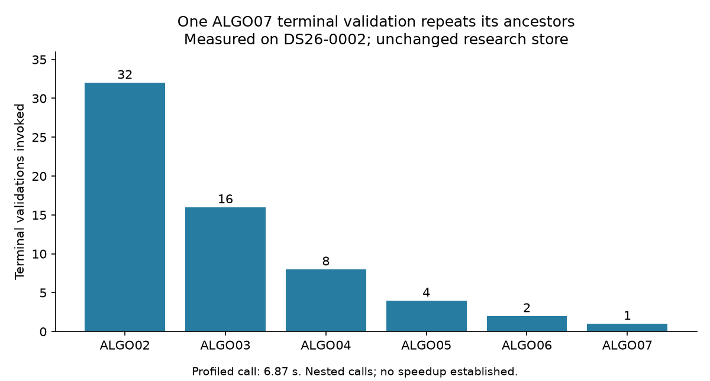

# ALGO07*: first DS26 cohort pair and repeated-validation profile

The first two cases in the reproducible cohort order, **DS26-0267** and
**DS26-0102**, pass their fresh initial-stage comparison against independent
production-watcher runs. The preparation bytes and both calibration arms'
scientific results agree exactly. Their remaining stages are in progress; these
are not yet full ALGO07 parity passes. Production is unchanged.

## Cohort and initial results

The refreshed public-native inventory has 159 DS26 fast members: 158 available
native runs and one unavailable run. All remain in the denominator. The 158
adaptive members are outside this fast-scan comparison. Available cases are
ordered by SHA256 of `seed:dataset_label:input_sha256`, with seed `20261104`;
no fit outcome or evaluation GPS enters this ordering.

The complete order and hashes of the immutable plan and comparisons are in
[evidence.json](evidence.json). The planner and its four component-owned tests
are committed with this report. The two paths use separate native clones,
unchanged 1,200-second scientific stage budgets and the same frozen causal TLE
view. Four concurrent paths are for parity testing, not speed measurement.

| Case | Prepared files compared byte-for-byte | Scientific result files | Scientific differences | Scope |
| --- | ---: | ---: | ---: | --- |
| DS26-0267 | 17 | 6 | 0 | Initial ALGO02 stage, both arms |
| DS26-0102 | 17 | 6 | 0 | Initial ALGO02 stage, both arms |

The initial comparator preserves satellites, point ownership, decisions,
objectives and optimizer histories. Its existing normalization handles named
provenance paths/hash links and top-level elapsed time in five completed files;
the result is exact scientific equality, not equality of all raw JSON bytes.
The later full comparator independently checks process ancestry, intermediate
files and verified hash links. It has not yet completed on these two cases.

Both initial invocations checkpointed before ALGO03. The new verification CLI
resumed them without changing stage budgets. At the observed progress check,
both DS26-0267 paths had completed ALGO03 and were running ALGO04; DS26-0102 was
running ALGO03. These observations are progress, not parity receipts.

DS26-0002 remains the one completed smoke case with full scientific and completed
publication parity, as detailed in the
[previous report](../2026_11_04_algo07_star_intermediate_parity/README.md).
The new CLI independently rechecked that case successfully. Full available-DS26
qualification and a measured optimized implementation remain outstanding.

## Measured optimization opportunity: repeated terminal validation

A bounded `cProfile` experiment invoked the current research storage adapter's
`FastGraphPositionStoreV6.terminal(job)` once on DS26-0002's completed candidate.
The job was obtained through its public status port. It returned the verified
terminal and binding, with **6.870 seconds** of profiled wall time. The full
profile summary records source-file hashes, the execution-receipt hash, terminal
binding and function statistics; its path and hash are in `evidence.json`.

The one call invoked terminal validation 1, 2, 4, 8, 16 and 32 times for ALGO07
through ALGO02 respectively: 63 terminal validations in total. The implementation
first validates an incumbent through `verify_input`, then recursively reads and
validates it again to compare the terminal's embedded incumbent. Each earlier
stage repeats this pattern. The profile also observed 95 calls to the shared
storage `sha` function.

This is a concrete opportunity to remove duplicate verification work. It is
**not** evidence that verification can be skipped, nor a measured end-to-end
speedup. Cumulative profile times are nested and must not be summed. The
measurement used the research checkout, under concurrent cohort activity, and
includes profiling overhead; it is not an installed-production timing claim.

A prospective optimization should validate each dependency once within a
bounded operation, retain exact terminal and hash binding, and detect changed
source files. It must not cache across mutations or suppress contract failures.
Tests need to cover altered native evidence, altered incumbent bytes, wrong
embedded incumbents and changes during an operation. No such optimization was
installed or used in this cohort batch.

## Continuation

Use the [verification skill](../../.agents/skills/verify-algo07-star/SKILL.md)
and `tools/verify_algo07_star.py status/run/check` for the configured cases.
Resume only confirmed checkpoints, retain failed cases, and compare all stages
and artifacts after both paths finish. The existing deadline-sensitive grid
failure on the smoke case remains recorded separately from the completed-grid
passes. No optimization is accepted until the required DS26 comparisons pass.
