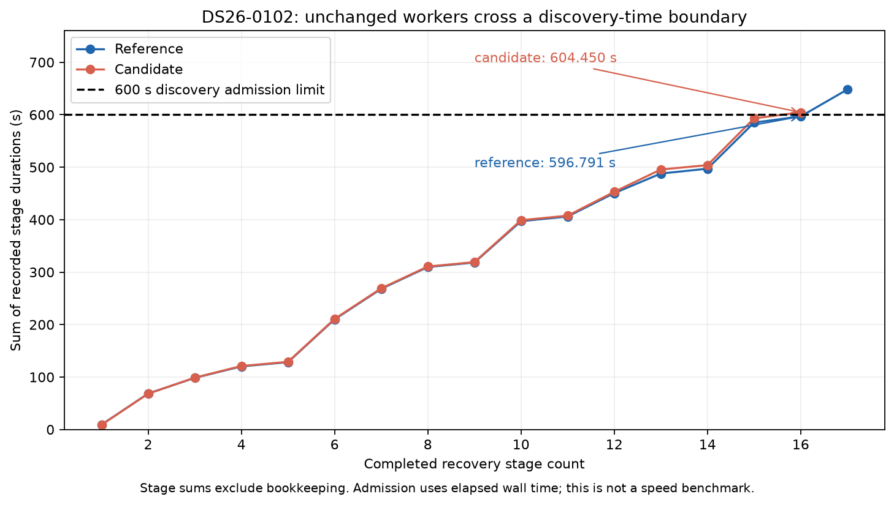

# ALGO07*: discovery deadline divergence on DS26-0102

The zero-change DS26-0102 pair **fails strict intermediate equivalence** because
the original predictive-recovery worker tested one more track on the reference
path. The first differing admission is explained by its existing 600-second
discovery limit. This occurred before the terminal-read optimization was enabled.

The final selected model, both position estimates, all 3,471 point-to-satellite
assignments in each arm, and the selected ALGO03/ALGO04 fit objectives agree
exactly. That limited outcome agreement does not erase the different search or
qualify this case as a full scientific or publication pass. Production and the
strict comparator are unchanged.

## First divergent work

Both paths run the pinned ALGO03 worker at
`/opt/leo-fast-graph-runtime-algo03/f286f3e3029ec17479f4aa2b41312e4220258944`.
Its `tools/algo03_shadow_worker.py` checks elapsed monotonic wall time before each
target annotation:

```python
discovery_budget = min(600., maximum_seconds * .7)
if time.monotonic() - began > discovery_budget:
    attempt['status'] = 'discovery_budget_exhausted'
    continue
```

Both recorded recovery budgets are 1,169 seconds within the unchanged outer
1,200-second stage budget. Therefore the discovery threshold is 600 seconds
on both sides. The threshold stops admission of new targets; an admitted
annotation can finish after it.



| Evidence at the sixth target | Reference | Candidate |
| --- | ---: | ---: |
| Sum of preceding recorded stage durations | 596.791 s | 604.450 s |
| Discovery admission threshold | 600 s | 600 s |
| Target `17227ac79bdec1f733c0` | Annotated | Not admitted |
| Native points in target | 30 | 30 |
| Target outcome | `ambiguous_identity` | `discovery_budget_exhausted` |
| Extra annotation duration | 51.263 s | — |
| Recovery process receipts | 31 | 30 |

The stage-duration sums exclude bookkeeping and are not exact readings of the
admission clock. The worker's branch and recorded statuses establish which side
of the threshold each execution reached. The candidate sum alone already exceeds
600 seconds. The additional reference annotation nominated NORAD 68066 but failed
uniqueness; it did not add the 30 points. The seventh target is budget-exhausted
on both sides. The first five target statuses agree.

The mismatch propagates into copied evidence and downstream read receipts.
The process audit finds differing forests in 39 of 42 receipt groups, rather
than 39 independent numerical failures. The strict comparison stops at
`Process provenance differs`; it does not claim a complete numerical diff.

## Separate, limited outcome audit

The reproducible diagnostic rehashes every file in both six-stage evidence
exports and validates all twelve public stage terminals. It then compares
specific public outcomes using typed exact equality, with no tolerance:

| Compared outcome | Result |
| --- | --- |
| Final selected model | Both retain `algo04-causal-numerical-v1` |
| All six stage decision labels | Exact agreement |
| Final c=0 endpoint | Both `[37.85721050911312, -122.48654909403899]` |
| Final fitted-c endpoint | Both `[37.8569289082106, -122.48590368245982]` |
| Final native observation ownership | Exact, 3,471 observations per arm |
| ALGO03 selected arm objects | Exact, including objectives and ownership |
| ALGO04 selected arm objects | Exact, including objectives and ownership |
| Full intermediate science | **Failed qualification: different work** |
| Publication parity | Not established by this diagnostic |

This is not a new acceptance rule. The diagnostic explicitly records
`scientific_parity_qualified=false`. Final endpoint/ownership equality cannot
stand in for comparing all candidates, folds, optimizer histories, residual
arrays and artifacts. The original failed check is retained.

## What this means for optimization

The observation establishes a deadline-sensitive case in the unchanged-worker
cohort. Small timing differences can alter the number of hypotheses considered;
it does not establish that the optimized implementation is faster or incorrect.
In this pair the extra hypothesis was rejected, but another scan could accept
one and change its final position.

Keep the original wall-time budgets and fail-visible comparisons. Do not fix
this by raising the deadline only for the candidate, removing an intermediate
comparison, or rerunning until a pair happens to match. The already documented
qualification protocol requires matching logical cancellation boundaries for
deadline-sensitive behavior and separately reporting actual wall-time outcomes.
Those controlled cancellation tests remain outstanding. A deterministic work
limit would be a scientific-policy change and requires a separate proposal;
it cannot silently become an ALGO07* optimization.

The current terminal-read optimization operates in the outer storage adapter;
the numerical workers and their discovery clocks remain unchanged. Its fresh
DS26-0002 trial has completed ALGO03 and resumed from ALGO04. No end-to-end speed
claim or DS26-wide qualification is made. DS26-0170's reference and zero-change
candidate have finished all six stages and their full comparison is in progress
at this report checkpoint. DS26-0018 continues in bounded invocations, and
DS26-0084 is next in the frozen ordering. All 159 fast members remain in the
denominator, including the one unavailable native input.

## Reproduction and evidence

Use [the verification skill](../../.agents/skills/verify-algo07-star/SKILL.md) for
qualification. The additional diagnostic is [reproduce.py](reproduce.py), with
the compact [summary.json](summary.json) and [evidence.json](evidence.json).

```bash
cd /srv/bulk/leo-dev/algo06-promotion-20261101
sudo -n env PYTHONPATH=src:tools \
  /home/mouse9911/gits/leo-tracker-reduxredux/.venv/bin/python -B \
  reports/2026_11_04_algo07_star_deadline_divergence/reproduce.py \
  --check /srv/bulk/leo/research/algo07-star-20261104/iteration000/DS26-0102/verify-check-0001 \
  --output /absolute/new/private/diagnostic-directory
```

The full diagnostic remains in the private research evidence directory and is
bound by its SHA256 in the summary. It includes the full compared ownership and
selected-arm objects. No inference consumes evaluation coordinates or these
reference outputs.
