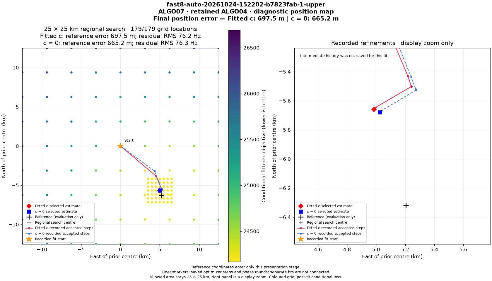
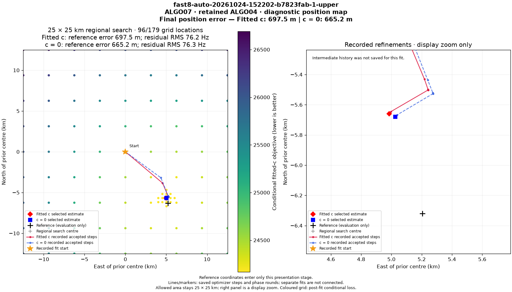

# ALGO07* iteration 000: first full inference and publication comparison

The isolated ALGO07* coordinator completed ALGO02 through ALGO07 on DS26-0002.
Its final public position, ownership, association statistics and residual metrics
match a fresh production-path replay exactly in both calibration arms. Seven
of the eight published PNGs are byte-identical. **Full artifact parity failed**:
the unchanged 30-second diagnostic-grid budget completed different numbers of
grid locations in the two publication runs. No optimization is qualified or
deployed by this result, and full DS26 validation remains outstanding.

This extends the [initial-stage foundation](../2026_11_04_algo07_star_foundation/README.md)
and follows the [ALGO07* plan](../../docs/operations/algo07-star-plan.md).

## Fresh inference result

Case: `DS26-0002`, recording
`fast8-auto-20261024-152202-b7823fab-1-upper`.
Both paths start from the same 4,211 native GLRT points. The reference uses the
installed production watcher entrypoints against an isolated store; the
candidate uses the new coordinator with the same pinned numerical workers.
The reference's initial stage is the fresh replay from the foundation report;
its five recovery stages are fresh runs here. The corrected candidate reran all
six stages from native evidence. Neither path reads a historical fitted answer
as its starting solution.

| Metric | Production path | ALGO07* |
| --- | ---: | ---: |
| Retained scientific model | ALGO04 | ALGO04 |
| Associated GLRT points, both arms | 2,783 | 2,783 |
| Associated GLRT percentage | 66.088815% | 66.088815% |
| Satellites, both arms | 28 | 28 |
| Tracks, both arms | 74 | 74 |
| `c=0` position error | 665.210070 m | 665.210070 m |
| Fitted-`c` position error | 697.463605 m | 697.463605 m |
| `c=0` residual RMS | 76.333281 Hz | 76.333281 Hz |
| Fitted-`c` residual RMS | 76.198125 Hz | 76.198125 Hz |

The displayed rounding is for readability; the comparator uses zero numerical
tolerance. Public terminal validation and complete observation-to-satellite
ownership maps also agree. The confirmed evaluation site enters publication
only, after the scientific terminals are complete.

See [publication comparison](publication-comparison.json),
[candidate execution receipt](candidate-chain.json),
[reference execution receipt](reference-chain.json) and
[runtime selection including required environment pins](runtimes.json).

## A real deadline-sensitive artifact difference

The production renderer is unchanged in both trials. It gives its conditional
position grid 30 seconds. The reference completed 179/179 locations in 28.56
seconds; the candidate completed 96/179 in 30.07 seconds. All 96 shared locations
have exactly equal coordinates and paired objective scores. Published science
documents have no differing scientific fields. The recorded optimizer path
data agree; their binding to the position PNG differs because that PNG differs.

| Artifact | Byte-identical? |
| --- | --- |
| CH1–4 all GLRT | Yes |
| CH5–8 all GLRT | Yes |
| CH1–4 unassociated | Yes |
| CH5–8 unassociated | Yes |
| CH1–4 residuals | Yes |
| CH5–8 residuals | Yes |
| Track RMS | Yes |
| Position map | **No: 179 versus 96 evaluated grid locations** |

Reference publication:

Candidate publication:

The grid is a post-fit diagnostic. Its timeout changes the amount of displayed
loss-surface evidence, not the selected position. The existing comparator rejects
this full-artifact comparison; no budget was extended and no failed artifact was
replaced to make the result pass. A controlled completed-grid comparison and
deadline-sensitive reporting are still required. This also demonstrates why
wall-clock cutoffs must be treated explicitly during runtime qualification.

## Harness defects found and corrected

The first recovery attempt omitted two production environment variables:
`LEO_ALGO03_RUNTIME_MANIFEST_SHA256` and
`LEO_ALGO07_RUNTIME_MANIFEST_SHA256`. The installed runtimes correctly rejected
those launches. ALGO03 published its fallback with the failure recorded, later
stages inherited unusable recovery evidence, and ALGO07 could not start. That
attempt is retained at `iteration000/DS26-0002/candidate`; it is not qualification
evidence. The corrected run uses a new store, `candidate-r2`, and matches the
production pins. The harness now rejects a missing or mismatched required pin
before launching numerical work. The reference also preserves the actual
production watcher overlays while keeping each worker on its qualified release.

Separately, a newly collected TLE snapshot invalidated the initial live-archive
inventory. `tools/algo07_star_archive.py` now materializes the frozen snapshots
through `TleArchiveReader` and mounts the clone read-only in a private Linux mount
namespace for each replay process. The canary observed 1,381 frozen snapshots in
that namespace, while the unchanged live host had 1,382. The original worker
paths and causal selection rules remain unchanged. The wrapper uses Linux
`unshare` and mount privileges; production's archive and collector are untouched.

The corrected inference manifest pins 72,405 files, including installed Python
environments, worker implementations, watcher overlays and the frozen catalogue.
Its SHA-256 is
`bac89fcc869d69730a3681a91ef89d45b5f2f72e930737349bfee499e4010a07`.
The full fixture and rejected attempts remain under
`/srv/bulk/leo/research/algo07-star-20261104/iteration000`.

## Intermediate evidence: promising, not yet a qualification waiver

The new storage diagnostic port exported every worker output, with hashes checked
before and after copying. Per-stage exports contain 33, 133, 323, 661, 1,338 and
1,347 files respectively. The strict diff retains operational differences instead
of silently stripping arbitrary metadata fields.

Across all six stage exports there are no changed Boolean values and no changed
floating-point values outside the explicitly listed runtime-accounting field
names. Changed dictionary keys are confined to process-specific read-receipt
filenames. Numerous provenance hashes and process/cache records differ as
expected when fresh runs have different timing and process IDs.

These observations are diagnostic evidence, **not a completed internal parity
gate**. A schema-specific pass must independently verify hash links and process
ancestry before allowing the corresponding operational differences. The
[intermediate summary](intermediate-diff-summary.json) preserves raw-diff hashes
and locations and explicitly reports `scientific_parity_qualified=false`.

## Measured opportunities to reduce overhead

Repeated export trees are substantial. The ALGO07 worker's output contains
2.061 GB of logical file bytes, but only 0.562 GB of distinct byte content:
1.499 GB, approximately 73%, repeats content already present elsewhere in that
worker tree. Across the six worker exports the total logical content is about
5.88 GB. This is content accounting, not measured copy time or physical disk
allocation. See [copy accounting](copy-accounting.json).

The bulk filesystem is XFS, but a bounded `FICLONE` probe returned
`Operation not supported`; copy-on-write cloning is not available as an easy
substitute on this mount. The [probe receipt](filesystem-clone-probe.json) is
retained. Hard links are not an acceptable generic replacement because preparation
can rewrite its local copies. The next transport prototype should use validated
immutable evidence through explicit ports and prove which copies can be removed.

Candidate stage-adapter times were approximately 130.35, 172.48, 51.51, 25.60,
61.50 and 82.61 seconds. These are workload attribution only. The inference paths
overlapped for scientific testing, publication contended with diagnostic export
I/O, and reference/candidate wrapper timing scopes differ. No speedup ratio is
claimed. Controlled unprofiled A/B and B/A timing follows parity qualification.

## Validation and remaining work

The focused suite passes 38 tests, and lint passes. Tests cover archive clone
membership/corruption, refusal to mount without a new namespace, required runtime
pins, actual production watcher command construction, complete diagnostic exports,
strict scientific diffs and preservation of grid/ownership evidence. The fresh
GLRT-input-to-publication smoke pair is additional integration evidence; native
GLRT extraction itself was not rerun in this comparison.

Next: finish the intermediate provenance comparator, handle completed and
deadline-sensitive presentation cases explicitly, and run bounded fresh paired
batches over all 158 currently available DS26 fast inputs while retaining the
159th missing input in the denominator. Then prototype one measured optimization
at a time and repeat the complete DS26 gate. Production remains unchanged.
