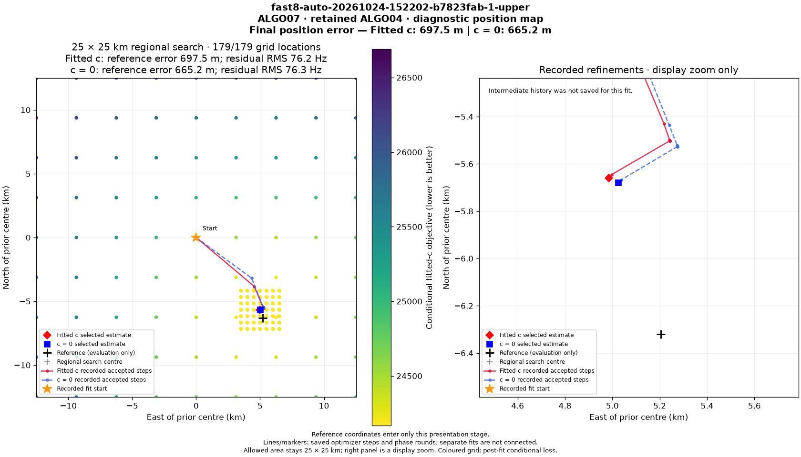

# ALGO07*: intermediate scientific parity on the first full smoke case

The first complete ALGO07* smoke case, **DS26-0002**, now passes the intermediate
JSON and numerical-array comparison against its fresh production-path reference.
Both controlled publication pairs also produce **eight byte-identical PNGs**,
identical complete 179-location diagnostic grids, and identical optimizer-path
data. This qualifies evidence on one case; it does not qualify the full DS26
cohort or an optimization. Production remains unchanged.

The underlying scientific executions are the unchanged workers described in the
[full smoke report](../2026_11_04_algo07_star_full_smoke/README.md). This iteration
adds a stricter comparator and fresh publication replays; it does not rerun or
change the numerical inference. The [execution plan](../../docs/operations/algo07-star-plan.md)
still requires all available DS26 fast cases at each accepted optimization.

## Scientific and provenance comparison

| Evidence, per execution | Checked | Result |
| --- | ---: | --- |
| Worker exports across ALGO02–ALGO07 | 3,835 files | Complete inventories and byte hashes verified |
| Scientific/provenance JSON documents | 3,037 | Zero remaining scientific-value differences |
| Other binary/text files | 477 | Exact bytes, except reviewed log timing messages |
| Process receipts, including copied receipts | 279 in 42 groups | Recorded work and ancestry match |
| Named file-hash references | 15,955 | Bound to exported target bytes |
| Relocation receipts | 18 | Direct and historical copy proofs checked |
| Public scientific terminals | All six stages | Contract validation passes |
| Original whole-worker budgets | 1,200 seconds each | Bound to the paired execution/configuration evidence |
| Font-cache files | 42 | Explicit presentation-cache differences retained |

The comparison uses zero numerical tolerance. It retains array bytes, types,
ordering and all scientific JSON values, including point ownership, satellite
identities, gates, objectives, nuisance parameters and saved optimizer state.
Both `c=0` and fitted-`c` remain required by the public terminal validation.

The [intermediate receipt summary](intermediate-summary.json) binds the full
13.8 MB diagnostic by its SHA-256 and local research path. The full diagnostic
retains every verified link and all 4,536 classified accounting differences.
Its `scientific_json_and_array_parity=true` is a case-level result. Broader
scientific qualification remains false because cohort validation is unfinished.

## What was normalized, and why

Hash differences are resolved against the actual files they name. Every target
remains in the comparison inventory. A correct hash for a different file is
rejected. The comparator does not remove arbitrary fields containing `hash`,
`seconds` or `metadata`.

Later copies of relocation receipts preserve historical digest maps even when
their path strings move. Those maps are checked against the original receipt,
using a verified enclosing copy edge and an exact path-only transformation.
Opaque historical copies must be byte-identical to an already verified receipt.
Changing a historical digest cannot be excused by updating the outer file hash.

Accounting differences require specific record shapes and contexts. Completed
subprocess durations must fit their stated budgets. Public terminal accounting
must pass the versioned contract. Numeric process IDs must map to the same
independently audited role. Remaining launch budgets are bound to the frozen
runtime specification, reference commands, and candidate execution's final
terminal. Solver iterations, phase rounds, coordinates, scores and decisions
remain exact.

The 58 changed log files are copies of three log types. The comparator preserves
their complete text except the elapsed-time number in two reviewed message
formats: the initial completion message and the predictive-fit endpoint message.
The displayed endpoint text must still match. Unknown messages and changed
endpoint values fail comparison.

The 42 Matplotlib font-cache files remain an explicit presentation-only class.
They are not used to claim artifact equality; the publication comparator separately
validates every PNG byte, grid value, optimizer-path value and terminal binding.

## Unchanged localization result

Recording: `fast8-auto-20261024-152202-b7823fab-1-upper`.
The retained scientific model is ALGO04 on both paths.

| Metric | Production ALGO07 path | ALGO07* |
| --- | ---: | ---: |
| Native GLRT points | 4,211 | 4,211 |
| Associated points, both arms | 2,783 | 2,783 |
| Associated percentage | 66.088815% | 66.088815% |
| Tracks / satellites, both arms | 74 / 28 | 74 / 28 |
| `c=0` position error | 665.210070 m | 665.210070 m |
| Fitted-`c` position error | 697.463605 m | 697.463605 m |
| `c=0` residual RMS | 76.333281 Hz | 76.333281 Hz |
| Fitted-`c` residual RMS | 76.198125 Hz | 76.198125 Hz |

Displayed rounding is for readability; comparison is exact. Evaluation GPS enters
publication only and does not control inference or acceptance.

## Completed-grid publication comparison

Four publication trials were declared in advance: reference A1, candidate B1,
candidate B2, reference A2. Each runs in a separate process using the installed
renderer, matching one-thread BLAS settings, a new private publication store and
the unchanged 30-second grid budget. Scientific source terminals are checked
before and after publishing. The presentation runtime's frozen file inventory
is verified around the experiment.

Trial results and both pair comparisons are recorded in
[publication trials](publication-trials.json), [A1/B1 comparison](publication-A1-B1.json)
and [A2/B2 comparison](publication-A2-B2.json).

| Declared trial order | Publication wall time | Grid time | Grid coverage |
| --- | ---: | ---: | ---: |
| Reference A1 | 56.73 s | 28.36 s | 179 / 179 |
| Candidate B1 | 51.58 s | 27.45 s | 179 / 179 |
| Candidate B2 | 53.18 s | 28.56 s | 179 / 179 |
| Reference A2 | 50.09 s | 28.00 s | 179 / 179 |

Both pair comparisons pass every PNG, grid and path check. The
[case qualification receipt](case-qualification.json) binds this evidence to the
intermediate comparison and preserves the earlier deadline-sensitive failure.

The reference position map below is also the candidate's byte-identical
position map for A1/B1.

The previous 179-versus-96-location failure remains valid and is retained in the
[earlier report](../2026_11_04_algo07_star_full_smoke/README.md#a-real-deadline-sensitive-artifact-difference).
These completed runs do not establish universal equality under arbitrary wall
interruptions. Faster code can change which work fits inside a deadline; that
outcome must remain separately reported.

Publication timings describe these unchanged-renderer replays, not an ALGO07*
speedup. No numerical optimization is promoted on this evidence.

## Validation and next actions

The focused suite passes **76 tests**, and lint passes. New tests cover wrong-file
hash substitution, export mutation, missing copy proofs, corrupted historical
maps, process-path collisions, wrong execution/input bindings, unknown timing
fields, changed scientific values, incomplete fits, changed solver budgets, and
log endpoint changes. Separate publication roots must still bind the exact
scientific terminal.

Next, extend the fresh paired runs to additional recovery/acceptance cases and
the complete available DS26 fast cohort. Then implement one measured transport
or exact-calculation reuse change and repeat that cohort gate. The inventory
contains 158 available fast inputs and one missing native input; the missing case
remains in the denominator. There is no full-DS26 result or speedup claim yet.
