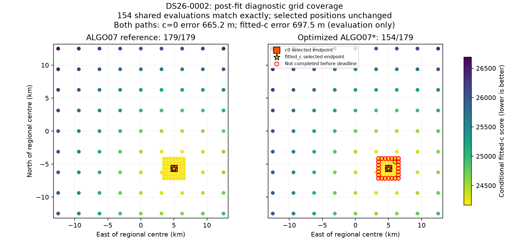
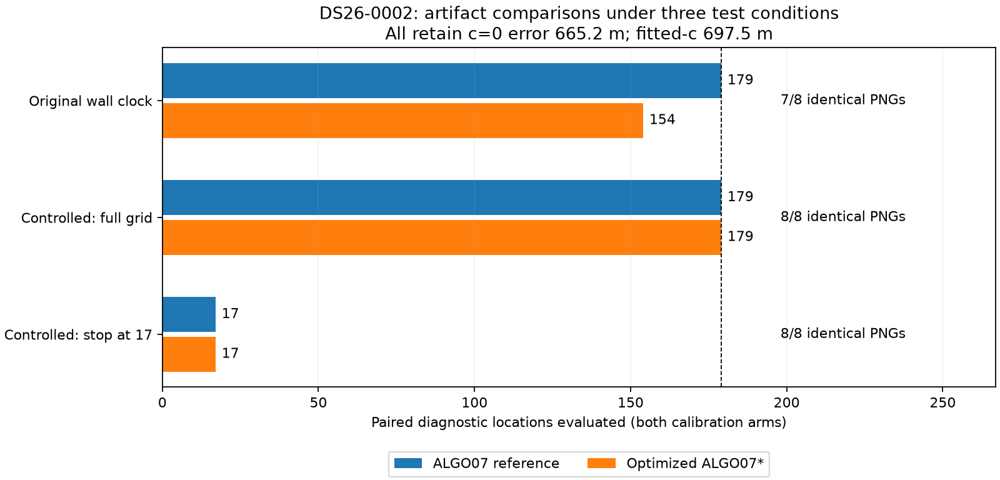

# ALGO07*: optimized scientific replays and publication qualification

The opt-in terminal-read adapter has passed five full scientific replays,
on **DS26-0002, DS26-0267, DS26-0084, DS26-0018 and DS26-0162**.
Every scientific stage, both calibration arms and the final
policy agree exactly with their independent pinned production references. This
qualifies five scientific cases, not the DS26 cohort or deployment. DS26-0084
also passes the full ordinary-clock artifact comparison: all eight PNGs and all
179 grid locations match. Earlier incomplete-grid failures remain recorded;
see the [full case receipt](../2026_11_04_algo07_star_second_deadline_case/ds26-0084-full-verification.json).

## Optimization and scientific evidence

The candidate uses `FastGraphPositionStoreV6ReadReuse` only at the final-stage
public storage boundary. A fresh operation-local scope reuses already validated
ancestor values while checking input/receipt bytes. The original six numerical
workers, TLE archive, stage budgets and scientific parameters are unchanged.
The earlier [adapter report](../2026_11_04_algo07_star_read_adapter/README.md)
describes the implementation and integrity tests.

| Exact comparison | Optimized DS26-0002 |
| --- | ---: |
| Scientific JSON documents | 3,037 |
| Binary/text files | 477 |
| Process receipts | 279 |
| Verified hash links per path | 15,955 |
| Scientific differences | **0** |
| Hash-link errors | **0** |
| Public stage terminals validated | All six, both paths |

Forty-two font-cache differences remain explicitly accounted for as operational
presentation evidence; they do not disappear from the receipts. Scientific
equality uses the existing reviewed accounting rules and no numerical tolerance.
The candidate source pins were checked before and after execution. This run
adopts the previously completed independent reference for parity only, so its
elapsed time is not a valid paired speed measurement.

| Scientific output | ALGO07 reference | Optimized ALGO07* |
| --- | ---: | ---: |
| Retained model | ALGO04 | ALGO04 |
| GLRT points | 4,211 | 4,211 |
| Associated points, each arm | 2,783 | 2,783 |
| Associated percentage | 66.088815% | 66.088815% |
| Tracks / satellites | 74 / 28 | 74 / 28 |
| c=0 error, evaluation only | 665.210070 m | 665.210070 m |
| Fitted-c error, evaluation only | 697.463605 m | 697.463605 m |
| c=0 residual RMS | 76.333281 Hz | 76.333281 Hz |
| Fitted-c residual RMS | 76.198125 Hz | 76.198125 Hz |

Full observation ownership, endpoints, objectives, nuisance values, intermediate
decisions and saved numerical evidence are covered by the strict science
comparison. The geographic reference enters presentation only.

## First artifact comparison: retained failure

All eight PNGs were generated with the frozen renderer and unchanged grid limit.
Seven PNGs match byte-for-byte. The position PNG differs: the adopted reference
has all 179 locations, while the candidate completes 154. Every shared grid
point has exactly matching scores in both arms. The position-path sidecar's
only reported difference is its correctly bound position-PNG hash.

This figure compares **post-fit diagnostic evaluations**, not optimizer search
steps. Missing red circles mark reference grid locations not completed in the
candidate's timed presentation. Both selected position estimates are unchanged.
The original failed artifact receipt is retained; this is not a full artifact
parity pass, and no rerender-until-pass procedure was used.

## DS26-0170 unchanged-worker replay

The next completed zero-change coordinator pair also passes the full scientific
comparison: **7,122 JSON documents, 691 binary/text files, 427 process receipts**,
and **32,305 verified hash links per path**, with zero scientific differences
and zero link errors. Its first rendered grids are incomplete on both paths:
49/179 reference locations and 60/179 candidate locations. Seven PNGs match
byte-for-byte and every one of the 49 shared grid scores matches exactly in both
arms. The artifact comparison fails; completed science cannot waive incomplete
figures.

On this larger completed case a predeclared A1/B1/B2/A2 terminal-reader component
probe returns exactly the same full terminal and receipt on all four calls:

| Call | Reader | Wall time |
| --- | --- | ---: |
| A1 | Original | 8.819 s |
| B1 | Operation-local reuse | 1.515 s |
| B2 | Operation-local reuse | 1.720 s |
| A2 | Original | 11.403 s |

These are component measurements on a shared host. They do not measure
end-to-end inference or publication speed, and the component ratio must not be
multiplied into a pipeline speedup. The inputs were selected by the existing
cohort order, not by position error or a favorable timing result.

## Qualification status and next work

The zero-change coordinator now has six completed scientific passes:
DS26-0002, DS26-0267, DS26-0170, DS26-0018, DS26-0084 and DS26-0162. DS26-0084 required
the narrowly reviewed diagnostic-duration classification described below;
DS26-0162 required the capped-timeout accounting review in the follow-up report.
DS26-0102 remains a strict failure because of
the documented [discovery-deadline divergence](../2026_11_04_algo07_star_deadline_divergence/README.md),
despite identical final positions and ownership. The optimized adapter has five
completed scientific passes, DS26-0002, DS26-0267, DS26-0084, DS26-0018 and
DS26-0162. These are separate cohorts/iterations.

The mandatory population remains **159 fast members: 158 available native inputs
and one unavailable input**. DS26-0162's unchanged-worker full comparison has
passed. Optimized DS26-0170 has failed strict
qualification: three ALGO03 targets were omitted after crossing the discovery
deadline, although its final selected result, owners and all six decisions match
exactly. See the [full diagnosis](../2026_11_04_algo07_star_second_deadline_case/README.md).
The DS26-0082 reference has finished and its optimized candidate is running.
References DS26-0259 and DS26-0221 continue in the predeclared cohort order.
Optimized DS26-0018 has passed science. Its first ordinary publication pair has
68/179 versus 46/179 grid locations and fails artifact completeness; all shared
scores match exactly. DS26-0162 has passed science; its first artifact comparison
also fails grid completeness (19/179 versus 36/179), with all 19 shared scores
exact. DS26-0102's optimized case has started its first run; its previous
unchanged-worker deadline failure remains included, not excluded from evaluation.
The remaining full-cohort runs, deadline-sensitive
qualification, complete artifact comparisons and controlled pipeline timings
are still required. Production is unchanged.

A proposed shortcut—checking the optimized reader against historical completed
DS26 production terminals—was explicitly inventoried and found **zero matching
completed public ALGO07 jobs among all 159 members**. Native observations exist,
but the old retrospective evaluation summaries are not those terminal chains.
The unused probe was retained in private research evidence; it was not added as
new product tooling or counted as qualification. Fresh replays remain necessary.

Use the [verification skill](../../.agents/skills/verify-algo07-star/SKILL.md) for
the continued bounded runs. [Evidence and hashes](evidence.json) bind the saved
comparisons, publication receipts, component probe and availability inventory.

## Follow-up: match logical grid work explicitly

The sampler already exposes a clock dependency. A research-only fixture injects
a logical admission clock into that sampler inside each isolated publication
process. It admits a predeclared number of paired locations, while the unmodified
renderer, scoring functions, scientific inputs and evaluation reference remain
the same. A separate **600-second real wall limit per publication** is enforced
by the launcher. The fixture does not enter production or numerical inference.

The original plan declared a full 179-location pair followed by cancellation
after 17 paired locations. Both experiments completed, with frozen presentation
files and fixture source verified before/after. No previous failed publication
was overwritten, and the strict comparison's completeness requirement was kept.

| Test condition | Reference locations | Candidate locations | Identical PNGs | Result |
| --- | ---: | ---: | ---: | --- |
| Original 30-second wall-clock runs | 179 | 154 | 7/8 | Artifact parity fails |
| Controlled full grid | 179 | 179 | **8/8** | Exact publication content under this fixture |
| Controlled stop after 17 locations | 17 | 17 | **8/8** | Equivalent cancellation; both remain incomplete |

For the full controlled pair, all 179 paired scores, all eight PNG bytes,
published scientific summaries and path sidecars match exactly. For the
17-location fixture, all 17 shared scores and all PNGs/path data also match; the
unmodified strict comparator still reports `publication_exact=false` because
both grids are incomplete. A separate cancellation receipt records the expected
equivalent truncation without converting it into a full artifact pass.

**The injected clock's `elapsed_seconds` is synthetic.** Separate receipts record
the real grid times: 57.667 / 34.022 seconds for the full reference/candidate
pair, and 2.843 / 3.232 seconds for the 17-location pair. These are shared-host
fixture executions, not controlled performance trials, and no speed ratio is
claimed. The 179-location reference took more than the normal 30-second budget;
matching work demonstrates content equivalence, not identical behavior under
arbitrary wall-clock interruptions.

The fixture and existing sampler have 10 passing focused tests, including
whole-pair cancellation, exact point prefixes, failed score retention and
unexpected clock-protocol rejection. [Controlled evidence](evidence-controlled.json)
binds both plans, executions, comparisons and implementation hashes.

## Further scientific comparisons and an accounting correction

DS26-0018 passes all six stages with **6,667 JSON documents, 662 binary/text
files, 409 process receipts and 30,223 verified hash links per path**. There are
zero scientific differences and zero link errors. Its figure comparison is
still outstanding.

DS26-0084's first comparison reported one difference, preserved in its original
failed receipt: `ALGO07/.../58627/screen.json`, `/cavity/c0/seconds`, was
5.013776754029095 versus 6.932386378757656. The cavity coordinates, objective,
history, phase state and unsuccessful optimizer flag were otherwise identical.

Source review of the pinned `algo07_science/diagnose.py::refit` establishes that
this field is assigned from elapsed monotonic time **after** `minimize` returns;
the function has no wall-clock stopping rule. Its optimizer may return
unsuccessfully and still produce a complete diagnostic record. The previous
accounting classifier recognized this elapsed field only for successful fits.

The new classification applies only to this known cavity schema and exact
`seconds` pointer. Both records must be phase-closed diagnostics with an
unsuccessful optimizer and unsuccessful final history entry, valid elapsed
values, and **every other field identical**. The failure remains a failure;
objectives, histories, satellite identity, phase state and acceptance decisions
are never ignored. Unknown schemas and invalid timing remain differences.

The classifier, fixture and sampler suite has **37 passing tests**, including
mutated scientific values, changed failure outcomes, malformed histories and
invalid durations. The broader comparator, receipt, publication and verification
CLI regression selection has **85 passing tests**. No golden scientific fixture
was changed. Rehashing and
rechecking the original DS26-0084 exports now passes: **2,681 JSON documents,
290 binary/text files, 114 process receipts, 12,481 verified links per path**,
zero scientific differences and zero link errors. This is an explicit accounting
review, not a numerical tolerance or an inference rerun. DS26-0102's different
search work remains a failure and is unaffected by this correction.

## Second optimized scientific pass and another publication comparison

The fresh optimized DS26-0267 candidate passes the full scientific comparison:
**3,650 JSON documents, 392 binary/text files, 205 process receipts and 17,479
verified links per path**. All six public terminals validate, both arms match
exactly, and scientific differences and link errors are both zero. Forty-two
font-cache byte differences remain explicitly recorded as presentation accounting.
There is no new accounting rule or numerical tolerance for this comparison.
The previous independent reference is reused for parity; this does not measure
pipeline speed. See the [verification receipt](ds26-0267-optimized-verification.json)
and [follow-up evidence bindings](evidence-followup.json).

DS26-0018's first ordinary wall-clock publication pair now completes. Its
previous full scientific pass remains unchanged. Both paths produce all eight
figures, but the 30-second diagnostic-grid budget admits different prefixes:

| DS26-0018 publication | ALGO07 reference | Unchanged-worker ALGO07* |
| --- | ---: | ---: |
| Grid locations completed / planned | 75 / 179 | 77 / 179 |
| Associated GLRT points, each arm | 3,226 | 3,226 |
| c=0 evaluation error | 521.406039 m | 521.406039 m |
| Fitted-c evaluation error | 482.321559 m | 482.321559 m |
| c=0 residual RMS | 95.020310 Hz | 95.020310 Hz |
| Fitted-c residual RMS | 90.924497 Hz | 90.924497 Hz |

All 75 shared paired grid scores match exactly; the seven non-position PNGs are
byte-identical. Published science has zero differences. The position-path data
differs only in its binding to the different position-PNG hash. This remains a
**failed full-artifact comparison** because both grids are incomplete. No
injected clock, changed grid budget or repeated attempt was used for this pair.
The frozen renderer was verified before and after, and the private runner has
a separate 600-second real limit for each publication. The
[publication comparison](ds26-0018-publication.json) and
[saved runner](publication_followup.py) preserve the procedure and result.

DS26-0084's first ordinary publication pair also fails full artifact parity:
the reference admits **84/179** grid locations, while the unchanged-worker
candidate completes **179/179**. All 84 shared paired scores are exact, published
science has zero differences, and seven PNGs match byte-for-byte. Again, the
only path-sidecar difference is the position-PNG hash binding. The reference
grid took 30.016 seconds and the candidate grid took 25.117 seconds. These are
uncontrolled, shared-host timings with unequal work; **they do not establish a
speedup**, and this candidate does not use the terminal-read optimization.
Both original publications and the [failed comparison](ds26-0084-publication.json)
are retained. The renderer's 2,149 frozen files verified before and after both
new publication pairs.
