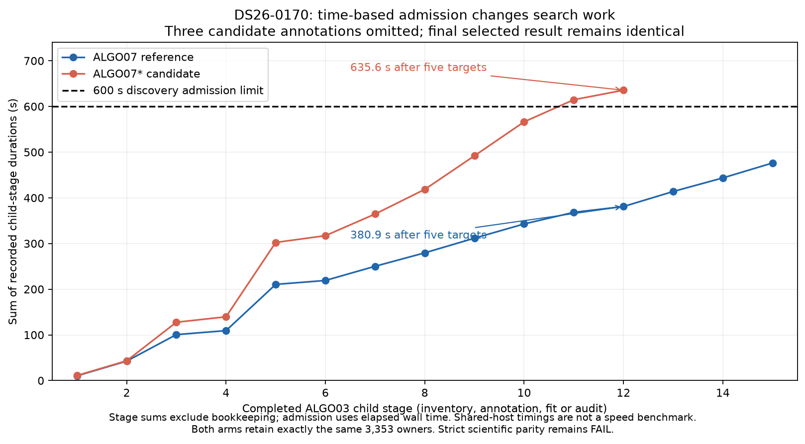

# ALGO07*: DS26-0170 fails because the discovery deadline omits three targets

The optimized DS26-0170 candidate finishes inference but **fails strict scientific
qualification**. Its first differing process group is ALGO03 discovery: the
reference evaluates eight targets, while the candidate crosses the existing
600-second admission limit after the fifth and skips three. The terminal-read
optimization is only installed at the final ALGO07 storage boundary; the
divergence occurs earlier, in the unchanged ALGO03 worker.

Both runs preserve the original 1,200-second stage budgets. ALGO03 records the
same 1,168-second recovery allowance after preparation/reserve, and its discovery
admission limit is `min(600, 0.7 * recovery_allowance)`, or 600 seconds. The worker
checks this before starting each target; an already admitted target can finish
after the limit. It does not interrupt an inclusion solely because discovery
admission has closed.

| Evidence after the first five targets | Reference | Candidate |
| --- | ---: | ---: |
| Sum of recorded child-stage durations | 380.909484 s | 635.631133 s |
| ALGO03 process receipts | 16 | 13 |
| Additional targets annotated | 3 | 0 |
| Total available targets considered for admission | 8 | 8 |

These durations exclude Python bookkeeping. Admission uses actual elapsed wall
time, so the sums locate the boundary but are not an exact reconstruction of
every clock read. The numerical workers are pinned and unchanged. These are
shared-host executions at different times, not a controlled timing trial; the
duration difference cannot be attributed to a particular host resource from
these receipts alone.

| Omitted target | GLRT points | Reference outcome | Candidate outcome |
| --- | ---: | --- | --- |
| `a6b06e9895ba90815a29` | 35 | `unstable_identity` | `discovery_budget_exhausted` |
| `a5d11aa5f4141cb314d1` | 32 | `ambiguous_identity` | `discovery_budget_exhausted` |
| `3f26523f1eb74e47f7ec` | 31 | `unstable_identity` | `discovery_budget_exhausted` |

The first five attempt statuses match. The 99-point first target qualifies on
both paths; the later 37-point fifth target is rejected on both. The reference
also rejects the three extra targets. A separate, limited outcome diagnostic
rehashes the complete exports, validates all six public terminals per path, and
then compares the complete selected public result, full owner dictionaries and
all six stage decision labels exactly. All three projections are equal:

| Final output, identical on both paths | c=0 | Fitted-c |
| --- | --- | --- |
| Associated observation IDs and satellite assignments | 3,353 | 3,353 |
| Latitude | 37.863571924067934 | 37.86348259169218 |
| Longitude | −122.48040045343036 | −122.48036056618852 |

This explains why the final outcome agrees in this case. It does **not** establish
that omitted targets are always harmless. The strict comparator still fails,
and this diagnostic is not an alternate acceptance gate or a numerical tolerance.
The missing work and original failure are retained.

## Consequence for optimization and qualification

This repeats the discovery-boundary mechanism previously observed in
[DS26-0102](../2026_11_04_algo07_star_deadline_divergence/README.md). ALGO07 includes
time-dependent work admission, so unchanged scientific code alone cannot
guarantee identical intermediate work under different wall-clock conditions.
Replacing the time limit with a target quota would be a policy change and is not
part of the current candidate.

Continue the predeclared DS26 comparisons and record deadline-sensitive failures
separately. The matched logical-cancellation replay below uses actual numerical
children while keeping the ordinary wall-clock failures visible.
Existing worker control-flow tests cover the admission boundary and
preservation of earlier accepted recovery using explicitly stubbed children;
they do not substitute for that numerical replay or full-cohort qualification.

The optimized adapter now has five full scientific passes, DS26-0002,
DS26-0267, DS26-0084, DS26-0018 and DS26-0162, plus this failed case.
The full population is still 159 fast members,
158 with available native inputs. No production change or end-to-end speedup is
claimed.

An [iteration source-pin audit](source-pin-audit.json) checks all nine initialized
optimized cases (including unfinished and failed cases). Their complete maps of
852 Python/coordinator source files are identical, as are their fixture pins.
The current source-file inventory and bytes also match that common map. This
rules out mixing implementation revisions within these configured trials; it
does not qualify their scientific outcomes or extend the completed denominator.

### Unavailable native input: failed acquisition

The single unavailable fast member is DS26-0172,
`fast8-auto-20261027-202259-4b766129-1-lower`. A fresh read through
`FastScanStore.automatic_status` still reports `state: failed` and no native run
ID. The recorded acquisition failure identifies invalid or partial support in
continuous visits 5387 and 5388, a regressed terminal source counter, and a
missing terminal drain/restoration receipt. The status records 5,389 captured
windows; that count does not establish valid native input.

The [availability audit](unavailable-input-audit.json) binds this public status
to the frozen cohort member. No partial recording was substituted, no new RF
collection was attempted, and the member remains in the 159-member denominator.
This explains an acquisition exclusion, not an ALGO07* inference failure or pass.

## Optimized DS26-0084: complete ordinary-clock parity

The first ordinary-clock publication pair for optimized DS26-0084 completes
all 179 diagnostic grid locations on both paths. All eight PNGs are byte-identical;
grid, path and published scientific values have zero differences. The combined
CLI check independently rehashes the scientific exports and validates publication
bindings: **PASS, `case_full_parity: true`**. This is the optimized iteration's
first full case pass under ordinary clocks, not a full DS26 qualification.

Both arms retain 3,715 of 4,628 GLRT points. Evaluation errors are exactly
1,217.272407 m for c=0 and 1,259.897558 m for fitted-c. The retained model is
ALGO02. The shared frozen renderer uses the original terminal reader on both
publication paths; differences in publication wall times are not evidence of
an optimization speedup. No failed rendering was replaced to obtain this pass.

Evidence: [combined verification](ds26-0084-full-verification.json) and
[publication comparison](ds26-0084-publication.json).

## Optimized DS26-0267 publication follow-up

The first independent ordinary-clock publication pair for this optimized case
also finishes. Both paths produce all eight PNGs; seven are byte-identical. The
reference grid admits 66/179 locations and the candidate 65/179. Every shared
paired score is exact, published scientific values have zero differences, and
the path-sidecar difference is solely its position-PNG hash binding. Full
artifact parity remains **false** because both grids are incomplete.

Both retain 4,028 associated points out of 5,154 and identical evaluation errors
of 451.017666 m (c=0) and 540.373645 m (fitted-c). Evaluation coordinates enter
presentation only. The frozen renderer's 2,149 files verified before and after.
This is a first comparison for the optimized case, not a rerender-until-pass
attempt, and its independently reused scientific reference does not qualify a
paired performance claim.

Evidence: [strict failure](verification.json), [process comparison](process-difference.json),
[limited diagnostic summary](diagnostic-summary.json),
[publication comparison](ds26-0267-publication.json), [hash bindings](evidence.json).
The saved diagnostic and publication runners preserve the executed procedures.

## DS26-0162: a separate accounting representation issue

The unchanged-worker DS26-0162 pair has identical process provenance and zero
hash-link errors. Its initial comparison reports 326 differences, all integer
versus floating-point types at `budget_seconds`: copies of two completed ALGO03
child receipts propagated through 169 files. All other scientific values in
7,584 JSON documents, 608 binary/text files and 366 process receipts compare
exactly. The original failed comparison remains saved.

| Completed child | Reference timeout | Candidate timeout | Reference elapsed | Candidate elapsed |
| --- | ---: | ---: | ---: | ---: |
| Target 7 audit | 552.181124 s (float) | 600 s (int) | 13.261421 s | 18.028681 s |
| Target 7 retry | 538.758938 s (float) | 600 s (int) | 184.842375 s | 176.160735 s |

The pinned producer writes `min(600, remaining)`. Python returns the integer
cap when it wins and the floating-point remaining duration otherwise. The
classifier already accounts for differing completed subprocess wall budgets,
but it previously rejected every type difference before reaching that rule.

A narrow new accounting class accepts only this known complete receipt shape,
matching nonempty commands and stage names, successful integer return codes,
elapsed durations below each recorded limit, and exactly an integer cap of 600
versus a positive finite float below 600. Other numeric type changes, solver
budgets, unknown schemas, changed commands, failed work and invalid durations
remain differences. A malformed string budget also now fails classification
instead of raising an incidental comparison exception.

The comparator, receipt, publication, CLI and deadline regression selection has
**107 passing tests**. Inference and frozen numerical code are unchanged. The
original DS26-0162 exports have now been rehashed and rechecked: **PASS**, with
zero scientific differences and zero link errors across all six stages, both
arms and 33,595 verified links per path. All 326 budget-type records are
explicitly classified; the original failure remains in the report. This rule
does not affect DS26-0170 or DS26-0102, whose different admitted work fails before
field accounting is reached.

The unchanged-worker coordinator therefore has six scientific passes:
DS26-0002, DS26-0267, DS26-0170, DS26-0018, DS26-0084 and DS26-0162.
These are distinct from the optimized iteration's five passes. Optimized
DS26-0084 independently matches 2,681 JSON documents, 290 binary/text files,
114 process receipts and 12,481 verified links per path, with no scientific
differences or link errors. It does not require the new capped-timeout rule.
See [DS26-0162's reviewed receipt](ds26-0162-reviewed-verification.json) and
[optimized DS26-0084's receipt](ds26-0084-optimized-verification.json).

Optimized DS26-0018 also passes the full scientific comparison with no scientific
differences or link errors: 6,667 JSON documents, 662 binary/text files, 409 process
receipts and 30,223 verified links per path. Its
[verification receipt](ds26-0018-optimized-verification.json) retains the exact
execution bindings. Its first ordinary-clock publication pair fails artifact
parity: the unchanged 30-second grid budget admits 68/179 locations on the
reference and 46/179 on the candidate. All 46 shared scores are exact, seven of
eight PNGs are byte-identical, and published scientific values have no
differences. The incomplete position grids remain failures; see the
[publication receipt](ds26-0018-publication.json). No rendering retry is used.

Optimized DS26-0162 independently passes its scientific comparison: 7,584 JSON
documents, 608 binary/text files, 366 process receipts and 33,595 verified links
per path, with no scientific differences or link errors. This comparison records
62 capped-timeout accounting classifications; no missing search work is waived.
Its first ordinary artifact pair fails completeness: 19/179 reference locations
versus 36/179 candidate locations, with all 19 shared scores exact, seven PNGs
byte-identical, and no published scientific differences. See the
[optimized verification receipt](ds26-0162-optimized-verification.json) and
[artifact comparison](ds26-0162-publication.json).

## Controlled numerical cancellation trial: matched retained outcomes

The new [stage-clock fixture](../../tools/algo03_stage_clock_fixture.py) runs the
installed worker's real control flow and delegates each numerical child to its
unchanged executor. A declared schedule supplies synthetic parent-stage
durations. After the fifth target's audit, the next admission clock read exceeds
600 seconds, so the remaining three annotations are omitted on both paths.
Real child wall durations and timeouts are recorded separately. The worker's
clock and executor bindings are restored after the diagnostic call.

The [frozen plan](logical-cancellation-plan.json) declares two trials, reference
then candidate, using independent ALGO02 snapshots exported through the public
storage port. Both use the original 1,168-second logical recovery allowance,
the same first twelve child stages, the same installed numerical runtime and
thread limits, and a separate 1,200-second real wall limit per trial. A 1,300-second
outer supervisor bound also covers verification and cleanup. Source pins,
snapshot hashes and process read auditing remain required. No production
worker or default clock was modified.

Both trials complete their twelve real numerical children. All thirteen expected
process read-audit receipts verify on each path, with no denied paths; all 72,405
frozen runtime files and three source pins verify after execution. Both select
`ALGO03_single`, retaining the qualified first recovery and annotating the final
three attempts as `discovery_budget_exhausted`.

| Controlled cancellation evidence | Reference | Candidate |
| --- | ---: | ---: |
| Completed numerical children | 12 | 12 |
| Verified process read receipts | 13 | 13 |
| Retained owners, each calibration arm | 3,353 | 3,353 |
| Reported logical duration, synthetic | 600.001 s | 600.001 s |
| Measured worker wall duration | 515.470129 s | 654.273812 s |

The [limited outcome comparison](logical-cancellation-outcome.json) finds zero
differences in the complete selected scientific arm dictionaries, target details,
attempt identities/counts/statuses, RF checks, policy, eligibility and selected
track IDs. This includes exact endpoints, objectives and every retained owner
in both arms. The comparison revalidates the frozen runtime, pinned trial source,
planned input descriptors and copied input hashes, process audit ancestry, and
selected source receipts before comparing these projections.

The full decision diff is also retained: thirteen differences remain in
historical baseline accounting and evidence-hash bindings. This diagnostic does
not recursively qualify every linked child scientific document and does not
replace the stricter full-stage comparator. It supports the narrower conclusion
that this matched cancellation boundary preserves the same accepted recovery
and ownership with actual numerical children. It does not qualify ordinary
deadline behavior, clear DS26-0170's original failure, or establish a speedup;
both trials use the unchanged worker, and the synthetic schedule is explicit.

The [diagnostic script](compare_clock_outcomes.py) preserves all decision
differences instead of silently dropping them. The
[candidate execution receipt](logical-cancellation-candidate-execution.json)
records the separate measured wall time and read-audit outcome.

The fixture's control-flow tests use explicitly stubbed
children: twelve tests pass, including logical cancellation retaining accepted
recovery, changed child sequence and child failure. The combined comparator,
CLI and deadline selection now has **111 passing tests** ([test receipt](clock-regression.xml)).
Those tests do not replace the real numerical pair or full DS26 qualification.

The resulting stage `seconds` fields are synthetic. Any agreement under this
fixture will qualify only the declared cancellation condition. The ordinary
DS26-0170 failure stays failed; these outputs must not be passed off as a normal
wall-clock parity run. Saved preparation, trial and worker scripts accompany
the plan for reproducibility.
