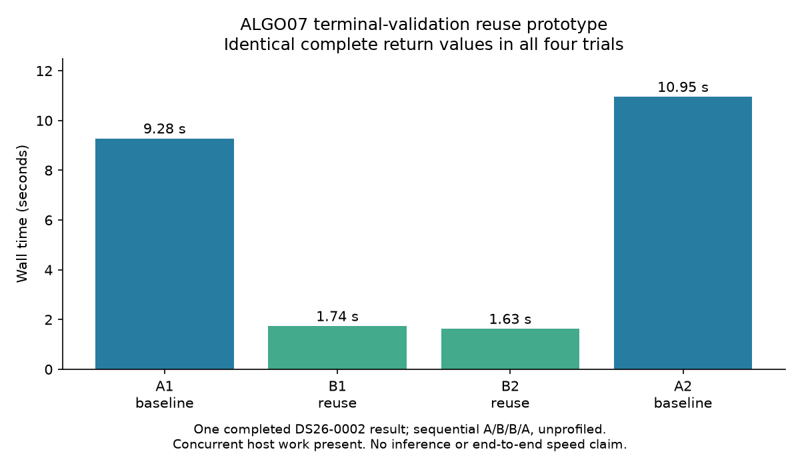

# ALGO07*: isolated terminal-validation reuse prototype

A research-only prototype reduces one complete ALGO07 terminal-validation call
from **9.28–10.95 seconds to 1.63–1.74 seconds** on the completed DS26-0002 smoke
result. All four trials return exactly the same complete terminal and receipt.
This is a validation microbenchmark, not a numerical inference replay or an
end-to-end speedup. It is not installed in production or in the active DS26
zero-change comparison chain.

## Implementation and integrity

The [earlier profile](../2026_11_04_algo07_star_cohort_start/README.md) found 63
recursive terminal validations for one ALGO07 read. The prototype composes the
unchanged storage adapters through their explicit `baseline`/`incumbent` ports.
It does not patch methods, replace numerical kernels, change model settings or
use evaluation coordinates.

`tools/probe_algo07_terminal_reuse.py` gives each ancestor a narrow research
terminal port with a dictionary local to one outer read operation. On the first
read, it calls the original terminal validator, reads the public receipt's exact
bytes, and checks both the digest and complete JSON value before retaining an
independent copy. For a repeated job it:

1. Calls the original `verify_input`, including recursive checks of native input
   bytes, acquisition provenance and source-terminal bindings.
2. Checks the terminal's resolved path and hashes its current bytes.
3. Returns an independent deep copy only if the recorded hash still matches.
4. Otherwise discards the entry and invokes the original full terminal validator.

There is no persistent cache, no mtime-based shortcut and no skipped source-input
validation. Job keys preserve all JSON fields and types through canonical JSON.
The prototype's API is intentionally only a `terminal` port; it does not replace
the source component's export or job lifecycle interfaces.

Eight focused tests pass: independent return objects, changed input despite an
unchanged terminal, changed/corrupt terminal bytes, removed files, different jobs,
mutation during the first read, symlink replacement returning to original
confinement checks, operation-local lifetime and changed native ancestors through
nested reuse. Several properties share a test. These tests and one fixture do
not establish universal equivalence under every concurrent mutation.

## Measurements

The order A1/B1/B2/A2 was recorded before execution. Each trial ran in a separate
process with the same interpreter and one-thread BLAS environment. The script and
all Python files under `src/leo` were pinned before the experiment and checked
after it. Each invocation had a 120-second timeout; the full driver was bounded.
There was concurrent host activity, so these exploratory component timings are
not a production latency benchmark.

| Trial | Path | Wall seconds | Complete returned value |
| --- | --- | ---: | --- |
| A1 | Original public store | 9.279 | Exact |
| B1 | Operation-local reuse | 1.737 | Exact |
| B2 | Operation-local reuse | 1.626 | Exact |
| A2 | Original public store | 10.952 | Exact |

The paired baseline/reuse ratios are 5.34 and 6.74. The complete `(terminal,
receipt)` value has canonical SHA-256
`78aec032136a1a7ae6c6a6d49c9f4d96f8a0894d07fb63991c702b057ef7174d`
in every trial, including both calibration arms and all embedded predecessor
results. [evidence.json](evidence.json) records the raw trials, verified source
plan and comparison hashes. It does not compare rounded positions alone.

A second, separately declared baseline/reuse pair on DS26-0267 also returned
identical complete terminals and receipts. Its calls took 12.88 and 1.93 seconds;
this extends return-value coverage to another completed store, not full pipeline
qualification. [second-case.json](second-case.json) preserves both trials and
the source comparison hash.

## Remaining qualification

The current production-versus-ALGO07* cohort continues with unchanged adapters;
the prototype cannot contaminate that baseline. DS26-0267 has completed both
six-stage scientific executions and now **passes the full intermediate scientific
comparison with zero scientific differences and zero hash-link errors**. The
[scientific summary](ds26-0267-science.json) binds the raw comparison by hash.
This is the second completed science comparison, after DS26-0002.

Its unchanged renderer hit the 30-second diagnostic-grid budget on both paths:
40 reference locations and 41 candidate locations were evaluated, with eight
figures produced on each. Seven PNGs are byte-identical. The position PNG differs;
all 40 shared grid points agree exactly. The [publication comparison](ds26-0267-publication.json)
records this failure. Those incomplete grids do not pass full artifact
qualification; they are retained without an automatic rerender.

Both paths retain ALGO04 on this case, associate 4,028 of 5,154 points (78.152891%),
and select 132 tracks across 26 satellites. Both-arm positions and residuals
agree exactly. The evaluation-only errors are 451.018 m for c=0 and 540.374 m for
fitted-c; these are equality checks, not accuracy improvements.

DS26-0102 and
DS26-0170 remain in progress. No full-cohort result is claimed here.

Before accepting this optimization, integrate its lifetime and integrity rules
into a component-owned public adapter, expand real-store mutation/failure tests,
and run a separately frozen candidate over the full available DS26 cohort using
the verification CLI. Require exact science and the declared artifact checks,
then measure sequential end-to-end trials. Retain the original implementation
for fallback. A speedup in one read operation cannot substitute for these gates.
