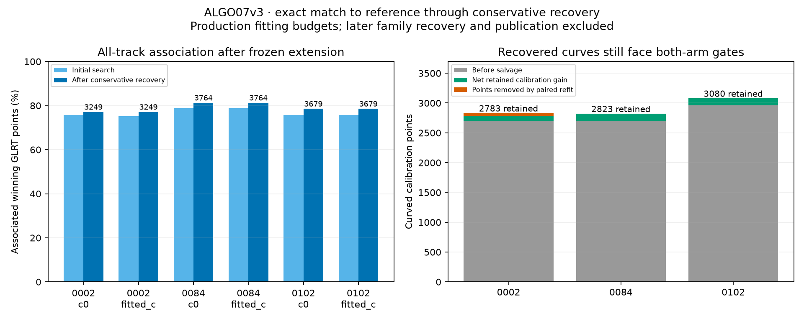

# ALGO07v3: independent conservative refitting and track salvage

ALGO07v3 now reproduces the initial regional search **and the following
conservative rejection/refit/salvage policy** exactly on three DS26 scans, with
production fitting budgets in both c arms. These are implementations of existing
production mathematics, not new association improvements over ALGO07.

The next family-weighted/history-calibrated fitting and predictive-linear policy,
subsequent recovery/reassociation stages and Web UI publication remain unfinished.
This is not a production release. Full DS26 localization parity and the 10×
complete-path speed target remain open.

## Implemented policy

The initial search uses its original previous-TLE catalogue. The following stage
constructs a **fresh scan context** with the separately prepared genuine-previous
catalogue, whose epochs differ by at least one second. The epoch provenance and
text hash enter explicitly; the analyzer does not open historical result paths.
Building a fresh context prevents reuse of orbital modes computed under the
initial prior.

`retained_position` reproduces the causal phase-width calculation, the retained
observation likelihood and phase-refreshed fits. The disagreement-derived width
is `clip(hypot(1, alignment × age / epoch_gap), 1, 15)` seconds, with the original
one-second fallback when no previous alignment is available. This is a
conservative disagreement proxy, not a calibrated confidence interval. The
original age, gap and alignment receipts are preserved.

`conservative_recovery` preserves these steps:

1. Select the same initial common hypothesis and exclude tracks failing its c=0
   calibration gates.
2. Fit both c arms on the same retained observations, aliases and identities.
   Each fit uses five phase-refresh rounds and up to 48 optimizer iterations.
   Remove the union of gate failures across both arms and refit, for up to four
   gate rounds. Never fit an empty mask; preserve the unstable/failure states.
3. If that pair is stable and tracks remain excluded, calibrate independently of
   those excluded tracks. Search a shortlist drawn from the entire causal
   catalogue, using the original whole-track and 20-second-window ranking.
4. Test whole, prefix and suffix supports containing at least 12 observations
   and 20 seconds of active curvature. Preserve the original phase grids,
   three-second shortlist penalty, visibility, bias, whiteness, RMS and six-sigma
   outlier gates. Rank admissible proposals by retained point count, then cost.
5. Refit and gate the proposed recoveries in both c arms. Count only the active
   observation IDs of retained fragments. Frozen-calibration extension remains
   subject to receiver/band support, and duplicate measurement ownership fails.

The salvage calibration retains the original bank phase widths; final retained
position fits apply the causal satellite-specific widths. This stage distinction
is intentional and matches the reference.

The application `refit_initial_position` connects prepared native evidence to
this policy. It marks the broader recovery pipeline incomplete and preserves an
unstable conservative result instead of treating it as a qualified final result.

## Exact full-budget results

| Scan | Original winning GLRT points | Initial points c=0 / fitted-c | After conservative policy, both arms | GLRT associated | Tracks, both arms | Exact reference/v3 comparison |
|---|---:|---|---:|---:|---:|---|
| DS26-0002 | 4,211 | 3,188 / 3,170 | 3,249 | 77.16% | 103 | Pass |
| DS26-0084 | 4,628 | 3,645 / 3,645 | 3,764 | 81.33% | 123 | Pass |
| DS26-0102 | 4,682 | 3,545 / 3,545 | 3,679 | 78.58% | 119 | Pass |

These counts describe an intermediate stage of the production chain, not final
ALGO07 association coverage. The reference and v3 produce identical results;
the increase within each row is the effect of an existing recovery stage.



The three scans exercise distinct recovery paths:

| Scan | Calibration points before salvage | Proposed additional points | Rejected in paired refit | Final calibration points |
|---|---:|---:|---:|---:|
| DS26-0002 | 2,704 | 129 | 50 | 2,783 |
| DS26-0084 | 2,704 | 119 | 0 | 2,823 |
| DS26-0102 | 2,963 | 117 | 0 | 3,080 |

On DS26-0002, the 50-point RX1 CH8 proposal passes its independent salvage test
but fails the subsequent paired refit. Both implementations remove it and retain
the same CH1/CH4 recoveries. DS26-0084 retains 19, 48 and 52 points from three
fragments; another candidate yields no admissible support. DS26-0102 retains
25, 42 and 50 points; two other fragments remain excluded.

Final retained-calibration RMS is 75.549/75.548 Hz on DS26-0002,
60.992/60.992 Hz on DS26-0084, and 64.677/64.673 Hz on DS26-0102
(c=0/fitted-c). This is frequency-fit evidence. No localization accuracy
improvement is claimed from it; exact endpoints match the reference too.

## Verification and isolation

The external reference harness executes the frozen numerical bodies with explicit
inputs, removing their preparation/publication I/O. Their scientific budgets,
salvage shortlist policy and gates are unchanged. The candidate runs with `/opt`
hidden in a private mount namespace and the legacy import/process audit guard.
No old worker, installation, completed solution or saved satellite assignment is
read by the candidate. Both sides discover their initial hypotheses afresh.

The exact fingerprint covers initial choices, final masks and node identities,
both arms' positions, coefficients, phase widths, optimization histories,
initial conditional residual arrays, retained-residual diagnostics, per-track
gates, saved salvage alternatives,
association observation IDs and coverage. Arrays retain dtype, shape and a digest
of every byte; floats use hexadecimal representation. No tolerance was introduced.

`comparison.json` binds all six raw outputs/receipts, input/prior files and loaded
numerical sources. `render.py` revalidates the numerical/input/output bindings
before producing this figure. The harness can be rerun with:

```text
tools/check_algo07v3_position.py --side candidate --source PREPARED_INPUTS \
  --output RESULT.json --search-center LAT LON \
  --conservative --rounds 5 --iterations 48
```

Reference mode additionally takes its explicitly pinned `--reference-runtime`.
Both sides used the same external 900-second watchdog; all finished normally.
That watchdog is not an inference stopping rule or a proposed production limit.

The focused suite has **118 passing tests**. New tests cover the causal-width
provenance and fallback, matched retained masks, rejection union, empty-mask
failure, masked-prefix accounting, duplicate ownership, all-catalogue nominee
replacement, untouched input state, prior-stage isolation and reference-harness
I/O removal. The optional shared-scale numerical interface is retained, but these
production-path comparisons exercise its native/no-extra-scale path.

## Runtime and next work

| Scope: prepared inputs through conservative result | Reference | V3 |
|---|---:|---:|
| DS26-0002 | 77.462 s | 77.610 s |
| DS26-0084 | 68.636 s | 65.281 s |
| DS26-0102 | 186.178 s | 184.773 s |

These concurrent shared-host observations establish completion, not a controlled
speedup. They exclude native-input preparation, later policy stages and artifact
publication. Complete-path performance remains unmeasured.

Next: port family-confidence weighting, history-calibrated phase fitting and
curved-posterior predictive linear evidence. Then integrate the later recovery
and guarded reassociation sequence. Only after the complete output path exists
can full-cohort parity, controlled end-to-end speed and production rollout pass.
