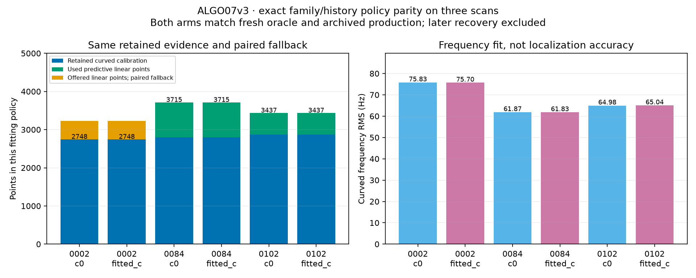

# ALGO07v3: exact family/history and predictive-linear policy

ALGO07v3 now reproduces the original family/history policy after initial search
and conservative recovery. Fresh full-budget runs match the frozen numerical
oracle on DS26-0002, DS26-0084 and DS26-0102. A separate audit also finds exact
agreement with every persisted scientific field of each archived production
`algo02_result.json`, including both calibration arms, endpoints, masks,
identities, nuisance values, rejection histories and policy choices.

This completes another stage of the independent engine. It is **not final
ALGO07 parity, a localization improvement, or a qualified speedup**. Signed-prior
and family-cavity selection, subsequent ALGO03–07 recovery, final publication,
full DS26 localization qualification and complete-path performance remain open.
Production is unchanged.

## Implemented policy

The candidate takes its independently prepared tracks, observations, noise,
causal catalogue, genuine previous elements and pre-RF phase history. It does
not load an old solution or invoke an old worker. All candidate comparisons
run with `/opt` hidden and the legacy import/process audit guard enabled.

1. Evaluate retained curved families across the candidate catalogue and regional
   anchors. Preserve the original conditional competitor weight and receiver
   support weighting. These weights are not calibrated satellite probabilities.
2. Validate the phase-history identity, digest, timing, causal elements and
   no-GPS provenance. Use the history-derived phase distribution only if its
   original validation gate qualifies; otherwise retain the original fallback.
3. Fit both c=0 and fitted-c with matched evidence and budgets. Reject a curved
   component from both arms if either arm fails. Preserve the original four-round
   gate limit and five phase-refresh rounds of up to 48 optimizer iterations.
4. Offer additional noncurved tracks using the frozen curved calibration. Their
   predictive likelihood includes the full curved posterior covariance, a 300 Hz
   per-new-curve constant and the original unseen-noise variance factor of two.
   Linear points do not update the curved nuisance normal equations at a fixed
   position. They can move the position; curved calibration is then evaluated at
   that position. All original gates and the 0.01 s phase-convergence condition
   remain in place.
5. Accept the predictive-linear pair only when both arms qualify; otherwise use
   the curved pair together. No choice uses evaluation position error.

The original history model's temporal validation is preserved for exact parity.
It is not a new randomized holdout experiment, and these development scans are
not independent validation of a new scientific algorithm.

## Results

| Scan | Curved fitting points, both arms | Linear tracks / points offered | Linear points used | Pair selected | Fresh / archived scientific comparison |
|---|---:|---:|---:|---|---|
| DS26-0002 | 2,748 | 30 / 484 | 0 | Curved fallback | Exact / exact |
| DS26-0084 | 2,797 | 55 / 918 | 918 | Curved + predictive linear | Exact / exact |
| DS26-0102 | 2,864 | 37 / 573 | 573 | Curved + predictive linear | Exact / exact |

These are points used by this fitting policy, not final published GLRT coverage.
They must not be compared as if they were the all-track frozen-extension totals
in the preceding conservative-recovery report.

| Scan | Curved RMS c=0 / fitted-c (Hz) | Selected east, north c=0 (km) | Selected east, north fitted-c (km) |
|---|---:|---|---|
| DS26-0002 | 75.826651 / 75.698326 | 5.021500, −5.679299 | 4.981329, −5.656909 |
| DS26-0084 | 61.872999 / 61.833675 | 4.132862, −6.385765 | 4.084029, −6.365767 |
| DS26-0102 | 64.984074 / 65.044655 | 5.978472, −5.243002 | 5.998434, −5.268470 |

Coordinates are relative to the configured regional search center. Rounded
values here are for display; exact binary-value comparisons passed. Frequency
RMS measures fit, not position accuracy. No accuracy gain is claimed because the
reference and candidate produce identical scientific results.



DS26-0002 and DS26-0084 each remove one curved component at this stage;
DS26-0102 removes four. The complete identities and gate histories are retained
in [comparison.json](comparison.json). This covers both rejection/refit and
predictive acceptance/fallback paths.

## Evidence and reproduction

Candidate modules are `family_weighting.py`, `history_position.py`,
`predictive_linear.py` and `history_policy.py` in
`src/leo/analysis/localization_v3/`. The application accepts owned in-memory
history and verifies its canonical digest before fitting. The external oracle
adapts the frozen original mathematical body, removing publication I/O and
operational metadata only. A separate archived-output comparison bridges the
fresh in-memory orchestration to production's persisted scientific values.

`tools/compare_algo07v3_history.py` excludes only seven root operational fields:
case, algorithm, source hashes and elapsed seconds. It checks exhaustive field
sets, scalar types and exact floating values, and restores arrays using the
declared fingerprint representation while rejecting value/shape changes.
JSON itself does not preserve ndarray dtype. Tests cover changed values, lossy
casts, shape changes, signed zero, unexpected fields and nested timing fields.

The focused suite passes **134 tests**. Component tests additionally cover causal
history contamination, identity mismatch, paired fallback, active receiver
support, phase means/scales, predictive covariance against a dense oracle and
unchanged curved coefficients at a fixed position. Ruff checks pass.

Fresh full-budget comparison:

```sh
PYTHONPATH=src:tools OPENBLAS_NUM_THREADS=1 python tools/check_algo07v3_position.py \
  --side candidate --source PREPARED_INPUTS --output OUTPUT.json \
  --history-policy --rounds 5 --iterations 48
```

Use the frozen reference runtime for the matching reference invocation and run
the candidate in the isolated environment used by the evidence receipts.
The report renderer verifies the input, numerical-module, tool, output and
archived-result digests before producing the table and figure:

```sh
PYTHONPATH=src:tools OPENBLAS_NUM_THREADS=1 python \
  reports/2026_11_04_algo07v3_history/render.py \
  --source /srv/bulk/leo/research/algo07v3-20261104/history001 \
  --output reports/2026_11_04_algo07v3_history
```

Archived production reads require the local archive's read permissions.
[comparison.json](comparison.json) binds all receipts and numerical sources.

## Runtime limits and next stage

Observed fresh reference/candidate durations through this stage are
101.906/102.593 s, 205.985/228.501 s and 216.759/219.935 s for the three scans.
These executions overlap on a shared host and are not qualified performance
measurements. There is no stage speedup claim; the 10× complete-path target
remains unachieved.

The next extraction is signed causal phase-mean qualification and family-cavity
selection, followed by the ordered recovery policies. Completing the mathematical
path and exact final-artifact comparison precedes a complete-path optimization
claim. The [runtime scorecard](../../docs/operations/algo07-runtime-scorecard.md)
retains the distinction between component timings and end-to-end latency.
