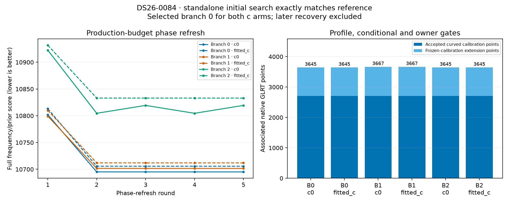

# ALGO07v3: standalone initial regional search and acceptance

The complete **initial regional search** now runs in owned v3 components without
invoking older ALGO workers. It reproduces the frozen reference exactly on
DS26-0084 with production search budgets. Reduced-budget comparisons also pass
on DS26-0002 and DS26-0102. This completes another part of the standalone engine;
later gate/refit, recovery, reassociation and all-artifact publication remain
unfinished. Complete-path speedup and production qualification remain open.

## What now runs independently

`initial_search` consumes an explicit scan context and search region. Its default
policy preserves the original order and arithmetic:

1. Discover four fresh hypotheses from the causal catalogue at the region centre.
2. Expand the best centre seed at all four corners of the 25 × 25 km region.
   Fix each proposal's native aliases at its actual geographic anchor.
3. Deduplicate satellite/fragment/alias identities, reset continuous calibration
   state to zero, and rank with the c=0 centre likelihood. Fit the best three
   branches, preserving the original stable ordering.
4. Fit both c=0 and fitted-c for each selected branch, with five phase-refresh
   rounds and up to 48 optimizer iterations per round. Priors, observations,
   candidates and budgets are matched; the RF-dependent c column is the intended
   difference between arms.
5. Apply the original profiled-residual gates, conditional-residual gates,
   visibility and alias checks. Recheck multiple RX/channel ownership after
   rejection for families using orbital correction modes.
6. Extend accepted families to remaining tracks using frozen calibration, only
   in supported receiver/band groups. Linear tracks never calibrate this model.
7. Select the common branch using the refreshed **c=0** score, then run the
   original zero-phase controls in both arms.

The application entry point `fit_initial_position` connects prepared native
evidence to this search with production budgets. It returns an initial incumbent
and explicitly marks recovery incomplete. It preserves the original previous-TLE
prior at this stage; the separately prepared genuine-previous prior and phase
forecast remain inputs to later policies. No evaluation GPS is supplied.

## Exact comparison results

| Scan | Phase rounds × optimizer limit | Unique / fitted hypotheses | Selected branch | Associated points c=0 / fitted-c | Associated tracks c=0 / fitted-c | Exact output |
|---|---|---|---:|---|---|---|
| DS26-0002 | 1 × 4 | 4 / 3 | 0 | 3,188 / 3,086 | 102 / 98 | Yes |
| DS26-0084 | 1 × 4 | 5 / 3 | 1 | 3,413 / 3,413 | 111 / 111 | Yes |
| DS26-0102 | 1 × 4 | 6 / 3 | 0 | 3,612 / 3,612 | 117 / 117 | Yes |
| **DS26-0084** | **5 × 48, production budget** | **5 / 3** | **0** | **3,645 / 3,645** | **120 / 120** | **Yes** |

The selected full-budget branch contains 2,704 accepted curved calibration points
and 941 frozen-calibration extension points in each arm. Frequency/prior scores
are 10,695.088176595758 for c=0 and 10,705.709071660243 for fitted-c. These are
frequency-model results, not evidence of improved position accuracy. The change
between reduced and full budgets is identical on both implementations; a reduced
test budget is not a proposed production optimization.



The plotted scores are per phase-refresh round, where the linearization changes;
they need not decrease monotonically between rounds. Of the 30 full-budget
branch/arm/round fits, 27 stop at the original small-step/improvement condition
and three at no accepted damped step. None hits the 48-iteration limit. This does
not establish a global minimum or correct satellite identities.

## Verification scope and provenance

The external oracle extracts the numerical body of the frozen `fit_case`, removes
file publication/progress printing and supplies the same prepared scan. Only
declared test budgets are substituted. The frozen modules run in a separate
reference process; the candidate process hides `/opt` in a private mount
namespace and installs the legacy import/process audit guard.

The comparison fingerprints every returned scientific field: nested branch
nodes, hypotheses, aliases, states, optimizer histories, phase histories,
conditional residual arrays, profile and conditional gate diagnostics, accepted
associations and zero-phase controls. Arrays include dtype, shape and a digest
of every byte; scalar floating-point values use exact hexadecimal encoding.
No tolerance or selected-position-only exception is applied. Operational paths,
wall-clock times and source identities are separately bound, not compared as
scientific values.

`comparison.json` records all four exact pairs, input hashes, raw result/receipt
bindings and loaded numerical module hashes. `render.py` checks those bindings
before rendering. Preparation JSON serialization differs between implementations;
their scientific preparation equivalence was established in the preceding
[preparation report](../2026_11_04_algo07v3_preparation/README.md).

The focused suite has **107 passing tests**. New tests exercise structured
residual rejection below the RMS threshold, loss of orbital owner support after
one track fails, alias-change rejection, receiver/band support in frozen extension,
input ownership, regional proposal order, cold calibration reset and common
branch selection even when the two arms prefer different hypotheses. Application
tests protect prior-stage selection and prevent premature completion claims.
An external-oracle test verifies that preparation/publication are excluded while
the numerical search, paired fits and explicitly declared budgets are retained.

The external CLI now supports:

```text
tools/check_algo07v3_position.py --side candidate --source PREPARED_INPUTS \
  --output RESULT.json --search-center LAT LON \
  --initial-search --rounds 5 --iterations 48 --seed-budget 4 --branch-budget 3
```

Reference mode additionally requires the explicit frozen `--reference-runtime`.
This tool is a comparison harness, not the production entry point.

## Runtime and remaining work

Full-budget DS26-0084 observed elapsed time is 123.472 seconds for the reference
and 88.268 seconds for v3, including scan-context loading. The processes overlapped
on a shared host. Another bounded pair was slower on v3 (71.942 versus 41.592
seconds). These are recorded observations, **not a qualified speedup or regression
measurement**. No complete native-GLRT-to-Web-UI speedup is established.

Next work is the subsequent initial gate/refit/salvage policy and family comparison,
then the ordered recovery and guarded reassociation policies. Reuse and numerical
optimization must retain the exact full scientific output checks. Full DS26
localization parity, all eight UI figures, controlled complete-path timing and
deployment remain required. The 10× target has not been achieved.
